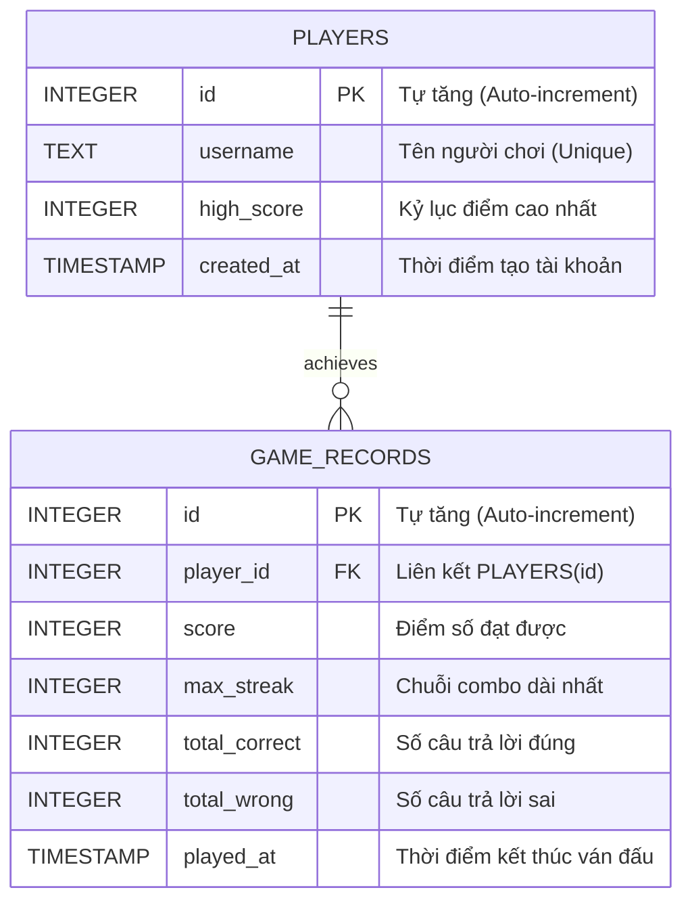

# Math Dash - Retro Arcade Speed Math (Android Java)

> **Math Dash** là ứng dụng game giải toán nhanh sinh tồn (Speed Arithmetic Survival) trên nền tảng **Android Native (Java)**, được thiết kế theo phong cách đồ họa **Retro Arcade cổ điển**, độ tương phản cao và kiến trúc chuẩn **MVC: View (Activity) / Controller / DAO / Entity** tuân thủ nguyên lý **Single Responsibility Principle (SRP)**.

---

## Mục lục
1. [Giới thiệu & Lối chơi](#-giới-thiệu--lối-chơi)
2. [Kiến trúc ứng dụng (MVC: View - Controller - DAO - Entity)](#-kiến-trúc-ứng-dụng)
3. [Mô hình dữ liệu (ERD)](#-mô-hình-dữ-liệu-erd)
4. [Giao diện & Phong cách Retro (UI/UX)](#-giao-diện--phong-cách-retro)
5. [Cấu trúc thư mục dự án](#-cấu-trúc-thư-mục-dự-án)
6. [Hướng dẫn cài đặt & Chạy ứng dụng](#-hướng-dẫn-cài-đặt--chạy-ứng-dụng)

---

## Giới thiệu & Lối chơi

Người chơi sẽ hóa thân vào một thử thách tính nhẩm phản xạ cao:
* **Thời gian giới hạn:** Mỗi câu hỏi có đúng **6 giây** đếm ngược. Nếu thanh thời gian về 0, tính là mất lượt!
* **Hệ thống Máu (Lives):** Bắt đầu với **3 mạng (`♥ ♥ ♥`)**. Trả lời sai hoặc hết giờ bị trừ 1 mạng. Hết 3 mạng kết thúc ván chơi.
* **Hệ thống Điểm & Combo:**
  * Điểm cơ bản: `+10 PTS` mỗi câu đúng.
  * Thưởng chuỗi (Streak Combo): Cộng thêm `combo * 2 PTS` (ví dụ chuỗi 5 được `+20 PTS`).
  * Trả lời sai sẽ reset Combo về `x0`.
* **Kỷ lục theo độ khó:** Mỗi ván offline được lưu vào SQLite; kỷ lục cao nhất ở từng độ khó hiện ngay ở màn chơi.

---

## Kiến trúc ứng dụng

Dự án áp dụng mô hình phân lớp rõ ràng, phân định trách nhiệm đơn nhất (**Single Responsibility**):

```
                        +----------------------+
                        |   Activities (View)  |  <- View Layer (UI & Events)
                        +----------+-----------+
                                   |
                                   v
                        +----------------------+
                        |    GameController    |  <- Controller Layer (Timer, Rules)
                        +----+------------+----+
                             |            |
             +---------------+            +---------------+
             v                                            v
+------------------------+                     +----------------------+
|        Entity          |                     |         DAO          |
| (Player, MathProblem,  |                     | (SQLite Database,    |
|  GameSession, Record)  |                     |  CRUD & Generator)   |
+------------------------+                     +----------------------+
```

### 1. Tầng Entity (`ptit.e23cnpm01.nguyenbahung.math_dash.entity`)
Các JavaBean / POJO thuần túy, đóng gói dữ liệu:
* [`Player.java`](app/src/main/java/ptit/e23cnpm01/nguyenbahung/math_dash/entity/Player.java): Thông tin người chơi (ID, tên người dùng, kỷ lục cá nhân `high_score`).
* [`MathProblem.java`](app/src/main/java/ptit/e23cnpm01/nguyenbahung/math_dash/entity/MathProblem.java): Đại diện cho phép toán (toán hạng, toán tử `+`, `-`, `×`, đáp án đúng và danh sách 4 lựa chọn).
* [`GameSession.java`](app/src/main/java/ptit/e23cnpm01/nguyenbahung/math_dash/entity/GameSession.java): Trạng thái ván đấu đang diễn ra (điểm số, chuỗi combo, số mạng còn lại, câu hỏi hiện tại).
* [`GameRecord.java`](app/src/main/java/ptit/e23cnpm01/nguyenbahung/math_dash/entity/GameRecord.java): Bản ghi tổng kết ván chơi để lưu vào bảng xếp hạng.

### 2. Tầng DAO (`ptit.e23cnpm01.nguyenbahung.math_dash.dao`)
Đảm nhiệm truy xuất và quản lý dữ liệu SQLite:
* [`DatabaseHelper.java`](app/src/main/java/ptit/e23cnpm01/nguyenbahung/math_dash/dao/DatabaseHelper.java): Kế thừa `SQLiteOpenHelper`, khởi tạo database `math_dash.db` và bảng `players`, `game_records`.
* [`PlayerDAO.java`](app/src/main/java/ptit/e23cnpm01/nguyenbahung/math_dash/dao/PlayerDAO.java): Tìm kiếm hoặc tạo mới người chơi theo tên gọi, cập nhật kỷ lục điểm cao nhất.
* [`GameRecordDAO.java`](app/src/main/java/ptit/e23cnpm01/nguyenbahung/math_dash/dao/GameRecordDAO.java): Thêm lịch sử trận đấu, truy vấn Top 10 / Top 20 điểm cao nhất.
* [`ProblemDAO.java`](app/src/main/java/ptit/e23cnpm01/nguyenbahung/math_dash/dao/ProblemDAO.java): Sinh ngẫu nhiên các câu hỏi số học hợp lý kèm 4 phương án không trùng lặp.

### 3. Tầng Controller (`ptit.e23cnpm01.nguyenbahung.math_dash.controller`)
* [`GameController.java`](app/src/main/java/ptit/e23cnpm01/nguyenbahung/math_dash/controller/GameController.java):
  * Điều khiển bộ đếm thời gian `CountDownTimer` 6 giây.
  * Nhận input từ giao diện, đối chiếu đáp án, tăng/giảm điểm và mạng.
  * Bắn callback qua interface `GameControllerListener` để cập nhật UI.

### 4. Tầng View / Activity (`ptit.e23cnpm01.nguyenbahung.math_dash.view`; code khung hiện vẫn ở package `frm`, đổi tên ở M1-05)
* [`FrmMainActivity.java`](app/src/main/java/ptit/e23cnpm01/nguyenbahung/math_dash/frm/FrmMainActivity.java): Màn hình Menu chính, nhập tên nhân vật, xem trước Top 5 kỷ lục, nút bắt đầu.
* [`FrmGameActivity.java`](app/src/main/java/ptit/e23cnpm01/nguyenbahung/math_dash/frm/FrmGameActivity.java): Màn hình thi đấu chính (bảng điểm, thanh thời gian chạy mượt, phép toán to bản, lưới 2x2 nút bấm xúc giác, modal Game Over).
* [`FrmLeaderboardActivity.java`](app/src/main/java/ptit/e23cnpm01/nguyenbahung/math_dash/frm/FrmLeaderboardActivity.java): Bảng vàng hiển thị đầy đủ thứ hạng, tỉ lệ chính xác và ngày chơi.

---

## Mô hình dữ liệu (ERD)

Cơ sở dữ liệu SQLite cục bộ được thiết kế theo sơ đồ quan hệ:



---

## Giao diện & Phong cách Retro

Lấy cảm hứng từ máy game thùng **Arcade 80s** và màn hình **CRT xanh Phosphor**:

* **Màu nền chủ đạo:** Đen carbon CRT (`#101419`) và xám khối bảng điều khiển (`#18202A`).
* **Hệ thống màu chỉ báo độ tương phản cao:**
  *  **Xanh Neon Phosphor (`#00FF66`):** Điểm số hiện tại, thông báo đúng `+ PTS`.
  *  **Vàng Hổ Phách (`#FFB800`):** Chuỗi Combo streak, kỷ lục cá nhân.
  *  **Xanh Cyan Neon (`#00E5FF`):** Thanh thời gian đếm ngược 6s, viền tiêu đề.
  *  **Đỏ Arcade (`#FF3344`):** Biểu tượng trái tim sinh mệnh `♥ ♥ ♥`, cảnh báo Game Over.
* **Touch Targets lớn:** 4 nút bấm phương án (lưới 2x2) có chiều cao tối thiểu **72dp**, chữ số monospace cỡ lớn `26sp`, viền nổi vật lý phản hồi xúc giác khi chạm.

---

## Cấu trúc thư mục dự án

```
math-dash/
├── app/
│   ├── build.gradle.kts
│   ├── proguard-rules.pro
│   └── src/
│       ├── main/
│       │   ├── AndroidManifest.xml
│       │   ├── java/ptit/e23cnpm01/nguyenbahung/math_dash/
│       │   │   ├── controller/
│       │   │   │   └── GameController.java
│       │   │   ├── dao/
│       │   │   │   ├── DatabaseHelper.java
│       │   │   │   ├── GameRecordDAO.java
│       │   │   │   ├── PlayerDAO.java
│       │   │   │   └── ProblemDAO.java
│       │   │   ├── entity/
│       │   │   │   ├── GameRecord.java
│       │   │   │   ├── GameSession.java
│       │   │   │   ├── MathProblem.java
│       │   │   │   └── Player.java
│       │   │   └── frm/
│       │   │       ├── FrmGameActivity.java
│       │   │       ├── FrmLeaderboardActivity.java
│       │   │       └── FrmMainActivity.java
│       │   └── res/
│       │       ├── drawable/
│       │       │   ├── bg_retro_button.xml
│       │       │   ├── bg_retro_button_accent.xml
│       │       │   ├── bg_retro_button_secondary.xml
│       │       │   ├── bg_retro_card.xml
│       │       │   ├── bg_retro_input.xml
│       │       │   ├── bg_retro_timer_progress.xml
│       │       │   └── ic_launcher.xml
│       │       ├── layout/
│       │       │   ├── activity_frm_game.xml
│       │       │   ├── activity_frm_leaderboard.xml
│       │       │   └── activity_frm_main.xml
│       │       └── values/
│       │           ├── colors.xml
│       │           ├── strings.xml
│       │           └── themes.xml
│       └── test/java/ptit/e23cnpm01/nguyenbahung/math_dash/
│           ├── GameSessionTest.java
│           └── ProblemDAOTest.java
├── build.gradle.kts
├── settings.gradle.kts
└── README.md
```

---

## Hướng dẫn cài đặt & Chạy ứng dụng

### Yêu cầu môi trường
* **Hệ điều hành:** Windows / macOS / Linux.
* **JDK:** Java 11 hoặc Java 17.
* **Android Studio:** Bản Iguana / Jellyfish / Koala / Ladybug trở lên.
* **SDK Tools:** `minSdk = 24` (Android 7.0+), `compileSdk = 36` (Android 15+).

### Chạy bằng Android Studio
1. Mở Android Studio, chọn **Open** và trỏ đến thư mục `D:\Code\Android\math-dash`.
2. Đợi Gradle đồng bộ (Sync Project with Gradle Files).
3. Chọn máy ảo (Emulator) hoặc cắm thiết bị thật (bật USB Debugging).
4. Nhấn nút **Run 'app'** (`Shift + F10`) để khởi chạy game.

### Chạy kiểm thử & Build qua dòng lệnh (Terminal / PowerShell)

* **Chạy bộ Unit Test tự động:**
  ```powershell
  .\gradlew.bat test
  ```

* **Build file APK Debug:**
  ```powershell
  .\gradlew.bat assembleDebug
  ```
  File APK đầu ra nằm tại:
  `app/build/outputs/apk/debug/app-debug.apk`

---

## Kiến trúc Math Dash 1v1 (phạm vi MVP)

Dự án hiện tại mới là **khung stub** (đủ class và chữ ký hàm, phần thân để `// TODO`). Phạm vi MVP gồm 6 chức năng: Đăng ký, Đăng nhập, Chơi offline, Cài đặt cấu hình game, Chơi online (Tạo phòng / Tìm phòng bằng mã), Xem lịch sử đấu. Chi tiết ở [`docs/chung/01-pham-vi-use-case.md`](docs/chung/01-pham-vi-use-case.md).

* **App Android** (`app/`): giao diện, luật chơi, SQLite cho chế độ offline (kỷ lục theo độ khó), SharedPreferences cho cấu hình game và phiên đăng nhập.
* **Backend Spring Boot + MySQL** (`server/`): tài khoản, lịch sử đấu. Cấu trúc mỏng `RestController → DAO (JDBC) → Entity`. Khi trận online kết thúc, backend làm **trọng tài**: đọc trận từ Firebase, xác định thắng / thua / hòa rồi lưu MySQL.
* **Firebase Realtime Database:** chỉ giữ trận **đang diễn ra** để 2 máy thấy điểm của nhau. Backend đọc và ghi trận qua REST API của Firebase.
* **Đồng bộ câu hỏi bằng seed:** khi tạo phòng sinh một `questionSeed`, cả 2 máy sinh cùng một dãy câu bằng `new ProblemDAO(new Random(questionSeed))`.

Cấu trúc trận đang diễn ra trên Realtime Database:

```
matches/{roomCode}                  // mã phòng 6 chữ số
    status       : "waiting" | "playing" | "finished"
    questionSeed : long
    createdAt    : ServerValue.TIMESTAMP
    players/
        {playerId} : { displayName: String, score: int, forfeited: bool, connected: bool, timeUp: bool }
```

Chi tiết từng nhiệm vụ: **[ISSUES_PLAN.md](ISSUES_PLAN.md)** · Quy ước code: **[CONVENTION.md](CONVENTION.md)** · Quy ước báo cáo OOAD: **[REPORT_CONVENTION.md](REPORT_CONVENTION.md)**

---

## Tác giả
* **Lớp:** E23CNPM01
* **Sinh viên thực hiện:**
  * Nguyễn Bá Hùng ([@HungNguyenBa1811](https://github.com/HungNguyenBa1811)) - Nhóm trưởng: Đăng ký, Đăng nhập, Chơi online, Xem lịch sử đấu, backend
  * Hoàng ([@Minahn210](https://github.com/Minahn210)) - Chơi offline, Cài đặt cấu hình game
* **Học viện Công nghệ Bưu chính Viễn thông (PTIT)**
