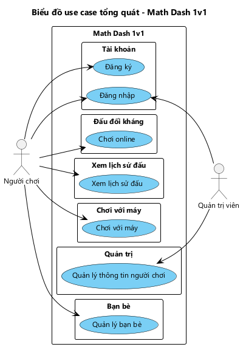

# PHẠM VI HỆ THỐNG VÀ BIỂU ĐỒ USE CASE TỔNG QUÁT — MATH DASH 1v1

---

## 1. Bảng thuật ngữ

| STT | Thuật ngữ | Định nghĩa / Giải thích |
|---|---|---|
| 1 | Người chơi | Người có tài khoản gồm tên đăng nhập, mật khẩu, tên hiển thị, và đã đăng nhập vào ứng dụng từ một máy client |
| 2 | Quản trị viên | Người có tài khoản quản trị, dùng để quản lý thông tin các người chơi. Tài khoản quản trị được tạo sẵn trên server, không đăng ký từ ứng dụng. Quản trị viên không thi đấu, không có trong danh sách online và bảng xếp hạng |
| 3 | Server | Máy chủ duy nhất của hệ thống. Server lưu toàn bộ thông tin tài khoản và trận đấu, sinh đề bài và làm trọng tài cho các trận đối kháng |
| 4 | Câu hỏi | Một phép tính gồm 2 toán hạng và 1 toán tử (+, −, ×), kèm 4 phương án trả lời, trong đó có đúng 1 phương án đúng. Người chơi chọn 1 trong 4 phương án |
| 5 | Đề bài | Danh sách N = 10 câu hỏi. Trong một trận đối kháng, server sinh một đề và gửi cùng đề đó cho cả 2 người chơi |
| 6 | Danh sách người chơi online | Danh sách các người chơi đang mở ứng dụng và đã đăng nhập. Mỗi dòng có tên, tổng điểm, trạng thái |
| 7 | Trạng thái | Rỗi: người chơi không chơi với ai. Bận: người chơi đang trong một trận đối kháng. Chỉ thách đấu được người đang rỗi |
| 8 | Lời mời thách đấu | Lời mời người chơi gửi tới một người chơi khác đang rỗi bằng cách bấm vào tên người đó. Người được mời chọn Đồng ý hoặc Từ chối |
| 9 | Trận đấu | Một ván đối kháng giữa 2 người chơi trên cùng một đề bài, thời gian tối đa 60 giây |
| 10 | Bài làm | Các phương án người chơi đã chọn cho 10 câu hỏi. Bài làm được nộp bằng nút Nộp bài. Hết 60 giây mà chưa nộp thì hệ thống tự nộp, câu chưa chọn tính là sai |
| 11 | Thời gian làm bài | Khoảng thời gian từ lúc trận bắt đầu đến lúc server nhận được bài làm của người chơi |
| 12 | Kết quả trận | Thắng, thua hoặc hòa, do server xác định: - Người bỏ trận thua. - Người đúng hết 10 câu thắng người có ít nhất 1 câu sai. - Cả 2 đúng hết thì ai có thời gian làm bài ngắn hơn thắng; bằng nhau thì hòa. - Cả 2 đều có ít nhất 1 câu sai thì hòa |
| 13 | Điểm trận | Thắng được 1 điểm, hòa 0,5 điểm, thua 0 điểm |
| 14 | Tổng điểm | Tổng điểm trận của một người chơi qua mọi trận đối kháng đã kết thúc |
| 15 | Bỏ trận | Người chơi nhấn nút Thoát khi trận chưa kết thúc, hoặc máy bị mất kết nối. Người bỏ trận bị xử thua |
| 16 | Chơi tiếp | Sau mỗi trận, hệ thống hỏi từng người có muốn chơi tiếp không. Cả 2 đồng ý thì server sinh đề mới cho trận tiếp theo; một người dừng thì cả 2 thoát ra và server báo cho người còn lại |
| 17 | Chơi với máy | Người chơi thi đấu với một đối thủ do ứng dụng giả lập, theo cùng luật của trận đối kháng. Chơi được khi không có mạng; kết quả lưu trên máy, không tính vào tổng điểm |
| 18 | Độ khó của máy | Dễ, Trung bình hoặc Khó. Độ khó quyết định khả năng trả lời đúng mỗi câu và thời gian làm bài của máy |
| 19 | Bảng xếp hạng | Danh sách mọi người chơi trong hệ thống, sắp lần lượt theo 3 tiêu chí: 1. Tổng điểm, giảm dần. 2. Trung bình tổng điểm của các đối thủ đã gặp, giảm dần. 3. Trung bình thời gian làm bài trong các trận thắng, tăng dần |
| 20 | Lịch sử đấu | Danh sách các trận đối kháng đã kết thúc mà người chơi đã tham gia, trận mới nhất đứng đầu, kèm tỉ lệ thắng / hòa / thua của người chơi qua các trận đó. Ván đấu với máy không nằm trong lịch sử đấu |
| 21 | Bạn bè | Hai người chơi đã đồng ý kết bạn với nhau. Người chơi gửi lời mời kết bạn bằng tên đăng nhập của người kia; người nhận chọn Đồng ý hoặc Từ chối. Mỗi bên đều có thể hủy kết bạn |
| 22 | Lời mời kết bạn | Lời đề nghị kết bạn chưa được trả lời. Lời mời bị từ chối thì bị xóa |

---

## 2. Mô hình nghiệp vụ bằng ngôn ngữ tự nhiên

### 2.1. Mục tiêu và phạm vi hệ thống

Math Dash 1v1 là trò chơi giải toán nhanh trên điện thoại Android. Người chơi thi xem ai giải đúng và nhanh hơn một đề gồm 10 câu cộng, trừ, nhân trắc nghiệm, với người chơi khác hoặc với máy.

Hệ thống gồm một server và nhiều client. Server lưu toàn bộ thông tin và dữ liệu, sinh đề bài và làm trọng tài cho mọi trận đối kháng. Mỗi điện thoại cài ứng dụng là một client.

Phạm vi:
- Người chơi phải có tài khoản và đăng nhập trước khi dùng các chức năng khác.
- **Chơi online:** thách đấu và đấu đối kháng.
  - Sau khi đăng nhập, người chơi thấy danh sách người chơi đang online và thách đấu một người đang rỗi.
  - Hai người làm cùng một đề do server sinh ra; server chấm bài và cộng điểm.
  - Sau mỗi trận, hai người chọn chơi tiếp hoặc dừng.
- **Chơi với máy:** người chơi chọn độ khó của máy rồi thi đấu theo cùng luật. Chức năng này chạy được khi không có mạng.
- **Xem lịch sử đấu:** người chơi xem tỉ lệ thắng / hòa / thua và danh sách các trận chơi online mình đã đấu, xem lại đề và kết quả của từng trận, và xem bảng xếp hạng của mọi người chơi trong hệ thống.
- **Quản lý bạn bè:** người chơi gửi lời mời kết bạn, đồng ý hoặc từ chối lời mời kết bạn, xem danh sách bạn bè kèm trạng thái online, hủy kết bạn.
- **Quản lý thông tin người chơi:** quản trị viên xem danh sách người chơi, sửa tên hiển thị, đặt lại mật khẩu, xóa tài khoản người chơi.
- Ngoài phạm vi:
  - Người chơi tự sửa thông tin cá nhân.
  - Đăng nhập không cần tài khoản.
  - Lịch sử các ván đấu với máy.
  - Trận nhiều hơn 2 người.
  - Ghép trận ngẫu nhiên.
  - Trò chuyện giữa các người chơi.

### 2.2. Ai có thể sử dụng phần mềm?

Có 2 nhóm người dùng:
- **Người chơi:** ai muốn chơi thì tự đăng ký tài khoản. Trong trận đối kháng, đối thủ cũng là một người chơi đang dùng ứng dụng trên một máy client khác.
- **Quản trị viên:** quản lý thông tin các người chơi. Tài khoản quản trị được tạo sẵn trên server.

### 2.3. Người dùng có những chức năng gì?

Người chơi có thể:
- **Đăng ký:** tạo tài khoản mới bằng tên đăng nhập, mật khẩu và tên hiển thị.
- **Đăng nhập:** đăng nhập bằng tên đăng nhập và mật khẩu; lần sau mở ứng dụng không phải đăng nhập lại.
- **Chơi online:**
  - Xem danh sách người chơi online.
  - Thách đấu một người đang rỗi, hoặc đồng ý / từ chối lời thách đấu của người khác.
  - Làm đề 10 câu trong tối đa 60 giây rồi nộp bài; được thoát giữa chừng nhưng bị xử thua.
  - Nhận kết quả và điểm trận, rồi chọn chơi tiếp hoặc dừng.
- **Chơi với máy:** chọn độ khó của máy, làm đề 10 câu và nhận kết quả thắng / thua / hòa với máy.
- **Xem lịch sử đấu:**
  - Xem tỉ lệ thắng / hòa / thua và danh sách các trận chơi online đã đấu.
  - Xem chi tiết một trận: đối thủ, kết quả, số câu đúng và thời gian của 2 bên, đề 10 câu kèm đáp án đúng.
  - Xem bảng xếp hạng: thứ hạng, tên, tổng điểm, trung bình điểm đối thủ, trung bình thời gian thắng của mọi người chơi.
- **Quản lý bạn bè:** gửi lời mời kết bạn bằng tên đăng nhập, đồng ý hoặc từ chối lời mời kết bạn, xem danh sách bạn bè và ai đang online, hủy kết bạn.

Quản trị viên có thể:
- **Đăng nhập:** dùng chung giao diện đăng nhập với người chơi; hệ thống nhận ra tài khoản quản trị và mở giao diện quản lý người chơi.
- **Quản lý thông tin người chơi:** xem danh sách người chơi, tìm theo tên, sửa tên hiển thị, đặt lại mật khẩu, xóa tài khoản người chơi.

### 2.4. Mỗi chức năng hoạt động như thế nào?

**Chức năng "Đăng ký":**

Người chơi nhấn "Đăng ký" ở giao diện đăng nhập → Hệ thống hiển thị giao diện đăng ký gồm: ô tên đăng nhập, ô mật khẩu, ô nhập lại mật khẩu, ô tên hiển thị, nút Đăng ký → Người chơi nhập thông tin và nhấn Đăng ký → Hệ thống kiểm tra thông tin → Hệ thống tạo tài khoản → Thông báo "Đăng ký thành công" → Quay về giao diện đăng nhập.

- Tên đăng nhập đã tồn tại: Hệ thống thông báo "Tên đăng nhập đã được dùng" → Người chơi nhập tên khác.
- Mật khẩu nhập lại không khớp hoặc có ô bỏ trống: Hệ thống thông báo lỗi tương ứng.

**Chức năng "Đăng nhập":**

Người chơi mở ứng dụng → Hệ thống hiển thị giao diện đăng nhập gồm: ô tên đăng nhập, ô mật khẩu, nút Đăng nhập, nút Đăng ký → Người chơi nhập tên đăng nhập, mật khẩu và nhấn Đăng nhập → Hệ thống kiểm tra tài khoản → Hệ thống ghi nhớ phiên đăng nhập → Hiển thị giao diện chính.

Giao diện chính gồm:
- Dòng thông tin của mình: tên hiển thị, tổng điểm.
- Danh sách người chơi online, mỗi dòng có tên, tổng điểm, trạng thái Rỗi / Bận.
- Các nút Chơi với máy, Lịch sử đấu, Bạn bè, Đăng xuất.

Ngoại lệ:
- Sai tên đăng nhập hoặc mật khẩu: Hệ thống thông báo "Sai tên đăng nhập hoặc mật khẩu".
- Đã đăng nhập từ lần trước: Hệ thống vào thẳng giao diện chính.
- Tài khoản là tài khoản quản trị: Hệ thống mở giao diện quản lý người chơi thay cho giao diện chính.

**Chức năng "Chơi online":**

Người chơi đang ở giao diện chính → Danh sách người chơi online tự cập nhật khi có người vào, người thoát, hoặc người đổi trạng thái → Người chơi bấm vào tên một người đang rỗi → Hệ thống gửi lời mời tới máy của người đó → Hiển thị "Đang chờ <tên> trả lời...".

Trên máy người được mời: hiện hộp thoại "<tên> (<tổng điểm> điểm) thách đấu bạn" với 2 nút Đồng ý, Từ chối.
- Đồng ý: Server sinh đề 10 câu, tạo trận, chuyển cả 2 người sang trạng thái bận và gửi đề cho cả 2 máy → Cả 2 máy chuyển sang giao diện thi đấu.
- Từ chối: Máy người mời thông báo "<tên> đã từ chối lời mời".

Thi đấu: Giao diện thi đấu gồm:
- Ô thời gian đếm ngược 60 giây.
- Dòng trạng thái đối thủ: "Đối thủ đang làm bài" / "Đối thủ đã nộp bài".
- Danh sách 10 câu hỏi, mỗi câu có 4 phương án để chọn.
- Nút Nộp bài, nút Thoát.

→ Người chơi chọn đáp án cho các câu, có thể đổi lựa chọn trước khi nộp → Nhấn Nộp bài → Server ghi nhận thời gian làm bài và chấm bài → Màn hình hiện "Đã nộp bài, đang chờ đối thủ..." → Khi cả 2 đã nộp bài, server xác định kết quả, cộng điểm trận vào tổng điểm của cả 2 người và báo kết quả về cả 2 máy.

Giao diện kết quả gồm:
- Dòng THẮNG / THUA / HÒA.
- Số câu đúng và thời gian làm bài của mình và của đối thủ.
- Điểm trận được cộng và tổng điểm mới.
- Câu hỏi "Chơi tiếp?" với 2 nút Chơi tiếp, Dừng.

Sau khi trả lời:
- Cả 2 chọn Chơi tiếp: Server sinh đề mới → Cả 2 vào trận tiếp theo.
- Một người chọn Dừng: Cả 2 về giao diện chính, trạng thái trở lại rỗi; máy người còn lại thông báo "Đối thủ đã dừng chơi".

Ngoại lệ:
- Bấm vào người đang bận: Hệ thống thông báo "<tên> đang bận".
- Người được mời vừa bận hoặc vừa thoát trước khi đồng ý: Hệ thống thông báo "Không bắt đầu được trận đấu".
- Hết 60 giây mà chưa nộp bài: Hệ thống tự nộp bài, câu chưa chọn tính là sai.
- Nhấn Thoát khi đang thi đấu: Hệ thống hỏi "Thoát sẽ bị xử thua?" → Đồng ý: người chơi bị xử thua, cả 2 về giao diện chính; máy đối thủ thông báo "Đối thủ đã thoát, bạn thắng".
- Đối thủ mất kết nối khi đang thi đấu: Đối thủ bị xử thua như khi nhấn Thoát.

**Chức năng "Xem lịch sử đấu":**

Người chơi nhấn "Lịch sử đấu" ở giao diện chính → Hệ thống lấy các trận đối kháng đã kết thúc của người chơi → Hiển thị giao diện lịch sử đấu gồm 2 thẻ Trận của tôi, Bảng xếp hạng; thẻ Trận của tôi được mở sẵn.

Thẻ Trận của tôi gồm:
- Biểu đồ tròn tỉ lệ thắng / hòa / thua, giữa biểu đồ ghi tỉ lệ thắng; bên cạnh ghi số trận thắng, hòa, thua và tổng số trận.
- Danh sách trận, mới nhất đứng đầu. Mỗi dòng có tên đối thủ, THẮNG / HÒA / THUA, điểm trận, số câu đúng của 2 bên, thời điểm kết thúc.

→ Người chơi bấm vào một trận → Hệ thống lấy đề và kết quả của trận → Hiển thị giao diện chi tiết trận gồm: tên đối thủ, THẮNG / HÒA / THUA, điểm trận, số câu đúng và thời gian làm bài của mình và của đối thủ, danh sách 10 câu hỏi kèm đáp án đúng → Người chơi nhấn Back để về giao diện lịch sử đấu.

→ Người chơi chọn thẻ Bảng xếp hạng → Hệ thống lấy thông tin mọi người chơi và các trận đã kết thúc → Sắp xếp theo 3 tiêu chí → Hiển thị bảng xếp hạng: mỗi dòng gồm hạng, tên, tổng điểm, trung bình điểm đối thủ, trung bình thời gian thắng. Dòng của chính người chơi được làm nổi bật → Người chơi nhấn Back để về giao diện chính.

- Người chơi chưa đấu trận nào: biểu đồ để trống, danh sách hiện "Bạn chưa đấu trận nào".
- Trận có người bỏ trận: dòng của trận ghi thêm "Bỏ trận" cạnh kết quả.
- Người chơi chưa thắng trận nào: cột trung bình thời gian thắng trên bảng xếp hạng hiện "—", và người đó đứng sau những người cùng 2 tiêu chí đầu nhưng đã có trận thắng.

**Chức năng "Quản lý bạn bè":**

Người chơi nhấn "Bạn bè" ở giao diện chính → Hệ thống lấy các lời mời kết bạn và danh sách bạn bè của người chơi → Hiển thị giao diện bạn bè gồm:
- Ô nhập tên đăng nhập và nút Kết bạn.
- Danh sách lời mời kết bạn đã nhận, mỗi dòng có tên người gửi, nút Đồng ý, nút Từ chối.
- Danh sách bạn bè, mỗi dòng có tên, tổng điểm, trạng thái Online / Offline, nút Hủy kết bạn. Lời mời mình đã gửi mà chưa được trả lời nằm cuối danh sách với dòng "Đang chờ trả lời".

→ Người chơi nhập tên đăng nhập của một người và nhấn Kết bạn → Hệ thống tạo lời mời kết bạn → Thông báo "Đã gửi lời mời kết bạn" → Lời mời hiện trong danh sách với dòng "Đang chờ trả lời".

→ Người chơi nhấn Đồng ý ở một lời mời đã nhận → Hệ thống ghi nhận hai người là bạn bè → Người gửi chuyển sang danh sách bạn bè.

- Nhấn Từ chối: Hệ thống xóa lời mời.
- Nhấn Hủy kết bạn: Hệ thống hỏi xác nhận → Đồng ý: Hệ thống xóa quan hệ bạn bè.
- Tên đăng nhập không tồn tại: Hệ thống thông báo "Không tìm thấy người chơi".
- Nhập tên đăng nhập của chính mình: Hệ thống thông báo "Không thể kết bạn với chính mình".
- Hai người đã là bạn bè hoặc đã có lời mời giữa hai người: Hệ thống thông báo "Đã có lời mời hoặc đã là bạn bè".

**Chức năng "Chơi với máy":**

Người chơi nhấn "Chơi với máy" ở giao diện chính → Hệ thống hiển thị giao diện chọn độ khó gồm 3 nút Dễ, Trung bình, Khó → Người chơi chọn một độ khó → Hệ thống sinh đề 10 câu → Hiển thị giao diện thi đấu giống trận đối kháng, đối thủ là Máy → Người chơi chọn đáp án và nhấn Nộp bài → Hệ thống chấm bài của người chơi, giả lập bài làm của máy theo độ khó → Xác định kết quả theo cùng luật → Lưu kết quả ván trên máy → Hiển thị giao diện kết quả gồm THẮNG / THUA / HÒA, số câu đúng và thời gian của mình và của máy, 2 nút Chơi lại, Về menu.

- Hết 60 giây mà chưa nộp bài: Hệ thống tự nộp bài.
- Máy có thể nộp bài trước người chơi: dòng trạng thái đối thủ đổi thành "Máy đã nộp bài".

**Chức năng "Quản lý thông tin người chơi":**

Quản trị viên đăng nhập → Hệ thống hiển thị giao diện quản lý người chơi gồm: ô tìm theo tên, danh sách người chơi (tên đăng nhập, tên hiển thị, tổng điểm, ngày tạo tài khoản), nút Đăng xuất → Quản trị viên bấm vào một người chơi → Hệ thống hiển thị giao diện thông tin người chơi gồm: tên đăng nhập, ô tên hiển thị, tổng điểm, số trận thắng / hòa / thua, các nút Lưu, Đặt lại mật khẩu, Xóa tài khoản → Quản trị viên sửa tên hiển thị và nhấn Lưu → Hệ thống cập nhật thông tin → Thông báo "Đã lưu" → Quay về danh sách người chơi.

- Nhấn Đặt lại mật khẩu: Hệ thống hiển thị ô mật khẩu mới → Quản trị viên nhập và xác nhận → Hệ thống cập nhật mật khẩu.
- Nhấn Xóa tài khoản: Hệ thống hỏi xác nhận → Đồng ý: Hệ thống xóa tài khoản.
- Người chơi đã tham gia trận đối kháng: Hệ thống không xóa, để giữ kết quả của các đối thủ, và thông báo "Không xóa được người chơi đã có trận đấu".
- Tên hiển thị bỏ trống: Hệ thống thông báo lỗi.

### 2.5. Những thông tin / đối tượng mà hệ thống cần xử lý

- **Người chơi:** tên đăng nhập, mật khẩu, tên hiển thị, thời điểm tạo tài khoản, vai trò (người chơi hoặc quản trị viên), tổng điểm, trạng thái rỗi / bận khi đang online.
- **Câu hỏi:** toán hạng thứ nhất, toán hạng thứ hai, toán tử, đáp án đúng, 4 phương án trả lời.
- **Lời mời thách đấu:** người mời, người được mời, trạng thái (đang chờ, đã đồng ý, đã từ chối), thời điểm gửi.
- **Trận đấu:** đề bài gồm 10 câu hỏi, thời điểm bắt đầu, thời điểm kết thúc, trạng thái (đang đấu, đã xong), 2 người chơi tham gia.
- **Người chơi trong trận:** người chơi, bài làm, số câu đúng, thời điểm nộp bài, đã bỏ trận hay chưa.
- **Ván đấu với máy:** người chơi, độ khó của máy, đề bài, số câu đúng và thời gian làm bài của người chơi, số câu đúng và thời gian làm bài của máy, thời điểm chơi.
- **Quan hệ bạn bè:** người gửi lời mời, người nhận lời mời, trạng thái (đang chờ, đã là bạn bè), thời điểm gửi.

### 2.6. Quan hệ giữa các đối tượng

- Một người chơi gửi nhiều lời mời và nhận nhiều lời mời. Mỗi lời mời có đúng một người mời và một người được mời (1-n ở mỗi vai trò).
- Một lời mời được đồng ý thì sinh ra trận đầu tiên giữa 2 người; các trận chơi tiếp sau đó không cần lời mời mới.
- Một người chơi tham gia nhiều trận đấu; một trận đấu có đúng 2 người chơi (n-n). Quan hệ này được thể hiện qua đối tượng trung gian "người chơi trong trận", nơi giữ bài làm, số câu đúng, thời điểm nộp bài và trạng thái bỏ trận của từng người.
- Một trận đấu có đúng 10 câu hỏi; mỗi câu hỏi thuộc về đúng một trận (1-n). Hai người trong trận làm chung đề này.
- Một người chơi chơi nhiều ván với máy; mỗi ván thuộc về một người chơi (1-n). Mỗi ván có 10 câu hỏi do ứng dụng sinh ra (1-n).
- Một người chơi kết bạn với nhiều người chơi khác (n-n giữa người chơi với người chơi). Quan hệ này được thể hiện qua đối tượng trung gian "quan hệ bạn bè", gồm đúng một người gửi và một người nhận, kèm trạng thái và thời điểm gửi.
- Các thông tin dẫn xuất, không lưu riêng:
  - Kết quả trận và điểm trận của một người chơi: suy ra từ số câu đúng, thời gian làm bài và trạng thái bỏ trận của 2 người.
  - Tổng điểm: tổng điểm trận của người đó qua các trận đã kết thúc.
  - Các tiêu chí của bảng xếp hạng: tính từ các trận đã kết thúc.
  - Tỉ lệ thắng / hòa / thua trong lịch sử đấu: đếm từ kết quả các trận đã kết thúc của người chơi.
  - Trạng thái online của bạn bè: lấy từ danh sách người chơi online, không lưu cùng quan hệ bạn bè.
  - Kết quả ván đấu với máy: suy ra từ số câu đúng và thời gian của người và của máy.
- Ràng buộc:
  - Chỉ thách đấu được người đang online và đang rỗi; không tự thách đấu chính mình.
  - Mỗi người chỉ ở trong tối đa một trận chưa kết thúc.
  - Mỗi người chỉ nộp bài một lần trong một trận.
  - Giữa 2 người chơi chỉ có tối đa một quan hệ bạn bè, dù ai là người gửi; không tự kết bạn với chính mình.

---

## 3. Mô hình nghiệp vụ bằng UML

### 3.1. Danh sách Actor

| STT | Tên Actor | Mô tả |
|---|---|---|
| 1 | Người chơi | Người dùng ứng dụng để chơi. Trong trận đối kháng, người được mời và đối thủ cũng là một Người chơi trên máy client khác |
| 2 | Quản trị viên | Người quản lý thông tin các người chơi |

### 3.2. Các Use Case cho từng Actor

| Mã UC | Actor | Use case | Module |
|---|---|---|---|
| UC01 | Người chơi | Đăng ký | Tài khoản |
| UC02 | Người chơi, Quản trị viên | Đăng nhập | Tài khoản |
| UC03 | Người chơi | Chơi online | Đấu đối kháng |
| UC04 | Người chơi | Xem lịch sử đấu | Xem lịch sử đấu |
| UC05 | Người chơi | Chơi với máy | Chơi với máy |
| UC06 | Quản trị viên | Quản lý thông tin người chơi | Quản trị |
| UC07 | Người chơi | Quản lý bạn bè | Bạn bè |

Mô tả các use case:
1. "Đăng ký" (UC01): cho phép người chơi tạo tài khoản mới.
2. "Đăng nhập" (UC02): cho phép người chơi đăng nhập để dùng các chức năng khác; ứng dụng ghi nhớ phiên đăng nhập.
3. "Chơi online" (UC03): cho phép người chơi xem danh sách người chơi online, thách đấu hoặc nhận lời thách đấu, làm cùng một đề với đối thủ, nhận kết quả do server xác định và chọn chơi tiếp.
4. "Xem lịch sử đấu" (UC04): cho phép người chơi xem tỉ lệ thắng / hòa / thua, danh sách và chi tiết các trận chơi online mình đã đấu, và xem bảng xếp hạng mọi người chơi theo 3 tiêu chí.
5. "Chơi với máy" (UC05): cho phép người chơi chọn độ khó của máy và thi đấu với máy theo cùng luật, kể cả khi không có mạng.
6. "Quản lý thông tin người chơi" (UC06): cho phép quản trị viên xem danh sách người chơi, sửa tên hiển thị, đặt lại mật khẩu và xóa tài khoản người chơi.
7. "Quản lý bạn bè" (UC07): cho phép người chơi gửi, đồng ý, từ chối lời mời kết bạn, xem danh sách bạn bè và hủy kết bạn.

Các bước con của từng UC được phân rã ở **biểu đồ use case chi tiết của từng module** trong tài liệu phân tích cá nhân, không đưa vào biểu đồ tổng quát. Ví dụ, UC03 có Xem danh sách người chơi online, Gửi lời thách đấu, Nhận lời thách đấu, Thi đấu, Thoát trận, Chơi tiếp; UC04 có Xem trận của tôi, Xem chi tiết trận, Xem bảng xếp hạng.

### 3.3. Biểu đồ use case tổng quát

*Hình 1: Biểu đồ use case tổng quát của Math Dash 1v1.*

Biểu đồ có 2 tác nhân:
- Người chơi khởi phát 6 use case: từ UC01 đến UC05 và UC07.
- Quản trị viên khởi phát 2 use case: UC02 và UC06.

Các use case được nhóm theo 6 module:
- **Tài khoản** (UC01, UC02): mọi chức năng khác cần đã đăng nhập.
- **Đấu đối kháng** (UC03): cần kết nối tới server. Server sinh đề, làm trọng tài và lưu kết quả trận.
- **Xem lịch sử đấu** (UC04): chỉ đọc kết quả các trận đối kháng đã lưu trên server; bảng xếp hạng cũng tính từ các trận này.
- **Chơi với máy** (UC05): chạy hoàn toàn trên ứng dụng, chơi được khi không có mạng.
- **Quản trị** (UC06): quản trị viên đọc và sửa dữ liệu người chơi lưu trên server.
- **Bạn bè** (UC07): quan hệ bạn bè lưu trên server; trạng thái online của bạn bè lấy từ danh sách người chơi online.

Mã nguồn PlantUML: [uc-tong-quat.puml](uc-tong-quat.puml).
