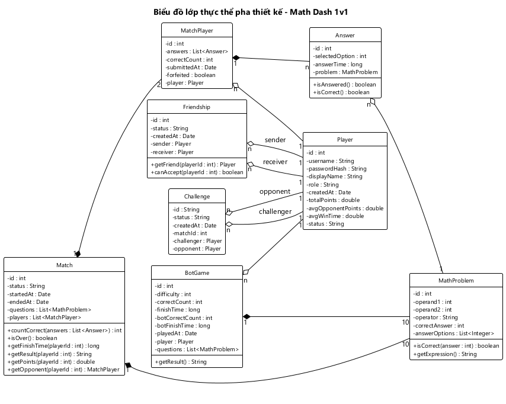

# LỚP THỰC THỂ TOÀN HỆ THỐNG — MATH DASH 1v1

---

# PHẦN A — PHA PHÂN TÍCH

## A.1. Bước 1: Mô tả hệ thống trong một đoạn văn

Hệ thống là một trò chơi giải toán nhanh gồm một server và nhiều client. Server lưu toàn bộ thông tin và dữ liệu. Mỗi người chơi có một tài khoản gồm tên đăng nhập, mật khẩu và tên hiển thị; người chơi đăng ký tài khoản rồi đăng nhập từ một máy client để chơi. Quản trị viên cũng đăng nhập bằng tài khoản, nhưng chỉ để quản lý thông tin các người chơi: xem, sửa tên hiển thị, đặt lại mật khẩu, xóa tài khoản.

Khi vào chơi online, người chơi thấy danh sách người chơi đang online, mỗi người có tên, tổng điểm và trạng thái rỗi hoặc bận. Người chơi bấm vào tên một người đang rỗi để gửi lời mời thách đấu; người được mời đồng ý hoặc từ chối. Khi lời mời được đồng ý, server tạo một trận đấu giữa 2 người, sinh một đề bài gồm 10 câu hỏi và gửi cùng đề cho cả 2 người. Mỗi câu hỏi là một phép tính gồm hai toán hạng và một toán tử, kèm 4 phương án trả lời trong đó có một đáp án đúng. Mỗi người làm lần lượt từng câu: chọn một phương án rồi sang câu sau, hệ thống ghi lại phương án đã chọn và thời gian làm câu; làm xong 10 câu thì nộp bài làm, tất cả trong tối đa 60 giây. Server ghi nhận thời điểm nộp bài, số câu đúng và bài làm từng câu của từng người. Người nhấn thoát giữa chừng thì bỏ trận và bị xử thua. Khi cả 2 đã nộp bài, server xác định kết quả trận: ai đúng hết và nhanh hơn thì thắng, cả 2 đều có câu sai thì hòa. Thắng được 1 điểm, hòa 0,5 điểm, thua 0 điểm; tổng điểm của người chơi là tổng các điểm trận này. Sau mỗi trận, nếu cả 2 chọn chơi tiếp thì server tạo trận mới với đề mới; nếu một người dừng thì server báo cho người còn lại.

Người chơi cũng có thể chơi với máy: người chơi chọn độ khó của máy, làm một đề 10 câu, máy cũng có số câu đúng và thời gian làm bài theo độ khó; kết quả ván được lưu lại cùng thời điểm chơi. Người chơi xem được lịch sử đấu gồm các trận đối kháng mình đã đấu cùng tỉ lệ thắng, hòa, thua; xem chi tiết một trận gồm đề bài kèm đáp án đúng và câu trả lời của mỗi người ở từng câu: đúng hay sai, phương án đã chọn, thời gian làm câu; và xem bảng xếp hạng mọi người chơi theo tổng điểm, trung bình điểm của các đối thủ đã gặp và trung bình thời gian trong các trận thắng. Người chơi còn có thể gửi lời mời kết bạn tới một người chơi khác bằng tên đăng nhập; người nhận đồng ý thì hai người thành bạn bè, từ chối thì lời mời bị xóa. Người chơi xem danh sách bạn bè kèm trạng thái online và có thể hủy kết bạn.

## A.2. Bước 2: Trích các danh từ xuất hiện trong đoạn văn

- **Các danh từ liên quan đến người:** người chơi, quản trị viên, người được mời, đối thủ, máy.
- **Các danh từ liên quan đến vật:** server, client, máy client.
- **Các danh từ liên quan đến thông tin:**
  - Tài khoản: tài khoản, tên đăng nhập, mật khẩu, tên hiển thị.
  - Danh sách online: danh sách người chơi online, tổng điểm, trạng thái.
  - Lời mời: lời mời thách đấu.
  - Trận đấu: trận đấu, đề bài, câu hỏi, phép tính, toán hạng, toán tử, phương án trả lời, đáp án đúng, bài làm, bài làm từng câu, phương án đã chọn, thời gian làm câu, thời điểm nộp bài, số câu đúng, bỏ trận, kết quả trận, điểm trận, chơi tiếp.
  - Chơi với máy: độ khó, ván đấu với máy, thời gian làm bài, thời điểm chơi.
  - Bảng xếp hạng: bảng xếp hạng, trung bình điểm đối thủ, trung bình thời gian thắng.
  - Lịch sử đấu: lịch sử đấu, tỉ lệ thắng, hòa, thua, chi tiết trận, câu trả lời, đúng / sai.
  - Bạn bè: lời mời kết bạn, người gửi, người nhận, bạn bè, danh sách bạn bè, trạng thái online.

## A.3. Bước 3: Đánh giá và lựa chọn các danh từ làm lớp thực thể hoặc thuộc tính

- **Các danh từ trừu tượng hoặc là thiết bị:** hệ thống, server, client, máy client → **loại**. Đây là nơi chạy phần mềm, không phải thông tin cần quản lý.
- **Các danh từ liên quan đến người:**
  - Người chơi → lớp Player: tên đăng nhập (username), mật khẩu (password), tên hiển thị (displayName), thời điểm tạo (createdAt).
  - Tài khoản → là thông tin đăng nhập của người chơi, quan hệ 1-1 → **gộp vào Player**.
  - Quản trị viên → cũng có tên đăng nhập, mật khẩu, tên hiển thị như người chơi, chỉ khác quyền được dùng chức năng nào → **gộp vào Player**, thêm thuộc tính vai trò (role: player / admin). Không tách lớp con, vì quản trị viên không có thông tin riêng nào khác.
  - Người được mời, đối thủ → cũng là một Player, đóng vai trò khác trong lời mời và trong trận → **không đề xuất lớp**.
  - Máy → đối thủ giả lập không có tài khoản, thông tin duy nhất là độ khó → **không đề xuất lớp**, độ khó là thuộc tính của ván đấu với máy.
- **Các danh từ liên quan đến danh sách online:**
  - Danh sách người chơi online → là các Player đang online, không có thông tin riêng → **loại**.
  - Trạng thái rỗi / bận → thông tin của người chơi trong lúc online → thuộc tính status của Player.
  - Tổng điểm → tổng điểm trận của người chơi qua các trận đã xong → thuộc tính dẫn xuất totalPoints của Player, **không lưu**.
- **Các danh từ liên quan đến lời mời:**
  - Lời mời thách đấu → lớp Challenge: trạng thái (status: pending / accepted / rejected), thời điểm gửi (createdAt). Người mời và người được mời là 2 Player.
- **Các danh từ liên quan đến trận đấu:**
  - Câu hỏi / phép tính → cùng một khái niệm → lớp MathProblem: toán hạng thứ nhất (operand1), toán hạng thứ hai (operand2), toán tử (operator), đáp án đúng (correctAnswer), các phương án trả lời (answerOptions).
  - Đề bài → là danh sách 10 MathProblem của một trận, không có thông tin riêng → **không đề xuất lớp**.
  - Trận đấu → lớp Match: trạng thái (status: playing / finished), thời điểm bắt đầu (startedAt), thời điểm kết thúc (endedAt).
  - Số câu đúng, thời điểm nộp bài, bỏ trận → là thông tin của **một người chơi trong một trận cụ thể**, không thuộc riêng Player hay Match → quyết định ở bước 4.
  - Bài làm → là 10 câu trả lời của một người chơi trong một trận, không có thông tin riêng nào khác → **không đề xuất lớp**.
  - Bài làm từng câu / câu trả lời → là thông tin của **một người chơi trong trận cho một câu hỏi cụ thể**, không thuộc riêng người chơi trong trận hay câu hỏi → lớp Answer (bài làm một câu): phương án đã chọn (selectedOption), thời gian làm câu (answerTime). Quan hệ quyết định ở bước 4.
  - Đúng / sai của một câu → so phương án đã chọn với đáp án đúng của câu → thuộc tính dẫn xuất, **không lưu**.
  - Kết quả trận, điểm trận → suy ra từ số câu đúng, thời điểm nộp bài và việc bỏ trận của 2 người → thuộc tính dẫn xuất, **không lưu**.
  - Chơi tiếp → là lựa chọn tạm thời của người chơi ngay sau trận, dùng để server quyết định có tạo trận mới không → **loại**.
- **Các danh từ liên quan đến chơi với máy:**
  - Ván đấu với máy → lớp BotGame: độ khó của máy (difficulty), số câu đúng của người chơi (correctCount), thời gian làm bài của người chơi (finishTime), số câu đúng của máy (botCorrectCount), thời gian làm bài của máy (botFinishTime), thời điểm chơi (playedAt).
  - Kết quả ván → suy ra từ số câu đúng và thời gian của người và máy → thuộc tính dẫn xuất, **không lưu**.
- **Các danh từ liên quan đến bảng xếp hạng:**
  - Bảng xếp hạng → là danh sách Player đã sắp xếp, không có thông tin riêng → **loại**.
  - Trung bình điểm đối thủ, trung bình thời gian thắng → tính từ các Match đã xong → thuộc tính dẫn xuất của Player, **không lưu**. Giống tổng điểm, giao diện bảng xếp hạng cần hiển thị chúng cùng tên người chơi.
- **Các danh từ liên quan đến lịch sử đấu:**
  - Lịch sử đấu → là danh sách các Match đã xong mà người chơi tham gia, không có thông tin riêng → **loại**.
  - Tỉ lệ thắng, hòa, thua → đếm từ Match.getResult() của các trận trong lịch sử → dẫn xuất, **không lưu**, không thành thuộc tính của lớp nào.
- **Các danh từ liên quan đến bạn bè:**
  - Lời mời kết bạn, bạn bè → cùng một quan hệ giữa 2 người chơi ở 2 giai đoạn: lúc chờ trả lời và lúc đã đồng ý → lớp Friendship: trạng thái (status: pending / accepted), thời điểm gửi (createdAt). Người gửi và người nhận là 2 Player.
  - Lời mời bị từ chối, hủy kết bạn → quan hệ không còn, bị xóa → không cần trạng thái riêng.
  - Danh sách bạn bè → là các Friendship đã đồng ý của người chơi → **loại**.
  - Trạng thái online của bạn bè → chính là status của Player khi online → **không thêm thuộc tính**.

## A.4. Bước 4: Xác định quan hệ số lượng giữa các thực thể

- Một người chơi gửi nhiều lời mời, mỗi lời mời có đúng một người mời → Player – Challenge là **1-n** ở vai trò người mời.
- Một người chơi nhận nhiều lời mời, mỗi lời mời có đúng một người được mời → Player – Challenge là **1-n** ở vai trò người được mời.
- Một người chơi tham gia nhiều trận đấu, một trận đấu có đúng 2 người chơi → Player – Match là **n-n** → đề xuất lớp trung gian MatchPlayer (người chơi trong trận) xác định duy nhất một người chơi trong một trận. MatchPlayer giữ số câu đúng (correctCount), thời điểm nộp bài (submittedAt) và bỏ trận (forfeited) của người đó.
- Một trận đấu có 10 câu hỏi, mỗi câu hỏi thuộc về đúng một trận → Match – MathProblem là **1-n**.
- Một người chơi trong trận làm 10 câu hỏi của đề, mỗi câu hỏi được cả 2 người chơi trong trận làm → MatchPlayer – MathProblem là **n-n** → lớp trung gian Answer (bài làm một câu) xác định duy nhất câu trả lời của một người chơi trong trận cho một câu hỏi. Answer giữ phương án đã chọn (selectedOption) và thời gian làm câu (answerTime).
- Một người chơi chơi nhiều ván với máy, mỗi ván thuộc về một người chơi → Player – BotGame là **1-n**.
- Một ván đấu với máy có 10 câu hỏi, mỗi câu hỏi thuộc về đúng một ván → BotGame – MathProblem là **1-n**.
- Một người chơi gửi nhiều lời mời kết bạn, mỗi lời mời có đúng một người gửi → Player – Friendship là **1-n** ở vai trò người gửi.
- Một người chơi nhận nhiều lời mời kết bạn, mỗi lời mời có đúng một người nhận → Player – Friendship là **1-n** ở vai trò người nhận.
- Một lời mời được đồng ý thì sinh ra trận đầu tiên của 2 người. Lời mời không có thông tin nào cần cho trận, trận cũng không cần biết lời mời → Challenge – Match **không nối**.

## A.5. Bước 5: Xác định quan hệ đối tượng giữa các thực thể

- **Quan hệ kế thừa (generalization):** không có.
  - Trận đối kháng và ván đấu với máy dùng cùng luật thắng thua nhưng dữ liệu khác nhau. Trận có 2 người chơi thật và lưu trên server; ván với máy chỉ có một người chơi và lưu trên máy.
- **Quan hệ gắn chặt (composition)**: thành phần không thể tồn tại nếu không có tổng thể.
  - Câu hỏi là thành phần của trận đấu: đề chỉ được sinh ra cho một trận.
  - Câu hỏi là thành phần của ván đấu với máy.
- **Quan hệ kết tập (aggregation)**: dùng cho các quan hệ 1-n, hình thoi đặt ở lớp chứa thông tin của lớp kia.
  - Thông tin người chơi nằm trong thông tin lời mời, ở 2 vai trò người mời và người được mời.
  - Thông tin người chơi nằm trong thông tin ván đấu với máy.
  - Thông tin người chơi nằm trong thông tin quan hệ bạn bè, ở 2 vai trò người gửi và người nhận.
- **Quan hệ liên kết (association)**: dùng cho quan hệ n-n, lớp trung gian được vẽ thành lớp liên kết gắn vào đường association.
  - Người chơi và Trận đấu liên kết tạo ra Người chơi trong trận duy nhất.
  - Người chơi trong trận và Câu hỏi liên kết tạo ra Bài làm một câu duy nhất.

Kết quả thu được biểu đồ lớp thực thể pha phân tích toàn hệ thống như mục A.7.

## A.6. Danh sách lớp thực thể

| TT | Lớp | Nguồn gốc | Ghi chú |
|---|---|---|---|
| 1 | Player | Người chơi, gộp tài khoản và quản trị viên | Trạng thái và tổng điểm là thông tin khi online, không lưu |
| 2 | MathProblem | Câu hỏi / phép tính | Thành phần của Match hoặc BotGame |
| 3 | Challenge | Lời mời thách đấu | Chỉ tồn tại từ lúc gửi tới lúc được trả lời |
| 4 | Match | Trận đấu | Kết quả trận, điểm trận, tổng điểm, bảng xếp hạng đều suy ra từ lớp này |
| 5 | MatchPlayer | Người chơi trong trận | Lớp liên kết của quan hệ n-n Player – Match |
| 6 | Answer | Bài làm từng câu / câu trả lời | Lớp liên kết của quan hệ n-n MatchPlayer – MathProblem |
| 7 | BotGame | Ván đấu với máy | Lưu trên máy client |
| 8 | Friendship | Lời mời kết bạn, bạn bè | Một lớp cho cả lời mời đang chờ và quan hệ đã đồng ý, phân biệt bằng status |

## A.7. Biểu đồ lớp thực thể pha phân tích

*Hình 2: Biểu đồ lớp thực thể pha phân tích toàn hệ thống Math Dash 1v1.*

Biểu đồ có 8 lớp thực thể.
- **Phía đối kháng:**
  - Quan hệ n-n giữa Player và Match được tách bằng lớp liên kết MatchPlayer, nơi giữ số câu đúng, thời điểm nộp bài và trạng thái bỏ trận của từng người.
  - Đề bài là các MathProblem gắn chặt vào Match (hình thoi đặc).
  - Quan hệ n-n giữa MatchPlayer và MathProblem được tách bằng lớp liên kết Answer, nơi giữ phương án đã chọn và thời gian làm câu của một người cho một câu. Bài làm của một người là các Answer của MatchPlayer đó.
  - Challenge chứa thông tin của 2 Player ở 2 vai trò người mời và người được mời.
- **Phía chơi với máy:** BotGame chứa thông tin người chơi (hình thoi rỗng) và đề bài riêng của ván (hình thoi đặc).
- **Phía bạn bè:** Friendship chứa thông tin của 2 Player ở 2 vai trò người gửi và người nhận, giống cách Challenge chứa người mời và người được mời.
- **Các thuộc tính dẫn xuất** không có trên biểu đồ: đúng / sai của từng câu, kết quả trận, điểm trận, kết quả ván với máy, các tiêu chí của bảng xếp hạng, tỉ lệ thắng / hòa / thua trong lịch sử đấu. Riêng tổng điểm và trạng thái được giữ ở Player vì giao diện cần hiển thị cùng tên người chơi.

Mã nguồn PlantUML: [lop-thuc-the-phan-tich.puml](lop-thuc-the-phan-tich.puml).

## A.8. Lớp thực thể dùng cho chức năng nào

| Lớp | UC01 Đăng ký | UC02 Đăng nhập | UC03 Chơi online | UC04 Xem lịch sử đấu | UC05 Chơi với máy | UC06 Quản lý thông tin người chơi | UC07 Quản lý bạn bè |
|---|---|---|---|---|---|---|---|
| Player | ✓ | ✓ | ✓ | ✓ | ✓ | ✓ | ✓ |
| MathProblem | | | ✓ | ✓ | ✓ | | |
| Challenge | | | ✓ | | | | |
| Match | | | ✓ | ✓ | | ✓ | |
| MatchPlayer | | | ✓ | ✓ | | ✓ | |
| Answer | | | ✓ | ✓ | | | |
| BotGame | | | | | ✓ | | |
| Friendship | | | | | | | ✓ |

---

# PHẦN B — PHA THIẾT KẾ

Đầu vào là biểu đồ lớp thực thể pha phân tích (Hình 2). Ngôn ngữ lập trình là Java, dùng chung cho app Android và server Spring Boot.

## B.1. Bước 1: Bổ sung thuộc tính khóa

Bổ sung thuộc tính id cho mọi lớp, vì lớp nào cũng cần được lưu và cần phân biệt từng đối tượng. Không có lớp nào kế thừa lớp khác.
- Player, Match, MatchPlayer, MathProblem, Answer, BotGame, Friendship: id : int, do CSDL tự sinh.
- Challenge: id : String. Lời mời chỉ nằm trên Firebase Realtime Database, khóa là push id do Firebase sinh.

MathProblem có id khi là câu của một trận đối kháng, vì server phải lưu đề để chấm bài. Câu của ván đấu với máy chỉ nằm trong bộ nhớ, id bằng 0.

## B.2. Bước 2: Bổ sung kiểu dữ liệu

Kiểu dữ liệu được chọn như sau:
- Chuỗi → String.
- Số đếm, toán hạng, độ khó → int.
- Thời gian làm bài, thời gian làm câu tính bằng mili giây → long.
- Phương án đã chọn → int, cùng kiểu với các phương án trả lời; câu bỏ trống có giá trị −1, đặt thành hằng Answer.NONE.
- Thời điểm → Date.
- Cờ đúng / sai → boolean.
- Tổng điểm → double, vì có điểm hòa 0,5.
- Độ khó dùng int: 1 = Dễ, 2 = Trung bình, 3 = Khó.

Bổ sung 1 thuộc tính phục vụ thiết kế cho Challenge: matchId : int, mã trận server tạo khi lời mời được đồng ý. Máy người mời đọc nó để mở đúng trận.

Đổi tên 1 thuộc tính so với pha phân tích: password của Player thành **passwordHash**, vì hệ thống chỉ lưu mật khẩu đã băm (BCrypt), không lưu mật khẩu gốc.

Thuộc tính kiểu boolean đặt tên theo trạng thái, không có tiền tố is (forfeited); getter tương ứng là isForfeited() theo quy ước JavaBean. Nếu đặt tên trường là isForfeited thì getter thành isIsForfeited(), và thư viện chuyển JSON (Jackson ở server, Firebase SDK ở app) sẽ đọc sai tên trường.

| Lớp | Thuộc tính |
|---|---|
| Player | id: int, username: String, passwordHash: String, displayName: String, role: String, createdAt: Date, totalPoints: double, avgOpponentPoints: double, avgWinTime: double, status: String |
| MathProblem | id: int, operand1: int, operand2: int, operator: String, correctAnswer: int, answerOptions: List&lt;Integer&gt; |
| Challenge | id: String, status: String, createdAt: Date, matchId: int |
| Match | id: int, status: String, startedAt: Date, endedAt: Date |
| MatchPlayer | id: int, correctCount: int, submittedAt: Date, forfeited: boolean |
| Answer | id: int, selectedOption: int, answerTime: long |
| BotGame | id: int, difficulty: int, correctCount: int, finishTime: long, botCorrectCount: int, botFinishTime: long, playedAt: Date |
| Friendship | id: int, status: String, createdAt: Date |

## B.3. Bước 3: Chuyển quan hệ liên kết thành kết tập / hợp thành

- Quan hệ n-n Player – Match qua lớp liên kết MatchPlayer chuyển thành:
  - **Match chứa MatchPlayer** (hợp thành, 1 – 2): người chơi trong trận chỉ có nghĩa khi thuộc về một trận; xóa trận thì 2 người chơi trong trận cũng mất.
  - **MatchPlayer chứa Player** (kết tập, n – 1): người chơi tồn tại độc lập với trận, mỗi người chơi trong trận chỉ tham chiếu đúng một người chơi.

  Lí do chọn hướng chứa này: khi xử lí (chấm bài, xác định kết quả, tính tổng điểm), hệ thống luôn lấy trận kèm cả 2 người chơi trong trận để so số câu đúng và thời gian làm bài.
- Quan hệ n-n MatchPlayer – MathProblem qua lớp liên kết Answer chuyển thành:
  - **MatchPlayer chứa Answer** (hợp thành, 1 – n): Answer là thành phần của MatchPlayer, kiểu 1-n. Bài làm một câu chỉ có nghĩa khi thuộc về một người chơi trong trận; xóa trận thì bài làm cũng mất. Người chơi đã nộp bài có đúng 10 Answer; người bỏ trận trước khi nộp không có Answer nào.
  - **Answer chứa MathProblem** (kết tập, n – 1): câu hỏi thuộc về đề của trận, tồn tại không phụ thuộc vào bài làm; mỗi Answer chỉ tham chiếu đúng một câu hỏi, mỗi câu hỏi có tối đa 2 Answer, mỗi người chơi trong trận một.

  Lí do chọn hướng chứa này: khi chấm bài và khi hiện chi tiết trận, hệ thống duyệt bài làm của từng người chơi trong trận; mỗi Answer cần biết câu hỏi của nó để tự xác định đúng hay sai.
- Các quan hệ đã là kết tập / hợp thành từ pha phân tích giữ nguyên:
  - Match chứa MathProblem (hợp thành, 1 – 10).
  - BotGame chứa MathProblem (hợp thành, 1 – 10).
  - Challenge chứa Player 2 lần, ở vai trò người mời và người được mời (kết tập).
  - BotGame chứa Player (kết tập).
  - Friendship chứa Player 2 lần, ở vai trò người gửi và người nhận (kết tập).

Sau bước này không còn đường liên kết trơn nào trên biểu đồ.

## B.4. Bước 4: Bổ sung thuộc tính kiểu đối tượng

Quan hệ 1-n thì lớp chứa khai báo danh sách; quan hệ n-1 hoặc 1-1 thì khai báo một đối tượng:

- Challenge chứa người mời và người được mời → challenger : Player, opponent : Player.
- Match chứa 10 MathProblem → questions : List\<MathProblem>.
- Match chứa 2 MatchPlayer → players : List\<MatchPlayer>.
- MatchPlayer chứa 1 Player → player : Player.
- MatchPlayer chứa 10 Answer → answers : List\<Answer>. Answer thứ i của bài làm ứng với câu thứ i của đề.
- Answer chứa 1 MathProblem → problem : MathProblem.
- BotGame chứa 1 Player → player : Player.
- BotGame chứa 10 MathProblem → questions : List\<MathProblem>.
- Friendship chứa người gửi và người nhận → sender : Player, receiver : Player.

Các thuộc tính dẫn xuất ở pha phân tích không thành thuộc tính lưu trữ mà thành **phương thức nghiệp vụ** của lớp thực thể. Đây là các hàm Java thuần, có unit test:

| Lớp | Phương thức | Ý nghĩa |
|---|---|---|
| MathProblem | isCorrect(answer : int) : boolean | answer bằng correctAnswer |
| MathProblem | getExpression() : String | Chuỗi hiển thị, ví dụ "12 + 7 = ?" |
| Answer | isAnswered() : boolean | Câu đã được làm: selectedOption khác NONE |
| Answer | isCorrect() : boolean | Câu trả lời đúng: problem.isCorrect(selectedOption) |
| Match | countCorrect(answers : List\<Answer>) : int | Chấm một bài làm: gắn câu thứ i của đề vào answers.get(i) rồi đếm số câu có answers.get(i).isCorrect() |
| Match | isOver() : boolean | Trận đã xong: có người bỏ trận, hoặc cả 2 đã nộp bài |
| Match | getFinishTime(playerId : int) : long | Thời gian làm bài của người chơi: submittedAt − startedAt, tính bằng mili giây |
| Match | getResult(playerId : int) : String | WIN / LOSE / DRAW, theo thứ tự: 1. Ai bỏ trận thì thua. 2. Chỉ một người đúng hết 10 câu thì người đó thắng. 3. Cả 2 đều có câu sai thì hòa. 4. Cả 2 đúng hết thì so thời gian làm bài: ngắn hơn thắng, bằng nhau hòa |
| Match | getPoints(playerId : int) : double | 1 nếu WIN, 0,5 nếu DRAW, 0 nếu LOSE |
| Match | getOpponent(playerId : int) : MatchPlayer | Người chơi trong trận còn lại, dùng để hiện đối thủ trong lịch sử đấu |
| BotGame | getResult() : String | WIN / LOSE / DRAW của người chơi so với máy, cùng luật với Match.getResult |
| Friendship | getFriend(playerId : int) : Player | Người còn lại trong quan hệ: là receiver nếu playerId là sender, ngược lại là sender |
| Friendship | canAccept(playerId : int) : boolean | Lời mời đang chờ và playerId là người nhận; chỉ người nhận mới đồng ý được |

Một số thuộc tính dẫn xuất được giữ lại trong Player, vì giao diện cần hiển thị chúng cùng tên người chơi:
- totalPoints: tổng getPoints của người chơi qua các trận đã xong.
- avgOpponentPoints: trung bình totalPoints của các đối thủ khác nhau đã gặp.
- avgWinTime: trung bình getFinishTime trong các trận thắng, tính bằng giây.
- status: free (rỗi) hoặc busy (bận). Đây là trạng thái lúc online nên chỉ nằm trên Firebase.

Server tính 3 giá trị đầu trong DAO, vì phải duyệt nhiều Match, rồi gán vào Player để gửi tới app. Không thuộc tính nào trong số này có cột trong CSDL (xem tài liệu CSDL, bước 5).

## B.5. Biểu đồ lớp thực thể pha thiết kế

*Hình 3: Biểu đồ lớp thực thể pha thiết kế toàn hệ thống Math Dash 1v1.*

So với pha phân tích:
- Mọi lớp có thêm id; mọi thuộc tính có kiểu Java.
- Lớp liên kết MatchPlayer trở thành thành phần (hình thoi đặc) của Match và chứa Player (hình thoi rỗng).
- Lớp liên kết Answer trở thành thành phần (hình thoi đặc) của MatchPlayer và chứa MathProblem (hình thoi rỗng).
- Mỗi quan hệ chứa được thể hiện bằng một thuộc tính đối tượng ở lớp chứa:
  - Challenge.challenger, Challenge.opponent.
  - Match.questions, Match.players.
  - MatchPlayer.player, MatchPlayer.answers.
  - Answer.problem.
  - BotGame.player, BotGame.questions.
  - Friendship.sender, Friendship.receiver.

Các lớp Player, MathProblem, Match, MatchPlayer, Answer, Friendship có mặt ở **cả app và server** với cùng tên và cùng thuộc tính, để dữ liệu JSON đi qua REST ánh xạ thẳng vào đối tượng.
- passwordHash chỉ có giá trị ở server; app không bao giờ giữ mật khẩu.
- correctAnswer của câu hỏi chỉ được gửi về app sau khi trận đã xong, để không ai biết trước đáp án.
- Bài làm từng câu của 2 người cũng chỉ được gửi về app sau khi trận đã xong, để không ai xem được bài làm của đối thủ giữa trận.
- Answer.problem không đi qua JSON. Answer thứ i ứng với câu thứ i của đề, nên bên nhận tự gắn lại câu hỏi vào bài làm.

Mã nguồn PlantUML: [lop-thuc-the-thiet-ke.puml](lop-thuc-the-thiet-ke.puml).

## B.6. Ý nghĩa các thuộc tính

| Lớp | Thuộc tính | Ý nghĩa | Giá trị |
|---|---|---|---|
| Player | username | Tên đăng nhập, dùng khi đăng nhập | Duy nhất trong hệ thống |
| Player | passwordHash | Mật khẩu đã băm | Chuỗi BCrypt, không bao giờ là mật khẩu gốc |
| Player | displayName | Tên hiển thị trong danh sách online, lời mời, bảng xếp hạng | |
| Player | role | Vai trò của tài khoản | player (người chơi), admin (quản trị viên); đăng ký từ ứng dụng luôn là player |
| Player | createdAt | Thời điểm đăng ký tài khoản | |
| Player | totalPoints | Tổng điểm hiện có | ≥ 0, bước 0,5 |
| Player | avgOpponentPoints | Trung bình tổng điểm của các đối thủ khác nhau đã gặp | ≥ 0; 0 nếu chưa gặp ai |
| Player | avgWinTime | Trung bình thời gian làm bài trong các trận thắng | Giây; 0 nếu chưa thắng trận nào, khi đó đứng sau khi xếp hạng |
| Player | status | Trạng thái khi online | free (rỗi), busy (bận) |
| MathProblem | operand1, operand2 | Toán hạng bên trái, bên phải của phép tính | Số nguyên ≥ 1 |
| MathProblem | operator | Toán tử | "+", "-", "×" |
| MathProblem | correctAnswer | Kết quả đúng của phép tính | ≥ 0 |
| MathProblem | answerOptions | 4 phương án, đã xáo trộn, có chứa correctAnswer | 4 số khác nhau, ≥ 0 |
| Challenge | status | Trạng thái lời mời | pending (đang chờ), accepted (đã đồng ý), rejected (đã từ chối) |
| Challenge | createdAt | Thời điểm gửi lời mời | |
| Challenge | challenger, opponent | Người mời, người được mời | Hai người chơi khác nhau |
| Challenge | matchId | Trận được tạo khi lời mời được đồng ý; máy người mời dùng để mở đúng trận | 0 khi chưa đồng ý |
| Match | status | Trạng thái trận | playing (đang đấu), finished (đã xong) |
| Match | startedAt | Thời điểm server tạo trận và gửi đề | Mốc tính thời gian làm bài |
| Match | endedAt | Thời điểm trận kết thúc | Chỉ có khi status = finished |
| Match | questions | Đề bài | Đúng 10 câu |
| MatchPlayer | answers | Bài làm: các Answer của người chơi, theo thứ tự đề | Đúng 10 Answer khi đã nộp; rỗng nếu bỏ trận trước khi nộp |
| MatchPlayer | correctCount | Số câu đúng do server chấm | 0 – 10 |
| MatchPlayer | submittedAt | Thời điểm server nhận bài làm | Chưa có khi chưa nộp |
| MatchPlayer | forfeited | Người chơi này đã bỏ trận và bị xử thua | Mặc định false |
| Answer | selectedOption | Phương án người chơi đã chọn cho câu | Một trong 4 phương án của câu, hoặc −1 (NONE) khi bỏ trống |
| Answer | answerTime | Thời gian làm câu: từ lúc câu hiện ra tới lúc người chơi chọn | ≥ 0, mili giây; 0 khi bỏ trống |
| Answer | problem | Câu hỏi của bài làm này | Câu thứ i của đề ứng với Answer thứ i |
| BotGame | difficulty | Độ khó của máy | 1 = Dễ, 2 = Trung bình, 3 = Khó |
| BotGame | correctCount, finishTime | Số câu đúng, thời gian làm bài của người chơi | 0 – 10; mili giây |
| BotGame | botCorrectCount, botFinishTime | Số câu đúng, thời gian làm bài của máy | 0 – 10; mili giây |
| BotGame | playedAt | Thời điểm ván kết thúc | |
| Friendship | status | Trạng thái quan hệ | pending (đang chờ trả lời), accepted (đã là bạn bè) |
| Friendship | createdAt | Thời điểm gửi lời mời kết bạn | |
| Friendship | sender, receiver | Người gửi, người nhận lời mời | Hai người chơi khác nhau; giữa 2 người chỉ có tối đa một Friendship |
