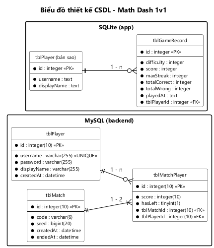

# THIẾT KẾ CƠ SỞ DỮ LIỆU — MATH DASH 1v1

> Issue: #24 [M1-03] · Người làm: Hùng · Người duyệt: Hoàng
> Nguồn cho **mục 2 "Thiết kế CSDL"** trong báo cáo của cả 2 người:
> - **Hoàng:** phần SQLite (`tblPlayer` bản sao, `tblGameRecord`) và cấu hình trong SharedPreferences.
> - **Hùng:** phần MySQL (`tblPlayer`, `tblMatch`, `tblMatchPlayer`) và cây `matches` trên Firebase.

Đầu vào là biểu đồ lớp thực thể pha thiết kế (Hình 3, `02-lop-thuc-the.md` phần B). Hệ thống có 3 nơi lưu dữ liệu, mỗi nơi giữ một loại dữ liệu:

| Nơi lưu | Giữ gì | Vì sao |
|---|---|---|
| **MySQL** (backend) | Tài khoản người chơi, các trận online đã kết thúc | Dữ liệu dùng chung giữa các máy, phải lưu lâu dài |
| **SQLite** (app) | Kết quả các ván offline, bản sao người chơi đang đăng nhập | Chơi offline phải chạy được khi mất mạng |
| **Firebase Realtime Database** | Trận online **đang diễn ra** | 2 máy cần thấy điểm của nhau ngay; trận xong thì xóa |

---

## 1. Thiết kế CSDL quan hệ (MySQL và SQLite)

### Bước 1: Mỗi lớp thực thể cần lưu đề xuất một bảng

| Lớp | Bảng | Nơi lưu |
|---|---|---|
| `Player` | `tblPlayer` | MySQL |
| `Match` | `tblMatch` | MySQL |
| `MatchPlayer` | `tblMatchPlayer` | MySQL |
| `GameRecord` | `tblGameRecord` | SQLite |
| `Player` (bản sao) | `tblPlayer` | SQLite |

Các lớp **không** đề xuất bảng:
- `MathProblem`, `GameSession`: chỉ tồn tại trong bộ nhớ khi đang chơi, không cần lưu.
- `GameConfig`: mỗi máy chỉ có đúng một cấu hình, không quan hệ với bảng nào, dữ liệu là các cặp khóa – giá trị → lưu bằng SharedPreferences (mục 3).

**Vì sao SQLite cần bảng `tblPlayer` bản sao:** `GameRecord` thuộc về một `Player`, nhưng bảng `tblPlayer` chính nằm trên MySQL ở máy chủ. SQLite không thể đặt khóa ngoại sang một CSDL khác, và khi mất mạng app không đọc được MySQL. Vì vậy mỗi lần đăng nhập thành công, app lưu một bản sao người chơi (cùng `id` với MySQL) vào SQLite. `tblGameRecord` có khóa ngoại thật tới bản sao này.

### Bước 2: Đưa thuộc tính kiểu cơ bản thành cột

Bỏ qua các thuộc tính kiểu đối tượng: `players` của `Match`, `player` của `MatchPlayer` và `GameRecord`.

Chuyển kiểu:

| Java | MySQL | SQLite |
|---|---|---|
| `String` | `varchar(255)` (mã phòng: `varchar(6)`) | `text` |
| `int` | `integer(10)` | `integer` |
| `long` | `bigint(20)` | `integer` |
| `Date` | `datetime` | `text` (dạng `yyyy-MM-dd HH:mm:ss`) |
| `boolean` | `tinyint(1)` | `integer` (0 / 1) |

| Bảng | Cột |
|---|---|
| `tblPlayer` (MySQL) | id, username, passwordHash, displayName, createdAt |
| `tblMatch` | id, roomCode, status, questionSeed, createdAt, endedAt |
| `tblMatchPlayer` | id, score, forfeited, timeUp |
| `tblGameRecord` | id, difficulty, score, maxStreak, correctCount, wrongCount, playedAt |
| `tblPlayer` (SQLite) | id, username, displayName |

Bảng `tblPlayer` bản sao trên SQLite **chỉ lấy các cột app cần hiển thị**. Không có `passwordHash` vì app không bao giờ giữ mật khẩu, không có `createdAt` vì app không dùng.

### Bước 3: Quan hệ số lượng giữa các bảng

- 1 `tblMatch` – n `tblMatchPlayer` (đúng 2 dòng cho mỗi trận).
- 1 `tblPlayer` – n `tblMatchPlayer` (MySQL).
- 1 `tblPlayer` – n `tblGameRecord` (SQLite).

Không còn quan hệ n-n: quan hệ n-n `tblPlayer` – `tblMatch` đã được tách bằng bảng `tblMatchPlayer` từ pha thiết kế lớp thực thể. Không có quan hệ 1-1 nào cần gộp bảng.

### Bước 4: Bổ sung khóa

**Khóa chính:** cột `id` của mọi bảng.
- MySQL: `AUTO_INCREMENT`.
- SQLite: `tblGameRecord.id` tự tăng. `tblPlayer.id` **không tự tăng** mà lấy đúng `id` của người chơi trên MySQL, để bản sao và bản chính là cùng một người.

**Khóa ngoại:**
- 1 `tblMatch` – n `tblMatchPlayer` → `tblMatchPlayer` có khóa ngoại `tblMatchId`. Xóa trận thì xóa luôn 2 dòng người chơi trong trận (`ON DELETE CASCADE`), đúng với quan hệ hợp thành ở thiết kế lớp thực thể.
- 1 `tblPlayer` – n `tblMatchPlayer` → `tblMatchPlayer` có khóa ngoại `tblPlayerId`.
- 1 `tblPlayer` – n `tblGameRecord` → `tblGameRecord` có khóa ngoại `tblPlayerId`.

**Ràng buộc duy nhất:**
- `tblPlayer.username`: không có 2 tài khoản trùng tên đăng nhập.
- `tblMatchPlayer (tblMatchId, tblPlayerId)`: một người chơi chỉ có một dòng trong một trận.
- `tblMatch (roomCode, createdAt)`: mã phòng có thể dùng lại sau khi trận cũ kết thúc, nhưng cặp mã phòng + thời điểm tạo xác định duy nhất một trận. Backend dùng cặp này để biết trận đã được lưu hay chưa khi máy thứ hai cũng gọi API kết thúc trận.

### Bước 5: Loại bỏ thuộc tính gây dư thừa

**Thuộc tính dẫn xuất bị loại bỏ** (không có cột, tính khi cần):
- Kết quả thắng / thua / hòa: suy ra từ `forfeited` và `score` của 2 dòng `tblMatchPlayer` → `Match.getResult(playerId)`.
- Kỷ lục: `SELECT MAX(score) FROM tblGameRecord WHERE tblPlayerId = ? AND difficulty = ?`.
- Tỉ lệ trả lời đúng: `correctCount / (correctCount + wrongCount)` → `GameRecord.getAccuracy()`.
- Mức hiện tại: chỉ có trong `GameSession`, không lưu.

**Cột bị loại vì luôn mang một giá trị:** MySQL chỉ lưu trận **đã kết thúc**, nên:
- `status` của `tblMatch` luôn là `finished`. Trạng thái `waiting` / `playing` chỉ có ý nghĩa khi trận đang diễn ra.
- `timeUp` của `tblMatchPlayer` luôn là `true` với người không bỏ trận, và không còn ý nghĩa sau khi trận đã có kết quả.

Hai thuộc tính này vẫn có trong lớp thực thể và được giữ trên Firebase khi trận đang diễn ra (mục 2).

**Các thuộc tính trông giống trùng lặp nhưng được giữ lại:**
- `username`, `displayName` trong `tblPlayer` của SQLite so với `tblPlayer` của MySQL: đây là bản sao có chủ đích để chơi offline khi mất mạng (bước 1). Bản sao được ghi đè mỗi lần đăng nhập nên luôn khớp bản chính.
- `questionSeed` trong `tblMatch`: không suy ra được từ cột khác; giữ lại để có thể sinh lại đúng dãy câu hỏi của trận khi cần kiểm tra.

### Ràng buộc NULL

Mọi cột đều `NOT NULL`. Không có cột nào được phép rỗng:
- Tài khoản bắt buộc có đủ tên đăng nhập, mật khẩu, tên hiển thị.
- MySQL chỉ lưu trận đã kết thúc nên luôn có `endedAt`.
- Mỗi dòng người chơi trong trận luôn có điểm (mặc định 0) và cờ bỏ trận (mặc định 0).

### Kết quả



*Hình 4: Biểu đồ thiết kế CSDL của Math Dash 1v1.*

Phía MySQL có 3 bảng: `tblMatchPlayer` là bảng trung gian nối `tblMatch` với `tblPlayer`, mỗi trận có đúng 2 dòng. Phía SQLite có 2 bảng: `tblGameRecord` nối tới bản sao `tblPlayer` bằng khóa ngoại thật, nên kỷ lục tính được ngay cả khi không có mạng. Hai CSDL không nối trực tiếp với nhau; chúng chỉ chung `id` người chơi.

Mã nguồn PlantUML: [`csdl.puml`](csdl.puml).

### Câu lệnh tạo bảng

**MySQL** (lưu ở `server/db/schema.sql`):

```sql
CREATE DATABASE IF NOT EXISTS mathdash CHARACTER SET utf8mb4 COLLATE utf8mb4_unicode_ci;
USE mathdash;

CREATE TABLE tblPlayer (
    id           INT(10)      NOT NULL AUTO_INCREMENT,
    username     VARCHAR(255) NOT NULL,
    passwordHash VARCHAR(255) NOT NULL,          -- mật khẩu đã băm BCrypt
    displayName  VARCHAR(255) NOT NULL,
    createdAt    DATETIME     NOT NULL DEFAULT CURRENT_TIMESTAMP,
    PRIMARY KEY (id),
    UNIQUE KEY uq_player_username (username)
);

CREATE TABLE tblMatch (
    id           INT(10)    NOT NULL AUTO_INCREMENT,
    roomCode     VARCHAR(6) NOT NULL,
    questionSeed BIGINT(20) NOT NULL,
    createdAt    DATETIME   NOT NULL,
    endedAt      DATETIME   NOT NULL,
    PRIMARY KEY (id),
    UNIQUE KEY uq_match_room_created (roomCode, createdAt)
);

CREATE TABLE tblMatchPlayer (
    id          INT(10)    NOT NULL AUTO_INCREMENT,
    score       INT(10)    NOT NULL DEFAULT 0,
    forfeited   TINYINT(1) NOT NULL DEFAULT 0,
    tblMatchId  INT(10)    NOT NULL,
    tblPlayerId INT(10)    NOT NULL,
    PRIMARY KEY (id),
    UNIQUE KEY uq_matchplayer (tblMatchId, tblPlayerId),
    FOREIGN KEY (tblMatchId)  REFERENCES tblMatch(id)  ON DELETE CASCADE,
    FOREIGN KEY (tblPlayerId) REFERENCES tblPlayer(id)
);
```

**SQLite** (trong `DatabaseHelper.onCreate`; bật khóa ngoại bằng `db.setForeignKeyConstraintsEnabled(true)` trong `onConfigure`):

```sql
CREATE TABLE tblPlayer (
    id          INTEGER PRIMARY KEY,            -- cùng id với MySQL, không tự tăng
    username    TEXT    NOT NULL,
    displayName TEXT    NOT NULL
);

CREATE TABLE tblGameRecord (
    id           INTEGER PRIMARY KEY AUTOINCREMENT,
    difficulty   INTEGER NOT NULL CHECK (difficulty BETWEEN 1 AND 3),
    score        INTEGER NOT NULL,
    maxStreak    INTEGER NOT NULL,
    correctCount INTEGER NOT NULL,
    wrongCount   INTEGER NOT NULL,
    playedAt     TEXT    NOT NULL,
    tblPlayerId  INTEGER NOT NULL REFERENCES tblPlayer(id)
);

CREATE INDEX idx_gamerecord_best ON tblGameRecord (tblPlayerId, difficulty, score);
```

Chỉ mục `idx_gamerecord_best` giúp câu truy vấn kỷ lục chạy nhanh khi số ván tăng lên.

### Các truy vấn chính

| Chức năng | Câu truy vấn | DAO |
|---|---|---|
| Đăng nhập | `SELECT * FROM tblPlayer WHERE username = ?` (so mật khẩu bằng BCrypt ở Java) | `PlayerDAO` (server) |
| Kỷ lục | `SELECT MAX(score) FROM tblGameRecord WHERE tblPlayerId = ? AND difficulty = ?` | `GameRecordDAO` (app) |
| Lưu trận | 1 `INSERT INTO tblMatch` + 2 `INSERT INTO tblMatchPlayer` trong một transaction | `MatchDAO` (server) |
| Lịch sử đấu | `tblMatch` JOIN 2 lần `tblMatchPlayer` (mình và đối thủ) JOIN `tblPlayer` (tên đối thủ), sắp `endedAt DESC` | `MatchDAO` (server) |

---

## 2. Thiết kế dữ liệu trên Firebase Realtime Database

Firebase là CSDL dạng cây JSON, không có bảng. Ánh xạ từ lớp thực thể theo cùng tinh thần 5 bước ở trên:
- Mỗi lớp là một node; mỗi đối tượng là một node con có khóa riêng.
- Thuộc tính kiểu cơ bản là field.
- Quan hệ hợp thành là node con nằm bên trong.

| Lớp | Node | Khóa |
|---|---|---|
| `Match` | `matches/{roomCode}` | Mã phòng 6 chữ số. Duy nhất vì trên Firebase chỉ có các trận chưa kết thúc |
| `MatchPlayer` (thành phần của `Match`) | `matches/{roomCode}/players/{playerId}` | `id` người chơi trên MySQL, cũng là `auth.uid` trên Firebase (custom token) |

```
matches/{roomCode}
    status       : "waiting" | "playing" | "finished"
    questionSeed : long
    createdAt    : ServerValue.TIMESTAMP
    players/
        {playerId} : {
            displayName : String
            score       : int
            forfeited   : bool
            connected   : bool
            timeUp      : bool
        }
```

**Thuộc tính có trên Firebase nhưng không lưu vào MySQL:**
- `status`, `timeUp`: chỉ có ý nghĩa khi trận chưa kết thúc (bước 5 ở trên). `Match.isOver()` đọc `forfeited` và `timeUp` của 2 người để biết trận đã xong chưa.
- `connected`: máy của người chơi còn kết nối hay không; dùng `onDisconnect()` để máy chủ Firebase tự ghi `false` khi mất kết nối. Đây là dữ liệu kỹ thuật, không có trong lớp thực thể; cùng lúc đó `onDisconnect()` ghi `forfeited = true` nên luật thắng thua chỉ cần `forfeited`.

**Thuộc tính sao chép:** `displayName` được chép từ `Player` khi vào phòng, để máy đối thủ hiện được tên mà không phải gọi backend.

**Vòng đời một trận:**
1. Tạo phòng → node `matches/{roomCode}` xuất hiện với `status = waiting`.
2. Đối thủ vào → `status = playing`.
3. Mỗi máy hết 60 giây thì ghi `timeUp = true` của mình. Khi `Match.isOver()` đúng (cả 2 đã hết giờ, hoặc có người bỏ trận), app gọi backend → backend đọc node, kiểm tra lại `isOver()`, lưu vào `tblMatch` + `tblMatchPlayer`, đặt `status = finished`. Máy thứ hai gọi sau thì nhận lại đúng bản đã lưu.
4. Node `finished` không còn được dùng. Lần tạo phòng sau nếu trùng mã thì ghi đè lên node này (tạo phòng coi node `finished` như mã còn trống). Phòng đang chờ mà người tạo hủy hoặc tắt app thì node bị xóa ngay.

Firebase vì vậy **không giữ dữ liệu lâu dài**; lịch sử đấu nằm ở MySQL.

---

## 3. Dữ liệu lưu bằng SharedPreferences (app)

| Tệp | Khóa | Kiểu | Mặc định | Ý nghĩa |
|---|---|---|---|---|
| `config` | `soundEnabled` | boolean | `true` | Âm thanh bật / tắt (`GameConfig`) |
| `config` | `vibrationEnabled` | boolean | `true` | Rung bật / tắt (`GameConfig`) |
| `config` | `secondsPerQuestion` | int | `6` | Thời gian mỗi câu, một trong 4 / 6 / 8 / 10 (`GameConfig`) |
| `session` | `token` | String | — | Token đăng nhập gửi kèm mỗi lời gọi REST |
| `session` | `playerId` | int | — | `id` người chơi đang đăng nhập |
| `session` | `displayName` | String | — | Tên hiển thị ở màn Chính |

`session` không phải lớp thực thể. Đây là dữ liệu kỹ thuật để app nhớ người chơi đang đăng nhập; đăng xuất thì xóa toàn bộ tệp này.
