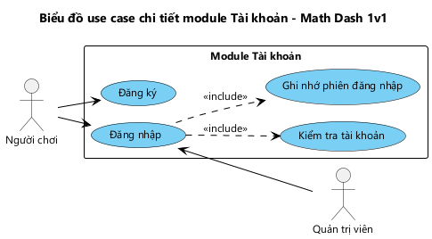

# USE CASE CHI TIẾT VÀ KỊCH BẢN v1 — CHƠI ONLINE, XEM BẢNG XẾP HẠNG, ĐĂNG NHẬP

**Dữ liệu mẫu:**

| Người chơi | Tên đăng nhập | Tên hiển thị | Tổng điểm | Trạng thái | Máy |
|---|---|---|---|---|---|
| Hùng | hung | HUNG | 12,5 | Rỗi | Máy 1, người mời |
| Hoàng | hoang | HOANG | 9 | Rỗi | Máy 2, người được mời |
| Minh | minh | MINH | 15 | Bận | Máy 3, đang đấu với người khác |
| Lan | lan | LAN | 4,5 | Rỗi | Máy 4 |

Trận số 37 bắt đầu lúc 20:15:03,0 ngày 25/10/2026. Đề bài server sinh cho trận 37:

| Câu | Phép tính | 4 phương án | Đáp án đúng |
|---|---|---|---|
| 1 | 12 + 7 | 17, 19, 21, 18 | 19 |
| 2 | 9 × 6 | 48, 54, 56, 63 | 54 |
| 3 | 45 − 18 | 27, 23, 33, 37 | 27 |
| 4 | 8 × 7 | 54, 56, 48, 64 | 56 |
| 5 | 36 + 25 | 51, 61, 59, 71 | 61 |
| 6 | 72 − 39 | 33, 43, 31, 37 | 33 |
| 7 | 7 × 12 | 74, 84, 82, 96 | 84 |
| 8 | 58 + 27 | 75, 85, 83, 95 | 85 |
| 9 | 91 − 46 | 45, 55, 35, 47 | 45 |
| 10 | 6 × 15 | 80, 90, 96, 75 | 90 |

---

## 1. Biểu đồ use case chi tiết module Chơi online

*Hình 5: Biểu đồ use case chi tiết module Chơi online.*

Người chơi khởi phát trực tiếp 2 use case của module: "Chơi online" (UC03) và "Xem bảng xếp hạng" (UC04). UC03 được phân rã như sau:
- **include "Xem danh sách người chơi online"**: danh sách tên, tổng điểm, trạng thái, tự cập nhật.
- **include "Vào trận đấu"**: use case trừu tượng (chữ nghiêng), có 2 use case con kế thừa:
  - "Gửi lời thách đấu": bấm vào tên một người đang rỗi và chờ người đó trả lời.
  - "Nhận lời thách đấu": đồng ý lời mời của người khác.
- **"Từ chối lời thách đấu" extend "Nhận lời thách đấu"**: người được mời có thể từ chối.
- **include "Thi đấu"**: làm đề 10 câu, nộp bài, nhận kết quả và điểm trận.
- **"Thoát trận" extend "Thi đấu"**: người chơi thoát giữa trận và bị xử thua.
- **"Chơi tiếp" extend "Thi đấu"**: sau mỗi trận, cả 2 chọn chơi tiếp thì vào trận mới.

| Use case | Mô tả |
|---|---|
| Chơi online (UC03) | Thách đấu một người chơi online, thi đấu trên cùng đề do server sinh, nhận kết quả do server xác định |
| Xem danh sách người chơi online | Hiển thị các người chơi đang online kèm tổng điểm, trạng thái rỗi / bận; cập nhật ngay khi có thay đổi |
| Vào trận đấu | Use case trừu tượng: đưa 2 người chơi vào cùng một trận |
| Gửi lời thách đấu | Người chơi bấm vào tên một người đang rỗi; hệ thống gửi lời mời và chờ trả lời |
| Nhận lời thách đấu | Người được mời đồng ý; server sinh đề, tạo trận và gửi đề cho cả 2 máy |
| Từ chối lời thách đấu | Người được mời từ chối; người mời nhận thông báo |
| Thi đấu | Hai người làm cùng đề 10 câu trong tối đa 60 giây, nộp bài; server chấm, xác định kết quả, cộng điểm |
| Thoát trận | Người chơi rời trận trước khi trận kết thúc (hoặc mất kết nối) và bị xử thua |
| Chơi tiếp | Cả 2 người chọn chơi tiếp sau trận; server sinh đề mới và tạo trận tiếp theo |
| Xem bảng xếp hạng (UC04) | Xem thứ hạng mọi người chơi theo tổng điểm, trung bình điểm đối thủ, trung bình thời gian thắng |

---

## 2. Mô tả chi tiết các chức năng

### 2.1. Chức năng "Chơi online"

Người chơi đã đăng nhập → Giao diện chính hiện lên với:
- Dòng thông tin của mình: tên hiển thị, tổng điểm.
- Danh sách người chơi online, xếp theo tổng điểm giảm dần; mỗi dòng có tên, tổng điểm, trạng thái Rỗi (màu xanh) / Bận (màu xám).
- Các nút Chơi với máy, Bảng xếp hạng, Đăng xuất.

→ Danh sách tự cập nhật khi có người vào, người thoát hoặc người đổi trạng thái → Người chơi bấm vào tên một người đang rỗi → Hệ thống gửi lời mời tới máy người đó → Hộp thoại "Đang chờ <tên> trả lời..." hiện lên với nút Hủy.

Trên máy người được mời: hộp thoại "<tên> (<tổng điểm> điểm) thách đấu bạn" hiện lên với 2 nút Đồng ý, Từ chối → Người được mời nhấn Đồng ý → Server kiểm tra cả 2 vẫn online và rỗi → Sinh đề 10 câu, tạo trận, chuyển cả 2 sang Bận, gửi đề cho cả 2 máy → Cả 2 máy chuyển sang giao diện thi đấu.

- Bấm vào người đang bận: "<tên> đang bận", không gửi lời mời.
- Người được mời nhấn Từ chối: máy người mời đóng hộp thoại chờ và báo "<tên> đã từ chối lời mời".
- Người mời nhấn Hủy khi đang chờ: lời mời bị hủy; người được mời có nhấn Đồng ý sau đó thì báo "Không bắt đầu được trận đấu".
- Người mời đã tắt ứng dụng hoặc đã vào trận khác khi người được mời nhấn Đồng ý: "Không bắt đầu được trận đấu".

Thi đấu: Giao diện thi đấu hiện lên với:
- Ô thời gian đếm ngược từ 60 giây.
- Dòng trạng thái đối thủ: "<tên đối thủ> đang làm bài".
- Danh sách 10 câu hỏi cuộn được; mỗi câu có số thứ tự, phép tính và 4 phương án dạng nút chọn.
- Nút Nộp bài, nút Thoát.

→ Người chơi chọn một phương án cho từng câu, đổi lựa chọn được trước khi nộp → Nhấn Nộp bài → Server ghi nhận thời điểm nộp, chấm bài → Danh sách câu bị khóa, nút Nộp bài ẩn, hiện "Đã nộp bài, đang chờ đối thủ..." → Khi đối thủ nộp bài, dòng trạng thái đối thủ trên máy còn lại đổi thành "<tên đối thủ> đã nộp bài" → Khi cả 2 đã nộp, server xác định kết quả, cộng điểm trận, cập nhật tổng điểm, báo cả 2 máy.

Giao diện kết quả hiện đè lên giao diện thi đấu với:
- Dòng kết quả THẮNG! (xanh) / THUA! (đỏ) / HÒA! (vàng).
- Bảng so sánh 2 người: số câu đúng, thời gian làm bài.
- Điểm trận được cộng và tổng điểm mới.
- Câu hỏi "Chơi tiếp?" với 2 nút Chơi tiếp, Dừng.

→ Người chơi nhấn Chơi tiếp → Hiện "Đang chờ đối thủ..." → Khi đối thủ cũng chọn Chơi tiếp: server sinh đề mới, tạo trận mới → Cả 2 máy vào giao diện thi đấu của trận mới.

- Hết 60 giây mà chưa nộp: hệ thống tự nộp, câu chưa chọn tính là sai.
- Nhấn Thoát hoặc Back khi đang thi đấu: hỏi "Thoát sẽ bị xử thua?" với 2 nút Ở lại / Thoát → Thoát: bị xử thua, về giao diện chính.
- Đối thủ thoát hoặc mất kết nối: báo "Đối thủ đã thoát, bạn thắng" → giao diện kết quả THẮNG!, không có nút Chơi tiếp.
- Một trong 2 người nhấn Dừng: cả 2 về giao diện chính, trạng thái trở lại Rỗi; máy người còn lại báo "Đối thủ đã dừng chơi".
- Không kết nối được server khi nộp bài: "Không kết nối được máy chủ, kiểm tra kết nối mạng", nút Nộp bài bấm lại được.

### 2.2. Chức năng "Xem bảng xếp hạng"

Người chơi đã đăng nhập, đang ở giao diện chính → Người chơi nhấn Bảng xếp hạng → Hệ thống lấy mọi người chơi và các trận đã kết thúc, tính 3 tiêu chí rồi sắp xếp → Giao diện bảng xếp hạng hiện lên với: tiêu đề "BẢNG XẾP HẠNG", danh sách mọi người chơi; mỗi dòng gồm hạng, tên, tổng điểm, trung bình điểm đối thủ, trung bình thời gian thắng; dòng của chính người chơi được tô nổi bật → Người chơi nhấn Back → Quay về giao diện chính.

Thứ tự xếp hạng:
1. Tổng điểm, giảm dần.
2. Cùng tổng điểm thì xét trung bình tổng điểm của các đối thủ đã gặp, giảm dần.
3. Cùng cả 2 tiêu chí trên thì xét trung bình thời gian làm bài trong các trận thắng, tăng dần. Người chưa thắng trận nào hiện "—" và đứng sau.

- Không kết nối được server: "Không tải được bảng xếp hạng, kiểm tra kết nối mạng", danh sách để trống.

---

## 3. Kịch bản UC03 "Chơi online"

| | |
|---|---|
| **Use case** | Chơi online (UC03), gồm Xem danh sách người chơi online, Gửi lời thách đấu, Nhận lời thách đấu, Thi đấu, Chơi tiếp |
| **Actor** | Người chơi: Hùng ở máy 1 là người mời, Hoàng ở máy 2 là người được mời; mỗi người là actor trên máy của mình |
| **Tiền điều kiện** | Cả 2 người chơi đã đăng nhập, máy có kết nối mạng, đang ở giao diện chính |
| **Hậu điều kiện** | Trận đấu được lưu trên server cùng đề, số câu đúng và thời gian nộp bài của 2 người; tổng điểm của 2 người được cập nhật; cả 2 thấy cùng một kết quả |

Kịch bản chuẩn chia 4 đoạn, khớp với các use case con:
- A. Gửi lời thách đấu (máy 1).
- B. Nhận lời thách đấu (máy 2).
- C. Thi đấu (máy 1; máy 2 diễn ra tương tự).
- D. Chơi tiếp.

### 3.1. Kịch bản chuẩn

**A. Gửi lời thách đấu**

1. Hùng đăng nhập trên máy 1. Giao diện chính hiện lên gồm:

   | Thành phần | Giá trị |
   |---|---|
   | Dòng thông tin | HUNG · 12,5 điểm |
   | Danh sách người chơi online | Bảng dưới đây |
   | Nút | **Chơi với máy**, **Bảng xếp hạng**, **Đăng xuất** |

   | Tên | Tổng điểm | Trạng thái |
   |---|---|---|
   | MINH | 15 | Bận |
   | HOANG | 9 | Rỗi |
   | LAN | 4,5 | Rỗi |

2. Hùng bấm vào dòng HOANG.
3. Hệ thống thấy HOANG đang rỗi, gửi lời mời tới máy 2. Máy 1 hiện hộp thoại "Đang chờ HOANG trả lời..." với nút **Hủy**.

**B. Nhận lời thách đấu**

4. Trên máy 2, Hoàng đang ở giao diện chính. Hộp thoại "HUNG (12,5 điểm) thách đấu bạn" hiện lên với 2 nút **Đồng ý**, **Từ chối**.
5. Hoàng nhấn **Đồng ý**.
6. Server kiểm tra HUNG và HOANG vẫn online và đang rỗi. Server sinh đề 10 câu như bảng dữ liệu mẫu, tạo trận số 37 bắt đầu lúc 20:15:03,0, chuyển HUNG và HOANG sang Bận, rồi gửi đề cho cả 2 máy.
7. Máy 2 chuyển sang giao diện thi đấu. Cùng lúc, máy 1 đóng hộp thoại chờ và chuyển sang giao diện thi đấu. Trên máy của Lan, HUNG và HOANG chuyển sang Bận.

**C. Thi đấu**

8. Giao diện thi đấu trên máy 1 gồm:

   | Thành phần | Giá trị |
   |---|---|
   | Ô thời gian | 60 |
   | Trạng thái đối thủ | HOANG đang làm bài |
   | Danh sách câu hỏi | 10 câu như bảng dữ liệu mẫu, mỗi câu 4 nút chọn, chưa câu nào được chọn |
   | Nút | **Nộp bài**, **Thoát** |

   Máy 2 hiện cùng đề, dòng trạng thái là "HUNG đang làm bài".
9. Hùng lần lượt chọn 19, 54, 27, 56, 61, 33, 84, 85, 45, 90. Ô thời gian đếm ngược mỗi giây.
10. Khi ô thời gian còn 22, Hùng nhấn **Nộp bài**.
11. Server nhận bài làm của HUNG lúc 20:15:41,2, tức thời gian làm bài 38,2 giây, chấm đúng 10/10 câu. Máy 1 khóa danh sách câu, ẩn nút Nộp bài, hiện "Đã nộp bài, đang chờ đối thủ...". Trên máy 2, dòng trạng thái đổi thành "HUNG đã nộp bài".
12. Hoàng nộp bài trên máy 2. Server nhận lúc 20:15:48,6, tức 45,6 giây, đúng 10/10 câu.
13. Server xác định kết quả: không ai bỏ trận, cả 2 đúng hết, HUNG nộp nhanh hơn nên HUNG thắng. HUNG được 1 điểm, tổng điểm thành 13,5; HOANG được 0 điểm, tổng điểm giữ 9. Server lưu trận và báo cả 2 máy.
14. Giao diện kết quả hiện lên trên máy 1 gồm:

    | Thành phần | Giá trị |
    |---|---|
    | Dòng kết quả | **THẮNG!** (màu xanh) |
    | Bạn | 10/10 câu đúng · 38,2 giây |
    | HOANG | 10/10 câu đúng · 45,6 giây |
    | Điểm | +1 điểm · Tổng điểm: 13,5 |
    | Câu hỏi | Chơi tiếp? |
    | Nút | **Chơi tiếp**, **Dừng** |

    Máy 2 hiện **THUA!** (màu đỏ), +0 điểm, tổng điểm 9.

**D. Chơi tiếp**

15. Hùng nhấn **Chơi tiếp**. Máy 1 ẩn 2 nút, hiện "Đang chờ đối thủ...".
16. Hoàng nhấn **Chơi tiếp** trên máy 2.
17. Server sinh đề mới, câu đầu là 23 + 48, tạo trận số 38 và gửi đề cho cả 2 máy.
18. Cả 2 máy hiện giao diện thi đấu của trận 38, ô thời gian 60. Trận diễn ra như các bước 8–14.

### 3.2. Kịch bản ngoại lệ

| Bước | Tình huống ngoại lệ và cách xử lý |
|---|---|
| 2 | Hùng bấm vào dòng MINH. MINH đang Bận nên hệ thống báo "MINH đang bận", không gửi lời mời, giữ nguyên giao diện chính. |
| 3 | **Hủy lời mời.** Hùng nhấn **Hủy** trên hộp thoại chờ. Lời mời bị hủy, máy 1 ở lại giao diện chính. Nếu Hoàng nhấn Đồng ý sau đó, server thấy lời mời đã hủy nên không tạo trận; máy 2 báo "Không bắt đầu được trận đấu". |
| 5 | **Từ chối.** Hoàng nhấn **Từ chối**. Máy 2 đóng hộp thoại. Máy 1 đóng hộp thoại chờ và báo "HOANG đã từ chối lời mời"; Hùng vẫn ở giao diện chính, có thể mời người khác. |
| 6 | Hùng tắt ứng dụng trước khi Hoàng nhấn Đồng ý. Server thấy HUNG không còn online nên không tạo trận. Máy 2 báo "Không bắt đầu được trận đấu" và ở lại giao diện chính. |
| 9–10 | **Hết giờ.** Hùng mới chọn 8 câu thì ô thời gian về 0. Hệ thống tự nộp bài; 2 câu chưa chọn tính là sai, HUNG đúng 8/10. |
| 9–10 | **Thoát trận.** Hùng nhấn **Thoát**. Hệ thống hỏi "Thoát sẽ bị xử thua?" với 2 nút **Ở lại**, **Thoát**. Hùng nhấn **Thoát**: server xử HUNG thua, HOANG thắng và được 1 điểm (tổng 10), trả cả 2 về Rỗi. Máy 1 về giao diện chính. Máy 2 báo "Đối thủ đã thoát, bạn thắng" và hiện giao diện kết quả THẮNG! chỉ có nút **Về menu**, không hỏi chơi tiếp. Nhấn **Ở lại** thì tiếp tục làm bài, ô thời gian vẫn chạy. |
| 9–12 | **Đối thủ mất kết nối.** Máy 2 mất mạng khi đang làm bài. HOANG biến khỏi danh sách online; hệ thống xử HOANG bỏ trận. Máy 1 báo "Đối thủ đã thoát, bạn thắng" như ngoại lệ trên. |
| 10 | Máy 1 không kết nối được server khi nộp bài. Hệ thống báo "Không kết nối được máy chủ, kiểm tra kết nối mạng", nút Nộp bài vẫn bấm được; ô thời gian vẫn chạy. |
| 13 | **Một người đúng hết.** Hoàng chọn 74 ở câu 7, đúng 9/10, dù nộp ở giây 30,0. HUNG đúng hết nên HUNG thắng, không xét thời gian. |
| 13 | **Hòa.** HUNG chọn 23 ở câu 3, HOANG chọn 35 ở câu 9; cả 2 đều có câu sai nên hòa. Mỗi người được 0,5 điểm: HUNG 13, HOANG 9,5. Giao diện kết quả hiện **HÒA!** (màu vàng). |
| 15–16 | **Dừng chơi.** Hoàng nhấn **Dừng**. Server trả HUNG và HOANG về Rỗi. Máy 2 về giao diện chính. Máy 1 báo "Đối thủ đã dừng chơi" và về giao diện chính. |

---

## 4. Kịch bản UC04 "Xem bảng xếp hạng"

| | |
|---|---|
| **Use case** | Xem bảng xếp hạng (UC04) |
| **Actor** | Người chơi (Hùng) |
| **Tiền điều kiện** | Hùng đã đăng nhập, máy có kết nối mạng, đang ở giao diện chính |
| **Hậu điều kiện** | Hùng thấy thứ hạng của mọi người chơi; dữ liệu không thay đổi |

### 4.1. Kịch bản chuẩn

1. Ở giao diện chính (dòng "HUNG · 13,5 điểm"), Hùng nhấn nút **Bảng xếp hạng**.
2. Hệ thống lấy mọi người chơi và các trận đã kết thúc, tính 3 tiêu chí rồi sắp xếp. Giao diện bảng xếp hạng hiện lên gồm tiêu đề "BẢNG XẾP HẠNG" và danh sách:

   | Hạng | Tên | Tổng điểm | TB điểm đối thủ | TB thời gian thắng |
   |---|---|---|---|---|
   | 1 | MINH | 15 | 10,5 | 41,3 giây |
   | 2 | **HUNG** (dòng nổi bật) | 13,5 | 11 | 39,8 giây |
   | 3 | LAN | 13,5 | 9 | 44,0 giây |
   | 4 | HOANG | 9 | 13,5 | 47,2 giây |
   | 5 | AN | 4,5 | 12 | 49,0 giây |
   | 6 | NAM | 4,5 | 12 | 52,1 giây |
   | 7 | TUAN | 0 | 13,5 | — |

   - HUNG và LAN cùng 13,5 điểm, HUNG đã gặp các đối thủ mạnh hơn (11 so với 9) nên đứng trên.
   - AN và NAM trùng cả 2 tiêu chí đầu, AN thắng nhanh hơn nên đứng trên.
3. Hùng xem danh sách rồi nhấn Back.
4. Giao diện chính hiện lại.

### 4.2. Kịch bản ngoại lệ

| Bước | Tình huống ngoại lệ và cách xử lý |
|---|---|
| 2 | Máy mất mạng hoặc server không phản hồi. Hệ thống báo "Không tải được bảng xếp hạng, kiểm tra kết nối mạng", danh sách để trống; Hùng nhấn Back để về giao diện chính. |

---

## 5. Biểu đồ use case chi tiết module Tài khoản

*Hình 22: Biểu đồ use case chi tiết module Tài khoản.*

- Người chơi khởi phát "Đăng ký" (UC01) và "Đăng nhập" (UC02); Quản trị viên chỉ khởi phát "Đăng nhập".
- "Đăng nhập" include "Kiểm tra tài khoản" và "Ghi nhớ phiên đăng nhập": lần sau mở ứng dụng không phải đăng nhập lại.
- Hai use case được trình bày chung thành chức năng "Đăng nhập, đăng ký", vì người dùng đi từ giao diện đăng nhập sang đăng ký rồi quay lại.

| Use case | Mô tả |
|---|---|
| Đăng ký (UC01) | Tạo tài khoản người chơi mới bằng tên đăng nhập, mật khẩu, tên hiển thị |
| Đăng nhập (UC02) | Đăng nhập bằng tên đăng nhập và mật khẩu; vào giao diện chính, hoặc giao diện quản lý người chơi nếu là quản trị viên |
| Kiểm tra tài khoản | Hệ thống so tên đăng nhập và mật khẩu với tài khoản đã lưu |
| Ghi nhớ phiên đăng nhập | Hệ thống nhớ người đã đăng nhập trên máy cho tới khi đăng xuất |

---

## 6. Mô tả chi tiết chức năng "Đăng nhập, đăng ký"

Người dùng mở ứng dụng → Hệ thống kiểm tra phiên đăng nhập đã ghi nhớ → Chưa có phiên: giao diện đăng nhập hiện lên với ô tên đăng nhập, ô mật khẩu, nút Đăng nhập, nút Đăng ký.

- Đăng ký: Người dùng nhấn Đăng ký → Giao diện đăng ký hiện lên với ô tên đăng nhập, ô mật khẩu, ô nhập lại mật khẩu, ô tên hiển thị, nút Đăng ký → Người dùng nhập thông tin và nhấn Đăng ký → Hệ thống kiểm tra thông tin, tạo tài khoản người chơi → Thông báo "Đăng ký thành công" → Quay về giao diện đăng nhập.
  - Có ô bỏ trống: "Vui lòng nhập đủ thông tin".
  - Mật khẩu nhập lại không khớp: "Mật khẩu nhập lại không khớp".
  - Tên đăng nhập đã có: "Tên đăng nhập đã được dùng".
- Đăng nhập: Người dùng nhập tên đăng nhập, mật khẩu và nhấn Đăng nhập → Hệ thống kiểm tra tài khoản → Ghi nhớ phiên đăng nhập → Mở giao diện chính (người chơi) hoặc giao diện quản lý người chơi (quản trị viên).
  - Sai tên đăng nhập hoặc mật khẩu: "Sai tên đăng nhập hoặc mật khẩu".
  - Đã có phiên từ lần trước: vào thẳng giao diện chính, không hiện giao diện đăng nhập.
  - Không kết nối được server: thông báo lỗi kết nối, nút Đăng nhập bấm lại được.

---

## 7. Kịch bản UC01 "Đăng ký" và UC02 "Đăng nhập"

| | |
|---|---|
| **Use case** | Đăng ký (UC01), Đăng nhập (UC02) |
| **Actor** | Người chơi (Hùng, máy 1) |
| **Tiền điều kiện** | Máy có kết nối mạng; trên máy chưa có phiên đăng nhập; tên đăng nhập hung chưa có trong hệ thống |
| **Hậu điều kiện** | Hệ thống có tài khoản hung; máy 1 ghi nhớ phiên của HUNG và đang ở giao diện chính |

Kịch bản chuẩn chia 2 đoạn: **A. Đăng ký**, **B. Đăng nhập**.

### 7.1. Kịch bản chuẩn

**A. Đăng ký**

1. Hùng mở ứng dụng trên máy 1. Giao diện đăng nhập hiện lên gồm: tiêu đề MATH DASH 1v1, ô tên đăng nhập, ô mật khẩu, nút **Đăng nhập**, nút **Đăng ký**.
2. Hùng nhấn **Đăng ký**.
3. Giao diện đăng ký hiện lên gồm: ô tên đăng nhập, ô mật khẩu, ô nhập lại mật khẩu, ô tên hiển thị, nút **Đăng ký**.
4. Hùng nhập:

   | Ô | Giá trị |
   |---|---|
   | Tên đăng nhập | hung |
   | Mật khẩu | hung123 |
   | Nhập lại mật khẩu | hung123 |
   | Tên hiển thị | HUNG |

   rồi nhấn **Đăng ký**.
5. Hệ thống thấy các ô đủ, mật khẩu nhập lại khớp, tên đăng nhập hung chưa có. Hệ thống tạo tài khoản người chơi hung, tên hiển thị HUNG, tổng điểm 0, và thông báo "Đăng ký thành công".
6. Giao diện đăng nhập hiện lại.

**B. Đăng nhập**

7. Hùng nhập tên đăng nhập hung, mật khẩu hung123 và nhấn **Đăng nhập**.
8. Hệ thống kiểm tra đúng tài khoản, vai trò là người chơi. Hệ thống ghi nhớ phiên đăng nhập của HUNG trên máy 1.
9. Giao diện chính hiện lên với dòng "HUNG · 0 điểm", danh sách người chơi online, các nút Chơi với máy, Bảng xếp hạng, Đăng xuất.

### 7.2. Kịch bản ngoại lệ

| Bước | Tình huống ngoại lệ và cách xử lý |
|---|---|
| 1 | Máy 1 đã ghi nhớ phiên của HUNG từ lần trước. Hệ thống vào thẳng giao diện chính như bước 9. |
| 4 | Hùng để trống ô tên hiển thị. Hệ thống báo "Vui lòng nhập đủ thông tin", không tạo tài khoản. |
| 4 | Hùng nhập lại mật khẩu là hung124. Hệ thống báo "Mật khẩu nhập lại không khớp", không tạo tài khoản. |
| 5 | Tên đăng nhập hung đã có người dùng. Hệ thống báo "Tên đăng nhập đã được dùng", giữ nguyên giao diện đăng ký để nhập tên khác. |
| 8 | Hùng nhập mật khẩu hung000. Hệ thống báo "Sai tên đăng nhập hoặc mật khẩu", giữ nguyên giao diện đăng nhập. |
| 8 | Quản trị viên đăng nhập bằng tài khoản admin. Hệ thống ghi nhớ phiên và mở giao diện quản lý người chơi thay cho giao diện chính. |
