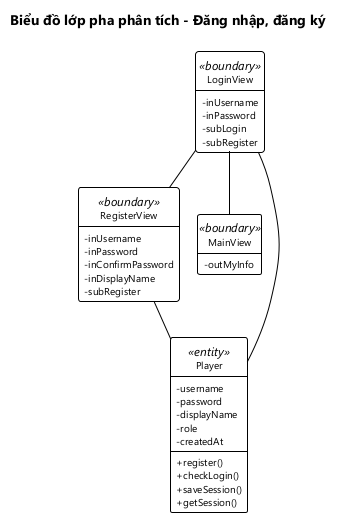

# BIỂU ĐỒ LỚP PHA PHÂN TÍCH — CHƠI ONLINE, XEM BẢNG XẾP HẠNG, ĐĂNG NHẬP

---

## 1. Phân tích tĩnh chức năng "Chơi online"

### Bước 1 + 2: Lớp View và thành phần

| Bước kịch bản v1 | Giao diện | Lớp View | Thành phần |
|---|---|---|---|
| 1–4 | Giao diện chính | MainView | outMyInfo: dòng "HUNG · 12,5 điểm" outsubListPlayer: danh sách người chơi online; mỗi dòng có tên, tổng điểm, trạng thái; bấm vào một dòng để thách đấu |
| 8–12 | Giao diện thi đấu | MatchView | outTimer: ô thời gian đếm ngược outOpponentStatus: dòng "HOANG đang làm bài" / "HOANG đã nộp bài" inoutListQuestion: danh sách 10 câu hỏi, mỗi câu hiện phép tính và 4 phương án để chọn subSubmit: nút Nộp bài subExit: nút Thoát |
| 14–15 | Giao diện kết quả | MatchResultView | outResult: THẮNG! / THUA! / HÒA! outMyResult: số câu đúng, thời gian làm bài của mình outOpponentResult: số câu đúng, thời gian làm bài của đối thủ outPoints: điểm trận được cộng và tổng điểm mới subContinue: nút Chơi tiếp subStop: nút Dừng |

inoutListQuestion mang tiền tố inout vì danh sách vừa hiển thị câu hỏi vừa nhận phương án người chơi chọn.

Không đề xuất lớp View cho:
- Hộp thoại lời mời "HUNG (12,5 điểm) thách đấu bạn" với 2 nút Đồng ý, Từ chối. Đây là hộp thoại xác nhận hiện trên giao diện chính.
- Hộp thoại "Đang chờ HOANG trả lời...", hộp thoại "Thoát sẽ bị xử thua?".
- Các thông báo "MINH đang bận", "HOANG đã từ chối lời mời", "Đối thủ đã thoát, bạn thắng", "Đối thủ đã dừng chơi".

### Bước 3: Phương thức và lớp thực thể được gán

| Bước v1 | Xử lý hệ thống | Tên phương thức | Đầu vào | Đầu ra | Gán cho lớp | Lý do |
|---|---|---|---|---|---|---|
| 1 | Ghi người chơi vào danh sách online với trạng thái rỗi | goOnline() | Người chơi (Player) | Không có | Player | Đầu vào chỉ thuộc Player |
| 1, 7 | Lấy danh sách người chơi online và theo dõi thay đổi | getOnlinePlayers() | Không có | Danh sách Player kèm tổng điểm, trạng thái | Player | Đầu ra là danh sách Player |
| 3 | Gửi lời mời tới một người chơi đang rỗi | sendChallenge() | Người mời, người được mời (Player) | Lời mời đang chờ (Challenge) | Challenge | Đầu ra là Challenge |
| 4, 7 | Theo dõi lời mời: người được mời nhận lời mời mới; người mời biết lời mời được đồng ý hay bị từ chối | watchChallenge() | Người chơi, hoặc lời mời | Lời mời mới nhất (Challenge) | Challenge | Đầu ra là Challenge |
| 5 (ngoại lệ) | Từ chối lời mời | rejectChallenge() | Lời mời (Challenge) | Không có | Challenge | Đầu vào chỉ thuộc Challenge |
| 6 | Tạo trận từ lời mời đã đồng ý: sinh đề, chuyển 2 người sang bận | createMatch() | Lời mời (Challenge) | Trận mới (Match) | Match | Đầu ra là Match |
| 6, 17 | Sinh một câu hỏi kèm 4 phương án | generateProblem() | Không có | Câu hỏi (MathProblem) | MathProblem | Đầu ra là MathProblem |
| 8, 11, 13 | Theo dõi trận: nhận đề, biết đối thủ đã nộp bài, biết trận đã xong | watchMatch() | Trận (Match) | Trận mới nhất (Match) | Match | Đầu ra là Match |
| 11 | Nhận bài làm, ghi thời điểm nộp, chấm bài | submitAnswers() | Trận (Match), bài làm của người chơi (MatchPlayer) | Trận sau khi chấm (Match) | Match | Đầu ra là Match |
| 11 | Chấm một câu | isCorrect() | Câu hỏi (MathProblem), phương án đã chọn | Đúng / sai | MathProblem | Đầu ra không phải thực thể; đầu vào chính là MathProblem |
| 13 | Kiểm tra trận đã xong chưa | isOver() | Trận (Match) | Đúng / sai | Match | Đầu vào chỉ thuộc Match |
| 14 | Lấy kết quả thắng / thua / hòa của một người chơi | getResult() | Trận (Match), người chơi | WIN / LOSE / DRAW | Match | Match chứa được cả 2 đầu vào, qua MatchPlayer |
| 14 | Lấy thời gian làm bài của một người chơi | getFinishTime() | Trận (Match), người chơi | Số mili giây | Match | Cần cả thời điểm bắt đầu của Match và thời điểm nộp của MatchPlayer |
| 14 | Lấy điểm trận của một người chơi | getPoints() | Trận (Match), người chơi | 1 / 0,5 / 0 | Match | Như getResult() |
| 9–10 (ngoại lệ) | Người chơi thoát trận và bị xử thua | forfeit() | Trận (Match), người chơi | Trận đã kết thúc (Match) | Match | Đầu ra là Match |
| 15–17 | Ghi nhận lựa chọn chơi tiếp hoặc dừng; cả 2 chơi tiếp thì tạo trận mới | continueMatch() | Trận (Match), người chơi, lựa chọn | Trận mới, hoặc trận cũ đã dừng (Match) | Match | Đầu ra là Match |

### Bước 4: Biểu đồ lớp pha phân tích

*Hình 6: Biểu đồ lớp pha phân tích chức năng Chơi online.*

- **3 lớp View** nối nhau bằng quan hệ liên kết theo luồng màn hình: MainView – MatchView – MatchResultView. MatchResultView quay về MatchView khi chơi tiếp, về MainView khi dừng.
- Mỗi View nối với lớp thực thể nó gọi phương thức bằng **quan hệ liên kết**:
  - MainView: Player (danh sách online), Challenge (lời mời), Match (tạo trận).
  - MatchView: Match (theo dõi trận, nộp bài, thoát trận).
  - MatchResultView: Match (kết quả, điểm, chơi tiếp).
- **Quan hệ giữa các thực thể** giữ đúng như Hình 2:
  - Challenge chứa thông tin 2 Player (kết tập).
  - Player – Match là n-n, qua lớp liên kết MatchPlayer.
  - MathProblem là thành phần của Match (hợp thành).
- **Match nhận nhiều phương thức nhất**, vì hầu hết xử lý của chức năng trả về một trận đấu. Các luật của trận đều nằm ở thực thể, không nằm ở giao diện.

---

## 2. Phân tích tĩnh chức năng "Xem bảng xếp hạng"

### Bước 1 + 2: Lớp View và thành phần

| Bước kịch bản v1 | Giao diện | Lớp View | Thành phần |
|---|---|---|---|
| 1 | Giao diện chính | MainView | outMyInfo: dòng "HUNG · 13,5 điểm" subRanking: nút Bảng xếp hạng |
| 2 | Giao diện bảng xếp hạng | RankingView | outListRanking: danh sách người chơi đã xếp hạng; mỗi dòng có hạng, tên, tổng điểm, trung bình điểm đối thủ, trung bình thời gian thắng; dòng của người xem được tô nổi bật |

Danh sách chỉ để xem, bấm vào một dòng không làm gì. Vì vậy thành phần mang tiền tố out, không phải outsub.

### Bước 3: Phương thức và lớp thực thể được gán

| Bước v1 | Xử lý hệ thống | Tên phương thức | Đầu vào | Đầu ra | Gán cho lớp | Lý do |
|---|---|---|---|---|---|---|
| 2 | Lấy mọi người chơi kèm 3 tiêu chí, đã sắp xếp | getRanking() | Không có | Danh sách Player kèm tổng điểm, trung bình điểm đối thủ, trung bình thời gian thắng | Player | Đầu ra là danh sách Player |
| 2 | Lấy điểm trận của một người trong một trận đã xong | getPoints() | Trận (Match), người chơi | 1 / 0,5 / 0 | Match | Như ở Chơi online; dùng chung |
| 2 | Biết người chơi thắng trận nào | getResult() | Trận (Match), người chơi | WIN / LOSE / DRAW | Match | Như ở Chơi online |
| 2 | Lấy thời gian làm bài trong trận thắng | getFinishTime() | Trận (Match), người chơi | Số mili giây | Match | Như ở Chơi online |

### Bước 4: Biểu đồ lớp pha phân tích

*Hình 7: Biểu đồ lớp pha phân tích chức năng Xem bảng xếp hạng.*

- Chức năng có 2 lớp View nối nhau bằng quan hệ liên kết: MainView mở RankingView; RankingView gọi getRanking() của Player.
- Player dùng 3 phương thức của Match để tính các tiêu chí. Bảng xếp hạng vì vậy dùng **cùng luật thắng thua** với trận đấu, không viết lại luật ở nơi khác.
- Các tiêu chí xếp hạng là thuộc tính dẫn xuất của Player, được tính khi xem chứ không lưu.

---

## 3. Phân tích tĩnh chức năng "Đăng nhập, đăng ký"

### Bước 1 + 2: Lớp View và thành phần

| Bước kịch bản v1 | Giao diện | Lớp View | Thành phần |
|---|---|---|---|
| 1, 6, 7 | Giao diện đăng nhập | LoginView | inUsername: ô tên đăng nhập inPassword: ô mật khẩu subLogin: nút Đăng nhập subRegister: nút Đăng ký |
| 3, 4 | Giao diện đăng ký | RegisterView | inUsername: ô tên đăng nhập inPassword: ô mật khẩu inConfirmPassword: ô nhập lại mật khẩu inDisplayName: ô tên hiển thị subRegister: nút Đăng ký |
| 9 | Giao diện chính | MainView | outMyInfo: dòng "HUNG · 0 điểm" |

Các thông báo "Đăng ký thành công", "Sai tên đăng nhập hoặc mật khẩu"… không phải giao diện nên không có lớp View.

### Bước 3: Phương thức và lớp thực thể được gán

| Bước v1 | Xử lý hệ thống | Tên phương thức | Đầu vào | Đầu ra | Gán cho lớp | Lý do |
|---|---|---|---|---|---|---|
| 5 | Tạo tài khoản người chơi mới | register() | Tên đăng nhập, mật khẩu, tên hiển thị | Người chơi mới (Player) | Player | Đầu ra là Player |
| 8 | Kiểm tra tên đăng nhập và mật khẩu | checkLogin() | Tên đăng nhập, mật khẩu | Người chơi (Player), hoặc không có | Player | Đầu ra là Player |
| 8 | Ghi nhớ phiên đăng nhập trên máy | saveSession() | Người chơi (Player) | Không có | Player | Đầu vào chỉ thuộc Player |
| 1 | Lấy phiên đã ghi nhớ | getSession() | Không có | Người chơi (Player), hoặc không có | Player | Đầu ra là Player |

### Bước 4: Biểu đồ lớp pha phân tích

*Hình 23: Biểu đồ lớp pha phân tích chức năng Đăng nhập, đăng ký.*

- 3 lớp View nối nhau bằng quan hệ liên kết: LoginView mở RegisterView và MainView.
- Cả 4 phương thức đều gán cho Player vì đầu ra hoặc đầu vào của chúng chỉ là người chơi.
- Vai trò (role) của Player quyết định giao diện mở ra sau khi đăng nhập.

---

## 4. Đối chiếu với kịch bản v1

Mọi thành phần giao diện nêu trong kịch bản v1 đều có ở lớp View tương ứng:

| Thành phần trong kịch bản v1 | Thuộc tính |
|---|---|
| Dòng thông tin của mình, danh sách người chơi online | MainView.outMyInfo, outsubListPlayer |
| Nút Bảng xếp hạng | MainView.subRanking |
| Ô thời gian, trạng thái đối thủ, danh sách câu hỏi, nút Nộp bài, nút Thoát | MatchView.outTimer, outOpponentStatus, inoutListQuestion, subSubmit, subExit |
| Dòng kết quả, kết quả của mình, của đối thủ, điểm, nút Chơi tiếp, nút Dừng | MatchResultView.outResult, outMyResult, outOpponentResult, outPoints, subContinue, subStop |
| Danh sách xếp hạng | RankingView.outListRanking |
| Ô tên đăng nhập, mật khẩu, nút Đăng nhập, nút Đăng ký | LoginView.inUsername, inPassword, subLogin, subRegister |
| Các ô và nút của giao diện đăng ký | RegisterView.inUsername, inPassword, inConfirmPassword, inDisplayName, subRegister |
