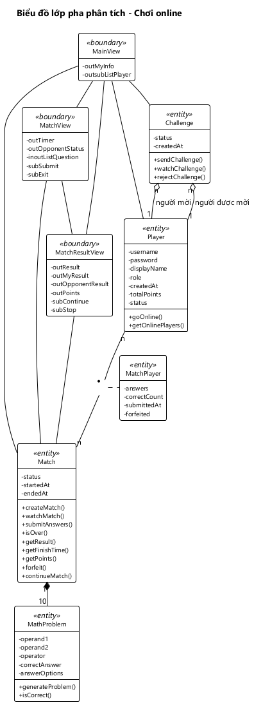
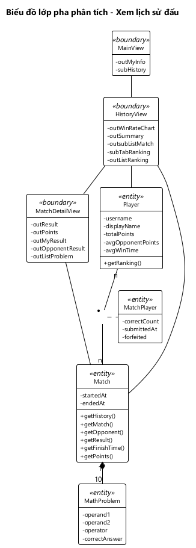

# BIỂU ĐỒ LỚP PHA PHÂN TÍCH — CHƠI ONLINE, XEM LỊCH SỬ ĐẤU

---

## 1. Phân tích tĩnh chức năng "Chơi online"

### Bước 1 + 2: Lớp View và thành phần

| Bước kịch bản v1 | Giao diện | Lớp View | Thành phần |
|---|---|---|---|
| 1–2 | Giao diện chính | MainView | subPlayBot: nút Chơi với máy subPlayOnline: nút Chơi online |
| 3–8 | Giao diện chơi online | OnlineView | outMyInfo: thẻ "HUNG · 12,5 điểm" outsubListPlayer: danh sách người chơi online; mỗi dòng có tên, tổng điểm, trạng thái; bấm vào một dòng để thách đấu |
| 10–18 | Giao diện thi đấu | MatchView | outTimer: ô thời gian đếm ngược outOpponentStatus: dòng "HOANG đang làm bài" / "HOANG đã nộp bài" outQuestion: số thứ tự câu đang làm "Câu 1/10" và phép tính "12 + 7 = ?" subOptions: 4 ô phương án A, B, C, D; bấm một ô là chọn phương án và sang câu sau subSubmit: nút Nộp bài, hiện khi đã làm xong 10 câu subExit: nút Thoát |
| 20–22 | Giao diện kết quả | MatchResultView | outResult: THẮNG! / THUA! / HÒA! outMyResult: số câu đúng, thời gian làm bài của mình outOpponentResult: số câu đúng, thời gian làm bài của đối thủ outPoints: điểm trận được cộng và tổng điểm mới subContinue: nút Chơi tiếp subStop: nút Dừng |

MainView gồm 2 nút chọn chế độ chơi; nút Đăng xuất ở góc phải trên thuộc module Tài khoản nên không đưa vào đây. Danh sách người chơi online nằm ở OnlineView: người chơi chỉ online khi đang ở giao diện này.

MatchView hiện mỗi lần một câu. outQuestion chỉ để xem nên mang tiền tố out. subOptions mang tiền tố sub vì mỗi ô là một nút: bấm là chọn phương án của câu đang làm, rồi giao diện chuyển sang câu sau, không quay lại sửa được.

Không đề xuất lớp View cho:
- Hộp thoại lời mời "HUNG (12,5 điểm) thách đấu bạn" với 2 nút Đồng ý, Từ chối. Đây là hộp thoại xác nhận hiện trên giao diện chơi online.
- Hộp thoại "Đang chờ HOANG trả lời...", hộp thoại "Thoát sẽ bị xử thua?".
- Các thông báo "MINH đang bận", "HOANG đã từ chối lời mời", "Đối thủ đã thoát, bạn thắng", "Đối thủ đã dừng chơi".
- Các dòng "Đã làm xong 10 câu", "Hết giờ", "Đang nộp bài...", "Đã nộp bài, đang chờ đối thủ...". Đây là thông báo hiện ở chỗ của outQuestion trên giao diện thi đấu.

### Bước 3: Phương thức và lớp thực thể được gán

| Bước v1 | Xử lý hệ thống | Tên phương thức | Đầu vào | Đầu ra | Gán cho lớp | Lý do |
|---|---|---|---|---|---|---|
| 3 | Ghi người chơi vào danh sách online với trạng thái rỗi | goOnline() | Người chơi (Player) | Không có | Player | Đầu vào chỉ thuộc Player |
| 3, 9 | Lấy danh sách người chơi online và theo dõi thay đổi | getOnlinePlayers() | Không có | Danh sách Player kèm tổng điểm, trạng thái | Player | Đầu ra là danh sách Player |
| 5 | Gửi lời mời tới một người chơi đang rỗi | sendChallenge() | Người mời, người được mời (Player) | Lời mời đang chờ (Challenge) | Challenge | Đầu ra là Challenge |
| 6, 9 | Theo dõi lời mời: người được mời nhận lời mời mới; người mời biết lời mời được đồng ý hay bị từ chối | watchChallenge() | Người chơi, hoặc lời mời | Lời mời mới nhất (Challenge) | Challenge | Đầu ra là Challenge |
| 7a | Từ chối lời mời | rejectChallenge() | Lời mời (Challenge) | Không có | Challenge | Đầu vào chỉ thuộc Challenge |
| 8 | Tạo trận từ lời mời đã đồng ý: sinh đề, chuyển 2 người sang bận | createMatch() | Lời mời (Challenge) | Trận mới (Match) | Match | Đầu ra là Match |
| 8, 24 | Sinh một câu hỏi kèm 4 phương án | generateProblem() | Không có | Câu hỏi (MathProblem) | MathProblem | Đầu ra là MathProblem |
| 10, 16, 19 | Theo dõi trận: nhận đề, biết đối thủ đã nộp bài, biết trận đã xong | watchMatch() | Trận (Match) | Trận mới nhất (Match) | Match | Đầu ra là Match |
| 16 | Nhận bài làm, ghi thời điểm nộp, lưu bài làm từng câu, chấm bài | submitAnswers() | Trận (Match), bài làm của người chơi gồm 10 Answer, mỗi Answer có phương án đã chọn và thời gian làm câu | Trận sau khi chấm (Match) | Match | Đầu ra là Match |
| 16 | Chấm một câu của bài làm | isCorrect() | Bài làm một câu (Answer), chứa câu hỏi và phương án đã chọn | Đúng / sai | Answer | Đầu ra không phải thực thể; đầu vào chính là Answer |
| 16 | So phương án đã chọn với đáp án đúng của câu hỏi | isCorrect() | Câu hỏi (MathProblem), phương án đã chọn | Đúng / sai | MathProblem | Đầu ra không phải thực thể; đầu vào chính là MathProblem |
| 19 | Kiểm tra trận đã xong chưa | isOver() | Trận (Match) | Đúng / sai | Match | Đầu vào chỉ thuộc Match |
| 20 | Lấy kết quả thắng / thua / hòa của một người chơi | getResult() | Trận (Match), người chơi | WIN / LOSE / DRAW | Match | Match chứa được cả 2 đầu vào, qua MatchPlayer |
| 20 | Lấy thời gian làm bài của một người chơi | getFinishTime() | Trận (Match), người chơi | Số mili giây | Match | Cần cả thời điểm bắt đầu của Match và thời điểm nộp của MatchPlayer |
| 20 | Lấy điểm trận của một người chơi | getPoints() | Trận (Match), người chơi | 1 / 0,5 / 0 | Match | Như getResult() |
| 11b | Người chơi thoát trận và bị xử thua | forfeit() | Trận (Match), người chơi | Trận đã kết thúc (Match) | Match | Đầu ra là Match |
| 21–24 | Ghi nhận lựa chọn chơi tiếp hoặc dừng; cả 2 chơi tiếp thì tạo trận mới | continueMatch() | Trận (Match), người chơi, lựa chọn | Trận mới, hoặc trận cũ đã dừng (Match) | Match | Đầu ra là Match |

Ghi phương án đã chọn và thời gian làm từng câu (bước 11–13) là xử lý của MatchView, không phải phương thức của thực thể: giao diện đo thời gian từ lúc câu hiện ra tới lúc người chơi bấm một ô và giữ bài làm từng câu cho tới khi nộp. Giao diện không biết đáp án đúng nên không chấm; việc chấm nằm ở isCorrect() của Answer, dùng luật isCorrect() của MathProblem.

### Bước 4: Biểu đồ lớp pha phân tích

*Hình 7: Biểu đồ lớp pha phân tích chức năng Chơi online.*

- **4 lớp View** nối nhau bằng quan hệ liên kết theo luồng màn hình: MainView – OnlineView – MatchView – MatchResultView. MatchResultView quay về MatchView khi chơi tiếp, về OnlineView khi dừng.
- Mỗi View nối với lớp thực thể nó gọi phương thức bằng **quan hệ liên kết**:
  - MainView không gọi thực thể nào, chỉ mở OnlineView.
  - OnlineView: Player (vào danh sách online, danh sách online), Challenge (lời mời), Match (tạo trận).
  - MatchView: Match (theo dõi trận, nộp bài, thoát trận).
  - MatchResultView: Match (kết quả, điểm, chơi tiếp).
- **Quan hệ giữa các thực thể** giữ đúng như Hình 2:
  - Challenge chứa thông tin 2 Player (kết tập).
  - Player – Match là n-n, qua lớp liên kết MatchPlayer.
  - MathProblem là thành phần của Match (hợp thành).
  - MatchPlayer – MathProblem là n-n, qua lớp liên kết Answer: mỗi người chơi trong trận làm 10 câu, mỗi câu được 2 người chơi làm; Answer giữ phương án đã chọn và thời gian làm câu.
- **Match nhận nhiều phương thức nhất**, vì hầu hết xử lý của chức năng trả về một trận đấu. Các luật của trận đều nằm ở thực thể, không nằm ở giao diện; chấm từng câu là isCorrect() của Answer.

---

## 2. Phân tích tĩnh chức năng "Xem lịch sử đấu"

### Bước 1 + 2: Lớp View và thành phần

| Bước kịch bản v1 | Giao diện | Lớp View | Thành phần |
|---|---|---|---|
| Xem lịch sử đấu 1, 4; Xem bảng xếp hạng 1, 4 | Giao diện chơi online | OnlineView | outMyInfo: thẻ "HUNG · 13,5 điểm" subHistory: nút Lịch sử đấu subRanking: nút Bảng xếp hạng |
| Xem lịch sử đấu 2–3; Xem chi tiết trận 4; Xem bảng xếp hạng 2–3 | Giao diện lịch sử đấu | HistoryView | outWinRateChart: biểu đồ tròn tỉ lệ thắng / hòa / thua outSummary: số trận thắng, hòa, thua và tổng số trận outsubListMatch: danh sách trận; mỗi dòng có đối thủ, kết quả, điểm trận, số câu đúng, thời điểm kết thúc; bấm vào một dòng để xem chi tiết trận subTabRanking: thẻ Bảng xếp hạng outListRanking: danh sách người chơi đã xếp hạng; dòng của người xem được tô nổi bật |
| Xem chi tiết trận 2–3 | Giao diện chi tiết trận | MatchDetailView | outResult: THẮNG! / THUA! / HÒA! outPoints: điểm trận outMyResult: số câu đúng, thời gian làm bài của mình outOpponentResult: tên, số câu đúng, thời gian làm bài của đối thủ outListAnswer: 10 câu; mỗi câu có phép tính kèm đáp án đúng và, với mỗi người chơi, đúng / sai, phương án đã chọn, thời gian làm câu |

Thẻ Trận của tôi và thẻ Bảng xếp hạng là 2 phần của cùng một giao diện, chuyển qua lại bằng thẻ, nên chỉ có một lớp HistoryView. OnlineView mở HistoryView theo 2 cách: subHistory mở sẵn thẻ Trận của tôi, subRanking mở thẳng thẻ Bảng xếp hạng. Danh sách xếp hạng và danh sách bài làm từng câu chỉ để xem, bấm vào không làm gì, nên mang tiền tố out. Danh sách trận mang tiền tố outsub vì bấm vào một dòng thì mở chi tiết trận.

Không đề xuất lớp View cho các thông báo "Bạn chưa đấu trận nào", "Không tải được lịch sử đấu…", "Không tải được chi tiết trận…", "Không tải được bảng xếp hạng…".

### Bước 3: Phương thức và lớp thực thể được gán

| Bước v1 | Xử lý hệ thống | Tên phương thức | Đầu vào | Đầu ra | Gán cho lớp | Lý do |
|---|---|---|---|---|---|---|
| Xem lịch sử đấu 2 | Lấy các trận đã kết thúc mà người chơi tham gia, mới nhất đứng đầu | getHistory() | Người chơi (Player) | Danh sách Match kèm 2 người chơi | Match | Đầu ra là danh sách Match |
| Xem lịch sử đấu 2; Xem chi tiết trận 2 | Biết người chơi thắng, hòa hay thua một trận | getResult() | Trận (Match), người chơi | WIN / LOSE / DRAW | Match | Như ở Chơi online; dùng chung |
| Xem lịch sử đấu 2; Xem chi tiết trận 2 | Lấy điểm trận của người chơi | getPoints() | Trận (Match), người chơi | 1 / 0,5 / 0 | Match | Như ở Chơi online |
| Xem lịch sử đấu 2; Xem chi tiết trận 2 | Lấy người chơi còn lại trong trận | getOpponent() | Trận (Match), người chơi | Người chơi trong trận của đối thủ (MatchPlayer) | Match | Match chứa cả 2 MatchPlayer |
| Xem chi tiết trận 2 | Lấy một trận kèm đề, đáp án đúng, 2 người chơi và bài làm từng câu của mỗi người | getMatch() | Trận (Match) | Trận đầy đủ (Match) | Match | Đầu ra là Match |
| Xem chi tiết trận 2 | Lấy thời gian làm bài của mỗi bên | getFinishTime() | Trận (Match), người chơi | Số mili giây | Match | Như ở Chơi online |
| Xem chi tiết trận 2 | Biết một câu trong bài làm đúng hay sai | isCorrect() | Bài làm một câu (Answer), chứa câu hỏi và phương án đã chọn | Đúng / sai | Answer | Như ở Chơi online |
| Xem chi tiết trận 2 | So phương án đã chọn với đáp án đúng của câu hỏi | isCorrect() | Câu hỏi (MathProblem), phương án đã chọn | Đúng / sai | MathProblem | Như ở Chơi online |
| Xem bảng xếp hạng 2 | Lấy mọi người chơi kèm 3 tiêu chí, đã sắp xếp | getRanking() | Không có | Danh sách Player kèm tổng điểm, trung bình điểm đối thủ, trung bình thời gian thắng | Player | Đầu ra là danh sách Player |

Số trận thắng, hòa, thua và tỉ lệ thắng trên biểu đồ tròn không phải phương thức của thực thể: HistoryView đếm các kết quả do getResult() trả về để hiển thị. Đây là thông tin dẫn xuất, không lưu. Đúng / sai của từng câu cũng là thông tin dẫn xuất, tính bằng isCorrect() của Answer; phương án đã chọn và thời gian làm câu là thuộc tính của Answer, hiển thị thẳng.

### Bước 4: Biểu đồ lớp pha phân tích

*Hình 8: Biểu đồ lớp pha phân tích chức năng Xem lịch sử đấu.*

- **3 lớp View** nối nhau bằng quan hệ liên kết theo luồng màn hình: OnlineView – HistoryView – MatchDetailView. OnlineView mở HistoryView bằng subHistory hoặc subRanking.
- Mỗi View nối với lớp thực thể nó gọi phương thức bằng **quan hệ liên kết**:
  - HistoryView: Match (lịch sử, kết quả, điểm, đối thủ), Player (bảng xếp hạng).
  - MatchDetailView: Match (trận đầy đủ, kết quả, điểm, đối thủ, thời gian làm bài), Answer (đúng / sai của từng câu).
- **Quan hệ giữa các thực thể** giữ đúng như Hình 2:
  - Player – Match là n-n, qua lớp liên kết MatchPlayer.
  - MathProblem là thành phần của Match (hợp thành); chi tiết trận cần đề để hiện đáp án đúng.
  - MatchPlayer – MathProblem là n-n, qua lớp liên kết Answer; chi tiết trận cần bài làm từng câu của 2 người.
- **Lịch sử đấu và bảng xếp hạng dùng cùng luật thắng thua** với trận đấu: getResult(), getPoints(), getFinishTime() của Match; chi tiết trận dùng cùng luật chấm câu isCorrect() với lúc nộp bài. Không có luật nào được viết lại ở giao diện.

---

## 3. Đối chiếu với kịch bản v1

Mọi thành phần giao diện nêu trong kịch bản v1 đều có ở lớp View tương ứng:

| Thành phần trong kịch bản v1 | Thuộc tính |
|---|---|
| Nút Chơi với máy, nút Chơi online | MainView.subPlayBot, subPlayOnline |
| Thẻ thông tin của mình, danh sách người chơi online | OnlineView.outMyInfo, outsubListPlayer |
| Nút Bạn bè, nút Lịch sử đấu, nút Bảng xếp hạng | OnlineView.subFriends, subHistory, subRanking |
| Ô thời gian, trạng thái đối thủ, số thứ tự câu và phép tính, 4 ô phương án A, B, C, D, nút Nộp bài, nút Thoát | MatchView.outTimer, outOpponentStatus, outQuestion, subOptions, subSubmit, subExit |
| Dòng kết quả, kết quả của mình, của đối thủ, điểm, nút Chơi tiếp, nút Dừng | MatchResultView.outResult, outMyResult, outOpponentResult, outPoints, subContinue, subStop |
| Biểu đồ tròn, số trận thắng / hòa / thua, danh sách trận, thẻ Bảng xếp hạng, danh sách xếp hạng | HistoryView.outWinRateChart, outSummary, outsubListMatch, subTabRanking, outListRanking |
| Kết quả, điểm trận, kết quả của mình, của đối thủ, mục Từng câu gồm 10 câu kèm đáp án đúng và bài làm của 2 người | MatchDetailView.outResult, outPoints, outMyResult, outOpponentResult, outListAnswer |
