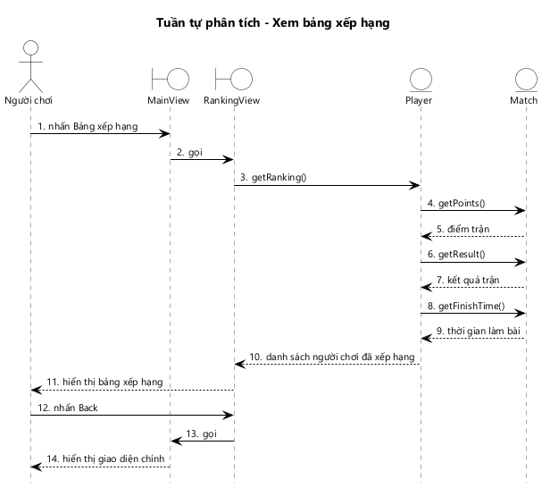
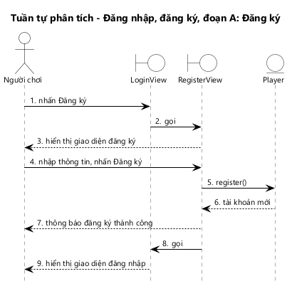
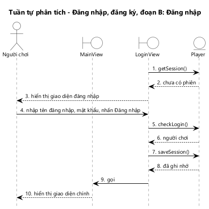

# KỊCH BẢN v2 VÀ BIỂU ĐỒ TUẦN TỰ PHA PHÂN TÍCH — CHƠI ONLINE, XEM BẢNG XẾP HẠNG, ĐĂNG NHẬP

---

## 1. Chức năng "Chơi online"

### 1.1. Đoạn A: Gửi lời thách đấu

1. MainView gọi hàm goOnline() của lớp Player để ghi người chơi vào danh sách online với trạng thái rỗi.
2. MainView gọi hàm getOnlinePlayers() của lớp Player.
3. Lớp Player trả về danh sách người chơi online, kèm tổng điểm và trạng thái, cho MainView.
4. MainView hiển thị tên, tổng điểm của người chơi và danh sách người chơi online.
5. Người chơi bấm vào tên một đối thủ đang rỗi trên MainView.
6. MainView gọi hàm sendChallenge() của lớp Challenge.
7. Lớp Challenge tạo lời mời đang chờ và trả về cho MainView.
8. MainView hiển thị thông báo đang chờ đối thủ trả lời.
9. MainView gọi hàm watchChallenge() của lớp Challenge để theo dõi lời mời.
10. Khi đối thủ đồng ý, lớp Challenge trả về lời mời đã được đồng ý, kèm trận đấu, cho MainView.
11. MainView gọi MatchView.

**Ngoại lệ 5a: Người chơi bấm vào một đối thủ đang bận.**

- 5a.1. MainView hiển thị thông báo đối thủ đang bận, không gọi sendChallenge().

**Ngoại lệ 10a: Đối thủ từ chối lời mời.**

- 10a.1. Lớp Challenge trả về lời mời đã bị từ chối cho MainView.
- 10a.2. MainView hiển thị thông báo đối thủ đã từ chối và giữ nguyên giao diện chính.

*Hình 8: Biểu đồ tuần tự pha phân tích chức năng Chơi online, đoạn A: Gửi lời thách đấu.*

- Biểu đồ có 11 thông điệp, khớp với 11 bước của kịch bản chuẩn.
- Hàm watchChallenge() ở bước 9 là lời đăng ký theo dõi: kết quả không trả về ngay mà trả về ở bước 10, khi đối thủ trả lời.
- Bước 10 xảy ra khi đối thủ đồng ý ở đoạn B, nên giữa bước 9 và bước 10 có một khoảng chờ.

### 1.2. Đoạn B: Nhận lời thách đấu

1. MainView gọi hàm watchChallenge() của lớp Challenge để nhận các lời mời gửi tới người chơi.
2. Khi có lời mời mới, lớp Challenge trả về lời mời cho MainView.
3. MainView hiển thị hộp thoại lời mời gồm tên và tổng điểm của người mời.
4. Người chơi nhấn Đồng ý.
5. MainView gọi hàm createMatch() của lớp Match.
6. Lớp Match gọi hàm generateProblem() của lớp MathProblem để sinh đề.
7. Lớp MathProblem trả về các câu hỏi của đề cho lớp Match.
8. Lớp Match tạo trận với đề vừa sinh, chuyển 2 người chơi sang trạng thái bận và trả về trận cho MainView.
9. MainView gọi MatchView.

**Ngoại lệ 4a: Người chơi từ chối lời mời.**

- 4a.1. Người chơi nhấn Từ chối.
- 4a.2. MainView gọi hàm rejectChallenge() của lớp Challenge.
- 4a.3. Lớp Challenge đánh dấu lời mời bị từ chối và trả về cho MainView.
- 4a.4. MainView đóng hộp thoại lời mời.

**Ngoại lệ 8a: Không tạo được trận.**

- 8a.1. Lớp Match trả về cho MainView: người mời không còn online hoặc đã bận.
- 8a.2. MainView hiển thị thông báo không bắt đầu được trận đấu.

*Hình 9: Biểu đồ tuần tự pha phân tích chức năng Chơi online, đoạn B: Nhận lời thách đấu.*

- Biểu đồ có 9 thông điệp, khớp với kịch bản chuẩn.
- Việc sinh đề nằm ở lớp thực thể (bước 6, 7). Cả 2 người chơi nhận đúng trận do lớp Match trả về, nên cùng một đề.

### 1.3. Đoạn C: Thi đấu

1. MatchView gọi hàm watchMatch() của lớp Match để theo dõi trận.
2. Lớp Match trả về trận đấu kèm đề bài cho MatchView.
3. MatchView hiển thị ô thời gian, trạng thái đối thủ, danh sách câu hỏi, nút Nộp bài và nút Thoát cho người chơi.
4. Người chơi chọn đáp án cho các câu hỏi và nhấn Nộp bài trên MatchView.
5. MatchView gọi hàm submitAnswers() của lớp Match.
6. Lớp Match gọi hàm isCorrect() của lớp MathProblem để chấm từng câu.
7. Lớp MathProblem trả kết quả chấm cho lớp Match.
8. Lớp Match lưu số câu đúng, thời điểm nộp bài và trả về trận cho MatchView.
9. MatchView hiển thị thông báo đã nộp bài, đang chờ đối thủ.
10. Khi đối thủ cũng nộp bài, lớp Match gọi hàm isOver() của chính nó để kiểm tra trận đã xong.
11. Lớp Match trả về trận đã kết thúc cho MatchView, theo lời đăng ký ở bước 1.
12. MatchView gọi MatchResultView.
13. MatchResultView gọi hàm getResult() của lớp Match.
14. Lớp Match trả về kết quả của người chơi cho MatchResultView.
15. MatchResultView gọi hàm getFinishTime() của lớp Match.
16. Lớp Match trả về thời gian làm bài của 2 người chơi cho MatchResultView.
17. MatchResultView gọi hàm getPoints() của lớp Match.
18. Lớp Match trả về điểm trận của người chơi cho MatchResultView.
19. MatchResultView hiển thị kết quả, số câu đúng, thời gian làm bài, điểm trận, tổng điểm và câu hỏi chơi tiếp cho người chơi.

**Ngoại lệ 4a: Hết thời gian mà người chơi chưa nộp bài.**

- 4a.1. MatchView tự gọi hàm submitAnswers() của lớp Match với các câu đã chọn; câu chưa chọn tính là sai. Kịch bản tiếp tục từ bước 6.

**Ngoại lệ 4b: Người chơi thoát trận.**

- 4b.1. Người chơi nhấn Thoát trên MatchView và xác nhận thoát.
- 4b.2. MatchView gọi hàm forfeit() của lớp Match.
- 4b.3. Lớp Match đánh dấu người chơi bỏ trận, kết thúc trận và trả về cho MatchView.
- 4b.4. MatchView gọi MainView.
- 4b.5. MainView hiển thị giao diện chính cho người chơi.

**Ngoại lệ 11a: Đối thủ bỏ trận.**

- 11a.1. Lớp Match trả về trận đã kết thúc do đối thủ bỏ trận cho MatchView.
- 11a.2. MatchView hiển thị thông báo đối thủ đã thoát. Kịch bản tiếp tục từ bước 12; MatchResultView không hiển thị lựa chọn chơi tiếp.

*Hình 10: Biểu đồ tuần tự pha phân tích chức năng Chơi online, đoạn C: Thi đấu.*

- Biểu đồ có 19 thông điệp.
- Chấm bài (bước 6, 7) và kiểm tra trận đã xong (bước 10) đều do lớp thực thể làm, giao diện không tự chấm.
- Bước 11 trả về theo lời đăng ký watchMatch() ở bước 1, khi đối thủ nộp bài.
- Kết quả, thời gian, điểm trận đều là thuộc tính dẫn xuất, được tính bằng getResult(), getFinishTime(), getPoints() (bước 13–18).

### 1.4. Đoạn D: Chơi tiếp

1. Người chơi nhấn Chơi tiếp trên MatchResultView.
2. MatchResultView gọi hàm continueMatch() của lớp Match.
3. Lớp Match ghi nhận lựa chọn chơi tiếp và trả về cho MatchResultView.
4. MatchResultView hiển thị thông báo đang chờ đối thủ.
5. MatchResultView gọi hàm watchMatch() của lớp Match để biết lựa chọn của đối thủ.
6. Khi đối thủ cũng chọn chơi tiếp, lớp Match gọi hàm generateProblem() của lớp MathProblem để sinh đề mới.
7. Lớp MathProblem trả về các câu hỏi của đề mới cho lớp Match.
8. Lớp Match tạo trận mới và trả về cho MatchResultView.
9. MatchResultView gọi MatchView.
10. MatchView hiển thị giao diện thi đấu với đề mới cho người chơi; trận tiếp theo diễn ra như đoạn C.

**Ngoại lệ 1a: Người chơi dừng chơi.**

- 1a.1. Người chơi nhấn Dừng trên MatchResultView.
- 1a.2. MatchResultView gọi hàm continueMatch() của lớp Match với lựa chọn dừng.
- 1a.3. Lớp Match ghi nhận, trả 2 người chơi về trạng thái rỗi và trả về cho MatchResultView.
- 1a.4. MatchResultView gọi MainView.
- 1a.5. MainView hiển thị giao diện chính cho người chơi.

**Ngoại lệ 3a: Đối thủ đã chọn chơi tiếp trước.**

- 3a.1. Lớp Match gọi hàm generateProblem() của lớp MathProblem để sinh đề mới, tạo trận mới và trả về ngay cho MatchResultView. Kịch bản tiếp tục từ bước 9.

**Ngoại lệ 8a: Đối thủ dừng chơi.**

- 8a.1. Lớp Match trả về trận đã dừng cho MatchResultView.
- 8a.2. MatchResultView hiển thị thông báo đối thủ đã dừng chơi.
- 8a.3. MatchResultView gọi MainView.
- 8a.4. MainView hiển thị giao diện chính cho người chơi.

*Hình 11: Biểu đồ tuần tự pha phân tích chức năng Chơi online, đoạn D: Chơi tiếp.*

- Biểu đồ có 10 thông điệp, vẽ cho người chọn chơi tiếp trước.
- Trận mới chỉ được tạo khi cả 2 người đã chọn chơi tiếp (bước 6–8). Người chọn sau đi theo ngoại lệ 3a.

---

## 2. Chức năng "Xem bảng xếp hạng"

1. Người chơi nhấn nút Bảng xếp hạng trên MainView.
2. MainView gọi RankingView.
3. RankingView gọi hàm getRanking() của lớp Player.
4. Lớp Player gọi hàm getPoints() của lớp Match cho từng trận đã kết thúc.
5. Lớp Match trả về điểm trận của người chơi cho lớp Player.
6. Lớp Player gọi hàm getResult() của lớp Match để biết các trận thắng.
7. Lớp Match trả về kết quả trận cho lớp Player.
8. Lớp Player gọi hàm getFinishTime() của lớp Match cho các trận thắng.
9. Lớp Match trả về thời gian làm bài cho lớp Player.
10. Lớp Player tính 3 tiêu chí, sắp xếp và trả danh sách người chơi cho RankingView.
11. RankingView hiển thị bảng xếp hạng cho người chơi.
12. Người chơi nhấn Back trên RankingView.
13. RankingView gọi MainView.
14. MainView hiển thị giao diện chính cho người chơi.

**Ngoại lệ 10a: Không lấy được bảng xếp hạng.**

- 10a.1. Lớp Player trả về lỗi cho RankingView.
- 10a.2. RankingView hiển thị thông báo không tải được bảng xếp hạng, danh sách để trống.

*Hình 12: Biểu đồ tuần tự pha phân tích chức năng Xem bảng xếp hạng.*

- Biểu đồ có 14 thông điệp.
- Lớp Player tính các tiêu chí dựa trên 3 phương thức của lớp Match (bước 4–9). Bảng xếp hạng vì vậy dùng đúng luật thắng thua của trận đấu.

---

## 3. Chức năng "Đăng nhập, đăng ký"

### 3.1. Đoạn A: Đăng ký

1. Người chơi nhấn nút Đăng ký trên LoginView.
2. LoginView gọi RegisterView.
3. RegisterView hiển thị giao diện đăng ký cho người chơi.
4. Người chơi nhập tên đăng nhập, mật khẩu, mật khẩu nhập lại, tên hiển thị và nhấn Đăng ký trên RegisterView.
5. RegisterView gọi hàm register() của lớp Player.
6. Lớp Player tạo tài khoản mới và trả về cho RegisterView.
7. RegisterView hiển thị thông báo đăng ký thành công cho người chơi.
8. RegisterView gọi LoginView.
9. LoginView hiển thị giao diện đăng nhập cho người chơi.

**Ngoại lệ 4a: Có ô bỏ trống hoặc mật khẩu nhập lại không khớp.**

- 4a.1. RegisterView hiển thị thông báo lỗi tương ứng, không gọi register().

**Ngoại lệ 6a: Tên đăng nhập đã được dùng.**

- 6a.1. Lớp Player trả về cho RegisterView: tên đăng nhập đã được dùng.
- 6a.2. RegisterView hiển thị thông báo tên đăng nhập đã được dùng.

*Hình 24: Biểu đồ tuần tự pha phân tích chức năng Đăng nhập, đăng ký, đoạn A: Đăng ký.*

- Biểu đồ có 9 thông điệp, khớp với kịch bản chuẩn.
- Kiểm tra ô trống và mật khẩu nhập lại nằm ở RegisterView; kiểm tra trùng tên đăng nhập nằm ở Player.

### 3.2. Đoạn B: Đăng nhập

1. Khi người chơi mở ứng dụng, LoginView gọi hàm getSession() của lớp Player để kiểm tra phiên đăng nhập đã ghi nhớ.
2. Lớp Player trả về cho LoginView: chưa có phiên đăng nhập.
3. LoginView hiển thị giao diện đăng nhập cho người chơi.
4. Người chơi nhập tên đăng nhập, mật khẩu và nhấn Đăng nhập trên LoginView.
5. LoginView gọi hàm checkLogin() của lớp Player.
6. Lớp Player kiểm tra tài khoản và trả về người chơi cho LoginView.
7. LoginView gọi hàm saveSession() của lớp Player để ghi nhớ phiên đăng nhập.
8. Lớp Player ghi nhớ phiên và trả về cho LoginView.
9. LoginView gọi MainView.
10. MainView hiển thị giao diện chính cho người chơi.

**Ngoại lệ 2a: Đã có phiên đăng nhập.**

- 2a.1. Lớp Player trả về người chơi đã ghi nhớ cho LoginView.
- 2a.2. LoginView gọi MainView. Kịch bản tiếp tục từ bước 10.

**Ngoại lệ 6a: Sai tên đăng nhập hoặc mật khẩu.**

- 6a.1. Lớp Player trả về cho LoginView: không có tài khoản phù hợp.
- 6a.2. LoginView hiển thị thông báo sai tên đăng nhập hoặc mật khẩu.

**Ngoại lệ 9a: Tài khoản là quản trị viên.**

- 9a.1. LoginView gọi giao diện quản lý người chơi thay cho MainView.

*Hình 25: Biểu đồ tuần tự pha phân tích chức năng Đăng nhập, đăng ký, đoạn B: Đăng nhập.*

- Biểu đồ có 10 thông điệp.
- Phiên đăng nhập được kiểm tra ngay khi mở ứng dụng (bước 1, 2), nên người đã đăng nhập không phải nhập lại.
