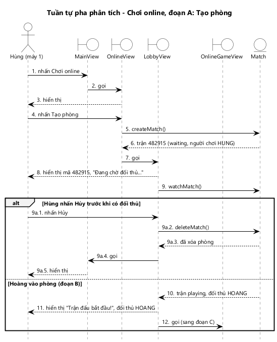
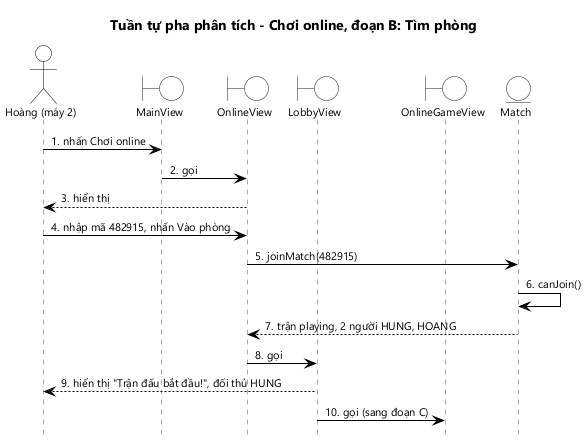
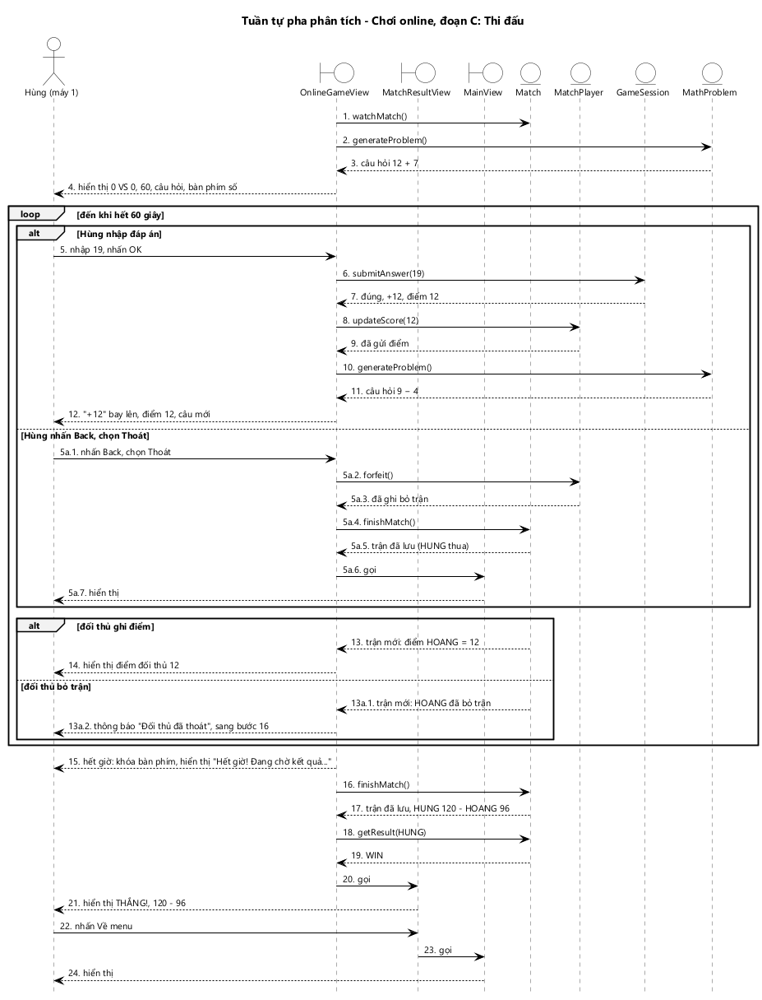
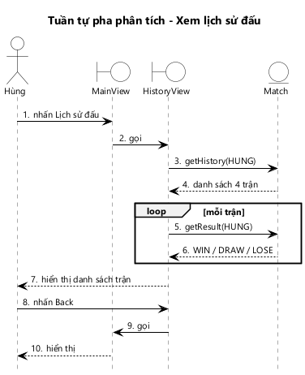

# KỊCH BẢN v2 VÀ BIỂU ĐỒ TUẦN TỰ PHA PHÂN TÍCH — CHƠI ONLINE, XEM LỊCH SỬ ĐẤU

> Issue: #41 [M3-05] · Người làm: Hùng · Người duyệt: Hoàng
> Bước A4 trong `REPORT_CONVENTION.md`. Đầu vào: kịch bản v1 (`1-kich-ban-v1.md`), biểu đồ lớp phân tích (`2-lop-phan-tich.md`).
> Trong báo cáo, phần này đặt ở **Phụ lục**.

Quy ước:
- Kịch bản v2 viết lại kịch bản chuẩn v1. **Mỗi bước là đúng một thông điệp** giữa Người chơi, lớp View và lớp thực thể.
- Biểu đồ tuần tự chỉ có 3 loại đối tượng: tác nhân, View (biên), thực thể. Số thứ tự trên mũi tên **trùng với số bước** của kịch bản.
- Ngoại lệ chính vẽ trong khung `alt`, đánh số theo bước rẽ nhánh (`9a.1`, `9a.2`…).
- Mọi phương thức trên biểu đồ đều có ở biểu đồ lớp phân tích (Hình 6, Hình 7).
- Chức năng "Chơi online" chia 3 đoạn như kịch bản v1: A. Tạo phòng, B. Tìm phòng, C. Thi đấu. Mỗi đoạn một biểu đồ và đánh số lại từ 1.

---

## 1. Chức năng "Chơi online" (UC05)

### 1.1. Đoạn A: Tạo phòng (Hùng, máy 1)

1. Hùng nhấn nút Chơi online trên `MainView`.
2. `MainView` gọi `OnlineView`.
3. `OnlineView` hiển thị cho Hùng: nút Tạo phòng, ô mã phòng, nút Vào phòng.
4. Hùng nhấn nút Tạo phòng trên `OnlineView`.
5. `OnlineView` gọi phương thức `createMatch()` của lớp `Match`.
6. Lớp `Match` tạo trận mã `482915` ở trạng thái `waiting`, người chơi thứ nhất là HUNG, rồi trả về cho `OnlineView`.
7. `OnlineView` gọi `LobbyView`.
8. `LobbyView` hiển thị cho Hùng mã phòng `482915` và trạng thái "Đang chờ đối thủ...".
9. `LobbyView` gọi phương thức `watchMatch()` của lớp `Match` để theo dõi trận.
10. Khi Hoàng vào phòng (đoạn B), lớp `Match` trả về cho `LobbyView` trận ở trạng thái `playing`, đối thủ HOANG.
11. `LobbyView` hiển thị cho Hùng "Trận đấu bắt đầu!" và đối thủ HOANG.
12. `LobbyView` gọi `OnlineGameView` (sang đoạn C).

**Ngoại lệ 9a: Hùng nhấn Hủy trước khi có đối thủ.**

- 9a.1. Hùng nhấn nút Hủy trên `LobbyView`.
- 9a.2. `LobbyView` gọi phương thức `deleteMatch()` của lớp `Match`.
- 9a.3. Lớp `Match` xóa phòng `482915` và trả về cho `LobbyView`.
- 9a.4. `LobbyView` gọi `MainView`.
- 9a.5. `MainView` hiển thị cho Hùng.

*Hình 8: Biểu đồ tuần tự pha phân tích chức năng Chơi online, đoạn A: Tạo phòng.*

- Biểu đồ có 12 thông điệp chính, khớp với 12 bước ở trên.
- `watchMatch()` (bước 9) là lời đăng ký theo dõi: kết quả không trả về ngay mà trả về ở bước 10, khi trận thay đổi.
- Trong lúc chờ, Hùng có thể nhấn Hủy. Khung `alt` thể hiện 2 khả năng loại trừ nhau: Hùng hủy phòng, hoặc Hoàng vào phòng.

### 1.2. Đoạn B: Tìm phòng (Hoàng, máy 2)

1. Hoàng nhấn nút Chơi online trên `MainView`.
2. `MainView` gọi `OnlineView`.
3. `OnlineView` hiển thị cho Hoàng: nút Tạo phòng, ô mã phòng, nút Vào phòng.
4. Hoàng nhập mã `482915` và nhấn nút Vào phòng trên `OnlineView`.
5. `OnlineView` gọi phương thức `joinMatch()` của lớp `Match` với mã `482915`.
6. Lớp `Match` gọi phương thức `canJoin()` của chính nó để kiểm tra trận `482915`: đang `waiting`, mới có 1 người, người đó không phải HOANG → đúng.
7. Lớp `Match` thêm HOANG vào trận, chuyển trận sang `playing`, rồi trả về cho `OnlineView`.
8. `OnlineView` gọi `LobbyView`.
9. `LobbyView` hiển thị cho Hoàng "Trận đấu bắt đầu!" và đối thủ HUNG.
10. `LobbyView` gọi `OnlineGameView` (sang đoạn C, diễn ra trên máy 2 giống máy 1).

**Ngoại lệ 7a: không có phòng `482915`, hoặc `canJoin()` sai (phòng đã đủ người, trận đã bắt đầu).**

- 7a.1. Lớp `Match` trả về cho `OnlineView`: không vào được.
- 7a.2. `OnlineView` hiển thị cho Hoàng thông báo "Không tìm thấy phòng" hoặc "Phòng đã đầy".

*Hình 9: Biểu đồ tuần tự pha phân tích chức năng Chơi online, đoạn B: Tìm phòng.*

- Biểu đồ có 10 thông điệp chính.
- Luật vào phòng nằm trong lớp thực thể `Match` (bước 6, thông điệp gọi chính nó), không nằm ở giao diện.
- Ngoại lệ "Mã phòng gồm 6 chữ số" xảy ra ngay trên `OnlineView` trước bước 5, không gọi thực thể nào nên không vẽ.

### 1.3. Đoạn C: Thi đấu (Hùng, máy 1)

1. `OnlineGameView` gọi phương thức `watchMatch()` của lớp `Match` để theo dõi điểm đối thủ.
2. `OnlineGameView` gọi phương thức `generateProblem()` của lớp `MathProblem`, dùng mã đồng bộ câu hỏi của trận và mức 1.
3. Lớp `MathProblem` trả về câu hỏi `12 + 7`.
4. `OnlineGameView` hiển thị cho Hùng: hàng điểm `0` VS `0`, đồng hồ `60`, câu hỏi `12 + 7 = ?` và bàn phím số.
5. Hùng bấm `1`, `9` rồi nhấn OK trên `OnlineGameView`. Việc bấm số và nút xóa chỉ thay đổi số đang nhập trên giao diện, không gọi thực thể nên không tách thành bước riêng.
6. `OnlineGameView` gọi phương thức `submitAnswer()` của lớp `GameSession` với đáp án `19`.
7. Lớp `GameSession` chấm đúng, cộng `12` điểm, trả về điểm mới `12` cho `OnlineGameView`.
8. `OnlineGameView` gọi phương thức `updateScore()` của lớp `MatchPlayer` với điểm `12`.
9. Lớp `MatchPlayer` ghi điểm mới để máy đối thủ thấy, rồi trả về cho `OnlineGameView`.
10. `OnlineGameView` gọi phương thức `generateProblem()` của lớp `MathProblem`.
11. Lớp `MathProblem` trả về câu hỏi tiếp theo `9 − 4`.
12. `OnlineGameView` cho chữ "+12" bay lên từ điểm của mình, hiển thị điểm `12`, xóa số đã nhập và hiện câu hỏi mới.
13. Khi Hoàng trả lời đúng, lớp `Match` trả về cho `OnlineGameView` trận mới với điểm HOANG = `12` (từ lời theo dõi ở bước 1).
14. `OnlineGameView` hiển thị cho Hùng điểm đối thủ `12`.

    *(Lặp lại các bước 5–14 cho đến khi hết 60 giây.)*
15. Hết 60 giây, `OnlineGameView` khóa bàn phím số và hiển thị cho Hùng "Hết giờ! Đang chờ kết quả..." ở chỗ đồng hồ.
16. `OnlineGameView` gọi phương thức `finishMatch()` của lớp `Match`.
17. Khi cả 2 máy đã hết giờ, lớp `Match` xác định trận đã xong, lưu trận vào lịch sử đấu, rồi trả về trận HUNG `120` – HOANG `96` cho `OnlineGameView`.
18. `OnlineGameView` gọi phương thức `getResult()` của lớp `Match` cho HUNG.
19. Lớp `Match` trả về `WIN`.
20. `OnlineGameView` gọi `MatchResultView`.
21. `MatchResultView` hiển thị cho Hùng "THẮNG!" và tỉ số `120 - 96`.
22. Hùng nhấn nút Về menu trên `MatchResultView`.
23. `MatchResultView` gọi `MainView`.
24. `MainView` hiển thị cho Hùng.

**Ngoại lệ 5a: Hùng thoát trận.**

- 5a.1. Hùng nhấn Back, hộp thoại "Thoát sẽ bị xử thua?" hiện lên, Hùng chọn Thoát.
- 5a.2. `OnlineGameView` gọi phương thức `forfeit()` của lớp `MatchPlayer`.
- 5a.3. Lớp `MatchPlayer` ghi HUNG đã bỏ trận, rồi trả về cho `OnlineGameView`.
- 5a.4. `OnlineGameView` gọi phương thức `finishMatch()` của lớp `Match`.
- 5a.5. Lớp `Match` lưu trận (HUNG thua vì bỏ trận) và trả về cho `OnlineGameView`.
- 5a.6. `OnlineGameView` gọi `MainView`.
- 5a.7. `MainView` hiển thị cho Hùng.

**Ngoại lệ 13a: đối thủ bỏ trận.**

- 13a.1. Lớp `Match` trả về cho `OnlineGameView` trận mới, trong đó HOANG đã bỏ trận.
- 13a.2. `OnlineGameView` hiển thị cho Hùng "Đối thủ đã thoát" rồi đi tiếp từ bước 16. Ở bước 19, `getResult()` trả về `WIN` dù điểm của Hùng thấp hơn.

*Hình 10: Biểu đồ tuần tự pha phân tích chức năng Chơi online, đoạn C: Thi đấu.*

- Biểu đồ có 24 thông điệp chính.
- Khung `loop` bao các bước 5–14, lặp đến khi hết 60 giây. Trong vòng lặp có 2 khung `alt`:
  - Hùng chọn đáp án, hoặc thoát trận.
  - Đối thủ ghi điểm, hoặc đối thủ bỏ trận.
- Chấm điểm thuộc `GameSession` (bước 6–7). Thắng thua thuộc `Match` (bước 18–19). Giao diện chỉ hiển thị.
- Hai máy chạy giống nhau; biểu đồ vẽ từ phía máy 1.

---

## 2. Chức năng "Xem lịch sử đấu" (UC06)

1. Hùng nhấn nút Lịch sử đấu trên `MainView`.
2. `MainView` gọi `HistoryView`.
3. `HistoryView` gọi phương thức `getHistory()` của lớp `Match` cho người chơi HUNG.
4. Lớp `Match` trả về cho `HistoryView` danh sách 4 trận đã kết thúc của HUNG, mới nhất trước.
5. Với mỗi trận, `HistoryView` gọi phương thức `getResult()` của lớp `Match` cho HUNG.
6. Lớp `Match` trả về kết quả: lần lượt `WIN`, `DRAW`, `LOSE`, `WIN`.
7. `HistoryView` hiển thị cho Hùng danh sách 4 trận: thời gian, đối thủ, tỉ số, kết quả có màu.
8. Hùng nhấn Back trên `HistoryView`.
9. `HistoryView` gọi `MainView`.
10. `MainView` hiển thị cho Hùng.

**Ngoại lệ 4a: Hùng chưa đấu trận nào.**

- 4a.1. Lớp `Match` trả về danh sách rỗng cho `HistoryView`.
- 4a.2. `HistoryView` hiển thị cho Hùng "Chưa có trận nào". Kịch bản đi tiếp từ bước 8.

*Hình 11: Biểu đồ tuần tự pha phân tích chức năng Xem lịch sử đấu.*

- Biểu đồ có 10 thông điệp chính.
- Bước 5–6 nằm trong khung `loop`, vì mỗi dòng của danh sách cần một kết quả.
- Kết quả không được lưu sẵn mà tính lại bằng `getResult()` (thuộc tính dẫn xuất D9).
