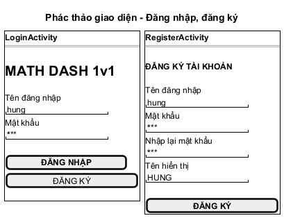
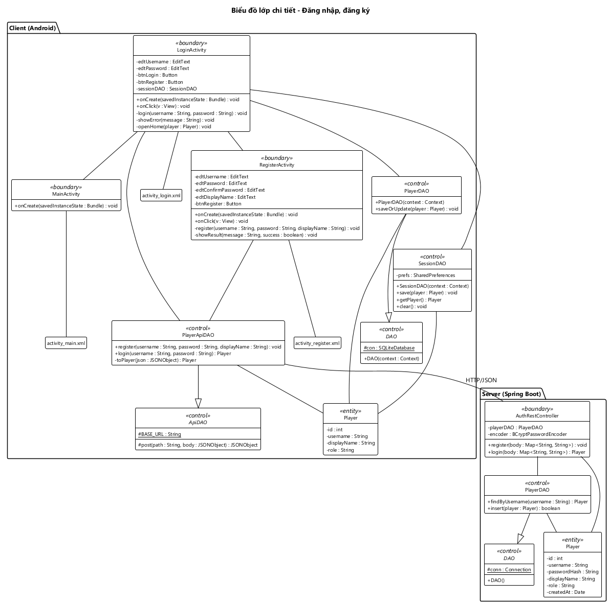

# THIẾT KẾ GIAO DIỆN VÀ BIỂU ĐỒ LỚP CHI TIẾT — CHƠI ONLINE, XEM BẢNG XẾP HẠNG, ĐĂNG NHẬP

---

## 0. Ánh xạ từ pha phân tích sang pha thiết kế

### 0.1. Lớp View sang Activity

| Lớp phân tích | Lớp thiết kế | Layout |
|---|---|---|
| MainView | MainActivity + PlayerAdapter | activity_main.xml, item_player.xml |
| MatchView | MatchActivity + QuestionAdapter | activity_match.xml, item_question.xml |
| MatchResultView | Overlay layoutResult nằm trong MatchActivity | activity_match.xml |
| RankingView | RankingActivity + RankingAdapter | activity_ranking.xml, item_ranking.xml |

MatchResultView là overlay chứ không phải Activity riêng:
- Kết quả hiện đè lên màn thi đấu ngay khi trận xong.
- Câu hỏi "Chơi tiếp?" cần tiếp tục theo dõi trận đang mở.

### 0.2. Phương thức của thực thể sang Activity hoặc DAO

| Phương thức pha phân tích | Lớp phân tích | Phương thức pha thiết kế | Lớp thiết kế |
|---|---|---|---|
| goOnline() | Player | goOnline(player : Player) : void | PresenceFirebaseDAO |
| getOnlinePlayers() | Player | watchOnlinePlayers(callback : PlayerListCallback) : void onPlayersChanged(players : List\<Player>) : void | PresenceFirebaseDAO MainActivity |
| sendChallenge() | Challenge | sendChallenge(challenger : Player, opponent : Player) : Challenge | ChallengeFirebaseDAO |
| watchChallenge() | Challenge | watchIncoming(playerId : int, callback : ChallengeCallback) : void watchChallenge(challengeId : String, callback : ChallengeCallback) : void onChallengeChanged(challenge : Challenge) : void | ChallengeFirebaseDAO ChallengeFirebaseDAO MainActivity |
| rejectChallenge() | Challenge | rejectChallenge(challengeId : String) : void | ChallengeFirebaseDAO |
| createMatch() | Match | createMatch(challenge : Challenge) : Match → create(challenge : Challenge) : Match readPresence(playerId : int) : Player, updateStatus(playerId : int, status : String) : void, updateChallenge(challengeId : String, status : String, matchId : int) : void, writeMatch(match : Match) : void insert(match : Match) : boolean | MatchApiDAO → MatchRestController FirebaseAdminDAO  MatchDAO |
| generateProblem() | MathProblem | generateProblems(count : int) : List\<MathProblem> generateProblem() : MathProblem | ProblemDAO (server) |
| watchMatch() | Match | watchMatch(matchId : int, callback : MatchCallback) : void onSuccess(match : Match) : void, onNextMatch(nextMatchId : int) : void, onStopped(playerId : int) : void | MatchFirebaseDAO MatchActivity |
| submitAnswers() | Match | submitAnswers() : void submit(matchId : int, playerId : int, answers : List\<Integer>) : Match → submit(id : int, matchPlayer : MatchPlayer) : Match findById(id : int) : Match, updateSubmission(matchId : int, matchPlayer : MatchPlayer) : boolean, updateEndedAt(matchId : int, endedAt : Date) : boolean writeSubmitted(matchId : int, playerId : int) : void, writeFinished(matchId : int) : void, updatePoints(playerId : int, totalPoints : double) : void | MatchActivity MatchApiDAO → MatchRestController MatchDAO  FirebaseAdminDAO |
| isCorrect() | MathProblem | countCorrect(answers : List\<Integer>) : int isCorrect(answer : int) : boolean | Match MathProblem |
| isOver(), getResult(), getFinishTime(), getPoints() | Match | Giữ nguyên, thêm tham số playerId : int cho 3 hàm sau | Match |
| forfeit() | Match | leaveMatch() : void forfeit(matchId : int, playerId : int) : Match → forfeit(id : int, playerId : int) : Match updateForfeit(matchId : int, playerId : int) : boolean, writeStopped(matchId : int, playerId : int) : void | MatchActivity MatchApiDAO → MatchRestController MatchDAO, FirebaseAdminDAO |
| continueMatch() | Match | sendChoice(choice : boolean) : void continueMatch(matchId : int, playerId : int, choice : boolean) : Match → continueMatch(id : int, playerId : int, choice : boolean) : Match writeChoice(matchId : int, playerId : int, choice : boolean) : void, writeNextMatch(matchId : int, nextMatchId : int) : void, writeStopped(matchId : int, playerId : int) : void | MatchActivity MatchApiDAO → MatchRestController FirebaseAdminDAO |
| register(), checkLogin() | Player | register(username : String, password : String, displayName : String) : void → register(body : Map\<String, String>) : void login(username : String, password : String) : Player → login(body : Map\<String, String>) : Player findByUsername(username : String) : Player, insert(player : Player) : boolean | PlayerApiDAO → AuthRestController  PlayerDAO (server) |
| saveSession(), getSession() | Player | save(player : Player) : void, getPlayer() : Player saveOrUpdate(player : Player) : void | SessionDAO PlayerDAO (app) |
| getRanking() | Player | getRanking() : List\<Player> → getRanking() : List\<Player> getRanking() : List\<Player>, findFinished() : List\<Match> | PlayerApiDAO → PlayerRestController PlayerDAO, MatchDAO |

### 0.3. Lớp DAO cha

Mỗi nơi lưu trữ có một lớp DAO cha giữ kết nối dùng chung; các DAO con kế thừa.

| Nơi lưu trữ | DAO cha | Giữ | DAO con dùng ở đây |
|---|---|---|---|
| App → Firebase | FirebaseDAO | con : DatabaseReference | PresenceFirebaseDAO, ChallengeFirebaseDAO, MatchFirebaseDAO |
| App → REST | ApiDAO | BASE_URL; gửi / nhận JSON | PlayerApiDAO, MatchApiDAO |
| Server → MySQL | DAO | conn : Connection | PlayerDAO, MatchDAO |

Các lớp không có lớp cha:
- SessionDAO chỉ đọc SharedPreferences.
- FirebaseAdminDAO gọi REST API của Firebase Realtime Database, không dùng JDBC nên không kế thừa DAO của server.
- ProblemDAO ở server chỉ sinh câu hỏi bằng Random, không kết nối nơi lưu trữ nào.

---

## 1. Chức năng "Chơi online"

### 1.1. Thiết kế giao diện

*Hình 13: Thiết kế giao diện chức năng Chơi online.*

Chức năng có 2 màn, 1 hộp thoại lời mời và 1 overlay, đi theo thứ tự MainActivity → hộp thoại lời mời trên máy người được mời → MatchActivity → overlay layoutResult.
- **Màn chính** chia 2 phần:
  - Trên cùng là thẻ thông tin của mình: tên, tổng điểm.
  - Bên dưới là danh sách người chơi online. Mỗi dòng có tên, tổng điểm và nhãn trạng thái: Rỗi nền xanh, Bận nền xám. Dòng Bận vẫn bấm được nhưng chỉ hiện thông báo.
- **Màn thi đấu** chia 3 tầng từ trên xuống:
  1. Hàng trên: ô thời gian đếm ngược bên trái, dòng trạng thái đối thủ bên phải.
  2. Danh sách 10 câu cuộn được. Mỗi câu là một thẻ gồm số thứ tự, phép tính chữ lớn, 4 phương án dạng RadioButton xếp thành một hàng ngang.
  3. Hàng dưới: nút Thoát nhỏ bên trái, nút Nộp bài lớn bên phải.
- **Overlay kết quả** che màn thi đấu. Bảng so sánh 2 cột (Bạn, đối thủ) giúp người chơi thấy vì sao thắng: đúng hết hay nhanh hơn.

**Bảng thành phần:**

| Màn | id trong layout | Loại View | Chức năng | Tên ở pha phân tích |
|---|---|---|---|---|
| MainActivity | txtMyName | TextView | Tên hiển thị của mình | outMyInfo |
| | txtMyPoints | TextView | "12,5 điểm" | outMyInfo |
| | rvPlayers | RecyclerView | Danh sách người chơi online, bấm được | outsubListPlayer |
| item_player.xml | txtName | TextView | Tên người chơi | một dòng của outsubListPlayer |
| | txtPoints | TextView | Tổng điểm | một dòng của outsubListPlayer |
| | txtStatus | TextView | Rỗi (xanh) / Bận (xám) | một dòng của outsubListPlayer |
| MatchActivity | txtTimer | TextView | Ô thời gian 01:00 → 00:00; nộp xong thì hiện "Đã nộp bài, đang chờ đối thủ..." | outTimer |
| | txtOpponentStatus | TextView | "HOANG đang làm bài" / "HOANG đã nộp bài" | outOpponentStatus |
| | rvQuestions | RecyclerView | Danh sách 10 câu hỏi | inoutListQuestion |
| | btnSubmit | Button | Nộp bài | subSubmit |
| | btnExit | Button | Thoát trận | subExit |
| item_question.xml | txtExpression | TextView | "1. 12 + 7 = ?" | một câu của inoutListQuestion |
| | rgOptions | RadioGroup | Nhóm 4 phương án, chỉ chọn được 1 | một câu của inoutListQuestion |
| | rbOptions | RadioButton[4] | 4 phương án | một câu của inoutListQuestion |
| Overlay layoutResult | txtResult | TextView | THẮNG! (xanh) / THUA! (đỏ) / HÒA! (vàng) | outResult |
| | txtMyResult | TextView | "Bạn: 10/10 câu đúng · 38,2 giây" | outMyResult |
| | txtOpponentResult | TextView | "HOANG: 10/10 câu đúng · 45,6 giây" | outOpponentResult |
| | txtPoints | TextView | "+1 điểm · Tổng điểm: 13,5" | outPoints |
| | btnContinue | Button | Chơi tiếp | subContinue |
| | btnStop | Button | Dừng; khi có người bỏ trận thì đổi thành Về menu | subStop |

Các thông báo ngắn ("MINH đang bận", "HOANG đã từ chối lời mời", "Đối thủ đã dừng chơi") dùng Toast. Hộp thoại lời mời, hộp thoại chờ trả lời và hộp thoại "Thoát sẽ bị xử thua?" dùng AlertDialog. Cả hai đều không phải thành phần của layout.

### 1.2. Biểu đồ lớp chi tiết

*Hình 14: Biểu đồ lớp chi tiết chức năng Chơi online.*

**Package "Client (Android)".**

| Loại | Lớp | Mô tả |
|---|---|---|
| Boundary | MainActivity | Màn chính, cài đặt PlayerListCallback và ChallengeCallback; giữ người chơi đang đăng nhập (me). - onCreate lấy me bằng SessionDAO.getPlayer, gọi PlayerApiDAO.getById trong Thread để có tổng điểm mới, rồi goOnline, watchOnlinePlayers, watchIncoming. - onPlayersChanged hiện thông tin của mình và đưa những người còn lại vào PlayerAdapter. - onPlayerClick: đối thủ bận thì hiện Toast; rỗi thì sendChallenge, watchChallenge và hiện hộp thoại chờ có nút Hủy. - onChallengeChanged: lời mời tới mình đang chờ thì showChallengeDialog; lời mình gửi được đồng ý thì openMatch(challenge.getMatchId()); bị từ chối thì hiện Toast.
- Đăng xuất gọi PresenceFirebaseDAO.goOffline để rời danh sách online. - acceptChallenge gọi MatchApiDAO.createMatch trong Thread, xong thì openMatch. Nút Từ chối gọi ChallengeFirebaseDAO.rejectChallenge |
| Boundary | PlayerAdapter, PlayerViewHolder | PlayerAdapter kế thừa RecyclerView.Adapter, giữ danh sách Player. setPlayers thay danh sách và vẽ lại. onClick của một dòng gọi MainActivity.onPlayerClick. PlayerViewHolder giữ 3 TextView của một dòng |
| Boundary | MatchActivity | Màn thi đấu, cài đặt MatchCallback; giữ me, mã trận (matchId), đồng hồ 60 giây (timer). - onCreate gọi MatchFirebaseDAO.watchMatch. Lần đầu nhận trận, onSuccess gọi startMatch: đưa đề vào QuestionAdapter, bật đồng hồ. - onTick vẽ thời gian; onFinish gọi submitAnswers. - submitAnswers lấy bài làm bằng QuestionAdapter.getAnswers, gọi MatchApiDAO.submit trong Thread, rồi khóa danh sách câu. - onSuccess các lần sau: đối thủ đã nộp thì showOpponentStatus; trận đã xong thì loadResult gọi MatchApiDAO.getById rồi showResult. - showResult dùng Match.getResult, getFinishTime, getPoints trên bản trận server trả về. - Nút Chơi tiếp / Dừng gọi sendChoice (MatchApiDAO.continueMatch). onNextMatch mở trận mới bằng openNextMatch; onStopped hiện Toast và về màn chính. - Nút Thoát và onBackPressed hỏi xác nhận rồi gọi leaveMatch (MatchApiDAO.forfeit).
- Cài đặt PlayerListCallback: khi trận đang đấu mà đối thủ biến khỏi danh sách online (mất kết nối), onPlayersChanged gọi forfeit(opponentId) thay cho đối thủ. Activity không tự chấm bài, không tự phân thắng thua |
| Boundary | QuestionAdapter, QuestionViewHolder | QuestionAdapter giữ danh sách MathProblem và mảng phương án đã chọn (answers). onBindViewHolder hiện getExpression và 4 phương án; onCheckedChanged lưu phương án vào answers. getAnswers trả bài làm, câu chưa chọn là −1. setLocked khóa mọi RadioButton sau khi nộp. QuestionViewHolder giữ txtExpression, rgOptions, rbOptions |
| Control | SessionDAO | getPlayer() đọc playerId, username, displayName từ SharedPreferences "session" và đóng gói thành Player |
| Control | FirebaseDAO ← PresenceFirebaseDAO | FirebaseDAO giữ con (gốc Realtime Database). PresenceFirebaseDAO đọc / ghi node presence: - goOnline ghi tên, tổng điểm, trạng thái free và đăng ký onDisconnect().removeValue(). - watchOnlinePlayers / stopWatching thêm / gỡ ValueEventListener. - toPlayer đóng gói một node thành Player |
| Control | FirebaseDAO ← ChallengeFirebaseDAO | Đọc / ghi node challenges: - sendChallenge tạo node bằng push(). - watchIncoming lọc lời mời có opponentId là mình và status pending. - watchChallenge theo dõi một lời mời đã gửi. - rejectChallenge ghi status rejected. - toChallenge đóng gói thành Challenge |
| Control | FirebaseDAO ← MatchFirebaseDAO | Chỉ đọc node matches/{matchId}. toMatch đóng gói thành Match kèm 10 MathProblem (không có đáp án) và 2 MatchPlayer. Khi node có nextMatchId thì gọi onNextMatch; có stoppedBy thì gọi onStopped |
| — | PlayerListCallback, ChallengeCallback, MatchCallback | Interface trả kết quả bất đồng bộ từ các FirebaseDAO về Activity |
| Control | ApiDAO ← PlayerApiDAO | getById gửi GET /api/players/{id}; toPlayer đóng gói JSON thành Player. Hàm chạy đồng bộ nên phải gọi trong Thread |
| Control | ApiDAO ← MatchApiDAO | ApiDAO giữ BASE_URL và các hàm gửi / nhận JSON bằng HttpURLConnection. MatchApiDAO có 5 hàm, mỗi hàm một API: - createMatch: POST /api/matches. - submit: POST /api/matches/{id}/submit. - forfeit: POST /api/matches/{id}/forfeit. - continueMatch: POST /api/matches/{id}/continue. - getById: GET /api/matches/{id}. toMatch đóng gói JSON trả về thành Match |
| Entity | Player, Challenge, Match, MatchPlayer, MathProblem | Như thiết kế lớp thực thể. Các phương thức nghiệp vụ là hàm Java thuần, có unit test: - MathProblem: isCorrect, getExpression. - Match: countCorrect, isOver, getFinishTime, getResult, getPoints |

**Package "Server (Spring Boot)".**

| Loại | Lớp | Mô tả |
|---|---|---|
| Boundary | PlayerRestController | getById(id) nhận GET /api/players/{id}: PlayerDAO.findById rồi gán tổng điểm bằng PlayerDAO.getTotalPoints |
| Boundary | MatchRestController | Trọng tài của mọi trận. Giữ waitingChoices: các trận đang có một người chọn chơi tiếp. - create(challenge) nhận POST /api/matches:   1. readChallengeStatus: lời mời đã bị hủy thì trả 409. readPresence của 2 người; một người không online hoặc đang bận thì trả 409 "Không bắt đầu được trận đấu".   2. startMatch: ProblemDAO.generateProblems(10), tạo Match, MatchDAO.insert, FirebaseAdminDAO.writeMatch, updateStatus busy cho 2 người.   3. updateChallenge accepted kèm id trận. - submit(id, matchPlayer):   1. Ghi thời điểm nhận, findById, chấm bằng Match.countCorrect, updateSubmission, writeSubmitted.   2. Nếu Match.isOver: endMatch (updateEndedAt, tính lại tổng điểm 2 người, updatePoints), rồi writeFinished. - forfeit(id, playerId): updateForfeit, endMatch, rồi mới writeStopped, writeFinished để máy đối thủ đọc được kết quả đã lưu; trả 2 người về free. - continueMatch(id, playerId, choice), synchronized:   - Dừng: writeStopped, 2 người về free.   - Chơi tiếp mà đối thủ chưa chọn: lưu vào waitingChoices, writeChoice.   - Đối thủ đã chọn chơi tiếp: startMatch rồi writeNextMatch. - getById(id): findById, gán tổng điểm cho 2 người chơi |
| Control | DAO ← PlayerDAO | DAO giữ conn : Connection (JDBC). - findById đọc tblPlayer. - getTotalPoints lấy các trận đã xong của người chơi rồi cộng Match.getPoints |
| Control | DAO ← MatchDAO | - insert ghi 1 dòng tblMatch, 10 dòng tblMathProblem, 2 dòng tblMatchPlayer trong một transaction, gán id vừa sinh. - findById đọc trận kèm đề và 2 người chơi. - updateSubmission ghi correctCount, submittedAt. - updateForfeit ghi forfeited. - updateEndedAt ghi endedAt |
| Control | ProblemDAO | Giữ random : Random. generateProblems gọi generateProblem 10 lần. Mỗi câu chọn toán tử +, −, ×, sinh 2 toán hạng, tính correctAnswer, sinh 3 phương án nhiễu gần đáp án rồi xáo trộn |
| Control | FirebaseAdminDAO | Giữ dbUrl, gọi REST API của Firebase: - readPresence gửi GET. - Các hàm write..., update... gửi PUT hoặc PATCH tới đúng node trong tài liệu CSDL mục 2 |
| Entity | Player, Challenge, Match, MatchPlayer, MathProblem | Cùng tên, cùng thuộc tính với phía app, để Jackson chuyển JSON thẳng vào đối tượng. Player ở server có thêm passwordHash, không bao giờ trả ra JSON. correctAnswer chỉ trả ra JSON khi trận đã xong |

**Quan hệ giữa các lớp giao diện:**
- MainActivity – MatchActivity nối nhau bằng quan hệ liên kết. MainActivity – PlayerAdapter – PlayerViewHolder và MatchActivity – QuestionAdapter – QuestionViewHolder cũng vậy.
- Mỗi lớp nối với layout của nó: activity_main.xml, item_player.xml, activity_match.xml, item_question.xml. Overlay kết quả nằm trong activity_match.xml.
- Kết tập:
  - MainActivity và MatchActivity chứa thông tin người chơi trong thuộc tính me, nên Player kết tập vào 2 Activity này.
  - PlayerAdapter chứa danh sách Player.
  - QuestionAdapter chứa danh sách MathProblem.

**Quan hệ liên kết HTTP/JSON** giữa 2 package có 2 cặp:
- MatchApiDAO – MatchRestController: trận đấu.
- PlayerApiDAO – PlayerRestController: tổng điểm.

Firebase không phải một lớp trên biểu đồ: các FirebaseDAO ở app và FirebaseAdminDAO ở server cùng đọc / ghi một cây dữ liệu, như mô tả trong tài liệu CSDL mục 2.

---

## 2. Chức năng "Xem bảng xếp hạng"

### 2.1. Thiết kế giao diện

*Hình 15: Thiết kế giao diện chức năng Xem bảng xếp hạng.*

Màn Bảng xếp hạng là một danh sách cuộn, mỗi dòng là một item_ranking.xml.
- Hàng tiêu đề cột cố định ở trên.
- Dòng của người xem có nền màu nhấn, để thấy ngay hạng của mình.

**Bảng thành phần:**

| Màn | id trong layout | Loại View | Chức năng | Tên ở pha phân tích |
|---|---|---|---|---|
| MainActivity | txtMyName, txtMyPoints | TextView | "HUNG · 13,5 điểm" | outMyInfo |
| | btnRanking | Button | Mở màn Bảng xếp hạng | subRanking |
| RankingActivity | rvRanking | RecyclerView | Danh sách đã xếp hạng | outListRanking |
| item_ranking.xml | txtRank | TextView | Hạng | một dòng của outListRanking |
| | txtName | TextView | Tên | một dòng của outListRanking |
| | txtPoints | TextView | Tổng điểm | một dòng của outListRanking |
| | txtAvgOpponent | TextView | Trung bình điểm đối thủ | một dòng của outListRanking |
| | txtAvgWinTime | TextView | Trung bình thời gian thắng, "—" nếu chưa thắng | một dòng của outListRanking |

### 2.2. Biểu đồ lớp chi tiết

*Hình 16: Biểu đồ lớp chi tiết chức năng Xem bảng xếp hạng.*

**Package "Client (Android)".**

| Loại | Lớp | Mô tả |
|---|---|---|
| Boundary | MainActivity | onClick của nút Bảng xếp hạng mở RankingActivity |
| Boundary | RankingActivity | onCreate lấy người chơi bằng SessionDAO.getPlayer rồi gọi loadRanking. loadRanking gọi PlayerApiDAO.getRanking trong Thread, rồi trong runOnUiThread gắn RankingAdapter. Lỗi mạng thì hiện Toast |
| Boundary | RankingAdapter, RankingViewHolder | RankingAdapter giữ danh sách Player và id của người xem. onBindViewHolder hiện hạng bằng vị trí + 1, 3 tiêu chí của Player, tô nền dòng có id trùng người xem. RankingViewHolder giữ 5 TextView của một dòng |
| Control | SessionDAO | Như ở Chơi online |
| Control | ApiDAO ← PlayerApiDAO | getRanking gửi GET /api/players/ranking, đóng gói từng phần tử JSON thành Player bằng toPlayer |
| Entity | Player | Mang 3 tiêu chí totalPoints, avgOpponentPoints, avgWinTime do server tính |

**Package "Server (Spring Boot)".**

| Loại | Lớp | Mô tả |
|---|---|---|
| Boundary | PlayerRestController | getRanking() nhận GET /api/players/ranking, gọi PlayerDAO.getRanking và trả danh sách Player dạng JSON |
| Control | DAO ← PlayerDAO | getRanking đọc mọi tblPlayer có role = player, lấy các trận đã xong bằng MatchDAO.findFinished, rồi gọi rank. rank là hàm tĩnh thuần, có unit test: 1. Đọc người chơi. 2. Duyệt các trận. 3. Cộng Match.getPoints vào tổng điểm từng người; ghi lại các đối thủ đã gặp; với trận Match.getResult là WIN thì cộng Match.getFinishTime. 4. Tính 2 giá trị trung bình rồi sắp xếp theo 3 tiêu chí |
| Control | DAO ← MatchDAO | findFinished truy vấn tblMatch có endedAt khác rỗng, JOIN tblMatchPlayer, tblPlayer, đóng gói mỗi trận thành 1 Match + 2 MatchPlayer + 2 Player. Không cần đề nên không đọc tblMathProblem |
| Entity | Player, Match, MatchPlayer | Như ở Chơi online |

**Quan hệ giữa các lớp giao diện:**
- MainActivity – RankingActivity – RankingAdapter – RankingViewHolder nối nhau bằng quan hệ liên kết.
- Layout: MainActivity – activity_main.xml, RankingActivity – activity_ranking.xml, RankingViewHolder – item_ranking.xml.
- RankingAdapter chứa danh sách người chơi trong thuộc tính listPlayer, nên Player kết tập vào RankingAdapter, bội số n ở phía Player.

Chức năng dùng lại các lớp PlayerApiDAO, PlayerRestController, PlayerDAO, MatchDAO với Chơi online. Biểu đồ chỉ vẽ các phương thức chức năng này dùng.

---

## 3. Chức năng "Đăng nhập, đăng ký"

### 3.1. Thiết kế giao diện

*Hình 26: Thiết kế giao diện chức năng Đăng nhập, đăng ký.*

Chức năng có 2 màn: LoginActivity là màn mở đầu của ứng dụng; RegisterActivity mở từ nút Đăng ký và tự đóng khi đăng ký thành công. Ô mật khẩu dùng inputType textPassword.

**Bảng thành phần:**

| Màn | id trong layout | Loại View | Chức năng | Tên ở pha phân tích |
|---|---|---|---|---|
| LoginActivity | edtUsername | EditText | Tên đăng nhập | inUsername |
| | edtPassword | EditText (textPassword) | Mật khẩu | inPassword |
| | btnLogin | Button | Đăng nhập | subLogin |
| | btnRegister | Button | Mở màn Đăng ký | subRegister |
| RegisterActivity | edtUsername | EditText | Tên đăng nhập | inUsername |
| | edtPassword | EditText (textPassword) | Mật khẩu | inPassword |
| | edtConfirmPassword | EditText (textPassword) | Nhập lại mật khẩu | inConfirmPassword |
| | edtDisplayName | EditText | Tên hiển thị | inDisplayName |
| | btnRegister | Button | Đăng ký | subRegister |

### 3.2. Biểu đồ lớp chi tiết

*Hình 27: Biểu đồ lớp chi tiết chức năng Đăng nhập, đăng ký.*

**Package "Client (Android)".**

| Loại | Lớp | Mô tả |
|---|---|---|
| Boundary | LoginActivity | onCreate: SessionDAO.getPlayer khác rỗng thì gọi openHome ngay. onClick: nút Đăng ký mở RegisterActivity; nút Đăng nhập kiểm tra 2 ô rồi gọi login. login gọi PlayerApiDAO.login trong Thread, lưu phiên bằng SessionDAO.save, lưu bản sao bằng PlayerDAO.saveOrUpdate, rồi openHome. openHome mở AdminActivity nếu role là admin, ngược lại mở MainActivity |
| Boundary | RegisterActivity | onClick kiểm tra ô trống và mật khẩu nhập lại ngay ở app, đúng thì gọi register. register gọi PlayerApiDAO.register trong Thread; showResult hiện thông báo, thành công thì finish |
| Control | SessionDAO | Đọc / ghi / xóa SharedPreferences "session" |
| Control | DAO ← PlayerDAO | PlayerDAO phía app ghi bản sao người chơi vào tblPlayer của SQLite, để Chơi với máy chạy được khi mất mạng |
| Control | ApiDAO ← PlayerApiDAO | register gửi POST /api/auth/register; login gửi POST /api/auth/login và đóng gói JSON thành Player bằng toPlayer. Lỗi 401, 409 chuyển thành thông báo tiếng Việt |
| Entity | Player | id, username, displayName, role. App không bao giờ giữ mật khẩu |

**Package "Server (Spring Boot)".**

| Loại | Lớp | Mô tả |
|---|---|---|
| Boundary | AuthRestController | register băm mật khẩu bằng BCryptPasswordEncoder rồi gọi PlayerDAO.insert; trùng tên đăng nhập thì trả 409. login gọi PlayerDAO.findByUsername và so mật khẩu bằng BCrypt; sai thì trả 401 |
| Control | DAO ← PlayerDAO | findByUsername đọc tblPlayer theo username; insert thêm dòng mới với role = player, trả false nếu trùng khóa duy nhất |
| Entity | Player | Có passwordHash, không trả ra JSON |

**Quan hệ giữa các lớp giao diện:** LoginActivity – RegisterActivity, LoginActivity – MainActivity nối bằng liên kết; mỗi Activity nối với layout của nó. Đường HTTP/JSON duy nhất là PlayerApiDAO – AuthRestController.
