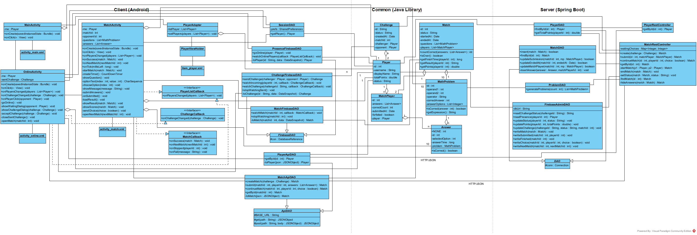
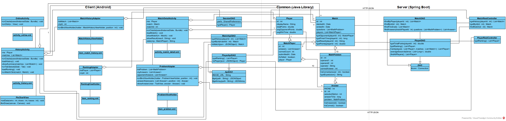

# THIẾT KẾ GIAO DIỆN VÀ BIỂU ĐỒ LỚP CHI TIẾT — CHƠI ONLINE, XEM LỊCH SỬ ĐẤU

---

## 0. Ánh xạ từ pha phân tích sang pha thiết kế

### 0.1. Lớp View sang Activity

| Lớp phân tích | Lớp thiết kế | Layout |
|---|---|---|
| MainView | MainActivity | activity_main.xml |
| OnlineView | OnlineActivity + PlayerAdapter | activity_online.xml, item_player.xml |
| MatchView | MatchActivity | activity_match.xml |
| MatchResultView | Overlay layoutResult nằm trong MatchActivity | activity_match.xml |
| HistoryView | HistoryActivity + PieChartView + MatchHistoryAdapter + RankingAdapter | activity_history.xml, item_match_history.xml, item_ranking.xml |
| MatchDetailView | MatchDetailActivity + ProblemAdapter | activity_match_detail.xml, item_problem.xml |

OnlineView là Activity riêng, tách khỏi giao diện chính:
- Người chơi chỉ online khi đang ở OnlineActivity hoặc một màn mở từ đó: onCreate gọi goOnline ghi node presence, onDestroy gọi goOffline xóa node. Nhấn Back về MainActivity là offline, nên người đang ở giao diện chính hay đang chơi với máy không hiện trong danh sách online và không bị thách đấu.
- Lời mời thách đấu cũng chỉ được theo dõi trong OnlineActivity.

MatchView hiện mỗi lần một câu nên không cần Adapter: 4 ô phương án là 4 Button cố định trong layoutOptions, gom thành mảng btnOptions; sang câu sau chỉ đổi chữ trên 4 ô.

MatchResultView là overlay chứ không phải Activity riêng:
- Kết quả hiện đè lên màn thi đấu ngay khi trận xong.
- Câu hỏi "Chơi tiếp?" cần tiếp tục theo dõi trận đang mở.

HistoryView là một Activity có 2 thẻ (TabLayout):
- Thẻ Trận của tôi gồm PieChartView và danh sách rvMatches; thẻ Bảng xếp hạng là danh sách rvRanking. Chọn thẻ chỉ ẩn / hiện 2 khối này, không mở Activity mới.
- Nút Lịch sử đấu và nút Bảng xếp hạng của OnlineView cùng mở HistoryActivity. Nút Bảng xếp hạng gửi kèm EXTRA_TAB = TAB_RANKING trong Intent để chọn sẵn thẻ Bảng xếp hạng.
- PieChartView là View tự vẽ biểu đồ tròn bằng Canvas, không dùng thư viện ngoài.

### 0.2. Phương thức của thực thể sang Activity hoặc DAO

| Phương thức pha phân tích | Lớp phân tích | Phương thức pha thiết kế | Lớp thiết kế |
|---|---|---|---|
| goOnline() | Player | goOnline(player : Player) : void | PresenceFirebaseDAO |
| getOnlinePlayers() | Player | watchOnlinePlayers(callback : PlayerListCallback) : void onPlayersChanged(players : List\<Player>) : void | PresenceFirebaseDAO OnlineActivity |
| sendChallenge() | Challenge | onPlayerClick(opponent : Player) : void sendChallenge(challenger : Player, opponent : Player) : Challenge | OnlineActivity ChallengeFirebaseDAO |
| watchChallenge() | Challenge | watchIncoming(playerId : int, callback : ChallengeCallback) : void watchChallenge(challengeId : String, callback : ChallengeCallback) : void onChallengeChanged(challenge : Challenge) : void | ChallengeFirebaseDAO ChallengeFirebaseDAO OnlineActivity |
| rejectChallenge() | Challenge | rejectChallenge(challengeId : String) : void | ChallengeFirebaseDAO |
| createMatch() | Match | createMatch(challenge : Challenge) : Match → create(challenge : Challenge) : Match readPresence(playerId : int) : Player, updateStatus(playerId : int, status : String) : void, updateChallenge(challengeId : String, status : String, matchId : int) : void, writeMatch(match : Match) : void insert(match : Match) : boolean | MatchApiDAO → MatchRestController FirebaseAdminDAO  MatchDAO |
| generateProblem() | MathProblem | generateProblems(count : int) : List\<MathProblem> generateProblem() : MathProblem | ProblemDAO (server) |
| watchMatch() | Match | watchMatch(matchId : int, callback : MatchCallback) : void onSuccess(match : Match) : void, onNextMatch(nextMatchId : int) : void, onStopped(playerId : int) : void | MatchFirebaseDAO MatchActivity |
| submitAnswers() | Match | chooseOption(index : int) : void, submitAnswers() : void submit(matchId : int, playerId : int, answers : List\<Answer>) : Match → submit(id : int, matchPlayer : MatchPlayer) : Match findById(id : int) : Match, updateSubmission(matchId : int, mp : MatchPlayer) : boolean, updateEndedAt(matchId : int, endedAt : Date) : boolean writeSubmitted(matchId : int, playerId : int) : void, writeFinished(matchId : int) : void, updatePoints(playerId : int, totalPoints : double) : void | MatchActivity MatchApiDAO → MatchRestController MatchDAO  FirebaseAdminDAO |
| isCorrect() | Answer | countCorrect(answers : List\<Answer>) : int isCorrect() : boolean isCorrect(answer : int) : boolean | Match Answer MathProblem |
| isOver(), getResult(), getFinishTime(), getPoints() | Match | Giữ nguyên, thêm tham số playerId : int cho 3 hàm sau | Match |
| forfeit() | Match | leaveMatch() : void forfeit(matchId : int, playerId : int) : Match → forfeit(id : int, playerId : int) : Match updateForfeit(matchId : int, playerId : int) : boolean, writeStopped(matchId : int, playerId : int) : void | MatchActivity MatchApiDAO → MatchRestController MatchDAO, FirebaseAdminDAO |
| continueMatch() | Match | sendChoice(choice : boolean) : void continueMatch(matchId : int, playerId : int, choice : boolean) : Match → continueMatch(id : int, playerId : int, choice : boolean) : Match writeChoice(matchId : int, playerId : int, choice : boolean) : void, writeNextMatch(matchId : int, nextMatchId : int) : void, writeStopped(matchId : int, playerId : int) : void | MatchActivity MatchApiDAO → MatchRestController FirebaseAdminDAO |
| getHistory() | Match | getHistory(playerId : int) : List\<Match> → getHistory(playerId : int) : List\<Match> findByPlayer(playerId : int) : List\<Match> | MatchApiDAO → MatchRestController MatchDAO |
| getMatch() | Match | getById(matchId : int) : Match → getById(id : int) : Match findById(id : int) : Match, findAnswers(matchPlayerId : int, questions : List\<MathProblem>) : List\<Answer>, getTotalPoints(playerId : int) : double | MatchApiDAO → MatchRestController MatchDAO, PlayerDAO |
| getOpponent() | Match | getOpponent(playerId : int) : MatchPlayer | Match |
| isCorrect() | Answer | isCorrect() : boolean, isAnswered() : boolean showAnswer(view : TextView, answer : Answer) : void | Answer ProblemAdapter |
| getResult(), getPoints(), getFinishTime() | Match | Giữ nguyên như ở Chơi online | Match |
| getRanking() | Player | getRanking() : List\<Player> → getRanking() : List\<Player> getRanking() : List\<Player>, rank(players : List\<Player>, matches : List\<Match>) : List\<Player>, findFinished() : List\<Match> | PlayerApiDAO → PlayerRestController PlayerDAO, MatchDAO |
| Đếm thắng / hòa / thua của HistoryView | HistoryView | showSummary(matches : List\<Match>) : void setData(wins : int, draws : int, losses : int) : void | HistoryActivity PieChartView |

Ghi phương án đã chọn và thời gian làm từng câu là xử lý của giao diện: chooseOption của MatchActivity ghi vào một Answer, không phải phương thức của thực thể. Answer chỉ giữ bài làm một câu và luật isCorrect; luật so phương án với đáp án vẫn nằm ở MathProblem.isCorrect.

### 0.3. Lớp DAO cha

Mỗi nơi lưu trữ có một lớp DAO cha giữ kết nối dùng chung; các DAO con kế thừa.

| Nơi lưu trữ | DAO cha | Giữ | DAO con dùng ở đây |
|---|---|---|---|
| App → Firebase | FirebaseDAO | con : DatabaseReference | PresenceFirebaseDAO, ChallengeFirebaseDAO, MatchFirebaseDAO |
| App → REST | ApiDAO | BASE_URL; gửi / nhận JSON | PlayerApiDAO, MatchApiDAO |
| Server → MySQL | DAO | conn : Connection | PlayerDAO, MatchDAO |

ApiDAO có 2 hàm gửi yêu cầu dùng ở đây: get và post.

Các lớp không có lớp cha:
- SessionDAO chỉ đọc SharedPreferences.
- FirebaseAdminDAO gọi REST API của Firebase Realtime Database, không dùng JDBC nên không kế thừa DAO của server.
- ProblemDAO ở server chỉ sinh câu hỏi bằng Random, không kết nối nơi lưu trữ nào.

---

## 1. Chức năng "Chơi online"

### 1.1. Thiết kế giao diện

*Hình 15: Thiết kế giao diện chức năng Chơi online.*

Chức năng có 3 màn, 1 hộp thoại lời mời và 1 overlay, đi theo thứ tự MainActivity → OnlineActivity → hộp thoại lời mời trên máy người được mời → MatchActivity → overlay layoutResult.
- **Màn chính** chỉ để chọn chế độ chơi: chữ MATH DASH, lời chào "Xin chào, HUNG", 2 nút lớn Chơi với máy và Chơi online. Góc phải thanh trên là nút biểu tượng đăng xuất.
- **Màn Chơi online** chia 3 phần từ trên xuống:
  1. Thanh trên: tiêu đề CHƠI ONLINE căn trái; góc phải có 3 nút biểu tượng Bạn bè, Lịch sử đấu, Bảng xếp hạng.
  2. Thẻ thông tin của mình: tên, tổng điểm.
  3. Danh sách người chơi online. Mỗi dòng có tên, tổng điểm và nhãn trạng thái: Rỗi chữ xanh, Bận chữ xám. Dòng Bận vẫn bấm được nhưng chỉ hiện thông báo. Không có ai khác online thì hiện "Chưa có ai khác online".
- **Màn thi đấu** hiện mỗi lần một câu, chia 4 tầng từ trên xuống:
  1. Hàng trên: ô thời gian đếm ngược bên trái, dòng trạng thái đối thủ bên phải.
  2. Thẻ câu hỏi: dòng "Câu 3/10" và phép tính chữ lớn "12 + 7 = ?".
  3. 4 ô phương án lớn xếp 2 x 2, mỗi ô một màu: A đỏ, B xanh dương, C vàng, D xanh lá. Trong ô, chữ cái nhỏ ở trên, giá trị phương án lớn ở dưới. Bấm một ô là chọn và sang câu sau: ô vừa chọn giữ nguyên, 3 ô còn lại mờ đi trong 0,2 giây. App không biết đáp án nên không báo đúng / sai ngay.
  4. Hàng dưới: nút Thoát; nút Nộp bài chỉ hiện khi đã làm xong 10 câu.
- Làm xong 10 câu, hết giờ, đang nộp hay đã nộp thì 4 ô và phép tính ẩn đi, thẻ câu hỏi chỉ còn một dòng thông báo: "Đã làm xong 10 câu", "Hết giờ", "Đang nộp bài...", "Đã nộp bài, đang chờ đối thủ...".
- **Overlay kết quả** che màn thi đấu. Bảng so sánh 2 cột (Bạn, đối thủ) giúp người chơi thấy vì sao thắng: đúng hết hay nhanh hơn.

Thanh trên của các màn Chơi online, Lịch sử đấu, Chi tiết trận cùng một kiểu: tiêu đề chữ lớn căn trái, các nút biểu tượng đặt ở góc phải.

**Bảng thành phần:**

| Màn | id trong layout | Loại View | Chức năng | Tên ở pha phân tích |
|---|---|---|---|---|
| MainActivity | txtMyName | TextView | "Xin chào, HUNG" | |
| | btnPlayOnline | Button | Mở màn Chơi online | subPlayOnline |
| OnlineActivity | txtMyName | TextView | Tên hiển thị của mình | outMyInfo |
| | txtMyPoints | TextView | "12,5 điểm" | outMyInfo |
| | rvPlayers | RecyclerView | Danh sách người chơi online, bấm một dòng để thách đấu | outsubListPlayer |
| | txtEmpty | TextView | "Chưa có ai khác online"; chỉ hiện khi danh sách rỗng | outsubListPlayer |
| | btnFriends | ImageButton | Biểu tượng hai người, mở giao diện bạn bè; contentDescription "Bạn bè" | subFriends |
| item_player.xml | txtName | TextView | Tên người chơi | một dòng của outsubListPlayer |
| | txtPoints | TextView | Tổng điểm | một dòng của outsubListPlayer |
| | txtStatus | TextView | Rỗi (xanh) / Bận (xám) | một dòng của outsubListPlayer |
| MatchActivity | txtTimer | TextView | Ô thời gian 01:00 → 00:00 | outTimer |
| | txtOpponentStatus | TextView | "HOANG đang làm bài" / "HOANG đã nộp bài" | outOpponentStatus |
| | txtProgress | TextView | "Câu 3/10"; làm xong, hết giờ, đang nộp, đã nộp thì hiện thông báo tương ứng | outQuestion |
| | txtExpression | TextView | Phép tính chữ lớn "12 + 7 = ?" | outQuestion |
| | layoutOptions | LinearLayout | Khung xếp 4 ô 2 x 2, ẩn khi thẻ câu hỏi hiện thông báo | subOptions |
| | btnOptionA, btnOptionB, btnOptionC, btnOptionD | Button | 4 ô phương án "A 17", "B 19", "C 21", "D 18"; trong code gom thành mảng btnOptions : Button[4] | subOptions |
| | btnSubmit | Button | Nộp bài; ẩn lúc đầu, hiện khi đã làm xong 10 câu hoặc khi nộp lỗi để nộp lại | subSubmit |
| | btnExit | Button | Thoát trận | subExit |
| Overlay layoutResult | txtResult | TextView | THẮNG! (xanh) / THUA! (đỏ) / HÒA! (vàng) | outResult |
| | txtMyResult | TextView | "Bạn: 10/10 câu đúng · 38,2 giây" | outMyResult |
| | txtOpponentResult | TextView | "HOANG: 10/10 câu đúng · 45,6 giây" | outOpponentResult |
| | txtPoints | TextView | "+1 điểm · Tổng điểm: 13,5" | outPoints |
| | btnContinue | Button | Chơi tiếp | subContinue |
| | btnStop | Button | Dừng; khi có người bỏ trận thì đổi thành Về menu | subStop |

Các thông báo ngắn ("MINH đang bận", "HOANG đã từ chối lời mời", "Đối thủ đã dừng chơi") dùng Toast. Hộp thoại lời mời, hộp thoại chờ trả lời và hộp thoại "Thoát sẽ bị xử thua?" dùng AlertDialog. Cả hai đều không phải thành phần của layout.

### 1.2. Biểu đồ lớp chi tiết

*Hình 16: Biểu đồ lớp chi tiết chức năng Chơi online.*

Biểu đồ chia 3 package: Client (Android) bên trái, Common (Java Library) ở giữa, Server (Spring Boot) bên phải. Package Common là thư viện mathdash-common.jar chứa các lớp thực thể; DAO của app và DAO của server cùng dùng một bộ thực thể này. Mỗi lớp chỉ ghi thuộc tính cốt lõi và các phương thức có trong kịch bản; các View con, biến tạm, cờ trạng thái và hàm override của Android như onDestroy, onCreateViewHolder, getItemCount nằm trong mã nguồn.

**Package "Client (Android)".**

| Loại | Lớp | Mô tả |
|---|---|---|
| Boundary | MainActivity | Màn chính, cài đặt View.OnClickListener. Giữ người chơi đang đăng nhập (me) để ghi lời chào vào txtMyName. onClick của btnPlayOnline mở OnlineActivity; btnPlayBot mở DifficultyActivity của chức năng Chơi với máy; btnLogout gọi logout: SessionDAO.clear rồi mở LoginActivity |
| Boundary | OnlineActivity | Màn Chơi online, cài đặt View.OnClickListener, PlayerListCallback và ChallengeCallback. Giữ người chơi đang đăng nhập (me), lời mời mình đã gửi và đang chờ trả lời (sentChallenge), id các lời mời tới mình đã hiện hộp thoại (shownChallenges), hộp thoại chờ (waitingDialog). - onCreate gọi bindViews, lấy me bằng SessionDAO.getPlayer, gọi watchOnlinePlayers và watchIncoming truyền chính nó (this) làm callback, rồi gọi goOnline. - goOnline gọi PlayerApiDAO.getById trong Thread để có tổng điểm mới, xong thì gọi PresenceFirebaseDAO.goOnline. - onPlayersChanged hiện thông tin của mình, đưa những người còn lại vào PlayerAdapter, danh sách rỗng thì hiện txtEmpty. - onPlayerClick: đối thủ bận thì hiện Toast; đã có sentChallenge thì bỏ qua; ngược lại sendChallenge, watchChallenge rồi showWaitingDialog hiện hộp thoại chờ có nút Hủy. - onChallengeChanged: lời mời tới mình chưa có trong shownChallenges thì showChallengeDialog; lời mình gửi được đồng ý thì closeSentChallenge rồi openMatch(challenge.getMatchId()); bị từ chối thì closeSentChallenge và hiện Toast. - closeSentChallenge gọi ChallengeFirebaseDAO.stopWatchingSent, xóa sentChallenge và đóng hộp thoại chờ. - acceptChallenge gọi MatchApiDAO.createMatch trong Thread, xong thì openMatch. Nút Từ chối gọi ChallengeFirebaseDAO.rejectChallenge. - onClick của btnFriends mở giao diện bạn bè; btnHistory, btnRanking mở HistoryActivity, mô tả ở chức năng Xem lịch sử đấu. - onDestroy gọi stopWatching của PresenceFirebaseDAO và ChallengeFirebaseDAO rồi PresenceFirebaseDAO.goOffline: rời màn này là offline |
| Boundary | PlayerAdapter, PlayerViewHolder | PlayerAdapter kế thừa RecyclerView.Adapter, giữ danh sách Player và OnlineActivity chứa nó. setPlayers thay danh sách và vẽ lại. onClick của một dòng gọi OnlineActivity.onPlayerClick. PlayerViewHolder giữ 3 TextView của một dòng |
| Boundary | MatchActivity | Màn thi đấu, cài đặt View.OnClickListener, MatchCallback và PlayerListCallback. Giữ me, mã trận (matchId, nhận qua Intent với khóa EXTRA_MATCH_ID), id đối thủ (opponentId), đồng hồ (timer, MATCH_MILLIS = 60 giây), đề (questions : List\<MathProblem>), bài làm (answers : List\<Answer>), chỉ số câu đang hiện (current) và thời điểm câu đó hiện ra (shownAt). 4 ô phương án gom thành mảng btnOptions : Button[4]; LETTERS giữ 4 chữ A, B, C, D. 6 cờ started, submitted, resultLoading, resultShown, opponentLeft, leaving chặn gọi lặp, vì onSuccess được gọi lại mỗi lần node trận thay đổi. - onCreate gọi MatchFirebaseDAO.watchMatch, truyền chính nó làm MatchCallback. - Lần đầu nhận trận có đề, onSuccess gọi startMatch: lưu opponentId bằng opponentOf, lấy đề vào questions, tạo 10 Answer rỗng, gọi showQuestion, createTimer rồi start, gọi PresenceFirebaseDAO.watchOnlinePlayers với chính nó làm PlayerListCallback. - showQuestion hiện câu thứ current: số thứ tự "Câu 3/10", phép tính và chữ của 4 ô (optionText ghép chữ cái nhỏ với giá trị lớn), bật lại 4 ô và ghi shownAt = SystemClock.elapsedRealtime(). Khi current đã qua câu cuối thì showMessage "Đã làm xong 10 câu" và hiện btnSubmit. - onClick của một ô gọi chooseOption(index): ghi giá trị phương án vào selectedOption và thời gian từ shownAt vào answerTime của answers[current], khóa 4 ô, làm mờ 3 ô không chọn, tăng current rồi sau NEXT_DELAY = 200 ms gọi lại showQuestion. Khóa 4 ô trong lúc chờ để bấm đúp không trả lời nhầm câu sau. - showMessage ẩn 4 ô và phép tính, ghi thông báo vào txtProgress. - onTick vẽ thời gian; onFinish showMessage "Hết giờ" rồi gọi submitAnswers; câu chưa làm giữ selectedOption = −1. - submitAnswers (nút Nộp bài hoặc hết giờ) showMessage "Đang nộp bài...", gọi MatchApiDAO.submit(matchId, me.getId(), answers) trong Thread. Thành công thì onSubmitted hủy đồng hồ, ẩn btnSubmit, showMessage "Đã nộp bài, đang chờ đối thủ..."; lỗi thì onSubmitFailed hiện lại btnSubmit để nộp lại. - Mỗi lần onSuccess gọi showOpponentStatus; trận đã xong thì loadResult gọi MatchApiDAO.getById rồi showResult. - showResult dùng Match.getResult cho showResultTitle; showScores dùng getFinishTime, getPoints trên bản trận server trả về. mineOf, opponentOf tìm MatchPlayer của mình và của đối thủ. - Nút Chơi tiếp / Dừng gọi sendChoice (MatchApiDAO.continueMatch). onNextMatch gọi openNextMatch: stopWatching trận cũ rồi mở trận mới. onStopped hiện Toast và đóng màn thi đấu, quay về màn Chơi online. - Nút Thoát và onBackPressed gọi confirmLeave hỏi xác nhận rồi gọi leaveMatch (MatchApiDAO.forfeit). - onPlayersChanged: khi trận đang đấu mà đối thủ biến khỏi danh sách online (mất kết nối), gọi forfeit(opponentId) thay cho đối thủ. - onDestroy hủy đồng hồ, gọi stopWatching của MatchFirebaseDAO và PresenceFirebaseDAO. Activity không tự chấm bài, không tự phân thắng thua |
| Control | SessionDAO | Giữ prefs : SharedPreferences "session". getPlayer() đọc playerId, username, displayName và đóng gói thành Player. clear() xóa phiên khi đăng xuất |
| Control | FirebaseDAO ← PresenceFirebaseDAO | FirebaseDAO giữ con (gốc Realtime Database). PresenceFirebaseDAO đọc / ghi node presence: - goOnline ghi tên, tổng điểm, trạng thái free và đăng ký onDisconnect().removeValue(). goOffline xóa node của mình. - watchOnlinePlayers / stopWatching thêm / gỡ ValueEventListener, giữ listener đang đăng ký trong watcher để gỡ đúng listener. - toPlayer đóng gói một node thành Player. presenceRef trả node presence |
| Control | FirebaseDAO ← ChallengeFirebaseDAO | Đọc / ghi node challenges: - sendChallenge tạo node bằng push(). - watchIncoming lọc lời mời có opponentId là mình và status pending; giữ incomingQuery, incomingWatcher. - watchChallenge theo dõi một lời mời đã gửi; giữ sentRef, sentWatcher. - stopWatchingSent chỉ gỡ theo dõi lời mời đã gửi; stopWatching gỡ cả 2. - rejectChallenge ghi status rejected. - toChallenge đóng gói thành Challenge, dùng toPlayer cho người mời và người được mời. challengesRef trả node challenges |
| Control | FirebaseDAO ← MatchFirebaseDAO | Chỉ đọc node matches/{matchId}; giữ matchRef và watcher để stopWatching gỡ đúng listener. toMatch đóng gói thành Match kèm 10 MathProblem (toProblem, không có đáp án) và 2 MatchPlayer (toMatchPlayer). Khi node có nextMatchId thì gọi onNextMatch; có stoppedBy thì gọi onStopped; còn lại gọi onSuccess. Mất kết nối thì gọi onFail với câu NETWORK_ERROR |
| — | PlayerListCallback, ChallengeCallback, MatchCallback | Interface trả kết quả bất đồng bộ từ các FirebaseDAO về Activity. FirebaseDAO chỉ phụ thuộc vào interface, không biết Activity cụ thể; Activity truyền chính nó (this) khi gọi hàm watch... Nhờ vậy PresenceFirebaseDAO dùng chung cho OnlineActivity và MatchActivity |
| Control | ApiDAO ← PlayerApiDAO | getById gửi GET /api/players/{id}; toPlayer đóng gói JSON thành Player. Hàm chạy đồng bộ nên phải gọi trong Thread |
| Control | ApiDAO ← MatchApiDAO | ApiDAO giữ BASE_URL, câu báo lỗi mạng NETWORK_ERROR và các hàm gửi / nhận JSON bằng HttpURLConnection. 3 hàm riêng: open mở kết nối, readGet gửi GET, read đọc phản hồi và ném IOException kèm câu thông báo của server khi mã ≥ 400. MatchApiDAO có 5 hàm, mỗi hàm một API: - createMatch: POST /api/matches. - submit(matchId, playerId, answers): POST /api/matches/{id}/submit, thân gồm id người chơi và 10 bài làm, mỗi bài làm có selectedOption, answerTime. - forfeit: POST /api/matches/{id}/forfeit. - continueMatch: POST /api/matches/{id}/continue. - getById: GET /api/matches/{id}. toMatch đóng gói JSON trả về thành Match, dùng toProblem cho từng câu hỏi và toMatchPlayer cho từng người chơi trong trận; toMatchPlayer gọi toAnswers đóng gói bài làm, gắn câu thứ i của đề vào bài làm thứ i |

**Package "Common (Java Library)".**

| Loại | Lớp | Mô tả |
|---|---|---|
| Entity | Player, Challenge, Match, MatchPlayer, Answer, MathProblem | Như thiết kế lớp thực thể. Answer là bài làm một câu: phương án đã chọn (selectedOption, NONE = −1 khi bỏ trống), thời gian làm câu (answerTime, mili giây) và câu hỏi tương ứng (problem). Các phương thức nghiệp vụ là hàm Java thuần, có unit test: - MathProblem: isCorrect, getExpression. - Answer: isAnswered, isCorrect. - Match: countCorrect, isOver, getFinishTime, getResult, getPoints. App và server cùng nhập thư viện này, nên Jackson ở server chuyển JSON thẳng vào cùng các lớp. Player có thêm passwordHash, chỉ server gán giá trị và gắn @JsonIgnore nên không bao giờ trả ra JSON. correctAnswer và bài làm chỉ trả ra JSON khi trận đã xong. Answer gửi qua JSON chỉ có id, selectedOption, answerTime; problem, isAnswered, isCorrect gắn @JsonIgnore vì câu thứ i của bài làm ứng với câu thứ i của đề |

**Package "Server (Spring Boot)".**

| Loại | Lớp | Mô tả |
|---|---|---|
| Boundary | PlayerRestController | getById(id) nhận GET /api/players/{id}: PlayerDAO.findById rồi gán tổng điểm bằng PlayerDAO.getTotalPoints |
| Boundary | MatchRestController | Trọng tài của mọi trận. Giữ waitingChoices: các trận đang có một người chọn chơi tiếp. - create(challenge) nhận POST /api/matches:   1. readChallengeStatus: lời mời đã bị hủy thì trả 409. readPresence của 2 người; một người không online hoặc đang bận thì trả 409 "Không bắt đầu được trận đấu".   2. startMatch: ProblemDAO.generateProblems(10), tạo Match, MatchDAO.insert, FirebaseAdminDAO.writeMatch, updateStatus busy cho 2 người.   3. updateChallenge accepted kèm id trận, rồi hideAnswers xóa đáp án trước khi trả về. - submit(id, matchPlayer):   1. Ghi thời điểm nhận, findMatch, findPlayer. Trận chưa xong và người chơi chưa nộp thì lưu bài làm vào MatchPlayer bằng setAnswers, chấm bằng Match.countCorrect, ghi submittedAt.   2. updateSubmission lưu kết quả và 10 bài làm; lỗi thì trả 500 "Không lưu được bài làm". Rồi writeSubmitted.   3. Nếu Match.isOver: endMatch (updateEndedAt, tính lại tổng điểm 2 người, updatePoints), rồi writeFinished. - forfeit(id, playerId): updateForfeit, endMatch, rồi mới writeStopped, writeFinished để máy đối thủ đọc được kết quả đã lưu; trả 2 người về free. - continueMatch(id, playerId, choice), synchronized:   - Dừng: writeStopped, 2 người về free.   - Chơi tiếp mà đối thủ chưa chọn: lưu vào waitingChoices, writeChoice.   - Đối thủ đã chọn chơi tiếp: startMatch rồi writeNextMatch. - getById(id): findById, gán tổng điểm cho 2 người chơi. Các hàm riêng: findMatch gọi MatchDAO.findById, không có thì trả 404; findPlayer tìm MatchPlayer theo id, không có thì trả 403; setStatus gọi updateStatus cho 2 người; isFree kiểm tra người chơi online và rỗi; hideAnswers khi trận chưa kết thúc thì đặt correctAnswer = −1 cho mọi câu và xóa bài làm của cả 2 người, để không ai xem được bài làm của đối thủ giữa trận |
| Control | DAO ← PlayerDAO | DAO giữ conn : Connection (JDBC), mở một lần bằng cấu hình loadConfig. - findById đọc tblPlayer qua findOne; toPlayer đóng gói một dòng, COLUMNS là danh sách cột dùng chung. - getTotalPoints lấy các trận đã xong bằng MatchDAO.findFinished, lọc trận có người chơi bằng hasPlayer rồi cộng Match.getPoints |
| Control | DAO ← MatchDAO | - insert ghi 1 dòng tblMatch, 10 dòng tblMathProblem, 2 dòng tblMatchPlayer trong một transaction bằng insertMatch, insertProblem, insertMatchPlayer, gán id vừa sinh. - findById, findFinished dùng chung câu SELECT_PLAYERS qua query; toMatch, toMatchPlayer đóng gói dòng kết quả, findProblems và toProblem đọc đề. - findById đọc trận kèm đề, 2 người chơi và bài làm của từng người: findAnswers đọc tblAnswer theo tblMathProblemId tăng dần, toAnswer đóng gói một dòng và gắn câu hỏi có cùng id. - updateSubmission chạy một transaction: updateMatchPlayer ghi correctCount, submittedAt (chỉ khi chưa nộp), rồi insertAnswer ghi từng câu vào tblAnswer; lỗi thì rollback và trả false. - updateForfeit ghi forfeited. - updateEndedAt ghi endedAt |
| Control | ProblemDAO | Giữ random : Random và 3 hằng OPERATORS, OPTION_COUNT = 4, MAX_OFFSET = 10. generateProblems gọi generateProblem 10 lần. Mỗi câu chọn toán tử +, −, ×, sinh 2 toán hạng bằng nextInt, tính correctAnswer; createOptions sinh 3 phương án nhiễu lệch không quá MAX_OFFSET rồi xáo trộn |
| Control | FirebaseAdminDAO | Giữ dbUrl, khóa truy cập secret, client : HttpClient và mapper : ObjectMapper; gọi REST API của Firebase: - readPresence, readChallengeStatus gửi GET. - Các hàm write..., update... gửi PUT hoặc PATCH tới đúng node trong tài liệu CSDL mục 2. updateStatus, updatePoints đi qua updatePresence. - toQuestions, toPlayers chuyển đề (bỏ đáp án) và 2 người chơi thành dữ liệu node. - send gửi yêu cầu và trả nội dung phản hồi |

**Quan hệ giữa các lớp giao diện:**
- MainActivity – OnlineActivity – MatchActivity nối nhau bằng quan hệ liên kết theo luồng màn hình. OnlineActivity – PlayerAdapter – PlayerViewHolder cũng vậy.
- Mỗi lớp nối với layout của nó: activity_main.xml, activity_online.xml, item_player.xml, activity_match.xml. Overlay kết quả nằm trong activity_match.xml.
- Kết tập:
  - MainActivity, OnlineActivity và MatchActivity chứa thông tin người chơi trong thuộc tính me, nên Player kết tập vào 3 Activity này.
  - PlayerAdapter chứa danh sách Player.
  - MatchActivity chứa đề (10 MathProblem) và bài làm (10 Answer) trong questions, answers.
- Thực thể: Match gồm 2 MatchPlayer và 10 MathProblem (kết tập); MatchPlayer gồm các Answer (kết tập, 10 khi đã nộp); Answer chứa thông tin MathProblem (kết tập, mỗi câu có 2 bài làm của 2 người).

DAO của app và DAO của server nối liên kết với thực thể trong package Common.

**Quan hệ liên kết HTTP/JSON** giữa package Client và package Server có 2 cặp:
- MatchApiDAO – MatchRestController: trận đấu.
- PlayerApiDAO – PlayerRestController: tổng điểm.

Firebase không phải một lớp trên biểu đồ: các FirebaseDAO ở app và FirebaseAdminDAO ở server cùng đọc / ghi một cây dữ liệu, như mô tả trong tài liệu CSDL mục 2.

---

## 2. Chức năng "Xem lịch sử đấu"

### 2.1. Thiết kế giao diện

*Hình 17: Thiết kế giao diện chức năng Xem lịch sử đấu.*

Chức năng đi từ màn Chơi online: biểu tượng đồng hồ mở màn Lịch sử đấu ở thẻ Trận của tôi, biểu tượng bảng xếp hạng ở góc phải ngoài cùng mở thẳng thẻ Bảng xếp hạng. Màn Lịch sử đấu có thanh trên với tiêu đề LỊCH SỬ ĐẤU căn trái, dưới là 2 thẻ.
- **Thẻ Trận của tôi** mở sẵn khi vào từ biểu tượng Lịch sử đấu. Trên cùng là thẻ tóm tắt: biểu đồ tròn dạng vành khuyên bên trái, giữa ghi tỉ lệ thắng to; chú giải 3 màu và tổng số trận bên phải. Người chơi thấy ngay phong độ của mình trước khi đọc từng trận.
- **Danh sách trận** nằm dưới thẻ tóm tắt, trận mới nhất ở trên. Mỗi dòng là một item_match_history.xml có dải màu bên trái theo kết quả: xanh lá thắng, vàng hòa, đỏ thua. Dòng trên ghi đối thủ, số trận, kết quả, điểm trận; dòng dưới ghi số câu đúng 2 bên và thời điểm kết thúc. Trận có người bỏ trận ghi thêm "Đối thủ bỏ trận" hoặc "Bạn bỏ trận".
- **Thẻ Bảng xếp hạng** giữ nguyên bố cục bảng xếp hạng: hàng tiêu đề cột cố định, mỗi dòng là một item_ranking.xml, dòng của người xem có nền màu nhấn.

*Hình 18: Thiết kế giao diện chi tiết trận.*

Màn Chi tiết trận có thanh trên với tiêu đề CHI TIẾT TRẬN căn trái, nội dung đi từ tổng quát tới chi tiết:
- Trên cùng là số trận kèm thời điểm kết thúc, kết quả và điểm trận chữ to.
- Giữa là khung so sánh 2 cột: tên, số câu đúng và thời gian nộp của mình và của đối thủ. Cột của người xem in đậm.
- Dưới là bảng TỪNG CÂU, hàng tiêu đề cột gồm #, Câu, tên mình, tên đối thủ. Mỗi dòng một câu: số thứ tự, phép tính kèm đáp án đúng, rồi ô bài làm của từng người. Ô bài làm có 2 dòng: dòng trên "✓ 19" chữ xanh nếu đúng hoặc "✗ 18" chữ đỏ kèm phương án đã chọn nếu sai, dòng dưới là thời gian làm câu "3,1 s". Câu bỏ trống hiện "Bỏ trống" chữ xám; người bỏ trận khi chưa nộp không có bài làm nên hiện "—".

**Bảng thành phần:**

| Màn | id trong layout | Loại View | Chức năng | Tên ở pha phân tích |
|---|---|---|---|---|
| OnlineActivity | btnHistory | ImageButton | Biểu tượng đồng hồ, mở màn Lịch sử đấu ở thẻ Trận của tôi; contentDescription "Lịch sử đấu" | subHistory |
| | btnRanking | ImageButton | Biểu tượng bảng xếp hạng dạng cột, góc phải ngoài cùng, mở màn Lịch sử đấu ở thẻ Bảng xếp hạng; contentDescription "Bảng xếp hạng" | subRanking |
| HistoryActivity | tabLayout | TabLayout | 2 thẻ Trận của tôi, Bảng xếp hạng | subTabRanking |
| | layoutMyMatches | LinearLayout | Khối thẻ Trận của tôi, ẩn khi chọn thẻ Bảng xếp hạng | |
| | pieChart | PieChartView | Biểu đồ tròn tỉ lệ thắng, hòa, thua | outWinRateChart |
| | txtWins, txtDraws, txtLosses | TextView | Chú giải số trận thắng, hòa, thua | outSummary |
| | txtTotal | TextView | Tổng số trận | outSummary |
| | rvMatches | RecyclerView | Danh sách trận | outsubListMatch |
| | txtEmpty | TextView | "Bạn chưa đấu trận nào", ẩn khi có trận | outsubListMatch |
| | rvRanking | RecyclerView | Danh sách đã xếp hạng | outListRanking |
| item_match_history.xml | viewResultBar | View | Dải màu theo kết quả | một dòng của outsubListMatch |
| | txtOpponent | TextView | "vs HOANG · #37" | một dòng của outsubListMatch |
| | txtResult | TextView | THẮNG / HÒA / THUA, kèm "Đối thủ bỏ trận" nếu có | một dòng của outsubListMatch |
| | txtPoints | TextView | "+1" | một dòng của outsubListMatch |
| | txtScore | TextView | "10 – 10 câu" | một dòng của outsubListMatch |
| | txtEndedAt | TextView | "25/10 20:15" | một dòng của outsubListMatch |
| item_ranking.xml | txtRank, txtName, txtPoints, txtAvgOpponent, txtAvgWinTime | TextView | Hạng, tên, tổng điểm, trung bình điểm đối thủ, trung bình thời gian thắng ("—" nếu chưa thắng) | một dòng của outListRanking |
| MatchDetailActivity | txtTitle | TextView | "Trận #37 · 25/10/2026 20:15" | |
| | txtResult | TextView | THẮNG! / THUA! / HÒA! | outResult |
| | txtPoints | TextView | "+1 điểm" | outPoints |
| | txtMyName, txtMyStats | TextView | Tên, "10/10 · 38,2 giây" của mình | outMyResult |
| | txtOpponentName, txtOpponentStats | TextView | Tên, "10/10 · 45,6 giây" hoặc "Bỏ trận" của đối thủ | outOpponentResult |
| | txtMyColumn | TextView | Tiêu đề cột bài làm của mình, ghi tên mình | outListAnswer |
| | txtOpponentColumn | TextView | Tiêu đề cột bài làm của đối thủ, ghi tên đối thủ | outListAnswer |
| | rvProblems | RecyclerView | 10 câu, mỗi câu kèm đáp án đúng và bài làm của 2 người | outListAnswer |
| item_problem.xml | txtIndex | TextView | Số thứ tự câu | một dòng của outListAnswer |
| | txtExpression | TextView | "12 + 7 = 19", phép tính kèm đáp án đúng | một dòng của outListAnswer |
| | txtMyAnswer | TextView | Bài làm của mình: "✓ 19" xanh hoặc "✗ 18" đỏ, dòng dưới "3,1 s"; "Bỏ trống" xám; "—" khi không có bài làm | một dòng của outListAnswer |
| | txtOpponentAnswer | TextView | Bài làm của đối thủ, cùng cách hiện như txtMyAnswer | một dòng của outListAnswer |

### 2.2. Biểu đồ lớp chi tiết

*Hình 19: Biểu đồ lớp chi tiết chức năng Xem lịch sử đấu.*

Biểu đồ chia 3 package: Client (Android) bên trái, Common (Java Library) ở giữa, Server (Spring Boot) bên phải. Package Common là thư viện mathdash-common.jar chứa các lớp thực thể; DAO của app và DAO của server cùng dùng một bộ thực thể này. Mỗi lớp chỉ ghi thuộc tính cốt lõi và các phương thức có trong kịch bản; các View con, biến tạm, cờ trạng thái và hàm override của Android như onDestroy, onCreateViewHolder, getItemCount nằm trong mã nguồn.

**Package "Client (Android)".**

| Loại | Lớp | Mô tả |
|---|---|---|
| Boundary | OnlineActivity | onClick của btnHistory mở HistoryActivity; btnRanking mở HistoryActivity kèm EXTRA_TAB = TAB_RANKING trong Intent |
| Boundary | HistoryActivity | onCreate lấy người chơi bằng SessionDAO.getPlayer rồi gọi loadHistory; Intent có EXTRA_TAB = TAB_RANKING thì chọn sẵn thẻ Bảng xếp hạng bằng tabLayout.selectTab, onTabSelected được gọi và tải bảng xếp hạng. loadHistory gọi MatchApiDAO.getHistory trong Thread, rồi trong runOnUiThread gọi showSummary và gắn MatchHistoryAdapter. showSummary đếm Match.getResult theo id người chơi thành số trận thắng, hòa, thua, gọi PieChartView.setData và ghi chú giải. onTabSelected ẩn / hiện 2 khối layoutMyMatches, layoutRanking; chưa tải bảng xếp hạng (rankingLoaded sai) thì gọi loadRanking. loadRanking đặt rankingLoaded, lỗi thì đặt lại để lần chọn sau tải lại. onMatchClick mở MatchDetailActivity kèm matchId với khóa EXTRA_MATCH_ID. Lỗi mạng thì showError hiện Toast |
| Boundary | PieChartView | View tự vẽ, kế thừa View của Android. Giữ 3 số wins, draws, losses, 3 Paint (arcPaint, percentPaint, labelPaint) và khung oval tạo sẵn để onDraw không cấp phát lại. setData lưu 3 số rồi gọi invalidate; onDraw gọi drawPart vẽ từng cung tròn bằng Canvas.drawArc theo tỉ lệ, khoét giữa thành vành khuyên và ghi tỉ lệ thắng. Cả 3 số bằng 0 thì vẽ vòng xám |
| Boundary | MatchHistoryAdapter, MatchHistoryViewHolder | MatchHistoryAdapter giữ danh sách Match, id người xem, HistoryActivity chứa nó và timeFormat định dạng thời điểm kết thúc. onBindViewHolder gọi Match.getOpponent, getResult, getPoints để điền một dòng và tô màu dải kết quả; bấm vào dòng thì gọi onMatchClick của HistoryActivity, giống cách PlayerAdapter gọi về OnlineActivity. MatchHistoryViewHolder giữ các View của một dòng |
| Boundary | RankingAdapter, RankingViewHolder | RankingAdapter hiện hạng bằng vị trí + 1, 3 tiêu chí của Player, tô nền dòng của người xem |
| Boundary | MatchDetailActivity | onCreate lấy người chơi bằng SessionDAO.getPlayer, đọc matchId từ Intent rồi gọi loadMatch. loadMatch gọi MatchApiDAO.getById trong Thread, rồi trong runOnUiThread gọi showMatch. showMatch dùng Match.getOpponent tìm MatchPlayer của đối thủ và của mình, showResult tô màu THẮNG / HÒA / THUA theo Match.getResult, getPoints ghi điểm trận; stats dùng getFinishTime ghi số câu đúng và thời gian của từng bên; ghi tên 2 người vào txtMyColumn, txtOpponentColumn; rồi gắn ProblemAdapter với đề và bài làm của 2 người. matchId giữ mã trận đọc từ Intent |
| Boundary | ProblemAdapter, ProblemViewHolder | ProblemAdapter giữ 10 MathProblem (listProblem) và bài làm của mình, của đối thủ (myAnswers, opponentAnswers : List\<Answer>). onBindViewHolder ghi số thứ tự, MathProblem.getExpression thay dấu "?" bằng correctAnswer, rồi gọi showAnswer cho 2 ô bài làm. answerAt lấy bài làm ở vị trí câu, không có thì trả null (người bỏ trận khi chưa nộp). showAnswer dùng Answer.isAnswered, isCorrect để hiện "✓" xanh hoặc "✗" đỏ kèm phương án đã chọn và answerTime đổi ra giây; bỏ trống hiện "Bỏ trống", không có bài làm hiện "—". ProblemViewHolder giữ txtIndex, txtExpression, txtMyAnswer, txtOpponentAnswer |
| Control | SessionDAO | Như ở Chơi online |
| Control | ApiDAO ← MatchApiDAO | getHistory gửi GET /api/matches?playerId={id}; getById gửi GET /api/matches/{id}. Cả 2 đóng gói JSON thành Match bằng toMatch. Với getById, toMatchPlayer gọi toAnswers đóng gói bài làm của từng người và gắn câu thứ i của đề vào bài làm thứ i; lịch sử đấu không kèm bài làm nên toAnswers trả danh sách rỗng |
| Control | ApiDAO ← PlayerApiDAO | getRanking gửi GET /api/players/ranking, đóng gói từng phần tử thành Player bằng toPlayer |

**Package "Common (Java Library)".**

| Loại | Lớp | Mô tả |
|---|---|---|
| Entity | Match, MatchPlayer, Answer, MathProblem, Player | Match có thêm getOpponent trả MatchPlayer còn lại; các luật getResult, getPoints, getFinishTime dùng chung với Chơi online. Answer.isCorrect so phương án đã chọn với correctAnswer của câu đã gắn qua MathProblem.isCorrect |

**Package "Server (Spring Boot)".**

| Loại | Lớp | Mô tả |
|---|---|---|
| Boundary | MatchRestController | getHistory(playerId) nhận GET /api/matches?playerId={id}, gọi MatchDAO.findByPlayer và trả danh sách Match dạng JSON. getById(id) nhận GET /api/matches/{id}, gọi MatchDAO.findById, gán tổng điểm 2 người bằng PlayerDAO.getTotalPoints; trận đã xong nên trả kèm đáp án đúng và bài làm từng câu của 2 người |
| Boundary | PlayerRestController | getRanking() nhận GET /api/players/ranking, gọi PlayerDAO.getRanking |
| Control | DAO ← MatchDAO | findByPlayer truy vấn tblMatch có endedAt khác rỗng và có dòng tblMatchPlayer của người chơi, JOIN tblMatchPlayer, tblPlayer, sắp theo endedAt giảm dần; đóng gói mỗi trận thành 1 Match + 2 MatchPlayer + 2 Player, không đọc đề và bài làm. findById đọc thêm 10 dòng tblMathProblem, rồi findAnswers đọc các dòng tblAnswer của từng MatchPlayer theo tblMathProblemId tăng dần, toAnswer gắn câu hỏi có cùng id vào bài làm. findFinished dùng cho bảng xếp hạng |
| Control | DAO ← PlayerDAO | getRanking đọc mọi người chơi bằng findAllPlayers, lấy các trận đã xong bằng MatchDAO.findFinished rồi gọi rank. PlayerDAO tạo MatchDAO ngay trong hàm, không giữ làm thuộc tính. rank là hàm static không truy cập CSDL: addMatch cộng điểm, ghi đối thủ và thời gian thắng của từng trận; averagePoints, averageSeconds tính 2 tiêu chí trung bình; cuối cùng sắp xếp 3 tiêu chí. getTotalPoints cộng Match.getPoints qua các trận đã xong |

**Quan hệ giữa các lớp giao diện:**
- OnlineActivity – HistoryActivity – MatchDetailActivity nối nhau bằng quan hệ liên kết theo luồng màn hình.
- HistoryActivity nối liên kết với PieChartView, MatchHistoryAdapter, RankingAdapter; mỗi Adapter nối với ViewHolder của nó. MatchDetailActivity – ProblemAdapter – ProblemViewHolder cũng vậy.
- MatchHistoryAdapter giữ HistoryActivity để gọi lại onMatchClick khi một dòng được bấm.
- Layout: OnlineActivity – activity_online.xml, HistoryActivity – activity_history.xml, MatchHistoryViewHolder – item_match_history.xml, RankingViewHolder – item_ranking.xml, MatchDetailActivity – activity_match_detail.xml, ProblemViewHolder – item_problem.xml.
- **Kết tập:** HistoryActivity giữ me và danh sách trận; MatchHistoryAdapter giữ danh sách Match; RankingAdapter giữ danh sách Player; MatchDetailActivity giữ me và một Match; ProblemAdapter giữ 10 MathProblem và bài làm của 2 người. Hình thoi ở phía Activity hoặc Adapter.
- Thực thể: Match gồm 2 MatchPlayer và 10 MathProblem (kết tập); MatchPlayer gồm các Answer (kết tập); Answer chứa thông tin MathProblem (kết tập).

Chức năng dùng lại MatchApiDAO, PlayerApiDAO, MatchRestController, PlayerRestController, MatchDAO, PlayerDAO của Chơi online; biểu đồ chỉ vẽ các phương thức chức năng này dùng. Phần mới gồm MatchApiDAO.getHistory, MatchRestController.getHistory, MatchDAO.findByPlayer và Match.getOpponent.
