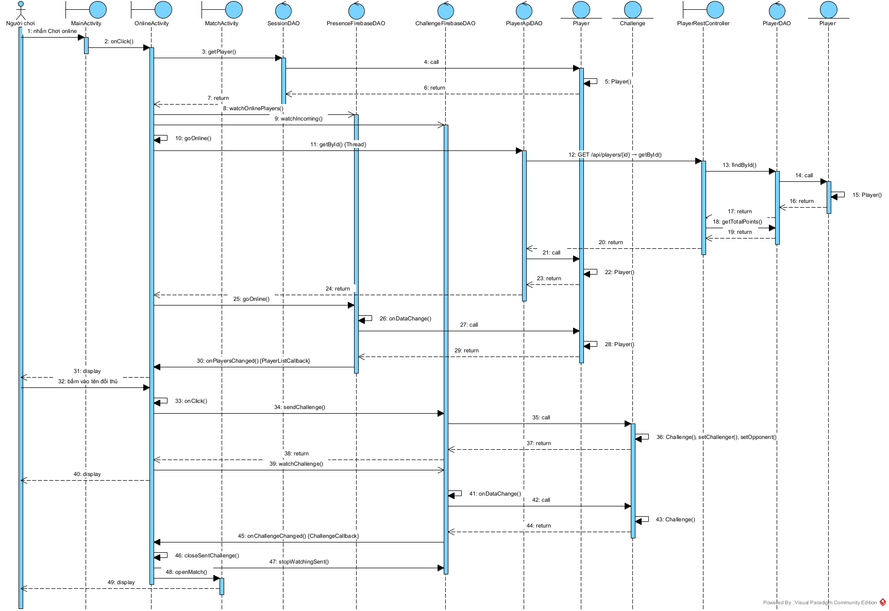
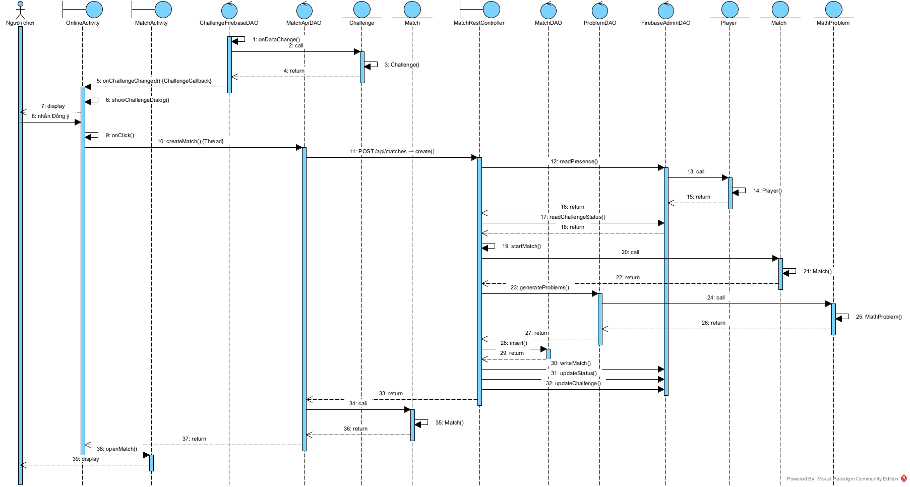
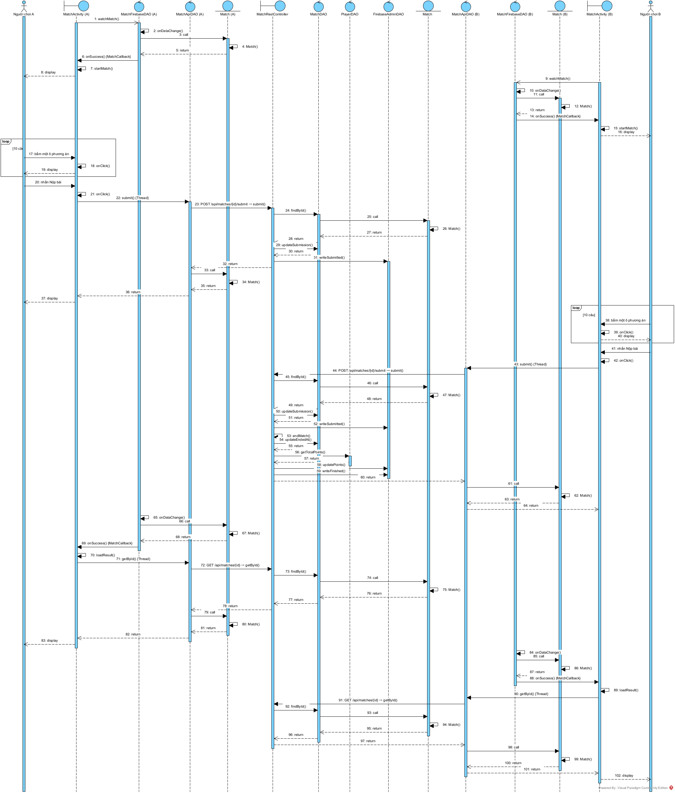
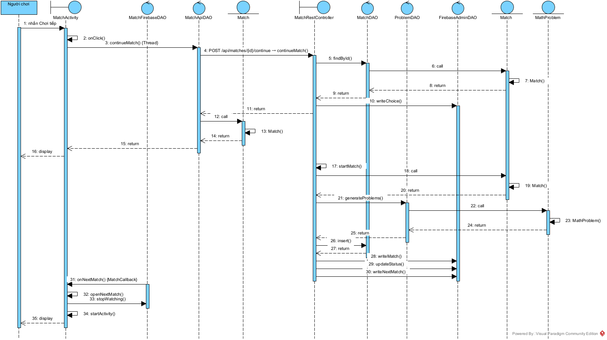
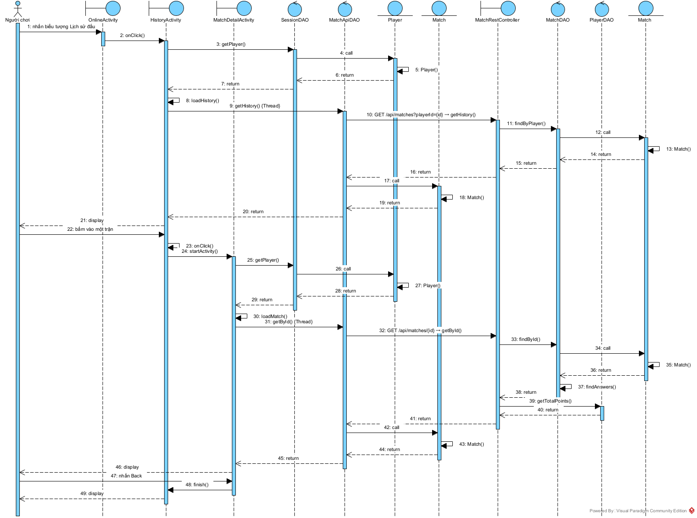
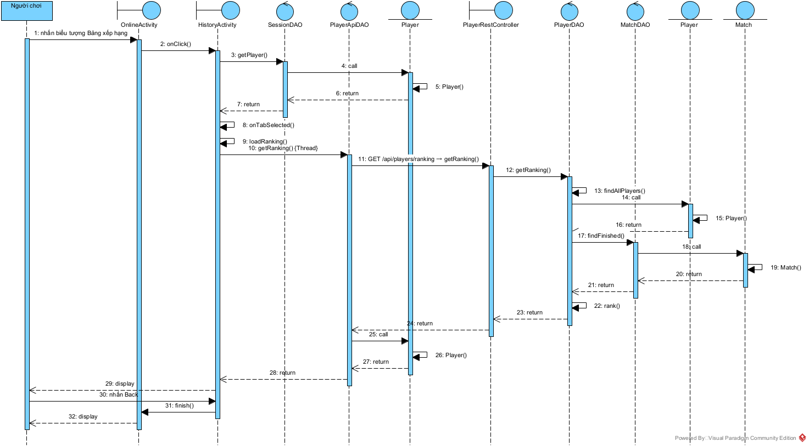

# KỊCH BẢN v3 VÀ BIỂU ĐỒ TUẦN TỰ CHI TIẾT — CHƠI ONLINE, XEM LỊCH SỬ ĐẤU

---

## 1. Chức năng "Chơi online"

### 1.1. Đoạn A: Gửi lời thách đấu

1. Người chơi nhấn nút Chơi online trên MainActivity.
2. Hàm onClick() của MainActivity gọi hàm startActivity() mở OnlineActivity.
3. Hàm onCreate() của OnlineActivity gọi hàm getPlayer() của SessionDAO.
4. Hàm getPlayer() gọi lớp Player để đóng gói người chơi đang đăng nhập.
5. Lớp Player gọi hàm khởi tạo Player() của chính nó để tạo đối tượng.
6. Lớp Player trả đối tượng Player cho SessionDAO.
7. SessionDAO trả đối tượng Player cho hàm onCreate().
8. Hàm onCreate() gọi hàm watchOnlinePlayers() của PresenceFirebaseDAO để đăng ký theo dõi danh sách online, truyền chính OnlineActivity làm PlayerListCallback.
9. Hàm onCreate() gọi hàm watchIncoming() của ChallengeFirebaseDAO để đăng ký theo dõi lời mời gửi tới người chơi, truyền chính OnlineActivity làm ChallengeCallback.
10. Hàm onCreate() gọi hàm goOnline() của chính nó.
11. Trong một Thread, hàm goOnline() gọi hàm getById() của PlayerApiDAO để lấy tổng điểm mới nhất.
12. Hàm getById() của PlayerApiDAO gửi yêu cầu GET /api/players/{id} tới hàm getById() của PlayerRestController.
13. Hàm getById() của PlayerRestController gọi hàm findById() của PlayerDAO.
14. Hàm findById() đọc tblPlayer rồi gọi lớp Player để đóng gói.
15. Lớp Player gọi hàm khởi tạo Player() của chính nó để tạo đối tượng.
16. Lớp Player trả đối tượng Player cho PlayerDAO.
17. PlayerDAO trả đối tượng Player cho PlayerRestController.
18. Hàm getById() gọi hàm getTotalPoints() của PlayerDAO để tính tổng điểm của người chơi.
19. PlayerDAO trả tổng điểm cho PlayerRestController.
20. PlayerRestController trả người chơi kèm tổng điểm dạng JSON cho PlayerApiDAO.
21. Hàm toPlayer() của PlayerApiDAO gọi lớp Player để đóng gói dữ liệu JSON.
22. Lớp Player gọi hàm khởi tạo Player() của chính nó để tạo đối tượng.
23. Lớp Player trả đối tượng Player cho PlayerApiDAO.
24. PlayerApiDAO trả đối tượng Player cho hàm goOnline().
25. Trong hàm runOnUiThread(), hàm goOnline() của OnlineActivity gọi hàm goOnline() của PresenceFirebaseDAO để ghi người chơi vào danh sách online với trạng thái rỗi.
26. Khi danh sách online thay đổi, Firebase gọi hàm onDataChange() của PresenceFirebaseDAO.
27. Hàm onDataChange() gọi lớp Player để đóng gói từng người chơi kèm tổng điểm và trạng thái.
28. Lớp Player gọi hàm khởi tạo Player() của chính nó để tạo đối tượng.
29. Lớp Player trả đối tượng Player cho hàm onDataChange().
30. PresenceFirebaseDAO gọi hàm onPlayersChanged() của PlayerListCallback đã đăng ký ở bước 8, chính là OnlineActivity, truyền danh sách người chơi online.
31. OnlineActivity hiển thị tổng điểm của người chơi và danh sách những người chơi online khác gồm tên, tổng điểm, trạng thái.
32. Người chơi bấm vào tên một đối thủ đang rỗi.
33. Hàm onClick() của dòng đó gọi hàm onPlayerClick() của OnlineActivity.
34. Hàm onPlayerClick() thấy đối thủ đang rỗi và người chơi chưa có lời mời nào đang chờ, gọi hàm sendChallenge() của ChallengeFirebaseDAO.
35. Hàm sendChallenge() ghi lời mời lên Firebase rồi gọi lớp Challenge để đóng gói lời mời.
36. Lớp Challenge gọi hàm khởi tạo Challenge() rồi các setter setChallenger(), setOpponent() của chính nó để đóng gói lời mời.
37. Lớp Challenge trả đối tượng Challenge cho ChallengeFirebaseDAO.
38. ChallengeFirebaseDAO trả đối tượng Challenge cho hàm onPlayerClick().
39. Hàm onPlayerClick() gọi hàm watchChallenge() của ChallengeFirebaseDAO để đăng ký theo dõi lời mời vừa gửi.
40. OnlineActivity hiển thị hộp thoại đang chờ đối thủ trả lời, có nút Hủy.
41. Khi đối thủ đồng ý, Firebase gọi hàm onDataChange() của ChallengeFirebaseDAO, hàm này gọi hàm toChallenge().
42. Hàm toChallenge() gọi lớp Challenge để đóng gói lời mời mới nhất, đã có mã trận.
43. Lớp Challenge gọi hàm khởi tạo Challenge() của chính nó để tạo đối tượng.
44. Lớp Challenge trả đối tượng Challenge cho hàm toChallenge().
45. ChallengeFirebaseDAO gọi hàm onChallengeChanged() của ChallengeCallback đã đăng ký, chính là OnlineActivity.
46. Hàm onChallengeChanged() thấy lời mời đã được đồng ý, gọi hàm closeSentChallenge() của chính nó.
47. Hàm closeSentChallenge() gọi hàm stopWatchingSent() của ChallengeFirebaseDAO để gỡ theo dõi lời mời, rồi đóng hộp thoại chờ.
48. Hàm onChallengeChanged() gọi hàm openMatch() mở MatchActivity với mã trận trong lời mời.
49. MatchActivity hiển thị màn thi đấu cho người chơi; trận diễn ra ở đoạn C.

*Hình 25: Biểu đồ tuần tự chi tiết chức năng Chơi online, đoạn A: Gửi lời thách đấu.*

- Biểu đồ có 49 thông điệp.
- MainActivity chỉ là điểm vào: nút Chơi online mở OnlineActivity (bước 1–2). Mọi việc của chức năng này, từ danh sách online tới lời mời, nằm ở OnlineActivity.
- **Lời gọi REST** duy nhất là bước 12, để lấy tổng điểm mới nhất từ server. Server đi theo khuôn PlayerRestController → PlayerDAO → Player.
- **Bước 8, 9 và 39 không có thông điệp trả về** vì đó là lời đăng ký theo dõi (mẫu Observer), vẽ bằng mũi tên bất đồng bộ. Hàm watchOnlinePlayers(), watchIncoming(), watchChallenge() chỉ gắn listener lên Firebase rồi trả về void ngay, không chờ dữ liệu. Dữ liệu đến sau, mỗi khi node thay đổi: Firebase gọi onDataChange() của DAO, DAO gọi lại OnlineActivity qua callback (bước 26–30 cho danh sách online, bước 41–45 cho lời mời). Thông điệp callback đó đóng vai trò kết quả trả về và có thể đến nhiều lần cho một lần đăng ký.
- **Nhiều người thay đổi cùng lúc** không làm sai trạng thái:
  - Firebase gọi các listener lần lượt trên main thread, cùng luồng với sự kiện bấm nút, nên 2 callback không chạy song song trên OnlineActivity. Vì thế onPlayersChanged() cập nhật giao diện trực tiếp mà không cần runOnUiThread().
  - Mỗi lần onDataChange() nhận ảnh chụp toàn bộ node tại thời điểm đó, không phải phần thay đổi. Nhiều người vào, ra cùng lúc thì lần gọi sau thay danh sách bằng trạng thái mới nhất.
  - Xung đột nghiệp vụ do server quyết định: hàm create() của MatchRestController là synchronized, đọc lại trạng thái lời mời và trạng thái 2 người trên Firebase. Lời mời đã hủy, hay một người đã bận vì nhận lời mời khác, thì server từ chối và trả lỗi 409. Ở app, onPlayerClick() bỏ qua đối thủ đang bận và chỉ cho 1 lời mời chờ trả lời.
- **Activity chỉ nhận đối tượng:** các DAO trả về Player, Challenge đã đóng gói; cách hiển thị các đối tượng đó nằm trong mã nguồn của OnlineActivity, biểu đồ chỉ vẽ bước hiển thị cho người chơi (bước 31, 40, 49).
- Bước 46–47 gỡ theo dõi lời mời đã gửi trước khi mở trận, để lần ghi sau của server lên lời mời không gọi lại onChallengeChanged().

### 1.2. Đoạn B: Nhận lời thách đấu

1. Khi có lời mời mới gửi tới người chơi, Firebase gọi hàm onDataChange() của ChallengeFirebaseDAO, hàm này gọi hàm toChallenge().
2. Hàm toChallenge() gọi lớp Challenge để đóng gói lời mời.
3. Lớp Challenge gọi hàm khởi tạo Challenge() của chính nó để tạo đối tượng.
4. Lớp Challenge trả đối tượng Challenge cho hàm toChallenge().
5. ChallengeFirebaseDAO gọi hàm onChallengeChanged() của ChallengeCallback đã đăng ký ở đoạn A, chính là OnlineActivity.
6. Hàm onChallengeChanged() thấy lời mời mới, gọi hàm showChallengeDialog() của chính nó.
7. OnlineActivity hiển thị hộp thoại lời mời gồm tên, tổng điểm người mời và 2 nút Từ chối, Đồng ý.
8. Người chơi nhấn Đồng ý.
9. Hàm onClick() của nút Đồng ý gọi hàm acceptChallenge() của OnlineActivity.
10. Trong một Thread, hàm acceptChallenge() gọi hàm createMatch() của MatchApiDAO với lời mời.
11. Hàm createMatch() gửi yêu cầu POST /api/matches tới hàm create() của MatchRestController.
12. Hàm create() gọi hàm readPresence() của FirebaseAdminDAO để đọc trạng thái 2 người chơi.
13. Hàm readPresence() gọi lớp Player để đóng gói người chơi kèm trạng thái.
14. Lớp Player gọi hàm khởi tạo Player() của chính nó để tạo đối tượng.
15. Lớp Player trả đối tượng Player cho FirebaseAdminDAO.
16. FirebaseAdminDAO trả người chơi cho hàm create().
17. Hàm create() gọi hàm readChallengeStatus() của FirebaseAdminDAO để đọc trạng thái lời mời.
18. FirebaseAdminDAO trả trạng thái lời mời cho hàm create().
19. Thấy lời mời còn chờ và cả 2 người đều rỗi, hàm create() gọi hàm startMatch() của chính nó.
20. Hàm startMatch() gọi lớp Match để đóng gói trận mới gồm 2 người chơi.
21. Lớp Match gọi hàm khởi tạo Match() của chính nó để tạo đối tượng.
22. Lớp Match trả đối tượng Match cho hàm startMatch().
23. Hàm startMatch() gọi hàm generateProblems() của ProblemDAO để sinh 10 câu hỏi.
24. Hàm generateProblems() gọi lớp MathProblem để đóng gói từng câu hỏi kèm 4 phương án.
25. Lớp MathProblem gọi hàm khởi tạo MathProblem() của chính nó để tạo đối tượng.
26. Lớp MathProblem trả đối tượng MathProblem cho ProblemDAO.
27. ProblemDAO trả 10 câu hỏi cho hàm startMatch().
28. Hàm startMatch() gọi hàm insert() của MatchDAO để lưu trận, đề và 2 người chơi trong một transaction.
29. MatchDAO trả kết quả lưu thành công cho hàm startMatch().
30. Hàm startMatch() gọi hàm writeMatch() của FirebaseAdminDAO để ghi trận lên Firebase, đề không kèm đáp án.
31. Hàm startMatch() gọi hàm updateStatus() của FirebaseAdminDAO để đặt 2 người chơi sang trạng thái đang đấu.
32. Hàm create() gọi hàm updateChallenge() của FirebaseAdminDAO để ghi lời mời là accepted kèm mã trận; máy người mời nhận được ở đoạn A.
33. MatchRestController trả trận không kèm đáp án dạng JSON cho MatchApiDAO.
34. Hàm toMatch() của MatchApiDAO gọi lớp Match để đóng gói dữ liệu JSON.
35. Lớp Match gọi hàm khởi tạo Match() của chính nó để tạo đối tượng.
36. Lớp Match trả đối tượng Match cho MatchApiDAO.
37. MatchApiDAO trả đối tượng Match cho hàm acceptChallenge().
38. Trong hàm runOnUiThread(), hàm acceptChallenge() gọi hàm openMatch() mở MatchActivity với mã trận.
39. MatchActivity hiển thị màn thi đấu cho người chơi; trận diễn ra ở đoạn C.

*Hình 26: Biểu đồ tuần tự chi tiết chức năng Chơi online, đoạn B: Nhận lời thách đấu.*

- Biểu đồ có 39 thông điệp.
- **Server sinh đề** (bước 23–27) và lưu đề vào MySQL cùng trận (bước 28–29), vì server cần đáp án để chấm bài sau này.
- **Đề không kèm đáp án:** đề ghi lên Firebase (bước 30) và bản trận trả về cho app (bước 33) đều không có đáp án. Người chơi không đọc được đáp án trước khi nộp bài.
- **Server kiểm tra lại** lời mời và trạng thái 2 người (bước 12–18) trước khi tạo trận, vì người mời có thể đã hủy hoặc một người đã vào trận khác.
- Bước 1 là callback của lời đăng ký watchIncoming() ở đoạn A, nên không có lời gọi nào đi trước.

### 1.3. Đoạn C: Thi đấu

1. Hàm onCreate() của MatchActivity (A) gọi hàm watchMatch() của MatchFirebaseDAO (A) để đăng ký theo dõi trận, truyền chính MatchActivity (A) làm MatchCallback.
2. Khi node trận có dữ liệu, Firebase gọi hàm onDataChange() của MatchFirebaseDAO (A).
3. Hàm onDataChange() gọi lớp Match để đóng gói trận kèm 10 câu hỏi và 2 người chơi.
4. Lớp Match gọi hàm khởi tạo Match() của chính nó để tạo đối tượng.
5. Lớp Match trả đối tượng Match cho MatchFirebaseDAO (A).
6. MatchFirebaseDAO (A) gọi hàm onSuccess() của MatchActivity (A), truyền đối tượng Match.
7. Lần đầu nhận trận, hàm onSuccess() gọi hàm startMatch() của MatchActivity (A) để lấy đề, tạo 10 bài làm rỗng và bắt đầu đếm ngược 60 giây.
8. MatchActivity (A) hiển thị câu thứ nhất với 4 ô A, B, C, D, đồng hồ đếm ngược và nút Thoát cho người chơi A.
9. Cùng lúc, hàm onCreate() của MatchActivity (B) gọi hàm watchMatch() của MatchFirebaseDAO (B).
10. Firebase gọi hàm onDataChange() của MatchFirebaseDAO (B).
11. Hàm onDataChange() gọi lớp Match để đóng gói trận.
12. Lớp Match gọi hàm khởi tạo Match() của chính nó để tạo đối tượng.
13. Lớp Match trả đối tượng Match cho MatchFirebaseDAO (B).
14. MatchFirebaseDAO (B) gọi hàm onSuccess() của MatchActivity (B).
15. Hàm onSuccess() gọi hàm startMatch() của MatchActivity (B).
16. MatchActivity (B) hiển thị câu thứ nhất cho người chơi B; 2 người làm cùng một đề.
17. Người chơi A bấm một ô phương án.
18. Hàm onClick() của MatchActivity (A) ghi phương án đã chọn và thời gian làm câu vào bài làm của câu đó.
19. MatchActivity (A) hiển thị câu tiếp theo; sau câu thứ 10 thì hiển thị nút Nộp bài.
20. Người chơi A làm xong trước và nhấn Nộp bài.
21. Hàm onClick() của MatchActivity (A) gọi hàm submitAnswers().
22. Trong một Thread, hàm submitAnswers() gọi hàm submit() của MatchApiDAO (A) với 10 bài làm.
23. Hàm submit() của MatchApiDAO (A) gửi yêu cầu POST /api/matches/{id}/submit tới hàm submit() của MatchRestController.
24. Hàm submit() gọi hàm findById() của MatchDAO để đọc trận kèm đề và đáp án.
25. Hàm findById() gọi lớp Match để đóng gói trận.
26. Lớp Match gọi hàm khởi tạo Match() của chính nó để tạo đối tượng.
27. Lớp Match trả đối tượng Match cho MatchDAO.
28. MatchDAO trả trận cho hàm submit(); hàm submit() chấm bài làm của người chơi A.
29. Hàm submit() gọi hàm updateSubmission() của MatchDAO để lưu số câu đúng, thời điểm nộp và 10 bài làm của người chơi A.
30. MatchDAO trả kết quả lưu cho hàm submit().
31. Hàm submit() gọi hàm writeSubmitted() của FirebaseAdminDAO để báo người chơi A đã nộp bài.
32. B chưa nộp nên trận chưa kết thúc; MatchRestController trả trận không kèm bài làm dạng JSON cho MatchApiDAO (A).
33. Hàm toMatch() của MatchApiDAO (A) gọi lớp Match để đóng gói dữ liệu JSON.
34. Lớp Match gọi hàm khởi tạo Match() của chính nó để tạo đối tượng.
35. Lớp Match trả đối tượng Match cho MatchApiDAO (A).
36. MatchApiDAO (A) trả đối tượng Match cho MatchActivity (A).
37. MatchActivity (A) dừng đồng hồ và hiển thị đã nộp bài, đang chờ đối thủ.
38. Người chơi B bấm một ô phương án.
39. Hàm onClick() của MatchActivity (B) ghi bài làm của câu đó.
40. MatchActivity (B) hiển thị câu tiếp theo; sau câu thứ 10 thì hiển thị nút Nộp bài.
41. Người chơi B nhấn Nộp bài sau người chơi A.
42. Hàm onClick() của MatchActivity (B) gọi hàm submitAnswers().
43. Trong một Thread, hàm submitAnswers() gọi hàm submit() của MatchApiDAO (B).
44. Hàm submit() của MatchApiDAO (B) gửi yêu cầu POST /api/matches/{id}/submit tới hàm submit() của MatchRestController.
45. Hàm submit() gọi hàm findById() của MatchDAO.
46. Hàm findById() gọi lớp Match để đóng gói trận, lúc này đã có bài làm của người chơi A.
47. Lớp Match gọi hàm khởi tạo Match() của chính nó để tạo đối tượng.
48. Lớp Match trả đối tượng Match cho MatchDAO.
49. MatchDAO trả trận cho hàm submit(); hàm submit() chấm bài làm của người chơi B.
50. Hàm submit() gọi hàm updateSubmission() của MatchDAO để lưu bài làm của người chơi B.
51. MatchDAO trả kết quả lưu cho hàm submit().
52. Hàm submit() gọi hàm writeSubmitted() của FirebaseAdminDAO để báo người chơi B đã nộp bài.
53. Cả 2 đã nộp, hàm submit() gọi hàm endMatch() của chính nó.
54. Hàm endMatch() gọi hàm updateEndedAt() của MatchDAO để ghi thời điểm kết thúc trận.
55. MatchDAO trả kết quả lưu cho hàm endMatch().
56. Hàm endMatch() gọi hàm getTotalPoints() của PlayerDAO để tính lại tổng điểm của từng người.
57. PlayerDAO trả tổng điểm cho hàm endMatch().
58. Hàm endMatch() gọi hàm updatePoints() của FirebaseAdminDAO để cập nhật tổng điểm trong danh sách online.
59. Hàm submit() gọi hàm writeFinished() của FirebaseAdminDAO để báo trận đã kết thúc cho cả 2 máy.
60. MatchRestController trả trận đã kết thúc dạng JSON cho MatchApiDAO (B).
61. Hàm toMatch() của MatchApiDAO (B) gọi lớp Match để đóng gói dữ liệu JSON.
62. Lớp Match gọi hàm khởi tạo Match() của chính nó để tạo đối tượng.
63. Lớp Match trả đối tượng Match cho MatchApiDAO (B).
64. MatchApiDAO (B) trả đối tượng Match cho MatchActivity (B).
65. Khi node trận đổi sang đã kết thúc, Firebase gọi hàm onDataChange() của MatchFirebaseDAO (A).
66. Hàm onDataChange() gọi lớp Match để đóng gói trận mới nhất.
67. Lớp Match gọi hàm khởi tạo Match() của chính nó để tạo đối tượng.
68. Lớp Match trả đối tượng Match cho MatchFirebaseDAO (A).
69. MatchFirebaseDAO (A) gọi hàm onSuccess() của MatchActivity (A).
70. Thấy trận đã kết thúc, hàm onSuccess() gọi hàm loadResult() của MatchActivity (A).
71. Trong một Thread, hàm loadResult() gọi hàm getById() của MatchApiDAO (A).
72. Hàm getById() của MatchApiDAO (A) gửi yêu cầu GET /api/matches/{id} tới hàm getById() của MatchRestController.
73. Hàm getById() gọi hàm findById() của MatchDAO.
74. Hàm findById() gọi lớp Match để đóng gói trận kèm đề và bài làm của 2 người.
75. Lớp Match gọi hàm khởi tạo Match() của chính nó để tạo đối tượng.
76. Lớp Match trả đối tượng Match cho MatchDAO.
77. MatchDAO trả trận cho hàm getById().
78. MatchRestController trả trận đã kết thúc dạng JSON cho MatchApiDAO (A).
79. Hàm toMatch() của MatchApiDAO (A) gọi lớp Match để đóng gói dữ liệu JSON.
80. Lớp Match gọi hàm khởi tạo Match() của chính nó để tạo đối tượng.
81. Lớp Match trả đối tượng Match cho MatchApiDAO (A).
82. MatchApiDAO (A) trả đối tượng Match cho MatchActivity (A).
83. MatchActivity (A) hiển thị kết quả trận, số câu đúng, thời gian, điểm của 2 người và 2 nút Chơi tiếp, Dừng.
84. Firebase cũng gọi hàm onDataChange() của MatchFirebaseDAO (B).
85. Hàm onDataChange() gọi lớp Match để đóng gói trận mới nhất.
86. Lớp Match gọi hàm khởi tạo Match() của chính nó để tạo đối tượng.
87. Lớp Match trả đối tượng Match cho MatchFirebaseDAO (B).
88. MatchFirebaseDAO (B) gọi hàm onSuccess() của MatchActivity (B).
89. Hàm onSuccess() gọi hàm loadResult() của MatchActivity (B).
90. Trong một Thread, hàm loadResult() gọi hàm getById() của MatchApiDAO (B).
91. Hàm getById() của MatchApiDAO (B) gửi yêu cầu GET /api/matches/{id} tới hàm getById() của MatchRestController.
92. Hàm getById() gọi hàm findById() của MatchDAO.
93. Hàm findById() gọi lớp Match để đóng gói trận.
94. Lớp Match gọi hàm khởi tạo Match() của chính nó để tạo đối tượng.
95. Lớp Match trả đối tượng Match cho MatchDAO.
96. MatchDAO trả trận cho hàm getById().
97. MatchRestController trả trận đã kết thúc dạng JSON cho MatchApiDAO (B).
98. Hàm toMatch() của MatchApiDAO (B) gọi lớp Match để đóng gói dữ liệu JSON.
99. Lớp Match gọi hàm khởi tạo Match() của chính nó để tạo đối tượng.
100. Lớp Match trả đối tượng Match cho MatchApiDAO (B).
101. MatchApiDAO (B) trả đối tượng Match cho MatchActivity (B).
102. MatchActivity (B) hiển thị kết quả trận và 2 nút Chơi tiếp, Dừng cho người chơi B.

*Hình 27: Biểu đồ tuần tự chi tiết chức năng Chơi online, đoạn C: Thi đấu.*

- Biểu đồ có 102 thông điệp.
- **Hai người chơi:** người chơi A ở bên trái, người chơi B ở bên phải; các lớp của mỗi máy ghi (A) hoặc (B). Server ở giữa là trọng tài chung. Biểu đồ vẽ trường hợp A nộp bài trước, B nộp sau.
- **Làm bài từng câu** lặp 10 lần trên mỗi máy: mỗi lần bấm, onClick() ghi phương án và thời gian làm câu vào bài làm của câu đó rồi hiện câu sau. App không có đáp án nên không báo đúng / sai ngay.
- **Server làm trọng tài:** mỗi lần nộp, hàm submit() đọc trận từ MySQL, chấm và lưu bài làm. Khi người nộp sau (B) gửi bài, submit() thấy cả 2 đã nộp nên gọi endMatch() ghi thời điểm kết thúc, tính lại tổng điểm và báo trận kết thúc qua Firebase.
- **Cả 2 máy nhận kết quả như nhau:** onDataChange() báo trận đã kết thúc, mỗi máy gọi getById() lấy trận đầy đủ rồi hiển thị kết quả. Activity chỉ nhận đối tượng Match; việc tính thắng thua, điểm để hiển thị nằm trong mã nguồn.
- watchMatch() là lời đăng ký theo dõi nên vẽ bất đồng bộ, không có thông điệp trả về; kết quả đến sau qua onSuccess(). Đồng hồ đếm ngược, theo dõi đối thủ còn online và phiên đăng nhập nằm trong mã nguồn của MatchActivity, không vẽ ở đây.

### 1.4. Đoạn D: Chơi tiếp

1. Người chơi nhấn Chơi tiếp.
2. Hàm onClick() gọi hàm sendChoice() của MatchActivity.
3. Trong một Thread, hàm sendChoice() gọi hàm continueMatch() của MatchApiDAO với lựa chọn chơi tiếp.
4. Hàm continueMatch() của MatchApiDAO gửi yêu cầu POST /api/matches/{id}/continue tới hàm continueMatch() của MatchRestController.
5. Hàm continueMatch() của MatchRestController gọi hàm findById() của MatchDAO.
6. Hàm findById() gọi lớp Match để đóng gói trận.
7. Lớp Match gọi hàm khởi tạo Match() của chính nó để tạo đối tượng.
8. Lớp Match trả đối tượng Match cho MatchDAO.
9. MatchDAO trả trận cho hàm continueMatch().
10. Hàm continueMatch() gọi hàm writeChoice() của FirebaseAdminDAO để ghi lựa chọn chơi tiếp; đối thủ chưa chọn nên server ghi nhớ lựa chọn này.
11. MatchRestController trả trận dạng JSON cho MatchApiDAO.
12. Hàm toMatch() của MatchApiDAO gọi lớp Match để đóng gói dữ liệu JSON.
13. Lớp Match gọi hàm khởi tạo Match() của chính nó để tạo đối tượng.
14. Lớp Match trả đối tượng Match cho MatchApiDAO.
15. MatchApiDAO trả đối tượng Match cho hàm sendChoice().
16. MatchActivity hiển thị đang chờ đối thủ chọn.
17. Khi đối thủ cũng chọn Chơi tiếp, hàm continueMatch() xử lý yêu cầu của đối thủ gọi hàm startMatch() của chính nó.
18. Hàm startMatch() gọi lớp Match để đóng gói trận mới gồm 2 người chơi.
19. Lớp Match gọi hàm khởi tạo Match() của chính nó để tạo đối tượng.
20. Lớp Match trả đối tượng Match cho hàm startMatch().
21. Hàm startMatch() gọi hàm generateProblems() của ProblemDAO để sinh 10 câu hỏi mới.
22. Hàm generateProblems() gọi lớp MathProblem để đóng gói từng câu hỏi.
23. Lớp MathProblem gọi hàm khởi tạo MathProblem() của chính nó để tạo đối tượng.
24. Lớp MathProblem trả đối tượng MathProblem cho ProblemDAO.
25. ProblemDAO trả 10 câu hỏi cho hàm startMatch().
26. Hàm startMatch() gọi hàm insert() của MatchDAO để lưu trận mới.
27. MatchDAO trả kết quả lưu thành công cho hàm startMatch().
28. Hàm startMatch() gọi hàm writeMatch() của FirebaseAdminDAO để ghi trận mới lên Firebase.
29. Hàm startMatch() gọi hàm updateStatus() của FirebaseAdminDAO để đặt 2 người chơi sang trạng thái đang đấu.
30. Hàm continueMatch() gọi hàm writeNextMatch() của FirebaseAdminDAO để ghi mã trận mới vào trận cũ.
31. Khi trận cũ có mã trận mới, hàm onDataChange() của MatchFirebaseDAO gọi hàm onNextMatch() của MatchCallback, chính là MatchActivity.
32. Hàm onNextMatch() gọi hàm openNextMatch() của chính nó.
33. Hàm openNextMatch() gọi hàm stopWatching() của MatchFirebaseDAO để gỡ theo dõi trận cũ.
34. Hàm openNextMatch() gọi hàm startActivity() mở MatchActivity cho trận mới rồi đóng màn cũ.
35. MatchActivity hiển thị màn thi đấu của trận mới; trận diễn ra như đoạn C.

*Hình 28: Biểu đồ tuần tự chi tiết chức năng Chơi online, đoạn D: Chơi tiếp.*

- Biểu đồ có 35 thông điệp.
- Biểu đồ vẽ cho người chọn Chơi tiếp trước. Lựa chọn được ghi lên Firebase (bước 10) và server ghi nhớ lựa chọn đó cho tới khi đối thủ chọn.
- Trận mới chỉ được tạo khi cả 2 cùng chọn Chơi tiếp (bước 17–29), trong yêu cầu của người chọn sau. Server ghi mã trận mới vào trận cũ (bước 30), cả 2 máy nhận qua onNextMatch() (bước 31) và cùng mở trận mới.
- Người chơi chọn Dừng thì server ghi stoppedBy lên Firebase, đối thủ nhận qua onStopped() và quay về màn Chơi online; nhánh này thuộc ngoại lệ nên không vẽ.

---

## 2. Chức năng "Xem lịch sử đấu"

### 2.1. Đoạn A: Xem trận của tôi và chi tiết trận

1. Người chơi nhấn biểu tượng Lịch sử đấu trên OnlineActivity.
2. Hàm onClick() của OnlineActivity gọi hàm startActivity() mở HistoryActivity.
3. Hàm onCreate() của HistoryActivity gọi hàm getPlayer() của SessionDAO.
4. Hàm getPlayer() gọi lớp Player để đóng gói người chơi đang đăng nhập.
5. Lớp Player gọi hàm khởi tạo Player() của chính nó để tạo đối tượng.
6. Lớp Player trả đối tượng Player cho SessionDAO.
7. SessionDAO trả đối tượng Player cho hàm onCreate().
8. Hàm onCreate() gọi hàm loadHistory() của chính nó.
9. Trong một Thread, hàm loadHistory() gọi hàm getHistory() của MatchApiDAO.
10. Hàm getHistory() của MatchApiDAO gửi yêu cầu GET /api/matches?playerId={id} tới hàm getHistory() của MatchRestController.
11. Hàm getHistory() gọi hàm findByPlayer() của MatchDAO.
12. Hàm findByPlayer() đọc các trận đã kết thúc của người chơi rồi gọi lớp Match để đóng gói từng trận kèm 2 người chơi, không kèm đề.
13. Lớp Match gọi hàm khởi tạo Match() của chính nó để tạo đối tượng.
14. Lớp Match trả đối tượng Match cho MatchDAO.
15. MatchDAO trả danh sách trận, mới nhất ở đầu, cho hàm getHistory().
16. MatchRestController trả danh sách trận dạng JSON cho MatchApiDAO.
17. Với mỗi phần tử JSON, hàm toMatch() của MatchApiDAO gọi lớp Match để đóng gói.
18. Lớp Match gọi hàm khởi tạo Match() của chính nó để tạo đối tượng.
19. Lớp Match trả đối tượng Match cho MatchApiDAO.
20. MatchApiDAO trả danh sách trận cho hàm loadHistory().
21. Trong hàm runOnUiThread(), HistoryActivity hiển thị biểu đồ tròn tỉ lệ thắng, hòa, thua và danh sách trận.
22. Người chơi bấm vào một trận trong danh sách.
23. Hàm onClick() của dòng đó gọi hàm onMatchClick() của HistoryActivity.
24. Hàm onMatchClick() gọi hàm startActivity() mở MatchDetailActivity với mã trận.
25. Hàm onCreate() của MatchDetailActivity gọi hàm getPlayer() của SessionDAO.
26. Hàm getPlayer() gọi lớp Player để đóng gói người chơi đang đăng nhập.
27. Lớp Player gọi hàm khởi tạo Player() của chính nó để tạo đối tượng.
28. Lớp Player trả đối tượng Player cho SessionDAO.
29. SessionDAO trả đối tượng Player cho hàm onCreate().
30. Hàm onCreate() gọi hàm loadMatch() của chính nó.
31. Trong một Thread, hàm loadMatch() gọi hàm getById() của MatchApiDAO.
32. Hàm getById() của MatchApiDAO gửi yêu cầu GET /api/matches/{id} tới hàm getById() của MatchRestController.
33. Hàm getById() gọi hàm findById() của MatchDAO.
34. Hàm findById() gọi lớp Match để đóng gói trận kèm đề và 2 người chơi.
35. Lớp Match gọi hàm khởi tạo Match() của chính nó để tạo đối tượng.
36. Lớp Match trả đối tượng Match cho MatchDAO.
37. Hàm findById() gọi hàm findAnswers() của chính nó để đọc bài làm từng câu của mỗi người.
38. MatchDAO trả trận đầy đủ cho hàm getById().
39. Hàm getById() gọi hàm getTotalPoints() của PlayerDAO để gán tổng điểm của 2 người.
40. PlayerDAO trả tổng điểm cho hàm getById().
41. MatchRestController trả trận kèm đáp án đúng và bài làm dạng JSON cho MatchApiDAO.
42. Hàm toMatch() của MatchApiDAO gọi lớp Match để đóng gói dữ liệu JSON, kèm bài làm từng câu của 2 người chơi.
43. Lớp Match gọi hàm khởi tạo Match() của chính nó để tạo đối tượng.
44. Lớp Match trả đối tượng Match cho MatchApiDAO.
45. MatchApiDAO trả đối tượng Match cho hàm loadMatch().
46. Trong hàm runOnUiThread(), MatchDetailActivity hiển thị kết quả, điểm trận, số câu đúng, thời gian của 2 người và bảng 10 câu với bài làm đúng / sai của mỗi người.
47. Người chơi nhấn Back.
48. MatchDetailActivity gọi hàm finish(), quay về HistoryActivity.
49. HistoryActivity hiển thị lại danh sách trận.

*Hình 29: Biểu đồ tuần tự chi tiết chức năng Xem lịch sử đấu, đoạn A: Xem trận của tôi và chi tiết trận.*

- Biểu đồ có 49 thông điệp.
- **Có 2 lời gọi REST:** bước 10 lấy danh sách trận, bước 32 lấy một trận đầy đủ. Server đi theo khuôn MatchRestController → MatchDAO → Match.
- **Danh sách trận không kèm đề** (bước 12) để mỗi lần mở lịch sử chỉ đọc 2 bảng tblMatch, tblMatchPlayer. Đề, đáp án và bài làm từng câu chỉ được đọc khi người chơi mở một trận (bước 34–37).
- **Activity chỉ nhận đối tượng Match:** việc đếm thắng, hòa, thua, tìm đối thủ, tính điểm và tô đúng / sai từng câu nằm trong mã nguồn của HistoryActivity, MatchDetailActivity và dùng các phương thức của Match, Answer. Biểu đồ chỉ vẽ bước hiển thị cho người chơi (bước 21, 46, 49).
- Lời gọi mạng chạy trong Thread (bước 9, 31); phần hiển thị chạy trong hàm runOnUiThread().

### 2.2. Đoạn B: Xem bảng xếp hạng

1. Người chơi nhấn biểu tượng Bảng xếp hạng trên OnlineActivity.
2. Hàm onClick() của OnlineActivity gọi hàm startActivity() mở HistoryActivity ở thẻ Bảng xếp hạng.
3. Hàm onCreate() của HistoryActivity gọi hàm getPlayer() của SessionDAO.
4. Hàm getPlayer() gọi lớp Player để đóng gói người chơi đang đăng nhập.
5. Lớp Player gọi hàm khởi tạo Player() của chính nó để tạo đối tượng.
6. Lớp Player trả đối tượng Player cho SessionDAO.
7. SessionDAO trả đối tượng Player cho hàm onCreate().
8. Hàm onCreate() chọn sẵn thẻ Bảng xếp hạng nên hàm onTabSelected() của HistoryActivity được gọi.
9. Hàm onTabSelected() gọi hàm loadRanking() của chính nó.
10. Trong một Thread, hàm loadRanking() gọi hàm getRanking() của PlayerApiDAO.
11. Hàm getRanking() của PlayerApiDAO gửi yêu cầu GET /api/players/ranking tới hàm getRanking() của PlayerRestController.
12. Hàm getRanking() của PlayerRestController gọi hàm getRanking() của PlayerDAO.
13. Hàm getRanking() của PlayerDAO gọi hàm findAllPlayers() của chính nó.
14. Hàm findAllPlayers() đọc tblPlayer rồi gọi lớp Player để đóng gói từng người chơi.
15. Lớp Player gọi hàm khởi tạo Player() của chính nó để tạo đối tượng.
16. Lớp Player trả đối tượng Player cho PlayerDAO.
17. Hàm getRanking() gọi hàm findFinished() của MatchDAO để lấy các trận đã kết thúc.
18. Hàm findFinished() gọi lớp Match để đóng gói từng trận.
19. Lớp Match gọi hàm khởi tạo Match() của chính nó để tạo đối tượng.
20. Lớp Match trả đối tượng Match cho MatchDAO.
21. MatchDAO trả danh sách trận cho hàm getRanking().
22. Hàm getRanking() gọi hàm rank() để tính tổng điểm, trung bình điểm đối thủ, trung bình thời gian thắng của từng người rồi sắp xếp theo 3 tiêu chí đó.
23. PlayerDAO trả danh sách người chơi đã xếp hạng cho PlayerRestController.
24. PlayerRestController trả danh sách dạng JSON cho PlayerApiDAO.
25. Với mỗi phần tử JSON, hàm toPlayer() của PlayerApiDAO gọi lớp Player để đóng gói.
26. Lớp Player gọi hàm khởi tạo Player() của chính nó để tạo đối tượng.
27. Lớp Player trả đối tượng Player cho PlayerApiDAO.
28. PlayerApiDAO trả danh sách người chơi cho hàm loadRanking().
29. Trong hàm runOnUiThread(), HistoryActivity hiển thị bảng xếp hạng gồm hạng, tên, tổng điểm; dòng của người xem được tô nổi bật.
30. Người chơi nhấn Back.
31. HistoryActivity gọi hàm finish(), quay về OnlineActivity.
32. OnlineActivity hiển thị lại màn Chơi online.

*Hình 30: Biểu đồ tuần tự chi tiết chức năng Xem lịch sử đấu, đoạn B: Xem bảng xếp hạng.*

- Biểu đồ có 32 thông điệp.
- **Lời gọi REST** của bảng xếp hạng là bước 11. Server đi theo khuôn PlayerRestController → PlayerDAO → MatchDAO → Match, Player.
- **Mở thẳng thẻ Bảng xếp hạng:** biểu tượng Bảng xếp hạng mở HistoryActivity và chọn sẵn thẻ này (bước 2, 8), giống như khi người chơi tự chọn thẻ.
- **Các tiêu chí không lưu trong CSDL** mà được hàm rank() tính lại từ các trận đã kết thúc (bước 22), nên bảng xếp hạng luôn khớp với kết quả các trận. Bảng chỉ hiện tổng điểm; 2 tiêu chí trung bình dùng để phân định khi trùng điểm.
