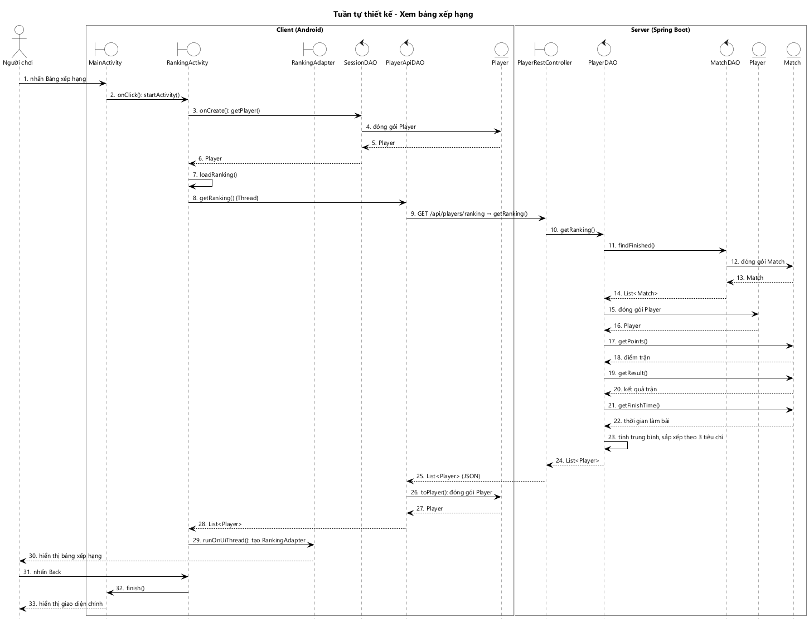
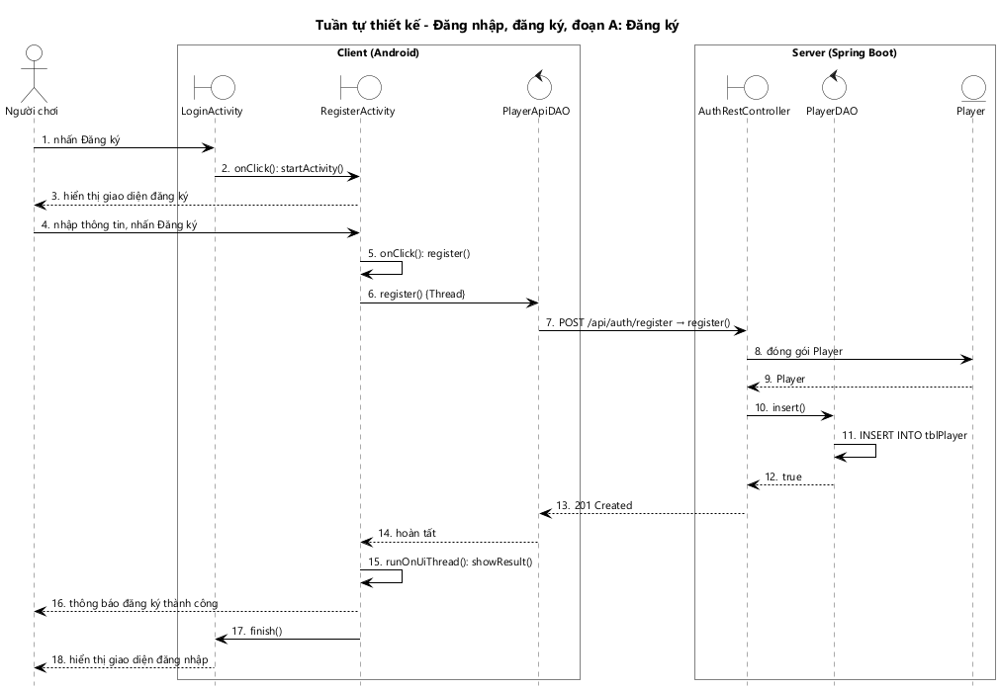
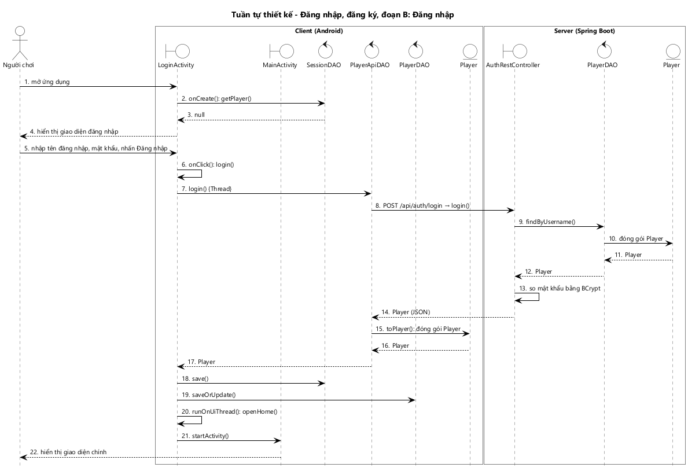

# KỊCH BẢN v3 VÀ BIỂU ĐỒ TUẦN TỰ CHI TIẾT — CHƠI ONLINE, XEM BẢNG XẾP HẠNG, ĐĂNG NHẬP

---

## 1. Chức năng "Chơi online"

### 1.1. Đoạn A: Gửi lời thách đấu

1. Người chơi đăng nhập thành công, MainActivity được mở.
2. Hàm onCreate() của MainActivity gọi hàm getPlayer() của SessionDAO.
3. Hàm getPlayer() gọi lớp Player để đóng gói người chơi đang đăng nhập.
4. Lớp Player trả đối tượng Player cho hàm getPlayer().
5. Hàm getPlayer() trả đối tượng Player cho hàm onCreate().
6. Hàm onCreate() mở một Thread và gọi hàm getById() của PlayerApiDAO để lấy tổng điểm mới nhất.
7. PlayerApiDAO gửi yêu cầu GET /api/players/{id} tới hàm getById() của PlayerRestController.
8. Hàm getById() của PlayerRestController gọi hàm findById() của PlayerDAO.
9. Hàm findById() truy vấn bảng tblPlayer và gọi lớp Player để đóng gói kết quả.
10. Lớp Player trả đối tượng Player cho hàm findById().
11. Hàm findById() trả đối tượng Player cho hàm getById().
12. Hàm getById() gọi hàm getTotalPoints() của PlayerDAO.
13. Hàm getTotalPoints() cộng điểm trận của người chơi qua các trận đã kết thúc và trả về cho hàm getById().
14. Hàm getById() trả người chơi kèm tổng điểm dạng JSON cho PlayerApiDAO.
15. Hàm toPlayer() của PlayerApiDAO gọi lớp Player để đóng gói dữ liệu JSON.
16. Lớp Player trả đối tượng Player cho PlayerApiDAO.
17. PlayerApiDAO trả đối tượng Player cho hàm onCreate().
18. Trong hàm runOnUiThread(), hàm onCreate() gọi hàm goOnline() của PresenceFirebaseDAO để ghi người chơi vào danh sách online với trạng thái rỗi.
19. Hàm onCreate() gọi hàm watchOnlinePlayers() của PresenceFirebaseDAO.
20. Hàm onCreate() gọi hàm watchIncoming() của ChallengeFirebaseDAO để nhận các lời mời gửi tới người chơi.
21. Khi danh sách online thay đổi, hàm onDataChange() của PresenceFirebaseDAO gọi hàm toPlayer() cho từng người chơi.
22. Hàm toPlayer() gọi lớp Player để đóng gói người chơi kèm tổng điểm và trạng thái.
23. Lớp Player trả đối tượng Player cho hàm toPlayer().
24. PresenceFirebaseDAO gọi hàm onPlayersChanged() của MainActivity, truyền danh sách người chơi online.
25. Hàm onPlayersChanged() hiển thị tên, tổng điểm của chính người chơi, rồi gọi hàm setPlayers() của PlayerAdapter với danh sách những người còn lại.
26. PlayerAdapter hiển thị danh sách người chơi online gồm tên, tổng điểm, trạng thái.
27. Người chơi bấm vào tên một đối thủ đang rỗi.
28. Hàm onClick() của PlayerAdapter gọi hàm onPlayerClick() của MainActivity.
29. Hàm onPlayerClick() thấy đối thủ đang rỗi, gọi hàm sendChallenge() của ChallengeFirebaseDAO.
30. Hàm sendChallenge() gọi lớp Challenge để tạo lời mời đang chờ, rồi ghi lời mời lên Firebase.
31. Lớp Challenge trả đối tượng Challenge cho hàm sendChallenge().
32. Hàm sendChallenge() trả đối tượng Challenge cho hàm onPlayerClick().
33. Hàm onPlayerClick() gọi hàm watchChallenge() của ChallengeFirebaseDAO để theo dõi lời mời vừa gửi.
34. MainActivity hiển thị hộp thoại đang chờ đối thủ trả lời.
35. Khi đối thủ đồng ý, hàm onDataChange() của ChallengeFirebaseDAO gọi hàm toChallenge().
36. Hàm toChallenge() gọi lớp Challenge để đóng gói lời mời mới nhất.
37. Lớp Challenge trả đối tượng Challenge cho hàm toChallenge().
38. ChallengeFirebaseDAO gọi hàm onChallengeChanged() của MainActivity.
39. Hàm onChallengeChanged() thấy lời mời đã được đồng ý, đóng hộp thoại chờ và gọi hàm openMatch() để mở MatchActivity với mã trận trong lời mời.

*Hình 17: Biểu đồ tuần tự chi tiết chức năng Chơi online, đoạn A: Gửi lời thách đấu.*

- Biểu đồ có 39 thông điệp.
- **Lời gọi REST** duy nhất là bước 7, để lấy tổng điểm mới nhất từ server. Server đi theo khuôn PlayerRestController → PlayerDAO → Player.
- **Firebase** làm 3 việc:
  - Ghi người chơi vào danh sách online (bước 18).
  - Báo khi danh sách thay đổi (bước 21–24).
  - Chuyển lời mời giữa 2 máy (bước 29–38).
- **Bất đồng bộ:** watchOnlinePlayers(), watchIncoming(), watchChallenge() là lời đăng ký; kết quả đến sau qua onDataChange(). Bước 35 xảy ra khi đối thủ đồng ý ở đoạn B.

### 1.2. Đoạn B: Nhận lời thách đấu

1. Khi có lời mời mới gửi tới người chơi, hàm onDataChange() của ChallengeFirebaseDAO gọi hàm toChallenge().
2. Hàm toChallenge() gọi lớp Challenge để đóng gói lời mời.
3. Lớp Challenge trả đối tượng Challenge cho hàm toChallenge().
4. ChallengeFirebaseDAO gọi hàm onChallengeChanged() của MainActivity.
5. Hàm onChallengeChanged() thấy lời mời đang chờ, gọi hàm showChallengeDialog() của chính nó.
6. MainActivity hiển thị hộp thoại lời mời gồm tên, tổng điểm của người mời và 2 nút Đồng ý, Từ chối.
7. Người chơi nhấn Đồng ý.
8. Hàm onClick() của nút Đồng ý gọi hàm acceptChallenge() của MainActivity.
9. Hàm acceptChallenge() mở một Thread và gọi hàm createMatch() của MatchApiDAO.
10. MatchApiDAO gửi yêu cầu POST /api/matches kèm lời mời tới hàm create() của MatchRestController.
11. Hàm create() gọi hàm readChallengeStatus() của FirebaseAdminDAO; lời mời vẫn đang chờ, người mời chưa hủy.
12. Hàm create() gọi hàm readPresence() của FirebaseAdminDAO cho người mời và người được mời.
13. Hàm readPresence() đọc node presence và gọi lớp Player để đóng gói người chơi kèm trạng thái.
14. Lớp Player trả đối tượng Player cho hàm readPresence().
15. Hàm readPresence() trả đối tượng Player cho hàm create(); cả 2 người đang online và rỗi.
16. Hàm create() gọi hàm startMatch() của chính nó.
17. Hàm startMatch() gọi hàm generateProblems() của ProblemDAO để sinh đề 10 câu.
18. Với mỗi câu, hàm generateProblems() sinh phép tính ngẫu nhiên và gọi lớp MathProblem để đóng gói kèm 4 phương án.
19. Lớp MathProblem trả đối tượng MathProblem cho hàm generateProblems().
20. Hàm generateProblems() trả danh sách 10 câu hỏi cho hàm startMatch().
21. Hàm startMatch() gọi lớp Match để tạo trận với đề vừa sinh, thời điểm bắt đầu và 2 người chơi.
22. Lớp Match trả đối tượng Match cho hàm startMatch().
23. Hàm startMatch() gọi hàm insert() của MatchDAO.
24. Hàm insert() lưu trận, 10 câu hỏi và 2 người chơi trong trận vào CSDL trong một transaction, gán id vừa sinh cho trận.
25. Hàm insert() trả kết quả cho hàm startMatch().
26. Hàm startMatch() gọi hàm writeMatch() của FirebaseAdminDAO để gửi đề, không kèm đáp án, cho cả 2 máy.
27. Hàm startMatch() gọi hàm updateStatus() của FirebaseAdminDAO để chuyển 2 người chơi sang trạng thái bận.
28. Hàm create() gọi hàm updateChallenge() của FirebaseAdminDAO để đánh dấu lời mời đã được đồng ý, kèm mã trận.
29. Hàm create() trả trận dạng JSON cho MatchApiDAO.
30. Hàm toMatch() của MatchApiDAO gọi lớp Match để đóng gói dữ liệu JSON.
31. Lớp Match trả đối tượng Match cho MatchApiDAO.
32. MatchApiDAO trả đối tượng Match cho hàm acceptChallenge().
33. Trong hàm runOnUiThread(), hàm acceptChallenge() gọi hàm openMatch() để mở MatchActivity với mã trận.

*Hình 18: Biểu đồ tuần tự chi tiết chức năng Chơi online, đoạn B: Nhận lời thách đấu.*

- Biểu đồ có 33 thông điệp.
- **Server sinh đề** (bước 17–20) và lưu đề vào MySQL cùng trận (bước 23–24), vì server cần đáp án để chấm bài sau này.
- **Đề gửi qua Firebase không kèm đáp án** (bước 26): người chơi không đọc được đáp án trước khi nộp bài.
- Bước 28 cập nhật lời mời, đây chính là tín hiệu để máy người mời mở MatchActivity ở bước 35 của đoạn A.
- Hàm create() kiểm tra lời mời chưa bị hủy (bước 11) và cả 2 người còn online, rỗi (bước 12–15), nên không thể có người ở trong 2 trận cùng lúc.

### 1.3. Đoạn C: Thi đấu

1. Hàm onCreate() của MatchActivity gọi hàm getPlayer() của SessionDAO.
2. Hàm getPlayer() đóng gói và trả đối tượng Player cho hàm onCreate().
3. Hàm onCreate() gọi hàm watchMatch() của MatchFirebaseDAO với mã trận.
4. Hàm onDataChange() của MatchFirebaseDAO gọi hàm toMatch() của chính nó.
5. Hàm toMatch() gọi lớp Match để đóng gói trận, kèm 10 câu hỏi và 2 người chơi trong trận.
6. Lớp Match trả đối tượng Match cho hàm toMatch().
7. MatchFirebaseDAO gọi hàm onSuccess() của MatchActivity.
8. Lần đầu nhận trận, hàm onSuccess() gọi hàm startMatch() của chính nó.
9. Hàm startMatch() gọi hàm setQuestions() của QuestionAdapter với 10 câu hỏi của trận.
10. Với mỗi câu, hàm onBindViewHolder() của QuestionAdapter gọi hàm getExpression() của MathProblem.
11. MathProblem trả chuỗi phép tính cho QuestionAdapter.
12. Hàm startMatch() gọi hàm start() của CountDownTimer 60 giây.
13. MatchActivity hiển thị ô thời gian, trạng thái đối thủ, danh sách câu hỏi, nút Nộp bài và nút Thoát cho người chơi.
14. Mỗi giây, CountDownTimer gọi hàm onTick() của MatchActivity để hiển thị thời gian còn lại.
15. Người chơi chọn một phương án cho từng câu hỏi.
16. Hàm onCheckedChanged() của QuestionAdapter lưu phương án đã chọn của câu đó.
17. Người chơi nhấn Nộp bài.
18. Hàm onClick() của nút Nộp bài gọi hàm submitAnswers() của chính nó.
19. Hàm submitAnswers() gọi hàm getAnswers() của QuestionAdapter.
20. QuestionAdapter trả bài làm gồm 10 phương án đã chọn cho hàm submitAnswers().
21. Hàm submitAnswers() mở một Thread và gọi hàm submit() của MatchApiDAO.
22. MatchApiDAO gửi yêu cầu POST /api/matches/{id}/submit kèm bài làm tới hàm submit() của MatchRestController.
23. Hàm submit() ghi lại thời điểm nhận bài làm, rồi gọi hàm findById() của MatchDAO.
24. Hàm findById() truy vấn trận, đề và 2 người chơi, rồi gọi lớp Match để đóng gói.
25. Lớp Match trả đối tượng Match cho hàm findById().
26. Hàm findById() trả đối tượng Match cho hàm submit().
27. Hàm submit() gọi hàm countCorrect() của Match để chấm bài làm.
28. Hàm countCorrect() gọi hàm isCorrect() của MathProblem cho từng câu.
29. MathProblem trả kết quả chấm câu đó cho hàm countCorrect().
30. Hàm countCorrect() trả số câu đúng cho hàm submit().
31. Hàm submit() gọi hàm updateSubmission() của MatchDAO để lưu số câu đúng và thời điểm nộp bài.
32. Hàm updateSubmission() trả kết quả cho hàm submit().
33. Hàm submit() gọi hàm writeSubmitted() của FirebaseAdminDAO để máy đối thủ biết người chơi đã nộp bài.
34. Hàm submit() gọi hàm isOver() của Match.
35. Match trả về sai vì đối thủ chưa nộp bài.
36. Hàm submit() trả trận dạng JSON cho MatchApiDAO.
37. Hàm toMatch() của MatchApiDAO gọi lớp Match để đóng gói dữ liệu JSON.
38. Lớp Match trả đối tượng Match cho MatchApiDAO.
39. MatchApiDAO trả đối tượng Match cho hàm submitAnswers().
40. Trong hàm runOnUiThread(), hàm submitAnswers() gọi hàm cancel() của CountDownTimer.
41. MatchActivity khóa danh sách câu hỏi, ẩn nút Nộp bài và hiển thị thông báo đã nộp bài, đang chờ đối thủ.
42. Khi đối thủ nộp bài, hàm submit() của MatchRestController, lúc này xử lý yêu cầu từ máy đối thủ, chấm bài như trên rồi gọi hàm isOver() của Match.
43. Match trả về đúng vì cả 2 người chơi đã nộp bài.
44. Hàm submit() gọi hàm updateEndedAt() của MatchDAO để ghi thời điểm kết thúc trận.
45. Hàm updateEndedAt() trả kết quả cho hàm submit().
46. Hàm submit() gọi hàm getTotalPoints() của PlayerDAO cho từng người chơi trong trận.
47. Hàm getTotalPoints() trả tổng điểm mới cho hàm submit().
48. Hàm submit() gọi hàm updatePoints() của FirebaseAdminDAO để cập nhật tổng điểm trong danh sách online.
49. Hàm submit() gọi hàm writeFinished() của FirebaseAdminDAO để báo trận đã kết thúc cho cả 2 máy.
50. Hàm onDataChange() của MatchFirebaseDAO gọi hàm toMatch().
51. Hàm toMatch() gọi lớp Match để đóng gói trận mới nhất.
52. Lớp Match trả đối tượng Match cho hàm toMatch().
53. MatchFirebaseDAO gọi hàm onSuccess() của MatchActivity.
54. Hàm onSuccess() thấy trận đã kết thúc, gọi hàm loadResult() của chính nó.
55. Hàm loadResult() mở một Thread và gọi hàm getById() của MatchApiDAO để lấy trận đầy đủ, có đáp án và kết quả chấm.
56. MatchApiDAO gửi yêu cầu GET /api/matches/{id} tới hàm getById() của MatchRestController.
57. Hàm getById() gọi hàm findById() của MatchDAO.
58. Hàm findById() truy vấn trận, đề, 2 người chơi và gọi lớp Match để đóng gói.
59. Lớp Match trả đối tượng Match cho hàm findById().
60. Hàm findById() trả đối tượng Match cho hàm getById().
61. Hàm getById() gọi hàm getTotalPoints() của PlayerDAO cho 2 người chơi và gán vào Player của trận.
62. Hàm getTotalPoints() trả tổng điểm cho hàm getById().
63. Hàm getById() trả trận dạng JSON cho MatchApiDAO.
64. Hàm toMatch() của MatchApiDAO gọi lớp Match để đóng gói dữ liệu JSON.
65. Lớp Match trả đối tượng Match cho MatchApiDAO.
66. MatchApiDAO trả đối tượng Match cho hàm loadResult().
67. Trong hàm runOnUiThread(), hàm loadResult() gọi hàm showResult() của chính nó.
68. Hàm showResult() gọi hàm getResult() của Match.
69. Match trả về kết quả của người chơi.
70. Hàm showResult() gọi hàm getFinishTime() của Match cho người chơi và đối thủ.
71. Match trả về thời gian làm bài.
72. Hàm showResult() gọi hàm getPoints() của Match.
73. Match trả về điểm trận của người chơi.
74. MatchActivity hiển thị lớp kết quả gồm kết quả, số câu đúng, thời gian làm bài, điểm trận, tổng điểm và câu hỏi chơi tiếp cho người chơi.

*Hình 19: Biểu đồ tuần tự chi tiết chức năng Chơi online, đoạn C: Thi đấu.*

- Biểu đồ có 74 thông điệp.
- Bước 2 lược bỏ thông điệp đóng gói Player bên trong SessionDAO, vì đã vẽ ở đoạn A.
- **Server làm trọng tài**, gồm 3 phần nghiệp vụ là hàm Java thuần của lớp thực thể:
  - **Chấm bài:** hàm countCorrect() của Match gọi hàm isCorrect() của MathProblem (bước 27–30).
  - **Điều kiện kết thúc:** hàm isOver() của Match (bước 34, 42).
  - **Thắng thua:** hàm getResult() và getPoints() của Match. App gọi 2 hàm này trên bản trận server trả về (bước 68–73).
- **Thời gian làm bài** tính theo đồng hồ server: thời điểm server nhận bài làm trừ thời điểm bắt đầu trận. Độ trễ khác nhau giữa 2 máy không làm sai kết quả do đồng hồ máy lệch nhau.
- Bước 42–49 diễn ra khi server xử lý yêu cầu nộp bài từ máy đối thủ. Máy này biết trận đã xong nhờ Firebase (bước 50–53).

### 1.4. Đoạn D: Chơi tiếp

1. Người chơi nhấn Chơi tiếp trên lớp kết quả của MatchActivity.
2. Hàm onClick() của nút Chơi tiếp gọi hàm sendChoice() của chính nó.
3. Hàm sendChoice() mở một Thread và gọi hàm continueMatch() của MatchApiDAO.
4. MatchApiDAO gửi yêu cầu POST /api/matches/{id}/continue kèm lựa chọn tới hàm continueMatch() của MatchRestController.
5. Hàm continueMatch() thấy đối thủ chưa chọn, ghi nhớ lựa chọn rồi gọi hàm writeChoice() của FirebaseAdminDAO.
6. Hàm continueMatch() trả trận hiện tại dạng JSON cho MatchApiDAO.
7. Hàm toMatch() của MatchApiDAO gọi lớp Match để đóng gói dữ liệu JSON.
8. Lớp Match trả đối tượng Match cho MatchApiDAO.
9. MatchApiDAO trả đối tượng Match cho hàm sendChoice().
10. Trong hàm runOnUiThread(), MatchActivity ẩn 2 nút và hiển thị thông báo đang chờ đối thủ.
11. Khi đối thủ cũng chọn chơi tiếp, hàm continueMatch(), lúc này xử lý yêu cầu từ máy đối thủ, gọi hàm startMatch() của chính nó.
12. Hàm startMatch() gọi hàm generateProblems() của ProblemDAO để sinh đề mới.
13. Hàm generateProblems() gọi lớp MathProblem để đóng gói từng câu hỏi.
14. Lớp MathProblem trả đối tượng MathProblem cho hàm generateProblems().
15. Hàm generateProblems() trả danh sách 10 câu hỏi cho hàm startMatch().
16. Hàm startMatch() gọi lớp Match để tạo trận mới với đề mới và 2 người chơi cũ.
17. Lớp Match trả đối tượng Match cho hàm startMatch().
18. Hàm startMatch() gọi hàm insert() của MatchDAO để lưu trận mới.
19. Hàm insert() trả kết quả cho hàm startMatch().
20. Hàm startMatch() gọi hàm writeMatch() của FirebaseAdminDAO để gửi đề mới cho cả 2 máy.
21. Hàm continueMatch() gọi hàm writeNextMatch() của FirebaseAdminDAO để ghi mã trận mới vào trận cũ.
22. Hàm onDataChange() của MatchFirebaseDAO thấy trận cũ đã có mã trận tiếp theo, gọi hàm onNextMatch() của MatchActivity.
23. Hàm onNextMatch() gọi hàm stopWatching() của MatchFirebaseDAO để ngừng theo dõi trận cũ.
24. Hàm onNextMatch() gọi hàm openNextMatch() mở MatchActivity mới với mã trận mới và đóng màn hiện tại; trận mới diễn ra như đoạn C.

*Hình 20: Biểu đồ tuần tự chi tiết chức năng Chơi online, đoạn D: Chơi tiếp.*

- Biểu đồ có 24 thông điệp, vẽ cho người chọn chơi tiếp trước.
- Hàm continueMatch() chạy tuần tự (synchronized). Nếu 2 yêu cầu chơi tiếp đến cùng lúc, chỉ yêu cầu đến sau tạo trận mới, nên không sinh 2 trận.
- Trận mới dùng lại hàm startMatch() của đoạn B (bước 11–20), không viết lại logic sinh đề.
- Máy này nhận trận mới qua Firebase (bước 22), mở MatchActivity mới và đi lại đoạn C.

---

## 2. Chức năng "Xem bảng xếp hạng"

1. Người chơi nhấn nút Bảng xếp hạng trên MainActivity.
2. Hàm onClick() của MainActivity gọi hàm startActivity() mở RankingActivity.
3. Hàm onCreate() của RankingActivity gọi hàm getPlayer() của SessionDAO.
4. Hàm getPlayer() gọi lớp Player để đóng gói người chơi đang đăng nhập.
5. Lớp Player trả đối tượng Player cho hàm getPlayer().
6. Hàm getPlayer() trả đối tượng Player cho hàm onCreate().
7. Hàm onCreate() gọi hàm loadRanking() của chính nó.
8. Hàm loadRanking() mở một Thread và gọi hàm getRanking() của PlayerApiDAO.
9. PlayerApiDAO gửi yêu cầu GET /api/players/ranking tới hàm getRanking() của PlayerRestController.
10. Hàm getRanking() của PlayerRestController gọi hàm getRanking() của PlayerDAO.
11. Hàm getRanking() của PlayerDAO gọi hàm findFinished() của MatchDAO.
12. Hàm findFinished() truy vấn các trận đã kết thúc kèm 2 người chơi, và gọi lớp Match để đóng gói từng trận.
13. Lớp Match trả đối tượng Match cho hàm findFinished().
14. Hàm findFinished() trả danh sách trận cho hàm getRanking().
15. Hàm getRanking() truy vấn các tài khoản có vai trò người chơi và gọi lớp Player để đóng gói từng người.
16. Lớp Player trả đối tượng Player cho hàm getRanking().
17. Với mỗi trận, hàm getRanking() gọi hàm getPoints() của Match để cộng điểm trận vào tổng điểm của 2 người.
18. Match trả về điểm trận.
19. Hàm getRanking() gọi hàm getResult() của Match để biết người thắng trận.
20. Match trả về kết quả trận.
21. Với trận thắng, hàm getRanking() gọi hàm getFinishTime() của Match.
22. Match trả về thời gian làm bài của người thắng.
23. Hàm getRanking() tính trung bình điểm đối thủ, trung bình thời gian thắng của từng người, rồi sắp xếp theo 3 tiêu chí.
24. Hàm getRanking() của PlayerDAO trả danh sách người chơi đã xếp hạng cho PlayerRestController.
25. Hàm getRanking() của PlayerRestController trả danh sách dạng JSON cho PlayerApiDAO.
26. Với mỗi phần tử JSON, hàm toPlayer() của PlayerApiDAO gọi lớp Player để đóng gói.
27. Lớp Player trả đối tượng Player cho PlayerApiDAO.
28. PlayerApiDAO trả danh sách người chơi cho hàm loadRanking().
29. Trong hàm runOnUiThread(), hàm loadRanking() tạo RankingAdapter với danh sách và id của người xem, rồi gắn vào danh sách.
30. RankingAdapter hiển thị bảng xếp hạng, dòng của người xem được tô nổi bật.
31. Người chơi nhấn Back.
32. RankingActivity gọi hàm finish(), quay về MainActivity.
33. MainActivity hiển thị giao diện chính cho người chơi.

*Hình 21: Biểu đồ tuần tự chi tiết chức năng Xem bảng xếp hạng.*

- Biểu đồ có 33 thông điệp.
- **Lời gọi REST** duy nhất là bước 9. Server đi theo khuôn PlayerRestController → PlayerDAO → MatchDAO → Match, Player.
- **Các tiêu chí không lưu trong CSDL** mà được tính lại ở bước 17–23 bằng getPoints(), getResult(), getFinishTime() của Match. Đây là cùng luật dùng khi kết thúc trận, nên bảng xếp hạng luôn khớp với kết quả các trận.
- Lời gọi mạng chạy trong Thread (bước 8). Phần vẽ giao diện chạy trong hàm runOnUiThread() (bước 29).

---

## 3. Chức năng "Đăng nhập, đăng ký"

### 3.1. Đoạn A: Đăng ký

1. Người chơi nhấn nút Đăng ký trên LoginActivity.
2. Hàm onClick() của LoginActivity gọi hàm startActivity() mở RegisterActivity.
3. Hàm onCreate() của RegisterActivity hiển thị giao diện đăng ký cho người chơi.
4. Người chơi nhập thông tin và nhấn Đăng ký.
5. Hàm onClick() kiểm tra các ô không bỏ trống và mật khẩu nhập lại khớp, rồi gọi hàm register() của chính nó.
6. Hàm register() mở một Thread và gọi hàm register() của PlayerApiDAO.
7. PlayerApiDAO gửi yêu cầu POST /api/auth/register tới hàm register() của AuthRestController.
8. Hàm register() gọi lớp Player để tạo người chơi mới, mật khẩu được băm bằng BCrypt.
9. Lớp Player trả đối tượng Player cho hàm register().
10. Hàm register() gọi hàm insert() của PlayerDAO.
11. Hàm insert() thêm một dòng vào bảng tblPlayer với vai trò người chơi.
12. Hàm insert() trả kết quả cho hàm register().
13. Hàm register() trả mã 201 cho PlayerApiDAO.
14. PlayerApiDAO trả về cho hàm register() của RegisterActivity.
15. Trong hàm runOnUiThread(), hàm register() gọi hàm showResult() của chính nó.
16. RegisterActivity hiển thị thông báo đăng ký thành công cho người chơi.
17. Hàm showResult() gọi hàm finish(), quay về LoginActivity.
18. LoginActivity hiển thị giao diện đăng nhập cho người chơi.

*Hình 28: Biểu đồ tuần tự chi tiết chức năng Đăng nhập, đăng ký, đoạn A: Đăng ký.*

- Biểu đồ có 18 thông điệp.
- **Lời gọi REST** duy nhất là bước 7. Server đi theo khuôn AuthRestController → PlayerDAO → Player.
- **Mật khẩu được băm ở server** (bước 8) trước khi lưu; app chỉ gửi mật khẩu qua HTTPS và không lưu lại.
- Kiểm tra ô trống và mật khẩu nhập lại chạy ở app (bước 5), nên lỗi nhập liệu không tốn một lần gọi server.

### 3.2. Đoạn B: Đăng nhập

1. Người chơi mở ứng dụng, LoginActivity được mở.
2. Hàm onCreate() của LoginActivity gọi hàm getPlayer() của SessionDAO.
3. Hàm getPlayer() trả về rỗng cho hàm onCreate() vì chưa có phiên đăng nhập.
4. LoginActivity hiển thị giao diện đăng nhập cho người chơi.
5. Người chơi nhập tên đăng nhập, mật khẩu và nhấn Đăng nhập.
6. Hàm onClick() kiểm tra 2 ô không bỏ trống, rồi gọi hàm login() của chính nó.
7. Hàm login() mở một Thread và gọi hàm login() của PlayerApiDAO.
8. PlayerApiDAO gửi yêu cầu POST /api/auth/login tới hàm login() của AuthRestController.
9. Hàm login() gọi hàm findByUsername() của PlayerDAO.
10. Hàm findByUsername() truy vấn bảng tblPlayer và gọi lớp Player để đóng gói kết quả.
11. Lớp Player trả đối tượng Player cho hàm findByUsername().
12. Hàm findByUsername() trả đối tượng Player cho hàm login().
13. Hàm login() so mật khẩu nhận được với passwordHash bằng BCrypt.
14. Hàm login() trả người chơi, không kèm passwordHash, dạng JSON cho PlayerApiDAO.
15. Hàm toPlayer() của PlayerApiDAO gọi lớp Player để đóng gói dữ liệu JSON.
16. Lớp Player trả đối tượng Player cho PlayerApiDAO.
17. PlayerApiDAO trả đối tượng Player cho hàm login() của LoginActivity.
18. Hàm login() gọi hàm save() của SessionDAO để ghi nhớ phiên đăng nhập.
19. Hàm login() gọi hàm saveOrUpdate() của PlayerDAO phía app để lưu bản sao người chơi vào SQLite.
20. Trong hàm runOnUiThread(), hàm login() gọi hàm openHome() của chính nó.
21. Hàm openHome() thấy vai trò là người chơi, gọi hàm startActivity() mở MainActivity và đóng LoginActivity.
22. MainActivity hiển thị giao diện chính cho người chơi.

*Hình 29: Biểu đồ tuần tự chi tiết chức năng Đăng nhập, đăng ký, đoạn B: Đăng nhập.*

- Biểu đồ có 22 thông điệp.
- **So mật khẩu bằng BCrypt ở server** (bước 13); server không bao giờ trả passwordHash về app.
- **Phiên** được ghi bằng SessionDAO (bước 18); **bản sao người chơi** được ghi vào SQLite bằng PlayerDAO phía app (bước 19), để Chơi với máy chạy được khi mất mạng.
- Hàm openHome() (bước 20, 21) rẽ nhánh theo vai trò: người chơi vào MainActivity, quản trị viên vào AdminActivity.
