# BÁO CÁO THIẾT KẾ CÁ NHÂN — MATH DASH 1v1

**Sinh viên:** Nguyễn Bá Hùng · **Lớp:** E23CNPM01
**Chức năng trình bày:** Chơi online, Xem lịch sử đấu, Quản lý bạn bè

**Phạm vi hệ thống:**
- Math Dash 1v1 là trò chơi giải toán nhanh trên Android: người chơi thách đấu nhau trên cùng một đề 10 câu trắc nghiệm, làm lần lượt từng câu, hoặc chơi với máy.
- Hệ thống gồm một server và nhiều client:
  - **App Android** (client): Java, mô hình MVC 3 tầng entity – dao – view.
  - **Server Spring Boot**: REST, MySQL. Lưu tài khoản, trận đấu, đề bài, bài làm từng câu, quan hệ bạn bè; sinh đề, chấm bài và làm trọng tài.
  - **Firebase Realtime Database**: kênh báo tức thời giữa các máy: ai đang ở giao diện chơi online, lời mời thách đấu, diễn biến trận đang đấu.
- Sau khi đăng nhập, giao diện chính chỉ có 2 nút chọn chế độ chơi: Chơi với máy, Chơi online. Nút Chơi online mở giao diện chơi online; người chơi chỉ có trong danh sách online và chỉ nhận được lời thách đấu khi đang ở giao diện này. Từ giao diện chơi online, 3 nút biểu tượng ở góc phải trên mở giao diện bạn bè, lịch sử đấu và bảng xếp hạng.
- 3 chức năng thuộc 3 module:
  - Chơi online thuộc module Đấu đối kháng.
  - Xem lịch sử đấu thuộc module Xem lịch sử đấu; module này đọc kết quả và bài làm từng câu của các trận chơi online và gồm cả bảng xếp hạng.
  - Quản lý bạn bè thuộc module Bạn bè.

---

## 1. Mô tả chi tiết các chức năng

### 1.1. Chức năng "Chơi online"

#### 1.1.1. Biểu đồ use case chi tiết module Đấu đối kháng

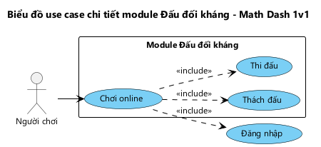

*Hình 1: Biểu đồ use case chi tiết module Đấu đối kháng.*

Người chơi khởi phát trực tiếp use case "Chơi online" (UC03) của module. Mỗi use case con ứng với giao diện mà người chơi tương tác:
- **include "Đăng nhập"**: người chơi phải đăng nhập trước khi chơi online; use case này thuộc module Tài khoản.
- **include "Thách đấu"**: ở giao diện chơi online, người chơi xem danh sách người chơi online và bấm vào tên một người đang rỗi để mời; người được mời đồng ý hoặc từ chối trên hộp thoại lời mời.
- **include "Thi đấu"**: ở giao diện thi đấu, 2 người làm lần lượt 10 câu và nộp bài; giao diện kết quả hiện kết quả, điểm trận và hỏi chơi tiếp.

Các thao tác Hủy lời mời, Từ chối, Thoát trận, Chơi tiếp, Dừng là bước trong 2 use case con trên, không phải use case riêng.

| Use case | Mô tả |
|---|---|
| Chơi online (UC03) | Vào giao diện chơi online, thách đấu một người chơi online, thi đấu trên cùng đề do server sinh, nhận kết quả do server xác định |
| Đăng nhập | Người chơi nhập tên đăng nhập, mật khẩu để vào hệ thống |
| Thách đấu | Người chơi chọn một người đang rỗi trong danh sách online và gửi lời mời; người được mời đồng ý thì server sinh đề, tạo trận và đưa cả 2 vào trận, từ chối thì người mời nhận thông báo |
| Thi đấu | Hai người làm cùng đề 10 câu, mỗi lần một câu, trong tối đa 60 giây, nộp bài; server lưu bài làm từng câu, chấm, xác định kết quả, cộng điểm; sau trận hai người chọn chơi tiếp hoặc dừng |

#### 1.1.2. Mô tả chi tiết chức năng "Chơi online"

Người chơi đăng nhập vào hệ thống → Giao diện chính xuất hiện với: chữ MATH DASH, lời chào "Xin chào, <tên>", 2 nút Chơi với máy, Chơi online, nút biểu tượng Đăng xuất ở góc phải trên → Người chơi nhấn Chơi online → Hệ thống ghi người chơi vào danh sách online với trạng thái Rỗi → Giao diện chơi online xuất hiện với: tiêu đề Chơi online, 3 nút biểu tượng ở góc phải trên là Bạn bè, Lịch sử đấu, Bảng xếp hạng, thẻ tên và tổng điểm của mình, danh sách những người khác đang ở giao diện chơi online xếp theo tổng điểm giảm dần, mỗi dòng gồm: tên, tổng điểm, trạng thái Rỗi màu xanh hoặc Bận màu xám, danh sách tự cập nhật khi có người vào, người rời hoặc đổi trạng thái → Người chơi bấm vào tên một người đang rỗi → Hệ thống gửi lời mời tới máy người đó và hiện hộp thoại "Đang chờ <tên> trả lời..." với nút Hủy → Máy người được mời hiện hộp thoại "<tên> (<tổng điểm> điểm) thách đấu bạn" với 2 nút Đồng ý, Từ chối → Người được mời nhấn Đồng ý → Server kiểm tra cả 2 vẫn online và rỗi, sinh đề 10 câu, tạo trận, chuyển cả 2 sang Bận và gửi đề cho cả 2 máy → Giao diện thi đấu xuất hiện trên cả 2 máy, mỗi lần một câu, với: ô thời gian đếm ngược từ 01:00, dòng trạng thái "<tên đối thủ> đang làm bài", dòng "Câu 1/10", phép tính chữ lớn, 4 ô phương án xếp 2 × 2 là A màu đỏ, B màu xanh dương, C màu vàng, D màu xanh lá, nút Thoát → Người chơi bấm một ô → Hệ thống ghi phương án đã chọn và thời gian làm câu tính từ lúc câu hiện ra, chưa báo đúng hay sai, rồi hiện câu tiếp theo → Người chơi làm lần lượt tới câu thứ 10 → Giao diện ẩn 4 ô, hiện dòng "Đã làm xong 10 câu" và nút Nộp bài → Người chơi nhấn Nộp bài → Server ghi thời điểm nộp, lưu bài làm từng câu và chấm bài → Giao diện hiện "Đã nộp bài, đang chờ đối thủ...", máy đối thủ đổi dòng trạng thái thành "<tên> đã nộp bài" → Khi cả 2 đã nộp, server xác định kết quả, cộng điểm trận, cập nhật tổng điểm và báo cả 2 máy → Giao diện kết quả hiện đè lên giao diện thi đấu với: dòng THẮNG! màu xanh, THUA! màu đỏ hoặc HÒA! màu vàng, số câu đúng và thời gian làm bài của 2 người, điểm trận được cộng và tổng điểm mới, câu hỏi "Chơi tiếp?" với 2 nút Chơi tiếp, Dừng → Người chơi nhấn Chơi tiếp → Giao diện hiện "Đang chờ đối thủ..." → Đối thủ cũng nhấn Chơi tiếp → Server sinh đề mới, tạo trận mới → Cả 2 máy vào giao diện thi đấu của trận mới.

#### 1.1.3. Kịch bản UC03 "Chơi online"

| | |
|---|---|
| **Use case** | Chơi online (UC03), gồm Thách đấu, Thi đấu |
| **Actor** | Người chơi: Hùng ở máy 1 là người mời, Hoàng ở máy 2 là người được mời; mỗi người là actor trên máy của mình |
| **Tiền điều kiện** | Cả 2 người chơi đã đăng nhập, máy có kết nối mạng; Hùng đang ở giao diện chính trên máy 1; Hoàng đã vào giao diện chơi online trên máy 2 |
| **Hậu điều kiện** | Trận đấu được lưu trên server cùng đề, bài làm từng câu, số câu đúng và thời gian nộp bài của 2 người; tổng điểm của 2 người được cập nhật; cả 2 thấy cùng một kết quả |

Kịch bản chuẩn chia 4 đoạn; đoạn A, B thuộc use case con Thách đấu, đoạn C, D thuộc use case con Thi đấu:
- A. Gửi lời thách đấu (máy 1).
- B. Nhận lời thách đấu (máy 2).
- C. Thi đấu (máy 1; máy 2 diễn ra tương tự).
- D. Chơi tiếp.

**Kịch bản chuẩn**

**A. Gửi lời thách đấu**

1. Trên máy 1, giao diện chính của Hùng gồm:

   | Thành phần | Giá trị |
   |---|---|
   | Tiêu đề | MATH DASH |
   | Lời chào | Xin chào, HUNG |
   | Nút | **Chơi với máy**, **Chơi online** |
   | Góc phải trên | Nút Đăng xuất dạng biểu tượng |

2. Hùng nhấn **Chơi online**.
3. Hệ thống ghi HUNG vào danh sách online với trạng thái Rỗi. Giao diện chơi online hiện lên gồm:

   | Thành phần | Giá trị |
   |---|---|
   | Thanh trên | Tiêu đề CHƠI ONLINE; góc phải trên có 3 nút biểu tượng **Bạn bè**, **Lịch sử đấu**, **Bảng xếp hạng** |
   | Thẻ thông tin | HUNG · 12,5 điểm |
   | Mục Người chơi online | Bảng dưới đây |

   | Tên | Tổng điểm | Trạng thái |
   |---|---|---|
   | MINH | 15 | Bận |
   | HOANG | 9 | Rỗi |
   | LAN | 4,5 | Rỗi |

   Trên máy 2 và máy 4, dòng HUNG · 12,5 · Rỗi xuất hiện trong danh sách.
4. Hùng bấm vào dòng HOANG.
5. Hệ thống thấy HOANG đang rỗi, gửi lời mời tới máy 2. Máy 1 hiện hộp thoại "Đang chờ HOANG trả lời..." với nút **Hủy**.

**B. Nhận lời thách đấu**

6. Trên máy 2, Hoàng đang ở giao diện chơi online. Hộp thoại "HUNG (12,5 điểm) thách đấu bạn" hiện lên với 2 nút **Đồng ý**, **Từ chối**.
7. Hoàng nhấn **Đồng ý**.
8. Server kiểm tra HUNG và HOANG vẫn online và đang rỗi. Server sinh đề 10 câu như bảng dữ liệu mẫu, tạo trận số 37 bắt đầu lúc 20:15:03,0, chuyển HUNG và HOANG sang Bận, rồi gửi đề cho cả 2 máy.
9. Máy 2 chuyển sang giao diện thi đấu. Cùng lúc, máy 1 đóng hộp thoại chờ và chuyển sang giao diện thi đấu. Trên máy của Lan, HUNG và HOANG chuyển sang Bận.

**C. Thi đấu**

10. Giao diện thi đấu trên máy 1 hiện câu 1, gồm:

    | Thành phần | Giá trị |
    |---|---|
    | Ô thời gian | 01:00, đếm ngược mỗi giây |
    | Trạng thái đối thủ | HOANG đang làm bài |
    | Số thứ tự câu | Câu 1/10 |
    | Phép tính | 12 + 7 = ? |
    | 4 ô phương án | **A** 17 (đỏ), **B** 19 (xanh dương), **C** 21 (vàng), **D** 18 (xanh lá) |
    | Nút | **Thoát** |

    Máy 2 hiện cùng câu 1, dòng trạng thái là "HUNG đang làm bài".
11. Sau 3,1 giây, Hùng bấm ô **B** 19.
12. Hệ thống ghi câu 1 của HUNG: phương án 19, thời gian 3,1 giây. Ô B giữ nguyên, 3 ô còn lại mờ đi, không báo đúng hay sai. Câu 2 hiện ra: "Câu 2/10", "9 × 6 = ?", **A** 48, **B** 54, **C** 56, **D** 63.
13. Các bước 11–12 lặp lại cho đến câu thứ 10. Hùng lần lượt chọn 54, 27, 56, 61, 33, 84, 85, 45, 90, thời gian từng câu như bảng bài làm ở dữ liệu mẫu.
14. Sau khi Hùng chọn ở câu 10, thẻ câu hỏi chỉ còn dòng "Đã làm xong 10 câu", 4 ô ẩn đi, nút **Nộp bài** hiện cạnh nút **Thoát**. Ô thời gian còn 00:22.
15. Hùng nhấn **Nộp bài**.
16. Máy 1 hiện "Đang nộp bài...". Server nhận bài làm của HUNG lúc 20:15:41,2, tức thời gian làm bài 38,2 giây, lưu phương án và thời gian làm từng câu, chấm đúng 10/10 câu. Máy 1 ẩn nút Nộp bài, hiện "Đã nộp bài, đang chờ đối thủ...". Trên máy 2, dòng trạng thái đổi thành "HUNG đã nộp bài".
17. Hoàng làm xong 10 câu và nộp bài trên máy 2. Server nhận lúc 20:15:48,6, tức 45,6 giây, lưu bài làm từng câu, đúng 10/10 câu.
18. Server xác định kết quả: không ai bỏ trận, cả 2 đúng hết, HUNG nộp nhanh hơn nên HUNG thắng. HUNG được 1 điểm, tổng điểm thành 13,5; HOANG được 0 điểm, tổng điểm giữ 9. Server lưu trận và báo cả 2 máy.
19. Giao diện kết quả hiện lên trên máy 1 gồm:

    | Thành phần | Giá trị |
    |---|---|
    | Dòng kết quả | **THẮNG!** (màu xanh) |
    | Bạn | 10/10 câu đúng · 38,2 giây |
    | HOANG | 10/10 câu đúng · 45,6 giây |
    | Điểm | +1 điểm · Tổng điểm: 13,5 |
    | Câu hỏi | Chơi tiếp? |
    | Nút | **Chơi tiếp**, **Dừng** |

    Máy 2 hiện **THUA!** (màu đỏ), +0 điểm, tổng điểm 9.

**D. Chơi tiếp**

20. Hùng nhấn **Chơi tiếp**. Máy 1 ẩn 2 nút, hiện "Đang chờ đối thủ...".
21. Hoàng nhấn **Chơi tiếp** trên máy 2.
22. Server sinh đề mới, câu đầu là 23 + 48, tạo trận số 38 và gửi đề cho cả 2 máy.
23. Cả 2 máy hiện giao diện thi đấu của trận 38: ô thời gian 01:00, "Câu 1/10", "23 + 48 = ?". Trận diễn ra như các bước 10–19.

**Kịch bản ngoại lệ**

| Bước | Tình huống ngoại lệ và cách xử lý |
|---|---|
| 3 | **Không có ai khác online.** Chỉ có HUNG ở giao diện chơi online. Mục Người chơi online hiện "Chưa có ai khác online"; danh sách tự hiện người chơi khi có người vào. |
| 3 | **Rời giao diện chơi online.** Hùng nhấn Back. Hệ thống xóa HUNG khỏi danh sách online; máy 1 về giao diện chính. Trên máy 2 và máy 4, dòng HUNG biến khỏi danh sách; không ai thách đấu được HUNG cho tới khi Hùng nhấn lại **Chơi online**. |
| 4 | Hùng bấm vào dòng MINH. MINH đang Bận nên hệ thống báo "MINH đang bận", không gửi lời mời, giữ nguyên giao diện chơi online. |
| 5 | **Hủy lời mời.** Hùng nhấn **Hủy** trên hộp thoại chờ. Lời mời bị hủy, máy 1 ở lại giao diện chơi online. Nếu Hoàng nhấn Đồng ý sau đó, server thấy lời mời đã hủy nên không tạo trận; máy 2 báo "Không bắt đầu được trận đấu". |
| 7 | **Từ chối.** Hoàng nhấn **Từ chối**. Máy 2 đóng hộp thoại. Máy 1 đóng hộp thoại chờ và báo "HOANG đã từ chối lời mời"; Hùng vẫn ở giao diện chơi online, có thể mời người khác. |
| 8 | Hùng rời giao diện chơi online hoặc tắt ứng dụng trước khi Hoàng nhấn Đồng ý. Server thấy HUNG không còn online nên không tạo trận. Máy 2 báo "Không bắt đầu được trận đấu" và ở lại giao diện chơi online. |
| 11–15 | **Hết giờ.** Hùng mới làm 8 câu thì ô thời gian về 00:00. Thẻ câu hỏi hiện "Hết giờ", hệ thống tự nộp bài; câu 9 và câu 10 ghi là bỏ trống và tính là sai, HUNG đúng 8/10. Nếu Hùng đã làm xong 10 câu nhưng chưa nhấn Nộp bài thì hệ thống cũng tự nộp đủ 10 câu. |
| 11–15 | **Thoát trận.** Hùng nhấn **Thoát**. Hệ thống hỏi "Thoát sẽ bị xử thua?" với 2 nút **Ở lại**, **Thoát**. Hùng nhấn **Thoát**: server xử HUNG thua, HOANG thắng và được 1 điểm (tổng 10), trả cả 2 về Rỗi. Máy 1 về giao diện chơi online. Máy 2 báo "Đối thủ đã thoát, bạn thắng" và hiện giao diện kết quả THẮNG! chỉ có nút **Về menu**, không hỏi chơi tiếp. Nhấn **Ở lại** thì tiếp tục làm bài ở câu đang làm, ô thời gian vẫn chạy. |
| 11–17 | **Đối thủ mất kết nối.** Máy 2 mất mạng khi đang làm bài. HOANG biến khỏi danh sách online; hệ thống xử HOANG bỏ trận. Máy 1 báo "Đối thủ đã thoát, bạn thắng" như ngoại lệ trên. |
| 16 | Máy 1 không kết nối được server khi nộp bài. Hệ thống báo "Không kết nối được máy chủ, kiểm tra kết nối mạng", nút Nộp bài hiện lại để Hùng nộp lại; ô thời gian vẫn chạy. |
| 18 | **Một người đúng hết.** Hoàng chọn ô **A** 74 ở câu 7, đúng 9/10, dù nộp ở giây 30,0. HUNG đúng hết nên HUNG thắng, không xét thời gian. |
| 18 | **Hòa.** HUNG chọn ô **B** 23 ở câu 3, HOANG chọn ô **C** 35 ở câu 9; cả 2 đều có câu sai nên hòa. Mỗi người được 0,5 điểm: HUNG 13, HOANG 9,5. Giao diện kết quả hiện **HÒA!** (màu vàng). |
| 20–21 | **Dừng chơi.** Hoàng nhấn **Dừng**. Server trả HUNG và HOANG về Rỗi. Máy 2 về giao diện chơi online. Máy 1 báo "Đối thủ đã dừng chơi" và về giao diện chơi online. |

### 1.2. Chức năng "Xem lịch sử đấu"

#### 1.2.1. Biểu đồ use case chi tiết module Xem lịch sử đấu

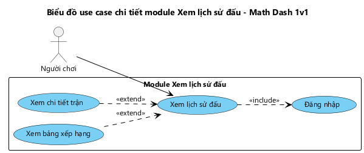

*Hình 2: Biểu đồ use case chi tiết module Xem lịch sử đấu.*

Người chơi khởi phát trực tiếp use case "Xem lịch sử đấu" (UC04). Mỗi use case con ứng với giao diện mà người chơi tương tác:
- **include "Đăng nhập"**: người chơi phải đăng nhập trước khi xem lịch sử đấu; use case này thuộc module Tài khoản.
- **"Xem chi tiết trận" extend "Xem lịch sử đấu"**: ở giao diện lịch sử đấu, người chơi có thể bấm vào một trận để mở giao diện chi tiết trận.
- **"Xem bảng xếp hạng" extend "Xem lịch sử đấu"**: người chơi có thể mở thẻ Bảng xếp hạng, bằng nút Bảng xếp hạng ở giao diện chơi online hoặc chọn thẻ khi đang xem lịch sử đấu.

| Use case | Mô tả |
|---|---|
| Xem lịch sử đấu (UC04) | Xem tỉ lệ thắng / hòa / thua dạng biểu đồ tròn và danh sách các trận chơi online mình đã đấu, trận mới nhất đứng đầu |
| Đăng nhập | Người chơi nhập tên đăng nhập, mật khẩu để vào hệ thống |
| Xem chi tiết trận | Xem đối thủ, kết quả, điểm trận, số câu đúng và thời gian làm bài của 2 bên; 10 câu của đề, mỗi câu có phép tính kèm đáp án đúng và bài làm của từng người: đúng / sai, phương án đã chọn, thời gian làm câu |
| Xem bảng xếp hạng | Xem thứ hạng mọi người chơi theo tổng điểm, trung bình điểm đối thủ, trung bình thời gian thắng |

#### 1.2.2. Mô tả chi tiết chức năng "Xem lịch sử đấu"

Người chơi đăng nhập vào hệ thống → Giao diện chính xuất hiện với 2 nút Chơi với máy, Chơi online → Người chơi nhấn Chơi online → Giao diện chơi online xuất hiện với: 3 nút biểu tượng Bạn bè, Lịch sử đấu, Bảng xếp hạng ở góc phải trên, thẻ tên và tổng điểm của mình, danh sách người chơi online → Người chơi nhấn nút Lịch sử đấu → Hệ thống lấy các trận chơi online đã kết thúc mà người chơi tham gia, trận mới nhất đứng đầu → Giao diện lịch sử đấu xuất hiện với: tiêu đề Lịch sử đấu, 2 thẻ Trận của tôi và Bảng xếp hạng, thẻ Trận của tôi mở sẵn gồm biểu đồ tròn chia 3 phần Thắng màu xanh lá, Hòa màu vàng, Thua màu đỏ, giữa biểu đồ ghi tỉ lệ thắng, bên cạnh ghi số trận thắng, hòa, thua và tổng số trận, dưới là danh sách trận, mỗi dòng gồm: dải màu theo kết quả, tên đối thủ, số trận, THẮNG / HÒA / THUA, điểm trận, số câu đúng của mình và của đối thủ, thời điểm kết thúc → Người chơi bấm vào một trận → Hệ thống lấy trận kèm đề, đáp án đúng và bài làm từng câu của 2 người → Giao diện chi tiết trận xuất hiện với: tiêu đề Chi tiết trận, dòng "Trận #<số trận> · <ngày giờ kết thúc>", dòng kết quả THẮNG! / THUA! / HÒA! và điểm trận, khung so sánh tên, số câu đúng, thời gian làm bài của mình và của đối thủ, mục Từng câu gồm hàng tiêu đề cột #, Câu, tên mình, tên đối thủ và 10 dòng, mỗi dòng gồm: số thứ tự, phép tính kèm đáp án đúng, với mỗi người chơi một ô ghi ✓ màu xanh hoặc ✗ màu đỏ kèm phương án đã chọn và thời gian làm câu, câu bỏ trống ghi "Bỏ trống" → Người chơi nhấn Back → Giao diện lịch sử đấu hiện lại → Người chơi chọn thẻ Bảng xếp hạng, hoặc từ giao diện chơi online nhấn nút Bảng xếp hạng để mở thẳng thẻ này → Hệ thống lấy mọi người chơi và các trận đã kết thúc, xếp hạng theo tổng điểm giảm dần, cùng tổng điểm thì theo trung bình tổng điểm các đối thủ đã gặp giảm dần, cùng cả 2 thì theo trung bình thời gian làm bài trong các trận thắng tăng dần, người chưa thắng trận nào ghi "—" và đứng sau → Thẻ Bảng xếp hạng hiện danh sách mọi người chơi, mỗi dòng gồm: hạng, tên, tổng điểm, trung bình điểm đối thủ, trung bình thời gian thắng, dòng của chính người chơi được tô nổi bật → Người chơi nhấn Back → Hệ thống quay về giao diện chơi online.

#### 1.2.3. Kịch bản UC04 "Xem lịch sử đấu"

| | |
|---|---|
| **Use case** | Xem lịch sử đấu (UC04), gồm Xem chi tiết trận, Xem bảng xếp hạng |
| **Actor** | Người chơi (Hùng) |
| **Tiền điều kiện** | Hùng đã đăng nhập, máy có kết nối mạng, đang ở giao diện chơi online; Hùng đã đấu 20 trận online, trận gần nhất là trận số 37 |
| **Hậu điều kiện** | Hùng thấy tỉ lệ thắng / hòa / thua, các trận đã đấu, chi tiết một trận và thứ hạng của mọi người chơi; dữ liệu không thay đổi |

Kịch bản chuẩn chia 2 đoạn; đoạn A gồm phần chính của use case và use case con Xem chi tiết trận, đoạn B là use case con Xem bảng xếp hạng:
- A. Xem trận của tôi và chi tiết trận.
- B. Xem bảng xếp hạng.

**Kịch bản chuẩn**

**A. Xem trận của tôi và chi tiết trận**

1. Ở giao diện chơi online (thẻ thông tin "HUNG · 13,5 điểm"), Hùng nhấn nút biểu tượng **Lịch sử đấu** ở góc phải trên.
2. Hệ thống lấy 20 trận đã kết thúc của HUNG, trận mới nhất đứng đầu. Giao diện lịch sử đấu hiện lên, thẻ **Trận của tôi** được mở sẵn, gồm:

   | Thành phần | Giá trị |
   |---|---|
   | Thanh trên | Tiêu đề LỊCH SỬ ĐẤU |
   | Thẻ | **Trận của tôi** (đang chọn), Bảng xếp hạng |
   | Biểu đồ tròn | Thắng 60%, Hòa 15%, Thua 25%; giữa biểu đồ ghi "60% thắng" |
   | Chú giải | Thắng 12 · Hòa 3 · Thua 5 · 20 trận |
   | Danh sách trận | Bảng dưới đây, cuộn xuống để xem các trận cũ hơn |

   | Trận | Đối thủ | Kết quả | Điểm | Câu đúng | Kết thúc |
   |---|---|---|---|---|---|
   | #37 | HOANG | THẮNG | +1 | 10 – 10 | 25/10 20:15 |
   | #35 | LAN | HÒA | +0,5 | 9 – 8 | 25/10 19:58 |
   | #33 | MINH | THUA | +0 | 10 – 10 | 25/10 19:40 |
   | #28 | HOANG | THẮNG · Đối thủ bỏ trận | +1 | 6 – 3 | 24/10 20:47 |
   | … | … | … | … | … | … |

   Tổng điểm trận của 20 trận là 12 × 1 + 3 × 0,5 = 13,5, khớp với tổng điểm của HUNG.
3. Hùng bấm vào dòng trận #37.
4. Hệ thống lấy trận 37 kèm đề, đáp án đúng và bài làm từng câu của HUNG và HOANG. Giao diện chi tiết trận hiện lên gồm:

   | Thành phần | Giá trị |
   |---|---|
   | Thanh trên | Tiêu đề CHI TIẾT TRẬN |
   | Dòng trận | Trận #37 · 25/10/2026 20:15 |
   | Dòng kết quả | **THẮNG!** (màu xanh) · +1 điểm |
   | Cột HUNG | 10/10 câu · 38,2 giây |
   | Cột HOANG | 10/10 câu · 45,6 giây |
   | Mục Từng câu | Bảng dưới đây |

   | # | Câu | HUNG | HOANG |
   |---|---|---|---|
   | 1 | 12 + 7 = 19 | ✓ 19 · 3,1 s | ✓ 19 · 4,0 s |
   | 2 | 9 × 6 = 54 | ✓ 54 · 4,0 s | ✓ 54 · 4,4 s |
   | 3 | 45 − 18 = 27 | ✓ 27 · 3,4 s | ✓ 27 · 4,0 s |
   | 4 | 8 × 7 = 56 | ✓ 56 · 3,8 s | ✓ 56 · 4,7 s |
   | 5 | 36 + 25 = 61 | ✓ 61 · 3,7 s | ✓ 61 · 4,3 s |
   | 6 | 72 − 39 = 33 | ✓ 33 · 3,5 s | ✓ 33 · 4,1 s |
   | 7 | 7 × 12 = 84 | ✓ 84 · 4,1 s | ✓ 84 · 4,9 s |
   | 8 | 58 + 27 = 85 | ✓ 85 · 3,2 s | ✓ 85 · 3,8 s |
   | 9 | 91 − 46 = 45 | ✓ 45 · 3,6 s | ✓ 45 · 4,4 s |
   | 10 | 6 × 15 = 90 | ✓ 90 · 2,8 s | ✓ 90 · 3,7 s |

   Mỗi ô bài làm hiện 2 dòng: dòng trên là dấu ✓ màu xanh kèm phương án đã chọn, dòng dưới là thời gian làm câu. Ví dụ câu 1: HUNG chọn đúng 19 sau 3,1 giây, HOANG chọn đúng 19 sau 4,0 giây.
5. Hùng xem xong và nhấn Back.
6. Giao diện lịch sử đấu hiện lại ở thẻ Trận của tôi, danh sách giữ nguyên vị trí.
7. Hùng nhấn Back.
8. Giao diện chơi online hiện lại.

**B. Xem bảng xếp hạng**

9. Ở giao diện chơi online, Hùng nhấn nút biểu tượng **Bảng xếp hạng** ở góc phải ngoài cùng.
10. Hệ thống lấy mọi người chơi và các trận đã kết thúc, tính 3 tiêu chí rồi sắp xếp. Giao diện lịch sử đấu hiện lên với thẻ **Bảng xếp hạng** được mở sẵn, thẻ Trận của tôi nằm bên cạnh để chọn qua lại. Thẻ Bảng xếp hạng hiện danh sách:

    | Hạng | Tên | Tổng điểm | TB điểm đối thủ | TB thời gian thắng |
    |---|---|---|---|---|
    | 1 | MINH | 15 | 10,5 | 41,3 giây |
    | 2 | **HUNG** (dòng nổi bật) | 13,5 | 11 | 39,8 giây |
    | 3 | LAN | 13,5 | 9 | 44,0 giây |
    | 4 | HOANG | 9 | 13,5 | 47,2 giây |
    | 5 | AN | 4,5 | 12 | 49,0 giây |
    | 6 | NAM | 4,5 | 12 | 52,1 giây |
    | 7 | TUAN | 0 | 13,5 | — |

    - HUNG và LAN cùng 13,5 điểm, HUNG đã gặp các đối thủ mạnh hơn (11 so với 9) nên đứng trên.
    - AN và NAM trùng cả 2 tiêu chí đầu, AN thắng nhanh hơn nên đứng trên.
11. Hùng xem danh sách rồi nhấn Back.
12. Giao diện chơi online hiện lại.

**Kịch bản ngoại lệ**

| Bước | Tình huống ngoại lệ và cách xử lý |
|---|---|
| 2 | **Chưa đấu trận nào.** TUAN vừa đăng ký, mở Lịch sử đấu. Biểu đồ tròn để trống, chú giải ghi "Thắng 0 · Hòa 0 · Thua 0 · 0 trận", danh sách hiện "Bạn chưa đấu trận nào". |
| 2 | Máy mất mạng hoặc server không phản hồi. Hệ thống báo "Không tải được lịch sử đấu, kiểm tra kết nối mạng", biểu đồ và danh sách để trống; Hùng nhấn Back để về giao diện chơi online. |
| 2 | **Trận có người bỏ trận.** Ở trận #28, HOANG nhấn Thoát giữa trận nên bị xử thua. Dòng của trận ghi "THẮNG · Đối thủ bỏ trận"; trên máy của Hoàng, dòng này ghi "THUA · Bạn bỏ trận". |
| 4 | Máy mất mạng khi Hùng bấm vào trận #37. Hệ thống báo "Không tải được chi tiết trận, kiểm tra kết nối mạng"; giao diện chi tiết trận chỉ có dòng "Trận #37", các mục kết quả và từng câu để trống. Hùng nhấn Back để quay lại giao diện lịch sử đấu. |
| 4 | **Có câu sai hoặc bỏ trống.** Hùng bấm vào trận #35 với LAN, HÒA 9 – 8. Ở câu 3 của trận này, HUNG chọn sai nên ô của HUNG hiện "✗ 23" màu đỏ, dòng dưới "5,2 s". LAN chưa làm câu 10 khi hết giờ nên ô của LAN ở câu 10 hiện "Bỏ trống" màu xám. |
| 4 | **Người bỏ trận chưa nộp bài.** Hùng cuộn xuống và bấm vào trận #12 với AN. AN nhấn Thoát ở câu 4 khi chưa nộp bài nên không có bài làm: cột AN ở khung so sánh ghi "Bỏ trận", mọi ô bài làm của AN ở mục Từng câu ghi "—". |
| 10 | Máy mất mạng khi Hùng mở thẻ Bảng xếp hạng. Hệ thống báo "Không tải được bảng xếp hạng, kiểm tra kết nối mạng", danh sách để trống; Hùng chọn thẻ Trận của tôi rồi chọn lại thẻ Bảng xếp hạng để tải lại. |
| 10 | **Chọn qua lại 2 thẻ.** Đang ở thẻ Bảng xếp hạng, Hùng chọn thẻ Trận của tôi. Giao diện hiện biểu đồ tròn và danh sách trận như bước 2; Hùng bấm vào một trận để xem chi tiết như bước 3–4. |

### 1.3. Chức năng "Quản lý bạn bè"

**Dữ liệu mẫu:**

| Người chơi | Tên đăng nhập | Tên hiển thị | Tổng điểm | Đang online | Máy |
|---|---|---|---|---|---|
| Hùng | hung | HUNG | 13,5 | Có | Máy 1, người gửi lời mời |
| Hoàng | hoang | HOANG | 9 | Có | Máy 2, người nhận lời mời |
| Minh | minh | MINH | 15 | Có | Máy 3 |
| Tuấn | tuan | TUAN | 0 | Không | |
| Lan | lan | LAN | 13,5 | Không | |

Quan hệ bạn bè có sẵn trước khi bắt đầu:

| Người gửi | Người nhận | Trạng thái | Thời điểm gửi |
|---|---|---|---|
| MINH | HUNG | Đã là bạn bè | 20/10/2026 19:02 |
| HUNG | TUAN | Đã là bạn bè | 22/10/2026 08:45 |
| LAN | HUNG | Đang chờ trả lời | 26/10/2026 21:30 |

#### 1.3.1. Biểu đồ use case chi tiết module Bạn bè

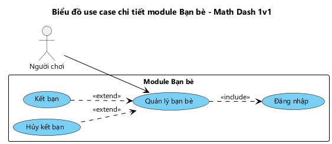

*Hình 3: Biểu đồ use case chi tiết module Bạn bè.*

Người chơi khởi phát trực tiếp use case "Quản lý bạn bè" (UC07). Cả module chỉ có một giao diện bạn bè; use case con là các việc làm thay đổi quan hệ bạn bè:
- **include "Đăng nhập"**: người chơi phải đăng nhập trước khi quản lý bạn bè; use case này thuộc module Tài khoản.
- **"Kết bạn" extend "Quản lý bạn bè"**: người chơi gửi lời mời bằng tên đăng nhập của một người; người nhận đồng ý thì 2 người thành bạn bè, từ chối thì lời mời bị xóa.
- **"Hủy kết bạn" extend "Quản lý bạn bè"**: một trong 2 người xóa quan hệ bạn bè; người gửi cũng rút lại lời mời chưa được trả lời theo cách này.

Đồng ý, Từ chối là bước của use case Kết bạn, không phải use case riêng.

| Use case | Mô tả |
|---|---|
| Quản lý bạn bè (UC07) | Mở giao diện bạn bè để xem lời mời đã nhận, các bạn bè kèm tổng điểm và trạng thái Online / Offline, các lời mời mình đã gửi |
| Đăng nhập | Người chơi nhập tên đăng nhập, mật khẩu để vào hệ thống |
| Kết bạn | Người chơi gửi lời mời bằng tên đăng nhập; người nhận đồng ý thì hai người trở thành bạn bè, từ chối thì lời mời bị xóa |
| Hủy kết bạn | Xóa quan hệ bạn bè, hoặc rút lại lời mời mình đã gửi |

#### 1.3.2. Mô tả chi tiết chức năng "Quản lý bạn bè"

Người chơi đăng nhập vào hệ thống → Giao diện chính xuất hiện với 2 nút Chơi với máy, Chơi online → Người chơi nhấn Chơi online → Giao diện chơi online xuất hiện với: 3 nút biểu tượng Bạn bè, Lịch sử đấu, Bảng xếp hạng ở góc phải trên, thẻ tên và tổng điểm của mình, danh sách người chơi online → Người chơi nhấn nút Bạn bè → Hệ thống lấy các lời mời kết bạn, các quan hệ bạn bè của người chơi và danh sách người đang online → Giao diện bạn bè xuất hiện với: tiêu đề Bạn bè, ô nhập tên đăng nhập và nút Kết bạn, mục "Lời mời kết bạn (số lời mời)" chỉ hiện khi có lời mời đã nhận, mỗi dòng gồm tên người gửi, nút Đồng ý, nút Từ chối, mục "Bạn bè (số người)" mỗi dòng gồm chấm trạng thái xanh Online hoặc xám Offline, tên, tổng điểm, nút Hủy kết bạn dạng biểu tượng ×, các lời mời mình đã gửi nằm cuối mục với chữ xám "Đang chờ trả lời", trạng thái Online / Offline tự cập nhật → Người chơi nhập tên đăng nhập của một người và nhấn Kết bạn → Hệ thống tìm người chơi theo tên đăng nhập, kiểm tra giữa 2 người chưa có lời mời hay quan hệ bạn bè nào và tạo lời mời đang chờ → Hệ thống thông báo "Đã gửi lời mời kết bạn tới <tên>", xóa trống ô tên đăng nhập và thêm dòng "<tên> · Đang chờ trả lời" vào cuối mục Bạn bè → Người nhận mở giao diện bạn bè trên máy của mình, thấy lời mời ở mục Lời mời kết bạn và nhấn Đồng ý → Hệ thống kiểm tra lời mời vẫn đang chờ, ghi nhận 2 người là bạn bè → Lời mời biến khỏi mục Lời mời kết bạn, người gửi hiện trong mục Bạn bè với tổng điểm và trạng thái → Người chơi nhấn × ở một người bạn → Hệ thống hỏi "Hủy kết bạn với <tên>?" với 2 nút Không, Hủy kết bạn → Người chơi nhấn Hủy kết bạn → Hệ thống xóa quan hệ bạn bè, dòng đó biến khỏi danh sách → Người chơi nhấn Back → Hệ thống quay về giao diện chơi online.

#### 1.3.3. Kịch bản UC07 "Quản lý bạn bè"

| | |
|---|---|
| **Use case** | Quản lý bạn bè (UC07), gồm Kết bạn |
| **Actor** | Người chơi: Hùng ở máy 1 là người gửi lời mời, Hoàng ở máy 2 là người nhận; mỗi người là actor trên máy của mình |
| **Tiền điều kiện** | Cả 2 người chơi đã đăng nhập, máy có kết nối mạng, đang ở giao diện chơi online; giữa HUNG và HOANG chưa có lời mời hay quan hệ bạn bè nào |
| **Hậu điều kiện** | Server lưu quan hệ bạn bè giữa HUNG và HOANG; mỗi người thấy người kia trong danh sách bạn bè |

Kịch bản chuẩn chia 2 đoạn, cùng thuộc use case con Kết bạn:
- A. Gửi lời mời kết bạn (máy 1).
- B. Đồng ý lời mời kết bạn (máy 2).

**Kịch bản chuẩn**

**A. Gửi lời mời kết bạn**

1. Ở giao diện chơi online trên máy 1 (thẻ thông tin "HUNG · 13,5 điểm"), Hùng nhấn nút biểu tượng **Bạn bè** ở góc phải trên.
2. Hệ thống lấy lời mời và quan hệ bạn bè của HUNG, cùng danh sách người chơi đang online. Giao diện bạn bè hiện lên gồm:

   | Thành phần | Giá trị |
   |---|---|
   | Thanh trên | Tiêu đề BẠN BÈ |
   | Ô tên đăng nhập | Trống |
   | Nút | **Kết bạn** |
   | Lời mời kết bạn (1) | LAN, nút **Đồng ý**, nút **Từ chối** |
   | Bạn bè (2) | Bảng dưới đây |

   | Trạng thái | Tên | Tổng điểm | Nút |
   |---|---|---|---|
   | ● Online (xanh) | MINH | 15 | × |
   | ● Offline (xám) | TUAN | 0 | × |

3. Hùng nhập "hoang" vào ô tên đăng nhập và nhấn **Kết bạn**.
4. Hệ thống tìm thấy người chơi HOANG, thấy giữa HUNG và HOANG chưa có lời mời hay quan hệ nào, tạo lời mời kết bạn đang chờ lúc 21:40 ngày 27/10/2026. Máy 1 thông báo "Đã gửi lời mời kết bạn tới HOANG", xóa trống ô tên đăng nhập. Mục Bạn bè đổi thành:

   | Trạng thái | Tên | Tổng điểm | Nút |
   |---|---|---|---|
   | ● Online (xanh) | MINH | 15 | × |
   | ● Offline (xám) | TUAN | 0 | × |
   | ● (xám) | HOANG | Đang chờ trả lời | × |

**B. Đồng ý lời mời kết bạn**

5. Trên máy 2, Hoàng nhấn nút biểu tượng **Bạn bè** ở góc phải trên giao diện chơi online. Giao diện bạn bè hiện lên gồm:

   | Thành phần | Giá trị |
   |---|---|
   | Thanh trên | Tiêu đề BẠN BÈ |
   | Ô tên đăng nhập | Trống |
   | Nút | **Kết bạn** |
   | Lời mời kết bạn (1) | HUNG, nút **Đồng ý**, nút **Từ chối** |
   | Bạn bè (0) | "Chưa có bạn bè" |

6. Hoàng nhấn **Đồng ý** ở dòng HUNG.
7. Hệ thống thấy lời mời vẫn đang chờ và HOANG là người nhận, ghi nhận HUNG và HOANG là bạn bè. Trên máy 2, mục Lời mời kết bạn ẩn đi; mục Bạn bè (1) có một dòng: ● Online (xanh) · HUNG · 13,5 điểm · ×.
8. Lần sau Hùng mở giao diện bạn bè trên máy 1, dòng HOANG trong mục Bạn bè đổi thành ● Online (xanh) · HOANG · 9 điểm · ×.

**Kịch bản ngoại lệ**

| Bước | Tình huống ngoại lệ và cách xử lý |
|---|---|
| 2 | **Từ chối.** Hùng nhấn **Từ chối** ở dòng LAN. Hệ thống xóa lời mời của LAN; mục Lời mời kết bạn ẩn đi. LAN không nhận thông báo nào. |
| 2 | **Hủy kết bạn.** Hùng nhấn × ở dòng TUAN. Hệ thống hỏi "Hủy kết bạn với TUAN?" với 2 nút **Không**, **Hủy kết bạn**. Hùng nhấn **Hủy kết bạn**: hệ thống xóa quan hệ, mục Bạn bè còn MINH. Nhấn **Không** thì giữ nguyên. |
| 2 | Máy 1 không kết nối được server. Hệ thống báo "Không kết nối được máy chủ, kiểm tra kết nối mạng", 2 mục để trống; Hùng nhấn Back để về giao diện chơi online. |
| 3 | Hùng nhấn **Kết bạn** khi ô tên đăng nhập trống. Hệ thống báo "Vui lòng nhập tên đăng nhập", không gửi gì. |
| 4 | Hùng nhập "hoangg". Không có người chơi nào có tên đăng nhập này, hệ thống báo "Không tìm thấy người chơi", giữ nguyên nội dung ô để Hùng sửa. |
| 4 | Hùng nhập "hung". Hệ thống báo "Không thể kết bạn với chính mình". |
| 4 | Hùng nhập "minh" (đã là bạn) hoặc "lan" (LAN đã gửi lời mời cho HUNG). Hệ thống báo "Đã có lời mời hoặc đã là bạn bè", không tạo lời mời mới. Muốn kết bạn với LAN thì Hùng nhấn **Đồng ý** ở mục Lời mời kết bạn. |
| 4–6 | **Rút lời mời.** Trước khi Hoàng trả lời, Hùng nhấn × ở dòng "HOANG · Đang chờ trả lời" và xác nhận. Hệ thống xóa lời mời. Hoàng nhấn **Đồng ý** sau đó thì máy 2 báo "Lời mời không còn" và dòng HUNG biến khỏi mục Lời mời kết bạn. |
| 6 | **Từ chối.** Hoàng nhấn **Từ chối** ở dòng HUNG. Hệ thống xóa lời mời. Lần sau Hùng mở giao diện bạn bè, dòng "HOANG · Đang chờ trả lời" không còn. |

---

## 2. Thiết kế cơ sở dữ liệu

Ba chức năng dùng 2 nơi lưu trữ:
- **MySQL** trên server: tài khoản, trận đấu, đề bài, kết quả chấm, bài làm từng câu và quan hệ bạn bè. Đây là nguồn dữ liệu của tổng điểm, lịch sử đấu, chi tiết trận và bảng xếp hạng.
- **Firebase Realtime Database**: người chơi đang online, lời mời, trận đang đấu. Dữ liệu này chỉ có ý nghĩa trong lúc chơi.

### 2.1. CSDL MySQL

**Bước 1: Mỗi lớp thực thể cần lưu đề xuất một bảng.**
- Player → tblPlayer.
- Match → tblMatch.
- MatchPlayer → tblMatchPlayer.
- MathProblem → tblMathProblem: server phải giữ đề và đáp án để chấm bài và để xem lại trong lịch sử đấu.
- Answer → tblAnswer: bài làm từng câu được lưu vì giao diện chi tiết trận cần hiện lại, với mỗi người chơi, từng câu đúng hay sai, phương án đã chọn và thời gian làm câu, kể cả khi trận đã xong từ lâu.
- Friendship → tblFriendship.
- Challenge không có bảng: lời mời chỉ có ý nghĩa vài giây, sau đó không chức năng nào tra lại.

**Bước 2: Thuộc tính kiểu cơ bản thành cột.**
- Bỏ thuộc tính kiểu đối tượng: Match.questions, Match.players, MatchPlayer.player, MatchPlayer.answers, Answer.problem, Friendship.sender, Friendship.receiver.
- Kiểu dữ liệu: String → varchar(255); int → integer(10); long → bigint(20); Date → datetime(3), có mili giây để so thời gian làm bài; boolean → tinyint(1).
- answerOptions luôn có 4 phần tử nên tách thành 4 cột option1 … option4.
- Kết quả:
  - tblPlayer: id, username, passwordHash, displayName, role, createdAt.
  - tblMatch: id, startedAt, endedAt.
  - tblMathProblem: id, operand1, operand2, operator, correctAnswer, option1, option2, option3, option4.
  - tblMatchPlayer: id, correctCount, submittedAt, forfeited.
  - tblAnswer: id, selectedOption, answerTime.
  - tblFriendship: id, status, createdAt.

**Bước 3: Quan hệ giữa các bảng.**
- 1 tblMatch – n tblMatchPlayer (đúng 2 dòng mỗi trận).
- 1 tblMatch – n tblMathProblem (đúng 10 dòng mỗi trận).
- 1 tblMatchPlayer – n tblAnswer (đúng 10 dòng khi người chơi đã nộp bài; không có dòng nào nếu người chơi bỏ trận trước khi nộp).
- 1 tblMathProblem – n tblAnswer (tối đa 2 dòng cho mỗi câu, mỗi người chơi trong trận một dòng).
- 1 tblPlayer – n tblMatchPlayer.
- 1 tblPlayer – n tblFriendship ở vai trò người gửi, và 1 tblPlayer – n tblFriendship ở vai trò người nhận. Quan hệ bạn bè n-n giữa người chơi với người chơi đã được tách bằng tblFriendship.
- Quan hệ n-n tblPlayer – tblMatch đã được tách bằng tblMatchPlayer từ thiết kế lớp thực thể; quan hệ n-n tblMatchPlayer – tblMathProblem đã được tách bằng tblAnswer.

**Bước 4: Khóa.**
- **Khóa chính:** id (AUTO_INCREMENT) ở mọi bảng.
- **Khóa ngoại** đặt ở bảng phía n:
  - tblMatchPlayer.tblMatchId → tblMatch.id và tblMathProblem.tblMatchId → tblMatch.id, có ON DELETE CASCADE đúng với quan hệ hợp thành.
  - tblAnswer.tblMatchPlayerId → tblMatchPlayer.id và tblAnswer.tblMathProblemId → tblMathProblem.id, có ON DELETE CASCADE: xóa trận thì xóa luôn 2 người chơi trong trận và 10 câu hỏi, kéo theo xóa luôn bài làm từng câu của 2 người.
  - tblMatchPlayer.tblPlayerId → tblPlayer.id.
  - tblFriendship.tblPlayerSenderId và tblFriendship.tblPlayerReceiverId → tblPlayer.id. Hai khóa cùng trỏ tới tblPlayer nên tên khóa thêm vai trò. Có ON DELETE CASCADE: xóa người chơi thì quan hệ bạn bè của người đó cũng mất.
- **Ràng buộc duy nhất:** tblPlayer.username; tblMatchPlayer (tblMatchId, tblPlayerId); tblAnswer (tblMatchPlayerId, tblMathProblemId), mỗi người chơi trong trận chỉ có một bài làm cho mỗi câu; tblFriendship (tblPlayerSenderId, tblPlayerReceiverId). Chiều ngược lại của quan hệ bạn bè được FriendshipDAO kiểm tra trước khi chèn.
- Thứ tự câu trong đề là thứ tự id tăng dần, vì server chèn 10 câu theo đúng thứ tự trong một transaction. Thứ tự câu trong bài làm cũng là thứ tự tblMathProblemId tăng dần, nên tblAnswer không cần cột số thứ tự.

**Bước 5: Loại thuộc tính gây dư thừa.**
- **Thuộc tính dẫn xuất không có cột:**
  - Kết quả và điểm trận: suy ra từ correctCount, submittedAt, forfeited của 2 người và startedAt của trận → Match.getResult(playerId), Match.getPoints(playerId).
  - Đúng / sai của một câu trong bài làm: so tblAnswer.selectedOption với correctAnswer của câu tương ứng trong tblMathProblem → Answer.isCorrect().
  - Tổng điểm, trung bình điểm đối thủ, trung bình thời gian thắng: tính từ các trận đã xong.
  - Tỉ lệ thắng / hòa / thua trong lịch sử đấu: đếm Match.getResult(playerId) trên các trận của người chơi.
  - Trạng thái online của bạn bè: lấy từ Firebase, không lưu cùng quan hệ bạn bè.
  - tblMatch.status: trận đã xong khi và chỉ khi endedAt có giá trị.
- **Không cần lưu lâu dài:** trạng thái rỗi / bận của người chơi (chỉ ở Firebase).
- **Giữ lại có chủ đích:**
  - correctAnswer suy ra được từ phép tính, nhưng là căn cứ chấm và đối chiếu kết quả.
  - correctCount suy ra được bằng cách đếm các dòng tblAnswer đúng của người chơi trong trận. Tuy vậy, kết quả trận, lịch sử đấu, tổng điểm và bảng xếp hạng đều đọc correctCount của mọi trận đã xong mà không cần đề và bài làm; giữ cột này thì không phải đọc và chấm lại 20 dòng tblAnswer cho mỗi trận.
- Chỉ endedAt và submittedAt được rỗng (trận đang đấu, người chưa nộp). tblAnswer.selectedOption có mặc định −1 (bỏ trống), tblAnswer.answerTime có mặc định 0. Mật khẩu chỉ lưu dạng băm BCrypt.

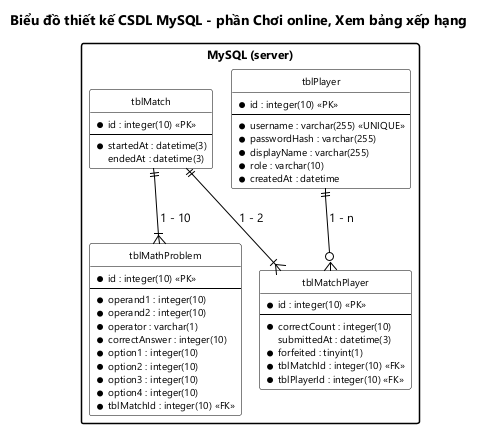

*Hình 4: Biểu đồ thiết kế CSDL MySQL cho chức năng Chơi online, Xem lịch sử đấu, Quản lý bạn bè.*

- tblMatch là trung tâm: 10 dòng tblMathProblem là đề, 2 dòng tblMatchPlayer nối trận với 2 người chơi.
- Mỗi dòng tblMatchPlayer có các dòng tblAnswer là bài làm từng câu của người đó; mỗi dòng tblAnswer trỏ tới đúng một câu trong tblMathProblem.
- Lịch sử đấu và bảng xếp hạng chỉ đọc tblPlayer, tblMatch, tblMatchPlayer; riêng chi tiết trận đọc thêm 10 dòng tblMathProblem và các dòng tblAnswer của 2 người.
- Nộp bài ghi tblMatchPlayer và 10 dòng tblAnswer của người chơi trong cùng một transaction.
- tblFriendship nối 2 dòng tblPlayer, một dòng là người gửi, một dòng là người nhận.

### 2.2. Dữ liệu trên Firebase Realtime Database

Firebase là cây JSON, ánh xạ từ lớp thực thể theo cùng tinh thần: mỗi lớp là một node, thuộc tính cơ bản là field, quan hệ hợp thành là node con.

```
presence/{playerId}            displayName, totalPoints, status ("free" | "busy")
challenges/{challengeId}       challengerId, challengerName, challengerPoints,
                               opponentId, opponentName,
                               status ("pending" | "accepted" | "rejected"), createdAt, matchId
matches/{matchId}              status ("playing" | "finished"), startedAt,
    questions/{i}              operand1, operand2, operator, answerOptions
    players/{playerId}         displayName, submitted, forfeited, choice
    nextMatchId, stoppedBy
```

- **presence**: app ghi khi vào giao diện chơi online, xóa khi rời giao diện này, và đăng ký onDisconnect().removeValue() để tự xóa khi app tắt hoặc mất mạng. Server đổi status và cập nhật totalPoints.
- **challenges**: app người mời tạo, app người được mời ghi rejected, server ghi accepted kèm matchId.
- Quản lý bạn bè chỉ đọc presence để biết bạn nào đang online, không thêm node mới.
- **matches**: chỉ server ghi. Đề trên Firebase **không có correctAnswer**, để người chơi không đọc được đáp án trước khi nộp bài.
- **Bài làm từng câu không đưa lên Firebase.** App gửi bài làm qua REST lúc nộp bài và chỉ đọc lại bài làm của 2 người qua REST khi trận đã xong, nên đối thủ không xem được bài làm của mình giữa trận.

---

## 3. Thiết kế lớp thực thể

Đầu vào là biểu đồ lớp thực thể pha phân tích (Phụ lục A). Các lớp liên quan đến 3 chức năng: Player, Challenge, Match, MatchPlayer, MathProblem, Answer, Friendship.

**Bước 1: Bổ sung thuộc tính khóa.**
- Thêm id : int cho Player, Match, MatchPlayer, MathProblem, Answer, Friendship.
- Challenge có id : String là push id do Firebase sinh, vì lời mời chỉ nằm trên Firebase.

**Bước 2: Bổ sung kiểu dữ liệu.**
- Kiểu Java: chuỗi String; số đếm, toán hạng int; thời gian làm bài, thời gian làm câu long (mili giây); thời điểm Date; cờ boolean; điểm double vì có điểm hòa 0,5.
- Phương án đã chọn là int, cùng kiểu với các phương án trả lời; câu bỏ trống có giá trị −1, đặt thành hằng Answer.NONE.
- Thuộc tính boolean không có tiền tố is (forfeited → getter isForfeited()), để Jackson và Firebase SDK đọc đúng tên trường.
- password đổi thành passwordHash vì chỉ lưu mật khẩu đã băm.

**Bước 3: Chuyển quan hệ liên kết thành kết tập / hợp thành.**
- Quan hệ n-n Player – Match qua lớp liên kết MatchPlayer chuyển thành:
  - **MatchPlayer là thành phần của Match** (hợp thành, 1-2): người chơi trong trận không tồn tại nếu không có trận.
  - **Player nằm trong MatchPlayer** (kết tập, n-1): người chơi tồn tại độc lập với trận.
- Quan hệ n-n MatchPlayer – MathProblem qua lớp liên kết Answer chuyển thành:
  - **Answer là thành phần của MatchPlayer** (hợp thành, 1-n): bài làm một câu chỉ có nghĩa khi thuộc về một người chơi trong trận; xóa trận thì bài làm cũng mất. Người chơi đã nộp bài có đúng 10 Answer; người bỏ trận trước khi nộp không có Answer nào.
  - **MathProblem nằm trong Answer** (kết tập, n-1): câu hỏi thuộc về đề của trận, tồn tại không phụ thuộc vào bài làm; mỗi câu hỏi có tối đa 2 Answer, mỗi người chơi trong trận một. Khi chấm bài và khi hiện chi tiết trận, mỗi Answer cần biết câu hỏi của nó để tự xác định đúng hay sai.
- Giữ nguyên từ pha phân tích:
  - MathProblem là thành phần của Match (hợp thành, 1-10).
  - Player nằm trong Challenge ở 2 vai trò người mời, người được mời (kết tập).
  - Player nằm trong Friendship ở 2 vai trò người gửi, người nhận (kết tập).

**Bước 4: Bổ sung thuộc tính đối tượng.**
- Challenge.challenger, Challenge.opponent : Player.
- Match.questions : List\<MathProblem>, Match.players : List\<MatchPlayer>.
- MatchPlayer.player : Player.
- MatchPlayer.answers : List\<Answer>. Answer thứ i của bài làm ứng với câu thứ i của đề.
- Answer.problem : MathProblem.
- Friendship.sender, Friendship.receiver : Player.

Thuộc tính dẫn xuất được viết thành **phương thức nghiệp vụ** (hàm Java thuần, có unit test):

| Lớp | Phương thức | Ý nghĩa |
|---|---|---|
| MathProblem | isCorrect(answer : int) : boolean | answer bằng correctAnswer |
| MathProblem | getExpression() : String | Chuỗi hiển thị, ví dụ "12 + 7 = ?" |
| Answer | isAnswered() : boolean | Câu đã được làm: selectedOption khác NONE |
| Answer | isCorrect() : boolean | Câu trả lời đúng: problem.isCorrect(selectedOption) |
| Match | countCorrect(answers : List\<Answer>) : int | Chấm một bài làm: gắn câu thứ i của đề vào answers.get(i) rồi đếm số câu có answers.get(i).isCorrect() |
| Match | isOver() : boolean | Có người bỏ trận, hoặc cả 2 đã nộp bài |
| Match | getFinishTime(playerId : int) : long | submittedAt − startedAt |
| Match | getResult(playerId : int) : String | WIN / LOSE / DRAW: bỏ trận thì thua; một người đúng hết thì người đó thắng; cả 2 có câu sai thì hòa; cả 2 đúng hết thì ai nhanh hơn thắng |
| Match | getPoints(playerId : int) : double | 1 / 0,5 / 0 |
| Match | getOpponent(playerId : int) : MatchPlayer | Người chơi còn lại trong trận, dùng cho lịch sử đấu |
| Friendship | getFriend(playerId : int) : Player | Người còn lại trong quan hệ bạn bè |
| Friendship | canAccept(playerId : int) : boolean | Lời mời đang chờ và playerId là người nhận |

Player giữ thêm các giá trị dẫn xuất mà giao diện cần hiển thị cùng tên: totalPoints, avgOpponentPoints, avgWinTime do server tính; status lấy từ Firebase. Các giá trị này không có cột trong CSDL.

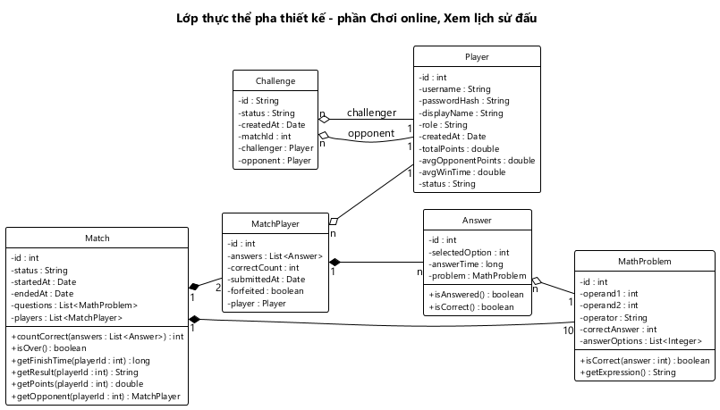

*Hình 5: Biểu đồ lớp thực thể pha thiết kế cho Chơi online, Xem lịch sử đấu, Quản lý bạn bè.*

- Không còn đường liên kết trơn nào trên biểu đồ.
- Lớp liên kết MatchPlayer trở thành thành phần (hình thoi đặc) của Match và chứa Player (hình thoi rỗng); lớp liên kết Answer trở thành thành phần (hình thoi đặc) của MatchPlayer và chứa MathProblem (hình thoi rỗng).
- Player, Challenge, Match, MatchPlayer, MathProblem, Answer, Friendship có ở **cả app và server** với cùng tên và cùng thuộc tính, để JSON đi qua REST ánh xạ thẳng vào đối tượng.
- passwordHash chỉ có giá trị ở server; correctAnswer và bài làm từng câu của 2 người chỉ được gửi về app khi trận đã xong, để không ai biết trước đáp án hay xem được bài làm của đối thủ giữa trận.
- Answer.problem không đi qua JSON. Answer thứ i ứng với câu thứ i của đề, nên bên nhận tự gắn lại câu hỏi vào bài làm.

---

## 4. Thiết kế chi tiết từng chức năng

**Ánh xạ từ pha phân tích sang pha thiết kế:**

**Lớp View sang Activity**

| Lớp phân tích | Lớp thiết kế | Layout |
|---|---|---|
| MainView | MainActivity | activity_main.xml |
| OnlineView | OnlineActivity + PlayerAdapter | activity_online.xml, item_player.xml |
| MatchView | MatchActivity | activity_match.xml |
| MatchResultView | Overlay layoutResult nằm trong MatchActivity | activity_match.xml |
| HistoryView | HistoryActivity + PieChartView + MatchHistoryAdapter + RankingAdapter | activity_history.xml, item_match_history.xml, item_ranking.xml |
| MatchDetailView | MatchDetailActivity + ProblemAdapter | activity_match_detail.xml, item_problem.xml |
| FriendView | FriendActivity + FriendRequestAdapter + FriendAdapter | activity_friend.xml, item_friend_request.xml, item_friend.xml |

OnlineView là Activity riêng, tách khỏi giao diện chính:
- Người chơi chỉ online khi đang ở OnlineActivity hoặc một màn mở từ đó: onCreate gọi goOnline ghi node presence, onDestroy gọi goOffline xóa node. Nhấn Back về MainActivity là offline, nên người đang ở giao diện chính hay đang chơi với máy không hiện trong danh sách online và không bị thách đấu.
- Lời mời thách đấu cũng chỉ được theo dõi trong OnlineActivity.

MatchView hiện mỗi lần một câu nên không cần Adapter: 4 ô phương án là 4 Button cố định trong layoutOptions, gom thành mảng btnOptions; sang câu sau chỉ đổi chữ trên 4 ô.

MatchResultView là overlay chứ không phải Activity riêng:
- Kết quả hiện đè lên màn thi đấu ngay khi trận xong.
- Câu hỏi "Chơi tiếp?" cần tiếp tục theo dõi trận đang mở.

HistoryView là một Activity có 2 thẻ (TabLayout):
- Thẻ Trận của tôi gồm PieChartView và danh sách rvMatches; thẻ Bảng xếp hạng là danh sách rvRanking. Chọn thẻ chỉ ẩn / hiện 2 khối này, không mở Activity mới.
- Nút Lịch sử đấu và nút Bảng xếp hạng của OnlineView cùng mở HistoryActivity. Nút Bảng xếp hạng gửi kèm EXTRA_TAB = TAB_RANKING trong Intent để chọn sẵn thẻ Bảng xếp hạng.
- PieChartView là View tự vẽ biểu đồ tròn bằng Canvas, không dùng thư viện ngoài.

**Phương thức của thực thể sang Activity hoặc DAO**

| Phương thức pha phân tích | Lớp phân tích | Phương thức pha thiết kế | Lớp thiết kế |
|---|---|---|---|
| goOnline() | Player | goOnline(player : Player) : void | PresenceFirebaseDAO |
| getOnlinePlayers() | Player | watchOnlinePlayers(callback : PlayerListCallback) : void<br>onPlayersChanged(players : List\<Player>) : void | PresenceFirebaseDAO<br>OnlineActivity |
| sendChallenge() | Challenge | onPlayerClick(opponent : Player) : void<br>sendChallenge(challenger : Player, opponent : Player) : Challenge | OnlineActivity<br>ChallengeFirebaseDAO |
| watchChallenge() | Challenge | watchIncoming(playerId : int, callback : ChallengeCallback) : void<br>watchChallenge(challengeId : String, callback : ChallengeCallback) : void<br>onChallengeChanged(challenge : Challenge) : void | ChallengeFirebaseDAO<br>ChallengeFirebaseDAO<br>OnlineActivity |
| rejectChallenge() | Challenge | rejectChallenge(challengeId : String) : void | ChallengeFirebaseDAO |
| createMatch() | Match | createMatch(challenge : Challenge) : Match → create(challenge : Challenge) : Match<br>readPresence(playerId : int) : Player, updateStatus(playerId : int, status : String) : void, updateChallenge(challengeId : String, status : String, matchId : int) : void, writeMatch(match : Match) : void<br>insert(match : Match) : boolean | MatchApiDAO → MatchRestController<br>FirebaseAdminDAO<br><br>MatchDAO |
| generateProblem() | MathProblem | generateProblems(count : int) : List\<MathProblem><br>generateProblem() : MathProblem | ProblemDAO (server) |
| watchMatch() | Match | watchMatch(matchId : int, callback : MatchCallback) : void<br>onSuccess(match : Match) : void, onNextMatch(nextMatchId : int) : void, onStopped(playerId : int) : void | MatchFirebaseDAO<br>MatchActivity |
| submitAnswers() | Match | chooseOption(index : int) : void, submitAnswers() : void<br>submit(matchId : int, playerId : int, answers : List\<Answer>) : Match → submit(id : int, matchPlayer : MatchPlayer) : Match<br>findById(id : int) : Match, updateSubmission(matchId : int, mp : MatchPlayer) : boolean, updateEndedAt(matchId : int, endedAt : Date) : boolean<br>writeSubmitted(matchId : int, playerId : int) : void, writeFinished(matchId : int) : void, updatePoints(playerId : int, totalPoints : double) : void | MatchActivity<br>MatchApiDAO → MatchRestController<br>MatchDAO<br><br>FirebaseAdminDAO |
| isCorrect() | Answer | countCorrect(answers : List\<Answer>) : int<br>isCorrect() : boolean<br>isCorrect(answer : int) : boolean | Match<br>Answer<br>MathProblem |
| isOver(), getResult(), getFinishTime(), getPoints() | Match | Giữ nguyên, thêm tham số playerId : int cho 3 hàm sau | Match |
| forfeit() | Match | leaveMatch() : void<br>forfeit(matchId : int, playerId : int) : Match → forfeit(id : int, playerId : int) : Match<br>updateForfeit(matchId : int, playerId : int) : boolean, writeStopped(matchId : int, playerId : int) : void | MatchActivity<br>MatchApiDAO → MatchRestController<br>MatchDAO, FirebaseAdminDAO |
| continueMatch() | Match | sendChoice(choice : boolean) : void<br>continueMatch(matchId : int, playerId : int, choice : boolean) : Match → continueMatch(id : int, playerId : int, choice : boolean) : Match<br>writeChoice(matchId : int, playerId : int, choice : boolean) : void, writeNextMatch(matchId : int, nextMatchId : int) : void, writeStopped(matchId : int, playerId : int) : void | MatchActivity<br>MatchApiDAO → MatchRestController<br>FirebaseAdminDAO |
| getHistory() | Match | getHistory(playerId : int) : List\<Match> → getHistory(playerId : int) : List\<Match><br>findByPlayer(playerId : int) : List\<Match> | MatchApiDAO → MatchRestController<br>MatchDAO |
| getMatch() | Match | getById(matchId : int) : Match → getById(id : int) : Match<br>findById(id : int) : Match, findAnswers(matchPlayerId : int, questions : List\<MathProblem>) : List\<Answer>, getTotalPoints(playerId : int) : double | MatchApiDAO → MatchRestController<br>MatchDAO, PlayerDAO |
| getOpponent() | Match | getOpponent(playerId : int) : MatchPlayer | Match |
| isCorrect() | Answer | isCorrect() : boolean, isAnswered() : boolean<br>showAnswer(view : TextView, answer : Answer) : void | Answer<br>ProblemAdapter |
| getResult(), getPoints(), getFinishTime() | Match | Giữ nguyên như ở Chơi online | Match |
| getRanking() | Player | getRanking() : List\<Player> → getRanking() : List\<Player><br>getRanking() : List\<Player>, rank(players : List\<Player>, matches : List\<Match>) : List\<Player>, findFinished() : List\<Match> | PlayerApiDAO → PlayerRestController<br>PlayerDAO, MatchDAO |
| Đếm thắng / hòa / thua của HistoryView | HistoryView | showSummary(matches : List\<Match>) : void<br>setData(wins : int, draws : int, losses : int) : void | HistoryActivity<br>PieChartView |
| getFriendships() | Friendship | loadFriendships() : void, showFriendships(list : List\<Friendship>) : void<br>getFriendships(playerId : int) : List\<Friendship> → getFriendships(playerId : int) : List\<Friendship><br>findByPlayer(playerId : int) : List\<Friendship>, getTotalPoints(playerId : int) : double | FriendActivity<br>FriendshipApiDAO → FriendshipRestController<br>FriendshipDAO, PlayerDAO |
| getOnlinePlayers() | Player | watchOnlinePlayers(callback : PlayerListCallback) : void<br>onPlayersChanged(players : List\<Player>) : void, setOnlineIds(onlineIds : Set\<Integer>) : void | PresenceFirebaseDAO<br>FriendActivity, FriendAdapter |
| sendRequest() | Friendship | onClick(v : View) : void<br>sendRequest(senderId : int, receiverUsername : String) : Friendship → sendRequest(body : Map\<String, String>) : Friendship<br>findById(id : int) : Player, findByUsername(username : String) : Player<br>existsBetween(playerId1 : int, playerId2 : int) : boolean, insert(friendship : Friendship) : boolean | FriendActivity<br>FriendshipApiDAO → FriendshipRestController<br>PlayerDAO<br>FriendshipDAO |
| accept() | Friendship | onAccept(friendship : Friendship) : void<br>accept(friendshipId : int, playerId : int) : Friendship → accept(id : int, playerId : int) : Friendship<br>findById(id : int) : Friendship, updateStatus(id : int, status : String) : boolean | FriendActivity<br>FriendshipApiDAO → FriendshipRestController<br>FriendshipDAO |
| delete() | Friendship | onReject(friendship : Friendship) : void, onUnfriend(friendship : Friendship) : void<br>delete(friendshipId : int, playerId : int) : void → delete(id : int, playerId : int) : void<br>delete(path : String) : void<br>findById(id : int) : Friendship, delete(id : int) : boolean | FriendActivity<br>FriendshipApiDAO → FriendshipRestController<br>ApiDAO<br>FriendshipDAO |
| canAccept(), getFriend() | Friendship | Giữ nguyên, thêm tham số playerId : int | Friendship |

Ghi phương án đã chọn và thời gian làm từng câu là xử lý của giao diện: chooseOption của MatchActivity ghi vào một Answer, không phải phương thức của thực thể. Answer chỉ giữ bài làm một câu và luật isCorrect; luật so phương án với đáp án vẫn nằm ở MathProblem.isCorrect.

**Lớp DAO cha**

Mỗi nơi lưu trữ có một lớp DAO cha giữ kết nối dùng chung; các DAO con kế thừa.

| Nơi lưu trữ | DAO cha | Giữ | DAO con dùng ở đây |
|---|---|---|---|
| App → Firebase | FirebaseDAO | con : DatabaseReference | PresenceFirebaseDAO, ChallengeFirebaseDAO, MatchFirebaseDAO |
| App → REST | ApiDAO | BASE_URL; gửi / nhận JSON | PlayerApiDAO, MatchApiDAO, FriendshipApiDAO |
| Server → MySQL | DAO | conn : Connection | PlayerDAO, MatchDAO, FriendshipDAO |

ApiDAO có 3 hàm gửi yêu cầu: get, post và delete; delete dùng để từ chối lời mời và hủy kết bạn.

Các lớp không có lớp cha:
- SessionDAO chỉ đọc SharedPreferences.
- FirebaseAdminDAO gọi REST API của Firebase Realtime Database, không dùng JDBC nên không kế thừa DAO của server.
- ProblemDAO ở server chỉ sinh câu hỏi bằng Random, không kết nối nơi lưu trữ nào.

### 4.1. Chức năng "Chơi online"

#### 4.1.1. Thiết kế giao diện

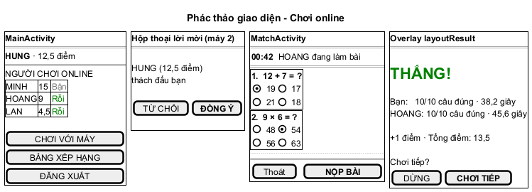

*Hình 6: Thiết kế giao diện chức năng Chơi online.*

Chức năng có 3 màn, 1 hộp thoại lời mời và 1 overlay, đi theo thứ tự MainActivity → OnlineActivity → hộp thoại lời mời trên máy người được mời → MatchActivity → overlay layoutResult.
- **Màn chính** chỉ để chọn chế độ chơi: chữ MATH DASH, lời chào "Xin chào, HUNG", 2 nút lớn Chơi với máy và Chơi online. Góc phải thanh trên là nút biểu tượng đăng xuất.
- **Màn Chơi online** chia 3 phần từ trên xuống:
  1. Thanh trên: tiêu đề CHƠI ONLINE căn trái; góc phải có 3 nút biểu tượng Bạn bè, Lịch sử đấu, Bảng xếp hạng.
  2. Thẻ thông tin của mình: tên, tổng điểm.
  3. Danh sách người chơi online. Mỗi dòng có tên, tổng điểm và nhãn trạng thái: Rỗi chữ xanh, Bận chữ xám. Dòng Bận vẫn bấm được nhưng chỉ hiện thông báo. Không có ai khác online thì hiện "Chưa có ai khác online".
- **Màn thi đấu** hiện mỗi lần một câu, chia 4 tầng từ trên xuống:
  1. Hàng trên: ô thời gian đếm ngược bên trái, dòng trạng thái đối thủ bên phải.
  2. Thẻ câu hỏi: dòng "Câu 3/10" và phép tính chữ lớn "12 + 7 = ?".
  3. 4 ô phương án lớn xếp 2 x 2, mỗi ô một màu: A đỏ, B xanh dương, C vàng, D xanh lá. Trong ô, chữ cái nhỏ ở trên, giá trị phương án lớn ở dưới. Bấm một ô là chọn và sang câu sau: ô vừa chọn giữ nguyên, 3 ô còn lại mờ đi trong 0,2 giây. App không biết đáp án nên không báo đúng / sai ngay.
  4. Hàng dưới: nút Thoát; nút Nộp bài chỉ hiện khi đã làm xong 10 câu.
- Làm xong 10 câu, hết giờ, đang nộp hay đã nộp thì 4 ô và phép tính ẩn đi, thẻ câu hỏi chỉ còn một dòng thông báo: "Đã làm xong 10 câu", "Hết giờ", "Đang nộp bài...", "Đã nộp bài, đang chờ đối thủ...".
- **Overlay kết quả** che màn thi đấu. Bảng so sánh 2 cột (Bạn, đối thủ) giúp người chơi thấy vì sao thắng: đúng hết hay nhanh hơn.

Thanh trên của các màn Chơi online, Lịch sử đấu, Chi tiết trận, Bạn bè cùng một kiểu: tiêu đề chữ lớn căn trái, các nút biểu tượng đặt ở góc phải.

**Bảng thành phần:**

| Màn | id trong layout | Loại View | Chức năng | Tên ở pha phân tích |
|---|---|---|---|---|
| MainActivity | txtMyName | TextView | "Xin chào, HUNG" | |
| | btnPlayOnline | Button | Mở màn Chơi online | subPlayOnline |
| OnlineActivity | txtMyName | TextView | Tên hiển thị của mình | outMyInfo |
| | txtMyPoints | TextView | "12,5 điểm" | outMyInfo |
| | rvPlayers | RecyclerView | Danh sách người chơi online, bấm một dòng để thách đấu | outsubListPlayer |
| | txtEmpty | TextView | "Chưa có ai khác online"; chỉ hiện khi danh sách rỗng | outsubListPlayer |
| item_player.xml | txtName | TextView | Tên người chơi | một dòng của outsubListPlayer |
| | txtPoints | TextView | Tổng điểm | một dòng của outsubListPlayer |
| | txtStatus | TextView | Rỗi (xanh) / Bận (xám) | một dòng của outsubListPlayer |
| MatchActivity | txtTimer | TextView | Ô thời gian 01:00 → 00:00 | outTimer |
| | txtOpponentStatus | TextView | "HOANG đang làm bài" / "HOANG đã nộp bài" | outOpponentStatus |
| | txtProgress | TextView | "Câu 3/10"; làm xong, hết giờ, đang nộp, đã nộp thì hiện thông báo tương ứng | outQuestion |
| | txtExpression | TextView | Phép tính chữ lớn "12 + 7 = ?" | outQuestion |
| | layoutOptions | LinearLayout | Khung xếp 4 ô 2 x 2, ẩn khi thẻ câu hỏi hiện thông báo | subOptions |
| | btnOptionA, btnOptionB, btnOptionC, btnOptionD | Button | 4 ô phương án "A 17", "B 19", "C 21", "D 18"; trong code gom thành mảng btnOptions : Button[4] | subOptions |
| | btnSubmit | Button | Nộp bài; ẩn lúc đầu, hiện khi đã làm xong 10 câu hoặc khi nộp lỗi để nộp lại | subSubmit |
| | btnExit | Button | Thoát trận | subExit |
| Overlay layoutResult | txtResult | TextView | THẮNG! (xanh) / THUA! (đỏ) / HÒA! (vàng) | outResult |
| | txtMyResult | TextView | "Bạn: 10/10 câu đúng · 38,2 giây" | outMyResult |
| | txtOpponentResult | TextView | "HOANG: 10/10 câu đúng · 45,6 giây" | outOpponentResult |
| | txtPoints | TextView | "+1 điểm · Tổng điểm: 13,5" | outPoints |
| | btnContinue | Button | Chơi tiếp | subContinue |
| | btnStop | Button | Dừng; khi có người bỏ trận thì đổi thành Về menu | subStop |

Các thông báo ngắn ("MINH đang bận", "HOANG đã từ chối lời mời", "Đối thủ đã dừng chơi") dùng Toast. Hộp thoại lời mời, hộp thoại chờ trả lời và hộp thoại "Thoát sẽ bị xử thua?" dùng AlertDialog. Cả hai đều không phải thành phần của layout.

#### 4.1.2. Biểu đồ lớp chi tiết


*Hình 7: Biểu đồ lớp chi tiết chức năng Chơi online.*

**Package "Client (Android)".**

| Loại | Lớp | Mô tả |
|---|---|---|
| Boundary | MainActivity | Màn chính, cài đặt View.OnClickListener. Giữ người chơi đang đăng nhập (me) để ghi lời chào vào txtMyName. onClick của btnPlayOnline mở OnlineActivity; btnPlayBot mở DifficultyActivity của chức năng Chơi với máy; btnLogout gọi logout: SessionDAO.clear rồi mở LoginActivity |
| Boundary | OnlineActivity | Màn Chơi online, cài đặt View.OnClickListener, PlayerListCallback và ChallengeCallback. Giữ người chơi đang đăng nhập (me), lời mời mình đã gửi và đang chờ trả lời (sentChallenge), id các lời mời tới mình đã hiện hộp thoại (shownChallenges), hộp thoại chờ (waitingDialog).<br>- onCreate gọi bindViews, lấy me bằng SessionDAO.getPlayer, gọi goOnline, rồi watchOnlinePlayers và watchIncoming, truyền chính nó (this) làm callback.<br>- goOnline gọi PlayerApiDAO.getById trong Thread để có tổng điểm mới, xong thì gọi PresenceFirebaseDAO.goOnline.<br>- onPlayersChanged hiện thông tin của mình, đưa những người còn lại vào PlayerAdapter, danh sách rỗng thì hiện txtEmpty.<br>- onPlayerClick: đối thủ bận thì hiện Toast; đã có sentChallenge thì bỏ qua; ngược lại sendChallenge, watchChallenge rồi showWaitingDialog hiện hộp thoại chờ có nút Hủy.<br>- onChallengeChanged: lời mời tới mình chưa có trong shownChallenges thì showChallengeDialog; lời mình gửi được đồng ý thì closeSentChallenge rồi openMatch(challenge.getMatchId()); bị từ chối thì closeSentChallenge và hiện Toast.<br>- closeSentChallenge gọi ChallengeFirebaseDAO.stopWatchingSent, xóa sentChallenge và đóng hộp thoại chờ.<br>- acceptChallenge gọi MatchApiDAO.createMatch trong Thread, xong thì openMatch. Nút Từ chối gọi ChallengeFirebaseDAO.rejectChallenge.<br>- onClick của 3 nút biểu tượng mở FriendActivity hoặc HistoryActivity, mô tả ở chức năng Xem lịch sử đấu và Quản lý bạn bè.<br>- onDestroy gọi stopWatching của PresenceFirebaseDAO và ChallengeFirebaseDAO rồi PresenceFirebaseDAO.goOffline: rời màn này là offline |
| Boundary | PlayerAdapter, PlayerViewHolder | PlayerAdapter kế thừa RecyclerView.Adapter, giữ danh sách Player và OnlineActivity chứa nó. setPlayers thay danh sách và vẽ lại. onClick của một dòng gọi OnlineActivity.onPlayerClick. PlayerViewHolder giữ 3 TextView của một dòng |
| Boundary | MatchActivity | Màn thi đấu, cài đặt View.OnClickListener, MatchCallback và PlayerListCallback. Giữ me, mã trận (matchId, nhận qua Intent với khóa EXTRA_MATCH_ID), id đối thủ (opponentId), đồng hồ (timer, MATCH_MILLIS = 60 giây), đề (questions : List\<MathProblem>), bài làm (answers : List\<Answer>), chỉ số câu đang hiện (current) và thời điểm câu đó hiện ra (shownAt). 4 ô phương án gom thành mảng btnOptions : Button[4]; LETTERS giữ 4 chữ A, B, C, D. 6 cờ started, submitted, resultLoading, resultShown, opponentLeft, leaving chặn gọi lặp, vì onSuccess được gọi lại mỗi lần node trận thay đổi.<br>- onCreate gọi MatchFirebaseDAO.watchMatch, truyền chính nó làm MatchCallback.<br>- Lần đầu nhận trận có đề, onSuccess gọi startMatch: lưu opponentId bằng opponentOf, lấy đề vào questions, tạo 10 Answer rỗng, gọi showQuestion, createTimer rồi start, gọi PresenceFirebaseDAO.watchOnlinePlayers với chính nó làm PlayerListCallback.<br>- showQuestion hiện câu thứ current: số thứ tự "Câu 3/10", phép tính và chữ của 4 ô (optionText ghép chữ cái nhỏ với giá trị lớn), bật lại 4 ô và ghi shownAt = SystemClock.elapsedRealtime(). Khi current đã qua câu cuối thì showMessage "Đã làm xong 10 câu" và hiện btnSubmit.<br>- onClick của một ô gọi chooseOption(index): ghi giá trị phương án vào selectedOption và thời gian từ shownAt vào answerTime của answers[current], khóa 4 ô, làm mờ 3 ô không chọn, tăng current rồi sau NEXT_DELAY = 200 ms gọi lại showQuestion. Khóa 4 ô trong lúc chờ để bấm đúp không trả lời nhầm câu sau.<br>- showMessage ẩn 4 ô và phép tính, ghi thông báo vào txtProgress.<br>- onTick vẽ thời gian; onFinish showMessage "Hết giờ" rồi gọi submitAnswers; câu chưa làm giữ selectedOption = −1.<br>- submitAnswers (nút Nộp bài hoặc hết giờ) showMessage "Đang nộp bài...", gọi MatchApiDAO.submit(matchId, me.getId(), answers) trong Thread. Thành công thì onSubmitted hủy đồng hồ, ẩn btnSubmit, showMessage "Đã nộp bài, đang chờ đối thủ..."; lỗi thì onSubmitFailed hiện lại btnSubmit để nộp lại.<br>- Mỗi lần onSuccess gọi showOpponentStatus; trận đã xong thì loadResult gọi MatchApiDAO.getById rồi showResult.<br>- showResult dùng Match.getResult cho showResultTitle; showScores dùng getFinishTime, getPoints trên bản trận server trả về. mineOf, opponentOf tìm MatchPlayer của mình và của đối thủ.<br>- Nút Chơi tiếp / Dừng gọi sendChoice (MatchApiDAO.continueMatch). onNextMatch gọi openNextMatch: stopWatching trận cũ rồi mở trận mới. onStopped hiện Toast và đóng màn thi đấu, quay về màn Chơi online.<br>- Nút Thoát và onBackPressed gọi confirmLeave hỏi xác nhận rồi gọi leaveMatch (MatchApiDAO.forfeit).<br>- onPlayersChanged: khi trận đang đấu mà đối thủ biến khỏi danh sách online (mất kết nối), gọi forfeit(opponentId) thay cho đối thủ.<br>- onDestroy hủy đồng hồ, gọi stopWatching của MatchFirebaseDAO và PresenceFirebaseDAO.<br>Activity không tự chấm bài, không tự phân thắng thua |
| Control | SessionDAO | Giữ prefs : SharedPreferences "session". getPlayer() đọc playerId, username, displayName và đóng gói thành Player. clear() xóa phiên khi đăng xuất |
| Control | FirebaseDAO ← PresenceFirebaseDAO | FirebaseDAO giữ con (gốc Realtime Database). PresenceFirebaseDAO đọc / ghi node presence:<br>- goOnline ghi tên, tổng điểm, trạng thái free và đăng ký onDisconnect().removeValue(). goOffline xóa node của mình.<br>- watchOnlinePlayers / stopWatching thêm / gỡ ValueEventListener, giữ listener đang đăng ký trong watcher để gỡ đúng listener.<br>- toPlayer đóng gói một node thành Player. presenceRef trả node presence |
| Control | FirebaseDAO ← ChallengeFirebaseDAO | Đọc / ghi node challenges:<br>- sendChallenge tạo node bằng push().<br>- watchIncoming lọc lời mời có opponentId là mình và status pending; giữ incomingQuery, incomingWatcher.<br>- watchChallenge theo dõi một lời mời đã gửi; giữ sentRef, sentWatcher.<br>- stopWatchingSent chỉ gỡ theo dõi lời mời đã gửi; stopWatching gỡ cả 2.<br>- rejectChallenge ghi status rejected.<br>- toChallenge đóng gói thành Challenge, dùng toPlayer cho người mời và người được mời. challengesRef trả node challenges |
| Control | FirebaseDAO ← MatchFirebaseDAO | Chỉ đọc node matches/{matchId}; giữ matchRef và watcher để stopWatching gỡ đúng listener. toMatch đóng gói thành Match kèm 10 MathProblem (toProblem, không có đáp án) và 2 MatchPlayer (toMatchPlayer). Khi node có nextMatchId thì gọi onNextMatch; có stoppedBy thì gọi onStopped; còn lại gọi onSuccess. Mất kết nối thì gọi onFail với câu NETWORK_ERROR |
| — | PlayerListCallback, ChallengeCallback, MatchCallback | Interface trả kết quả bất đồng bộ từ các FirebaseDAO về Activity. FirebaseDAO chỉ phụ thuộc vào interface, không biết Activity cụ thể; Activity truyền chính nó (this) khi gọi hàm watch... Nhờ vậy PresenceFirebaseDAO dùng chung cho OnlineActivity, MatchActivity và FriendActivity |
| Control | ApiDAO ← PlayerApiDAO | getById gửi GET /api/players/{id}; toPlayer đóng gói JSON thành Player. Hàm chạy đồng bộ nên phải gọi trong Thread |
| Control | ApiDAO ← MatchApiDAO | ApiDAO giữ BASE_URL, câu báo lỗi mạng NETWORK_ERROR và các hàm gửi / nhận JSON bằng HttpURLConnection. 3 hàm riêng: open mở kết nối, readGet gửi GET, read đọc phản hồi và ném IOException kèm câu thông báo của server khi mã ≥ 400. MatchApiDAO có 5 hàm, mỗi hàm một API:<br>- createMatch: POST /api/matches.<br>- submit(matchId, playerId, answers): POST /api/matches/{id}/submit, thân gồm id người chơi và 10 bài làm, mỗi bài làm có selectedOption, answerTime.<br>- forfeit: POST /api/matches/{id}/forfeit.<br>- continueMatch: POST /api/matches/{id}/continue.<br>- getById: GET /api/matches/{id}.<br>toMatch đóng gói JSON trả về thành Match, dùng toProblem cho từng câu hỏi và toMatchPlayer cho từng người chơi trong trận; toMatchPlayer gọi toAnswers đóng gói bài làm, gắn câu thứ i của đề vào bài làm thứ i |
| Entity | Player, Challenge, Match, MatchPlayer, Answer, MathProblem | Như thiết kế lớp thực thể. Answer là bài làm một câu: phương án đã chọn (selectedOption, NONE = −1 khi bỏ trống), thời gian làm câu (answerTime, mili giây) và câu hỏi tương ứng (problem). Các phương thức nghiệp vụ là hàm Java thuần, có unit test:<br>- MathProblem: isCorrect, getExpression.<br>- Answer: isAnswered, isCorrect.<br>- Match: countCorrect, isOver, getFinishTime, getResult, getPoints |

**Package "Server (Spring Boot)".**

| Loại | Lớp | Mô tả |
|---|---|---|
| Boundary | PlayerRestController | getById(id) nhận GET /api/players/{id}: PlayerDAO.findById rồi gán tổng điểm bằng PlayerDAO.getTotalPoints |
| Boundary | MatchRestController | Trọng tài của mọi trận. Giữ waitingChoices: các trận đang có một người chọn chơi tiếp.<br>- create(challenge) nhận POST /api/matches:<br>  1. readChallengeStatus: lời mời đã bị hủy thì trả 409. readPresence của 2 người; một người không online hoặc đang bận thì trả 409 "Không bắt đầu được trận đấu".<br>  2. startMatch: ProblemDAO.generateProblems(10), tạo Match, MatchDAO.insert, FirebaseAdminDAO.writeMatch, updateStatus busy cho 2 người.<br>  3. updateChallenge accepted kèm id trận, rồi hideAnswers xóa đáp án trước khi trả về.<br>- submit(id, matchPlayer):<br>  1. Ghi thời điểm nhận, findMatch, findPlayer. Trận chưa xong và người chơi chưa nộp thì lưu bài làm vào MatchPlayer bằng setAnswers, chấm bằng Match.countCorrect, ghi submittedAt.<br>  2. updateSubmission lưu kết quả và 10 bài làm; lỗi thì trả 500 "Không lưu được bài làm". Rồi writeSubmitted.<br>  3. Nếu Match.isOver: endMatch (updateEndedAt, tính lại tổng điểm 2 người, updatePoints), rồi writeFinished.<br>- forfeit(id, playerId): updateForfeit, endMatch, rồi mới writeStopped, writeFinished để máy đối thủ đọc được kết quả đã lưu; trả 2 người về free.<br>- continueMatch(id, playerId, choice), synchronized:<br>  - Dừng: writeStopped, 2 người về free.<br>  - Chơi tiếp mà đối thủ chưa chọn: lưu vào waitingChoices, writeChoice.<br>  - Đối thủ đã chọn chơi tiếp: startMatch rồi writeNextMatch.<br>- getById(id): findById, gán tổng điểm cho 2 người chơi.<br>Các hàm riêng: findMatch gọi MatchDAO.findById, không có thì trả 404; findPlayer tìm MatchPlayer theo id, không có thì trả 403; setStatus gọi updateStatus cho 2 người; isFree kiểm tra người chơi online và rỗi; hideAnswers khi trận chưa kết thúc thì đặt correctAnswer = −1 cho mọi câu và xóa bài làm của cả 2 người, để không ai xem được bài làm của đối thủ giữa trận |
| Control | DAO ← PlayerDAO | DAO giữ conn : Connection (JDBC), mở một lần bằng cấu hình loadConfig.<br>- findById đọc tblPlayer qua findOne; toPlayer đóng gói một dòng, COLUMNS là danh sách cột dùng chung.<br>- getTotalPoints lấy các trận đã xong bằng MatchDAO.findFinished, lọc trận có người chơi bằng hasPlayer rồi cộng Match.getPoints |
| Control | DAO ← MatchDAO | - insert ghi 1 dòng tblMatch, 10 dòng tblMathProblem, 2 dòng tblMatchPlayer trong một transaction bằng insertMatch, insertProblem, insertMatchPlayer, gán id vừa sinh.<br>- findById, findFinished dùng chung câu SELECT_PLAYERS qua query; toMatch, toMatchPlayer đóng gói dòng kết quả, findProblems và toProblem đọc đề.<br>- findById đọc trận kèm đề, 2 người chơi và bài làm của từng người: findAnswers đọc tblAnswer theo tblMathProblemId tăng dần, toAnswer đóng gói một dòng và gắn câu hỏi có cùng id.<br>- updateSubmission chạy một transaction: updateMatchPlayer ghi correctCount, submittedAt (chỉ khi chưa nộp), rồi insertAnswer ghi từng câu vào tblAnswer; lỗi thì rollback và trả false.<br>- updateForfeit ghi forfeited.<br>- updateEndedAt ghi endedAt |
| Control | ProblemDAO | Giữ random : Random và 3 hằng OPERATORS, OPTION_COUNT = 4, MAX_OFFSET = 10. generateProblems gọi generateProblem 10 lần. Mỗi câu chọn toán tử +, −, ×, sinh 2 toán hạng bằng nextInt, tính correctAnswer; createOptions sinh 3 phương án nhiễu lệch không quá MAX_OFFSET rồi xáo trộn |
| Control | FirebaseAdminDAO | Giữ dbUrl, khóa truy cập secret, client : HttpClient và mapper : ObjectMapper; gọi REST API của Firebase:<br>- readPresence, readChallengeStatus gửi GET.<br>- Các hàm write..., update... gửi PUT hoặc PATCH tới đúng node trong tài liệu CSDL mục 2. updateStatus, updatePoints đi qua updatePresence.<br>- toQuestions, toPlayers chuyển đề (bỏ đáp án) và 2 người chơi thành dữ liệu node.<br>- send gửi yêu cầu và trả nội dung phản hồi |
| Entity | Player, Challenge, Match, MatchPlayer, Answer, MathProblem | Cùng tên, cùng thuộc tính với phía app, để Jackson chuyển JSON thẳng vào đối tượng. Player ở server có thêm passwordHash, không bao giờ trả ra JSON. correctAnswer và bài làm chỉ trả ra JSON khi trận đã xong. Answer gửi qua JSON chỉ có id, selectedOption, answerTime; problem, isAnswered, isCorrect gắn @JsonIgnore vì câu thứ i của bài làm ứng với câu thứ i của đề |

**Quan hệ giữa các lớp giao diện:**
- MainActivity – OnlineActivity – MatchActivity nối nhau bằng quan hệ liên kết theo luồng màn hình. OnlineActivity – PlayerAdapter – PlayerViewHolder cũng vậy.
- Mỗi lớp nối với layout của nó: activity_main.xml, activity_online.xml, item_player.xml, activity_match.xml. Overlay kết quả nằm trong activity_match.xml.
- Kết tập:
  - MainActivity, OnlineActivity và MatchActivity chứa thông tin người chơi trong thuộc tính me, nên Player kết tập vào 3 Activity này.
  - PlayerAdapter chứa danh sách Player.
  - MatchActivity chứa đề (10 MathProblem) và bài làm (10 Answer) trong questions, answers.
- Thực thể: Match gồm 2 MatchPlayer và 10 MathProblem (hợp thành); MatchPlayer gồm các Answer (hợp thành, 10 khi đã nộp); Answer chứa thông tin MathProblem (kết tập, mỗi câu có 2 bài làm của 2 người).

**Quan hệ liên kết HTTP/JSON** giữa 2 package có 2 cặp:
- MatchApiDAO – MatchRestController: trận đấu.
- PlayerApiDAO – PlayerRestController: tổng điểm.

Firebase không phải một lớp trên biểu đồ: các FirebaseDAO ở app và FirebaseAdminDAO ở server cùng đọc / ghi một cây dữ liệu, như mô tả trong tài liệu CSDL mục 2.

#### 4.1.3. Biểu đồ tuần tự chi tiết

**Đoạn A: Gửi lời thách đấu**

1. Người chơi nhấn nút Chơi online trên MainActivity.
2. Hàm onClick() của MainActivity gọi hàm startActivity() mở OnlineActivity.
3. Hàm onCreate() của OnlineActivity gọi hàm getPlayer() của SessionDAO.
4. Hàm getPlayer() gọi lớp Player để đóng gói người chơi đang đăng nhập.
5. Lớp Player trả đối tượng Player cho hàm getPlayer().
6. Hàm getPlayer() trả đối tượng Player cho hàm onCreate().
7. Hàm onCreate() gọi hàm goOnline() của chính nó.
8. Hàm goOnline() mở một Thread và gọi hàm getById() của PlayerApiDAO để lấy tổng điểm mới nhất.
9. Hàm onCreate() gọi hàm watchOnlinePlayers() của PresenceFirebaseDAO, truyền chính OnlineActivity làm PlayerListCallback.
10. Hàm onCreate() gọi hàm watchIncoming() của ChallengeFirebaseDAO, truyền chính OnlineActivity làm ChallengeCallback, để nhận các lời mời gửi tới người chơi.
11. PlayerApiDAO gửi yêu cầu GET /api/players/{id} tới hàm getById() của PlayerRestController.
12. Hàm getById() của PlayerRestController gọi hàm findById() của PlayerDAO.
13. Hàm findById() truy vấn bảng tblPlayer và gọi lớp Player để đóng gói kết quả.
14. Lớp Player trả đối tượng Player cho hàm findById().
15. Hàm findById() trả đối tượng Player cho hàm getById().
16. Hàm getById() gọi hàm getTotalPoints() của PlayerDAO.
17. Hàm getTotalPoints() cộng điểm trận của người chơi qua các trận đã kết thúc và trả về cho hàm getById().
18. Hàm getById() trả người chơi kèm tổng điểm dạng JSON cho PlayerApiDAO.
19. Hàm toPlayer() của PlayerApiDAO gọi lớp Player để đóng gói dữ liệu JSON.
20. Lớp Player trả đối tượng Player cho PlayerApiDAO.
21. PlayerApiDAO trả đối tượng Player cho hàm goOnline().
22. Trong hàm runOnUiThread(), hàm goOnline() của OnlineActivity gọi hàm goOnline() của PresenceFirebaseDAO để ghi người chơi vào danh sách online với trạng thái rỗi.
23. Khi danh sách online thay đổi, hàm onDataChange() của PresenceFirebaseDAO gọi hàm toPlayer() cho từng người chơi.
24. Hàm toPlayer() gọi lớp Player để đóng gói người chơi kèm tổng điểm và trạng thái.
25. Lớp Player trả đối tượng Player cho hàm toPlayer().
26. PresenceFirebaseDAO gọi hàm onPlayersChanged() của PlayerListCallback đã đăng ký ở bước 9, chính là OnlineActivity, truyền danh sách người chơi online.
27. Hàm onPlayersChanged() hiển thị tổng điểm của chính người chơi, rồi gọi hàm setPlayers() của PlayerAdapter với danh sách những người còn lại, xếp theo tổng điểm giảm dần.
28. PlayerAdapter hiển thị danh sách người chơi online gồm tên, tổng điểm, trạng thái.
29. Người chơi bấm vào tên một đối thủ đang rỗi.
30. Hàm onClick() của PlayerAdapter gọi hàm onPlayerClick() của OnlineActivity.
31. Hàm onPlayerClick() thấy đối thủ đang rỗi và người chơi chưa có lời mời nào đang chờ, gọi hàm sendChallenge() của ChallengeFirebaseDAO.
32. Hàm sendChallenge() gọi lớp Challenge để tạo lời mời đang chờ, rồi ghi lời mời lên Firebase.
33. Lớp Challenge trả đối tượng Challenge cho hàm sendChallenge().
34. Hàm sendChallenge() trả đối tượng Challenge cho hàm onPlayerClick(); OnlineActivity giữ lời mời này trong sentChallenge.
35. Hàm onPlayerClick() gọi hàm watchChallenge() của ChallengeFirebaseDAO, truyền chính OnlineActivity làm ChallengeCallback, để theo dõi lời mời vừa gửi.
36. Hàm onPlayerClick() gọi hàm showWaitingDialog(), OnlineActivity hiển thị hộp thoại đang chờ đối thủ trả lời kèm nút Hủy.
37. Khi đối thủ đồng ý, hàm onDataChange() của ChallengeFirebaseDAO gọi hàm toChallenge().
38. Hàm toChallenge() gọi lớp Challenge để đóng gói lời mời mới nhất.
39. Lớp Challenge trả đối tượng Challenge cho hàm toChallenge().
40. ChallengeFirebaseDAO gọi hàm onChallengeChanged() của ChallengeCallback đã đăng ký ở bước 35, chính là OnlineActivity.
41. Hàm onChallengeChanged() thấy lời mời đã được đồng ý, gọi hàm closeSentChallenge() của chính nó.
42. Hàm closeSentChallenge() gọi hàm stopWatchingSent() của ChallengeFirebaseDAO để gỡ theo dõi lời mời, rồi đóng hộp thoại chờ.
43. Hàm onChallengeChanged() gọi hàm openMatch() để mở MatchActivity với mã trận trong lời mời.

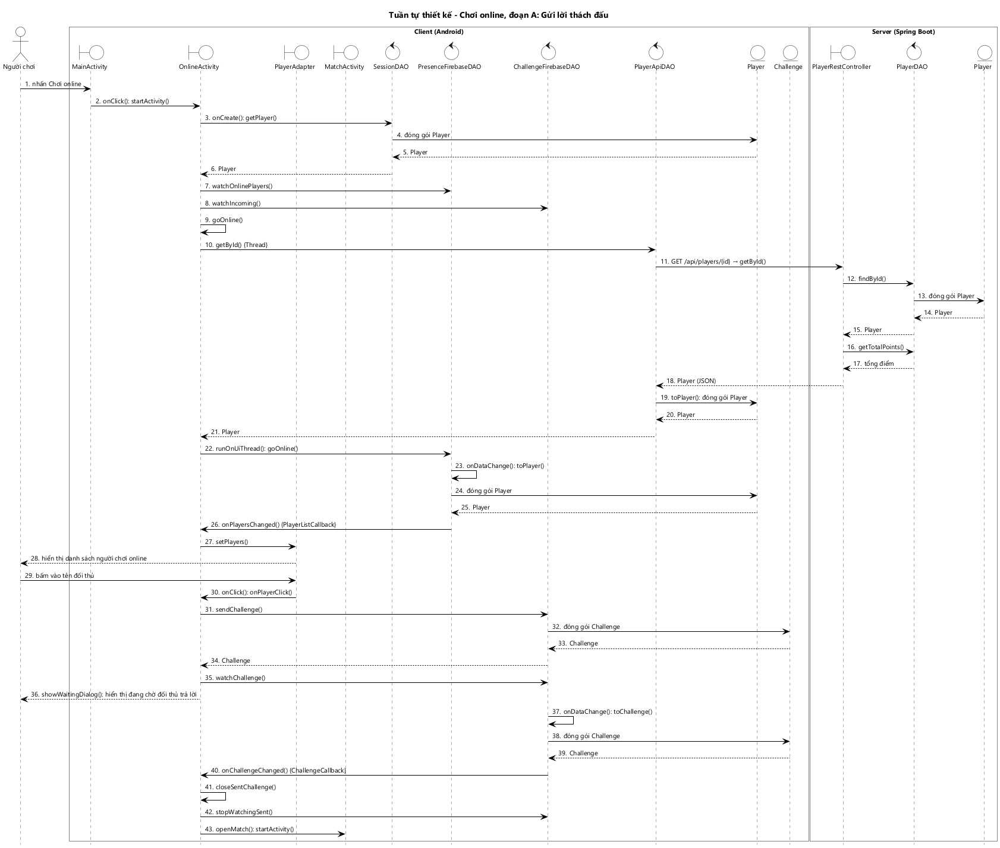

*Hình 8: Biểu đồ tuần tự chi tiết chức năng Chơi online, đoạn A: Gửi lời thách đấu.*

- Biểu đồ có 43 thông điệp.
- MainActivity chỉ là điểm vào: nút Chơi online mở OnlineActivity (bước 1–2). Mọi việc của chức năng này, từ danh sách online tới lời mời, nằm ở OnlineActivity.
- **Lời gọi REST** duy nhất là bước 11, để lấy tổng điểm mới nhất từ server. Server đi theo khuôn PlayerRestController → PlayerDAO → Player.
- **Firebase** làm 3 việc:
  - Ghi người chơi vào danh sách online (bước 22).
  - Báo khi danh sách thay đổi (bước 23–26).
  - Chuyển lời mời giữa 2 máy (bước 31–40).
- **Chỉ online khi ở màn Chơi online:** người chơi được ghi vào danh sách online khi mở OnlineActivity (bước 22). Khi rời màn này, hàm onDestroy() của OnlineActivity gỡ các theo dõi rồi gọi hàm goOffline() của PresenceFirebaseDAO. Lời mời thách đấu cũng chỉ nhận được trong lúc đó, vì watchIncoming() đăng ký ở bước 10.
- **Bất đồng bộ:** hàm goOnline() mở Thread ở bước 8 rồi trả về ngay, nên onCreate() đăng ký theo dõi ở bước 9–10 trong lúc yêu cầu REST ở bước 11–21 còn đang chạy. watchOnlinePlayers(), watchIncoming(), watchChallenge() là lời đăng ký; kết quả đến sau qua onDataChange(). Bước 37 xảy ra khi đối thủ đồng ý ở đoạn B.
- **Callback:** các FirebaseDAO không biết OnlineActivity, chỉ giữ interface PlayerListCallback, ChallengeCallback được truyền vào lúc đăng ký (bước 9, 10, 35). Bước 26 và 40 gọi qua interface đó; ở chức năng này đối tượng cài đặt là OnlineActivity.
- Bước 41–42 gỡ theo dõi lời mời đã gửi trước khi mở trận, để lần ghi sau của server lên lời mời không gọi lại onChallengeChanged().

**Đoạn B: Nhận lời thách đấu**

1. Khi có lời mời mới gửi tới người chơi, hàm onDataChange() của ChallengeFirebaseDAO gọi hàm toChallenge().
2. Hàm toChallenge() gọi lớp Challenge để đóng gói lời mời.
3. Lớp Challenge trả đối tượng Challenge cho hàm toChallenge().
4. ChallengeFirebaseDAO gọi hàm onChallengeChanged() của ChallengeCallback đã đăng ký bằng watchIncoming(), chính là OnlineActivity.
5. Hàm onChallengeChanged() thấy lời mời gửi tới người chơi chưa từng hiện, ghi id lời mời vào shownChallenges và gọi hàm showChallengeDialog() của chính nó.
6. OnlineActivity hiển thị hộp thoại lời mời gồm tên, tổng điểm của người mời và 2 nút Đồng ý, Từ chối.
7. Người chơi nhấn Đồng ý.
8. Hàm onClick() của nút Đồng ý gọi hàm acceptChallenge() của OnlineActivity.
9. Hàm acceptChallenge() mở một Thread và gọi hàm createMatch() của MatchApiDAO.
10. MatchApiDAO gửi yêu cầu POST /api/matches kèm lời mời tới hàm create() của MatchRestController.
11. Hàm create() gọi hàm readPresence() của FirebaseAdminDAO cho người mời và người được mời.
12. Hàm readPresence() đọc node presence và gọi lớp Player để đóng gói người chơi kèm trạng thái.
13. Lớp Player trả đối tượng Player cho hàm readPresence().
14. Hàm readPresence() trả đối tượng Player cho hàm create().
15. Hàm create() gọi hàm readChallengeStatus() của FirebaseAdminDAO; lời mời vẫn đang chờ, người mời chưa hủy, và cả 2 người đang online, rỗi.
16. Hàm create() gọi hàm startMatch() của chính nó.
17. Hàm startMatch() gọi lớp Match để tạo trận mới ở trạng thái đang đấu, kèm thời điểm bắt đầu.
18. Lớp Match trả đối tượng Match cho hàm startMatch().
19. Hàm startMatch() gọi hàm generateProblems() của ProblemDAO để sinh đề 10 câu.
20. Với mỗi câu, hàm generateProblems() sinh phép tính ngẫu nhiên và gọi lớp MathProblem để đóng gói kèm 4 phương án.
21. Lớp MathProblem trả đối tượng MathProblem cho hàm generateProblems().
22. Hàm generateProblems() trả danh sách 10 câu hỏi cho hàm startMatch(); hàm startMatch() gán đề và 2 người chơi vào trận.
23. Hàm startMatch() gọi hàm insert() của MatchDAO.
24. Hàm insert() lưu trận, 10 câu hỏi và 2 người chơi trong trận vào CSDL trong một transaction, gán id vừa sinh cho trận.
25. Hàm insert() trả kết quả cho hàm startMatch().
26. Hàm startMatch() gọi hàm writeMatch() của FirebaseAdminDAO để gửi đề, không kèm đáp án, cho cả 2 máy.
27. Hàm startMatch() gọi hàm setStatus() của chính nó với trạng thái bận.
28. Hàm setStatus() gọi hàm updateStatus() của FirebaseAdminDAO cho từng người chơi trong trận.
29. Hàm create() gọi hàm updateChallenge() của FirebaseAdminDAO để đánh dấu lời mời đã được đồng ý, kèm mã trận.
30. Hàm create() gọi hàm hideAnswers() của chính nó để xóa đáp án khỏi các câu hỏi trước khi trả về.
31. Hàm create() trả trận dạng JSON cho MatchApiDAO.
32. Hàm toMatch() của MatchApiDAO gọi lớp Match để đóng gói dữ liệu JSON.
33. Lớp Match trả đối tượng Match cho MatchApiDAO.
34. MatchApiDAO trả đối tượng Match cho hàm acceptChallenge().
35. Trong hàm runOnUiThread(), hàm acceptChallenge() gọi hàm openMatch() để mở MatchActivity với mã trận.

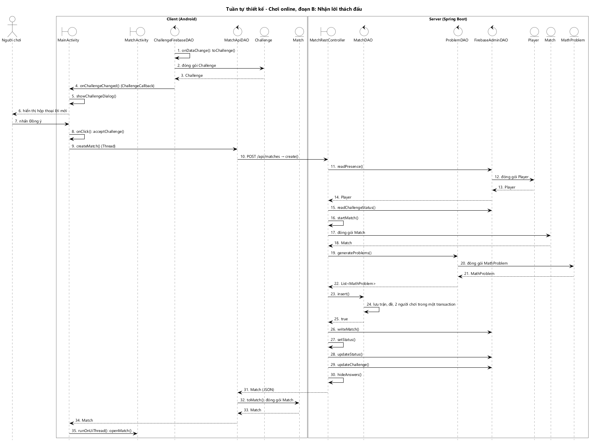

*Hình 9: Biểu đồ tuần tự chi tiết chức năng Chơi online, đoạn B: Nhận lời thách đấu.*

- Biểu đồ có 35 thông điệp.
- **Server sinh đề** (bước 19–22) và lưu đề vào MySQL cùng trận (bước 23–25), vì server cần đáp án để chấm bài sau này.
- **Đề không kèm đáp án:** đề gửi qua Firebase không có đáp án (bước 26), và bản trận trả về cho app cũng đã bị hideAnswers() xóa đáp án (bước 30). Người chơi không đọc được đáp án trước khi nộp bài.
- Bước 29 cập nhật lời mời, đây chính là tín hiệu để máy người mời mở MatchActivity ở bước 37 của đoạn A.
- Hàm create() đọc trạng thái online của 2 người (bước 11–14) và trạng thái lời mời (bước 15) trước khi tạo trận, nên không thể có người ở trong 2 trận cùng lúc. Lời mời đã hủy hoặc một người không rỗi thì server ghi lời mời là bị từ chối.

**Đoạn C: Thi đấu**

1. Hàm onCreate() của MatchActivity gọi hàm getPlayer() của SessionDAO.
2. Hàm getPlayer() đóng gói và trả đối tượng Player cho hàm onCreate().
3. Hàm onCreate() gọi hàm watchMatch() của MatchFirebaseDAO với mã trận, truyền chính MatchActivity làm MatchCallback.
4. Hàm onDataChange() của MatchFirebaseDAO gọi hàm toMatch() của chính nó.
5. Hàm toMatch() gọi lớp Match để đóng gói trận, kèm 10 câu hỏi và 2 người chơi trong trận.
6. Lớp Match trả đối tượng Match cho hàm toMatch().
7. MatchFirebaseDAO gọi hàm onSuccess() của MatchCallback đã đăng ký ở bước 3, chính là MatchActivity.
8. Lần đầu nhận trận có đề, hàm onSuccess() gọi hàm startMatch() của chính nó; hàm startMatch() lưu id đối thủ vào opponentId và lưu 10 câu hỏi của trận vào questions.
9. Hàm startMatch() gọi lớp Answer để tạo bài làm rỗng, chưa chọn phương án, cho từng câu.
10. Lớp Answer trả đối tượng Answer cho hàm startMatch(); hàm startMatch() giữ 10 bài làm trong answers.
11. Hàm startMatch() gọi hàm showQuestion() của chính nó để hiện câu đầu tiên.
12. Hàm showQuestion() gọi hàm getExpression() của MathProblem của câu đang làm.
13. MathProblem trả chuỗi phép tính cho hàm showQuestion().
14. Hàm showQuestion() gọi hàm getAnswerOptions() của MathProblem.
15. MathProblem trả 4 phương án cho hàm showQuestion().
16. Với mỗi ô, hàm showQuestion() gọi hàm optionText() của chính nó để ghép chữ cái A, B, C, D với giá trị phương án; sau đó hàm showQuestion() bật 4 ô và ghi thời điểm câu hiện ra vào shownAt.
17. Hàm startMatch() gọi hàm createTimer() của chính nó để tạo CountDownTimer 60 giây.
18. Hàm startMatch() gọi hàm start() của CountDownTimer.
19. Hàm startMatch() gọi hàm watchOnlinePlayers() của PresenceFirebaseDAO, truyền chính MatchActivity làm PlayerListCallback, để biết đối thủ còn online hay không.
20. MatchActivity hiển thị ô thời gian, trạng thái đối thủ và nút Thoát cho người chơi.
21. Hàm onDataChange() của PresenceFirebaseDAO đóng gói danh sách người chơi online và gọi hàm onPlayersChanged() của PlayerListCallback, chính là MatchActivity; đối thủ vẫn có trong danh sách nên trận tiếp tục.
22. Mỗi giây, CountDownTimer gọi hàm onTick() của MatchActivity để hiển thị thời gian còn lại.
23. MatchActivity hiển thị số thứ tự câu đang làm, phép tính và 4 ô phương án A, B, C, D cho người chơi.
24. Người chơi bấm một ô phương án.
25. Hàm onClick() của MatchActivity gọi hàm chooseOption() của chính nó.
26. Hàm chooseOption() gọi hàm setSelectedOption() của Answer ứng với câu đang làm để ghi phương án đã chọn.
27. Hàm chooseOption() gọi hàm setAnswerTime() của Answer để ghi thời gian làm câu, tính từ shownAt tới lúc bấm.
28. Hàm chooseOption() khóa 4 ô, làm mờ 3 ô không chọn, tăng current, rồi sau NEXT_DELAY gọi hàm showQuestion() của chính nó; khi còn câu, hàm showQuestion() hiện câu tiếp theo như bước 12–16.

Các bước 23–28 lặp lại cho đến câu thứ 10.

29. Sau câu thứ 10, hàm showQuestion() thấy đã làm xong 10 câu, gọi hàm showMessage() của chính nó.
30. MatchActivity thay câu hỏi bằng thông báo đã làm xong 10 câu và hiển thị nút Nộp bài cho người chơi.
31. Người chơi nhấn Nộp bài.
32. Hàm onClick() của MatchActivity gọi hàm submitAnswers() của chính nó.
33. Hàm submitAnswers() khóa nút Nộp bài và gọi hàm showMessage() của chính nó để hiển thị thông báo đang nộp bài.
34. Hàm submitAnswers() mở một Thread và gọi hàm submit() của MatchApiDAO với 10 bài làm.
35. MatchApiDAO gửi yêu cầu POST /api/matches/{id}/submit kèm phương án đã chọn và thời gian làm từng câu tới hàm submit() của MatchRestController.
36. Hàm submit() ghi lại thời điểm nhận bài làm, rồi gọi hàm findMatch() của chính nó.
37. Hàm findMatch() gọi hàm findById() của MatchDAO.
38. Hàm findById() truy vấn trận, đề và 2 người chơi, rồi gọi lớp Match để đóng gói.
39. Lớp Match trả đối tượng Match cho hàm findById().
40. Hàm findById() trả đối tượng Match cho hàm findMatch(), hàm findMatch() trả về cho hàm submit().
41. Hàm submit() gán bài làm nhận được cho người chơi trong trận, rồi gọi hàm countCorrect() của Match để chấm.
42. Hàm countCorrect() gọi hàm setProblem() của Answer để gắn câu thứ i của đề vào bài làm thứ i.
43. Hàm countCorrect() gọi hàm isCorrect() của Answer.
44. Hàm isCorrect() của Answer gọi hàm isCorrect() của MathProblem để so phương án đã chọn với đáp án đúng.
45. MathProblem trả kết quả so sánh cho hàm isCorrect() của Answer.
46. Answer trả đúng / sai cho hàm countCorrect().

Các bước 42–46 lặp lại cho đến câu thứ 10.

47. Hàm countCorrect() trả số câu đúng cho hàm submit().
48. Hàm submit() ghi số câu đúng và thời điểm nộp bài vào người chơi trong trận, rồi gọi hàm updateSubmission() của MatchDAO.
49. Hàm updateSubmission() mở một transaction và gọi hàm updateMatchPlayer() của chính nó để lưu số câu đúng và thời điểm nộp bài vào bảng tblMatchPlayer.
50. Với mỗi câu, hàm updateSubmission() gọi hàm insertAnswer() của chính nó để lưu phương án đã chọn và thời gian làm câu vào bảng tblAnswer.
51. Hàm updateSubmission() xác nhận transaction và trả kết quả cho hàm submit().
52. Hàm submit() gọi hàm writeSubmitted() của FirebaseAdminDAO để máy đối thủ biết người chơi đã nộp bài.
53. Hàm submit() gọi hàm isOver() của Match.
54. Match trả về sai vì đối thủ chưa nộp bài.
55. Hàm submit() gọi hàm hideAnswers() của chính nó để xóa đáp án và bài làm vì trận chưa kết thúc.
56. Hàm submit() trả trận dạng JSON cho MatchApiDAO.
57. Hàm toMatch() của MatchApiDAO gọi lớp Match để đóng gói dữ liệu JSON.
58. Lớp Match trả đối tượng Match cho MatchApiDAO.
59. MatchApiDAO trả đối tượng Match cho hàm submitAnswers().
60. Trong hàm runOnUiThread(), hàm submitAnswers() gọi hàm onSubmitted() của chính nó.
61. Hàm onSubmitted() gọi hàm cancel() của CountDownTimer.
62. Hàm onSubmitted() ẩn nút Nộp bài và gọi hàm showMessage() của chính nó.
63. MatchActivity hiển thị thông báo đã nộp bài, đang chờ đối thủ cho người chơi.
64. Khi đối thủ nộp bài, hàm submit() của MatchRestController, lúc này xử lý yêu cầu từ máy đối thủ, chấm và lưu bài làm như trên rồi gọi hàm isOver() của Match.
65. Match trả về đúng vì cả 2 người chơi đã nộp bài.
66. Hàm submit() gọi hàm endMatch() của chính nó.
67. Hàm endMatch() gọi hàm updateEndedAt() của MatchDAO để ghi thời điểm kết thúc trận.
68. Hàm updateEndedAt() trả kết quả cho hàm endMatch().
69. Hàm endMatch() gọi hàm getTotalPoints() của PlayerDAO cho từng người chơi trong trận.
70. Hàm getTotalPoints() trả tổng điểm mới cho hàm endMatch().
71. Hàm endMatch() gọi hàm updatePoints() của FirebaseAdminDAO để cập nhật tổng điểm trong danh sách online.
72. Hàm submit() gọi hàm writeFinished() của FirebaseAdminDAO để báo trận đã kết thúc cho cả 2 máy.
73. Hàm onDataChange() của MatchFirebaseDAO gọi hàm toMatch().
74. Hàm toMatch() gọi lớp Match để đóng gói trận mới nhất.
75. Lớp Match trả đối tượng Match cho hàm toMatch().
76. MatchFirebaseDAO gọi hàm onSuccess() của MatchCallback, chính là MatchActivity.
77. Hàm onSuccess() thấy trận đã kết thúc, gọi hàm loadResult() của chính nó.
78. Hàm loadResult() mở một Thread và gọi hàm getById() của MatchApiDAO để lấy trận đầy đủ, có đáp án và kết quả chấm.
79. MatchApiDAO gửi yêu cầu GET /api/matches/{id} tới hàm getById() của MatchRestController.
80. Hàm getById() gọi hàm findMatch() của chính nó.
81. Hàm findMatch() gọi hàm findById() của MatchDAO.
82. Hàm findById() truy vấn trận, đề, 2 người chơi và bài làm từng câu, rồi gọi lớp Match để đóng gói.
83. Lớp Match trả đối tượng Match cho hàm findById().
84. Hàm findById() trả đối tượng Match cho hàm findMatch(), hàm findMatch() trả về cho hàm getById().
85. Hàm getById() gọi hàm getTotalPoints() của PlayerDAO cho 2 người chơi và gán vào Player của trận.
86. Hàm getTotalPoints() trả tổng điểm cho hàm getById().
87. Hàm getById() trả trận dạng JSON, kèm đáp án và bài làm vì trận đã kết thúc, cho MatchApiDAO.
88. Hàm toMatch() của MatchApiDAO gọi lớp Match để đóng gói dữ liệu JSON.
89. Lớp Match trả đối tượng Match cho MatchApiDAO.
90. MatchApiDAO trả đối tượng Match cho hàm loadResult().
91. Trong hàm runOnUiThread(), hàm loadResult() gọi hàm showResult() của chính nó.
92. Hàm showResult() gọi hàm getResult() của Match.
93. Match trả về kết quả của người chơi.
94. Hàm showResult() gọi hàm showScores() của chính nó.
95. Hàm showScores() gọi hàm getFinishTime() của Match cho người chơi và đối thủ.
96. Match trả về thời gian làm bài.
97. Hàm showScores() gọi hàm getPoints() của Match.
98. Match trả về điểm trận của người chơi.
99. MatchActivity hiển thị lớp kết quả gồm kết quả, số câu đúng, thời gian làm bài, điểm trận, tổng điểm và câu hỏi chơi tiếp cho người chơi.

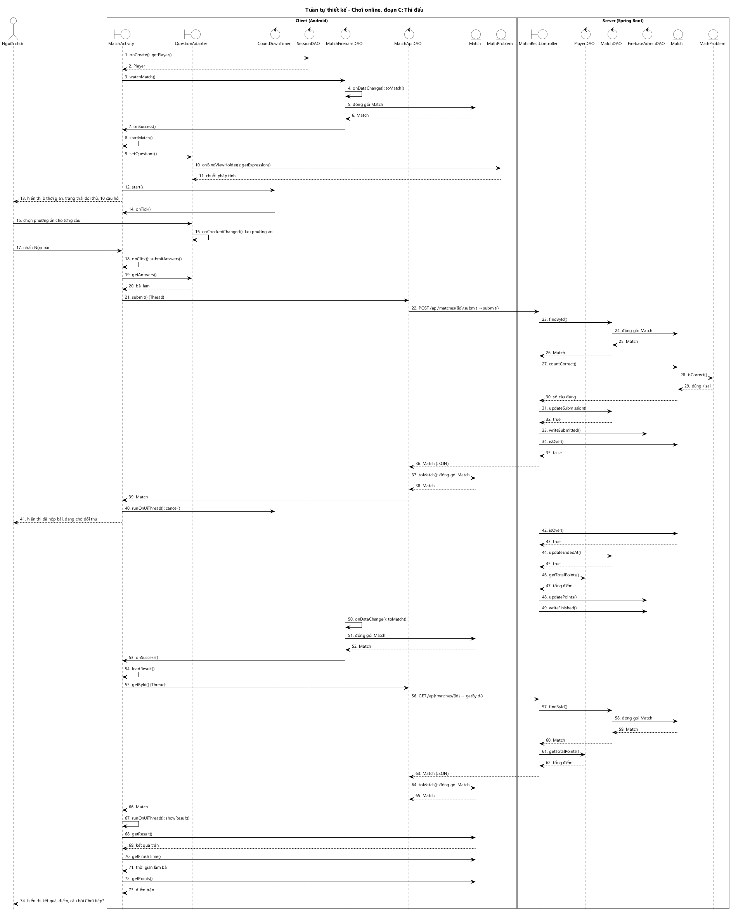

*Hình 10: Biểu đồ tuần tự chi tiết chức năng Chơi online, đoạn C: Thi đấu.*

- Biểu đồ có 99 thông điệp.
- Bước 2 lược bỏ thông điệp đóng gói Player bên trong SessionDAO, vì đã vẽ ở đoạn A.
- **Làm bài từng câu:** MatchActivity hiện mỗi lần một câu với 4 ô A, B, C, D (bước 11–16, 23). Người chơi bấm một ô thì hàm chooseOption() ghi phương án đã chọn và thời gian làm câu vào Answer của câu đó (bước 26–27) rồi chuyển sang câu sau; vòng này lặp cho 10 câu (bước 23–28). App không có đáp án nên không báo đúng / sai ngay. NEXT_DELAY khóa 4 ô một lúc sau khi chọn, để bấm đúp không trả lời nhầm câu sau.
- **Server làm trọng tài**, gồm 3 phần nghiệp vụ là hàm Java thuần của lớp thực thể:
  - **Chấm bài:** hàm countCorrect() của Match gắn từng câu của đề vào bài làm tương ứng rồi gọi hàm isCorrect() của Answer; Answer dùng hàm isCorrect() của MathProblem để so phương án đã chọn với đáp án (bước 41–47).
  - **Điều kiện kết thúc:** hàm isOver() của Match (bước 53, 64).
  - **Thắng thua:** hàm getResult() và getPoints() của Match. App gọi 2 hàm này trên bản trận server trả về (bước 92–98).
- **Lưu bài làm từng câu:** hàm updateSubmission() ghi số câu đúng, thời điểm nộp vào tblMatchPlayer và 10 dòng bài làm vào tblAnswer trong cùng một transaction (bước 48–51). Bài làm được lưu để chi tiết trận ở chức năng Xem lịch sử đấu hiện được đúng / sai và thời gian từng câu của mỗi người.
- **Không lộ bài làm giữa trận:** khi trận chưa kết thúc, hàm hideAnswers() xóa đáp án và bài làm của cả 2 người khỏi bản trận trả về (bước 55).
- **Thời gian làm bài** tính theo đồng hồ server: thời điểm server nhận bài làm trừ thời điểm bắt đầu trận. Độ trễ khác nhau giữa 2 máy không làm sai kết quả do đồng hồ máy lệch nhau. Thời gian làm từng câu đo ở app, từ lúc câu hiện ra tới lúc bấm, và chỉ dùng để hiển thị trong chi tiết trận.
- Bước 64–72 diễn ra khi server xử lý yêu cầu nộp bài từ máy đối thủ. Máy này biết trận đã xong nhờ Firebase (bước 73–76).
- **MatchActivity cài đặt 2 callback:** MatchCallback nhận diễn biến trận (bước 3, 7, 76), PlayerListCallback nhận danh sách người chơi online (bước 19, 21). Ở kịch bản chuẩn đối thủ vẫn online nên bước 21 không làm gì thêm; khi đối thủ biến khỏi danh sách giữa trận, hàm onPlayersChanged() gọi forfeit() thay cho đối thủ.
- Các cờ started, submitted, resultLoading của MatchActivity chặn gọi lặp: onSuccess() được gọi lại mỗi lần node trận thay đổi, nhưng startMatch() chỉ chạy ở lần đầu (bước 8), loadResult() chỉ chạy một lần (bước 77).
- Hết 60 giây mà người chơi chưa nộp thì CountDownTimer gọi hàm onFinish() của MatchActivity; hàm onFinish() gọi showMessage() rồi submitAnswers() thay cho bước 31–32, các câu chưa làm được gửi đi là bỏ trống.

**Đoạn D: Chơi tiếp**

1. Người chơi nhấn Chơi tiếp trên lớp kết quả của MatchActivity.
2. Hàm onClick() của nút Chơi tiếp gọi hàm sendChoice() của chính nó.
3. Hàm sendChoice() khóa 2 nút Chơi tiếp, Dừng; MatchActivity hiển thị thông báo đang chờ đối thủ.
4. Hàm sendChoice() mở một Thread và gọi hàm continueMatch() của MatchApiDAO.
5. MatchApiDAO gửi yêu cầu POST /api/matches/{id}/continue kèm lựa chọn tới hàm continueMatch() của MatchRestController.
6. Hàm continueMatch() gọi hàm findMatch() của chính nó.
7. Hàm findMatch() gọi hàm findById() của MatchDAO.
8. Hàm findById() đóng gói trận và trả đối tượng Match cho hàm findMatch(), hàm findMatch() trả về cho hàm continueMatch().
9. Hàm continueMatch() gọi hàm writeChoice() của FirebaseAdminDAO để ghi lựa chọn của người chơi.
10. Hàm continueMatch() thấy đối thủ chưa chọn, ghi người chơi vào waitingChoices rồi trả trận hiện tại dạng JSON cho MatchApiDAO.
11. Hàm toMatch() của MatchApiDAO gọi lớp Match để đóng gói dữ liệu JSON.
12. Lớp Match trả đối tượng Match cho MatchApiDAO.
13. MatchApiDAO trả đối tượng Match cho hàm sendChoice().
14. Khi đối thủ cũng chọn chơi tiếp, hàm continueMatch(), lúc này xử lý yêu cầu từ máy đối thủ, thấy người chơi đã có trong waitingChoices nên gọi hàm startMatch() của chính nó.
15. Hàm startMatch() gọi lớp Match để tạo trận mới với 2 người chơi cũ.
16. Lớp Match trả đối tượng Match cho hàm startMatch().
17. Hàm startMatch() gọi hàm generateProblems() của ProblemDAO để sinh đề mới.
18. Hàm generateProblems() gọi lớp MathProblem để đóng gói từng câu hỏi.
19. Lớp MathProblem trả đối tượng MathProblem cho hàm generateProblems().
20. Hàm generateProblems() trả danh sách 10 câu hỏi cho hàm startMatch().
21. Hàm startMatch() gọi hàm insert() của MatchDAO để lưu trận mới.
22. Hàm insert() trả kết quả cho hàm startMatch().
23. Hàm startMatch() gọi hàm writeMatch() của FirebaseAdminDAO để gửi đề mới cho cả 2 máy.
24. Hàm startMatch() gọi hàm setStatus() của chính nó với trạng thái bận.
25. Hàm setStatus() gọi hàm updateStatus() của FirebaseAdminDAO cho từng người chơi.
26. Hàm continueMatch() gọi hàm writeNextMatch() của FirebaseAdminDAO để ghi mã trận mới vào trận cũ.
27. Hàm onDataChange() của MatchFirebaseDAO thấy trận cũ đã có mã trận tiếp theo, gọi hàm onNextMatch() của MatchCallback, chính là MatchActivity.
28. Hàm onNextMatch() gọi hàm openNextMatch() của chính nó.
29. Hàm openNextMatch() gọi hàm stopWatching() của MatchFirebaseDAO để ngừng theo dõi trận cũ.
30. Hàm openNextMatch() mở MatchActivity mới với mã trận mới và đóng màn hiện tại; trận mới diễn ra như đoạn C.

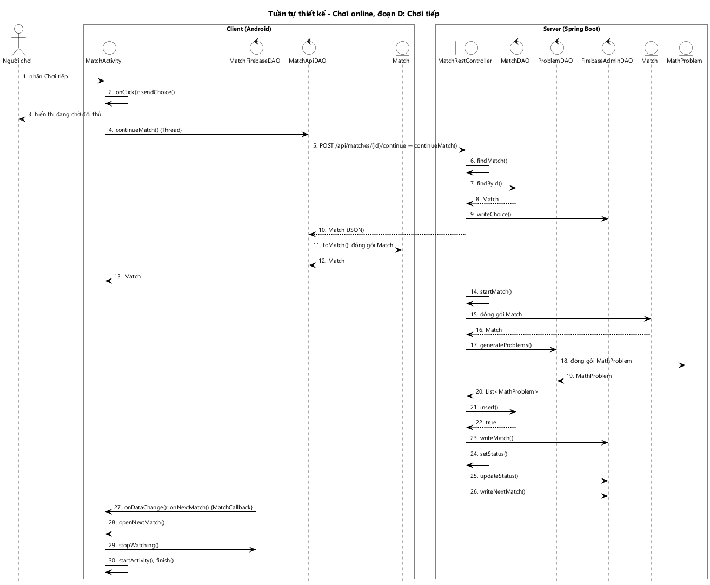

*Hình 11: Biểu đồ tuần tự chi tiết chức năng Chơi online, đoạn D: Chơi tiếp.*

- Biểu đồ có 30 thông điệp, vẽ cho người chọn chơi tiếp trước.
- Hàm continueMatch() chạy tuần tự (synchronized). Nếu 2 yêu cầu chơi tiếp đến cùng lúc, chỉ yêu cầu đến sau tạo trận mới, nên không sinh 2 trận.
- Trận mới dùng lại hàm startMatch() của đoạn B (bước 14–25), không viết lại logic sinh đề.
- Máy này nhận trận mới qua MatchCallback (bước 27), gỡ theo dõi trận cũ (bước 29), mở MatchActivity mới và đi lại đoạn C.

### 4.2. Chức năng "Xem lịch sử đấu"

#### 4.2.1. Thiết kế giao diện

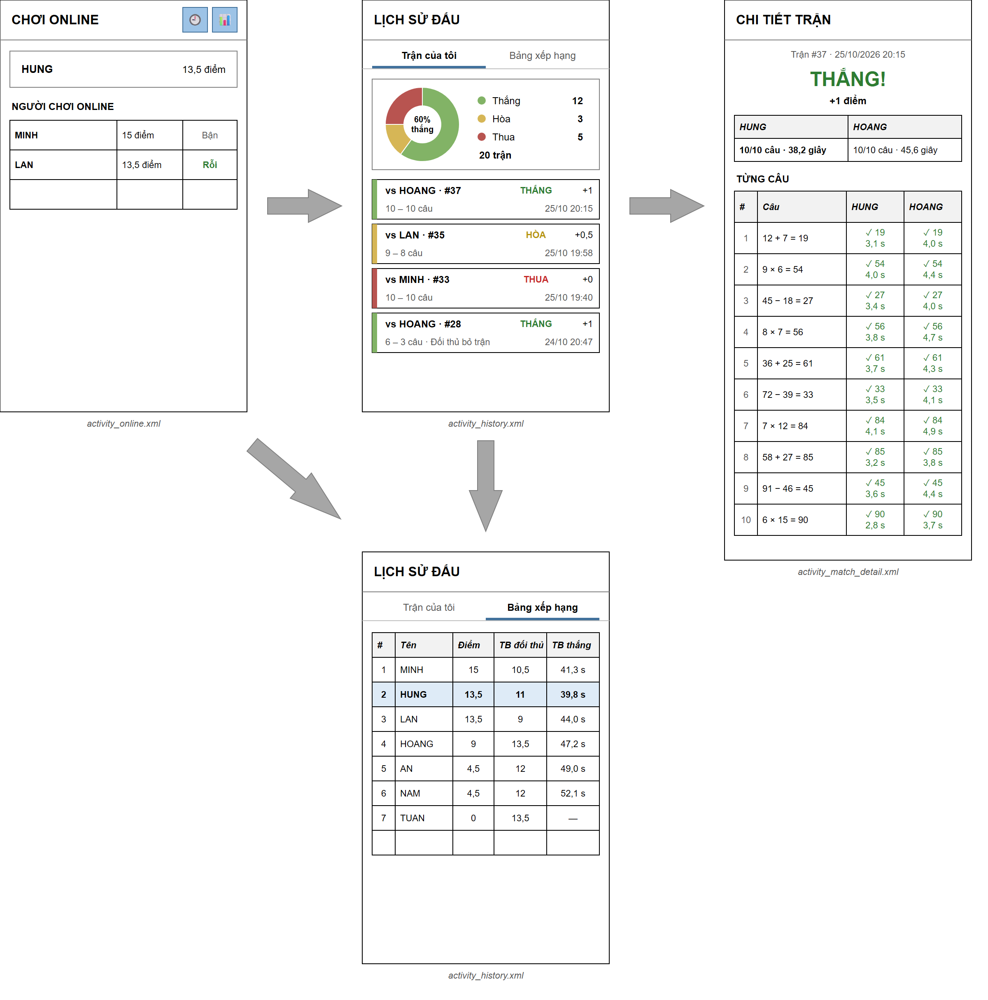

*Hình 12: Thiết kế giao diện chức năng Xem lịch sử đấu.*

Chức năng đi từ màn Chơi online: biểu tượng đồng hồ mở màn Lịch sử đấu ở thẻ Trận của tôi, biểu tượng bảng xếp hạng ở góc phải ngoài cùng mở thẳng thẻ Bảng xếp hạng. Màn Lịch sử đấu có thanh trên với tiêu đề LỊCH SỬ ĐẤU căn trái, dưới là 2 thẻ.
- **Thẻ Trận của tôi** mở sẵn khi vào từ biểu tượng Lịch sử đấu. Trên cùng là thẻ tóm tắt: biểu đồ tròn dạng vành khuyên bên trái, giữa ghi tỉ lệ thắng to; chú giải 3 màu và tổng số trận bên phải. Người chơi thấy ngay phong độ của mình trước khi đọc từng trận.
- **Danh sách trận** nằm dưới thẻ tóm tắt, trận mới nhất ở trên. Mỗi dòng là một item_match_history.xml có dải màu bên trái theo kết quả: xanh lá thắng, vàng hòa, đỏ thua. Dòng trên ghi đối thủ, số trận, kết quả, điểm trận; dòng dưới ghi số câu đúng 2 bên và thời điểm kết thúc. Trận có người bỏ trận ghi thêm "Đối thủ bỏ trận" hoặc "Bạn bỏ trận".
- **Thẻ Bảng xếp hạng** giữ nguyên bố cục bảng xếp hạng: hàng tiêu đề cột cố định, mỗi dòng là một item_ranking.xml, dòng của người xem có nền màu nhấn.

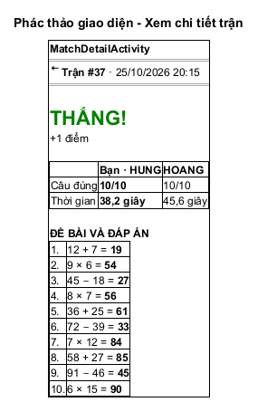

*Hình 13: Thiết kế giao diện chi tiết trận.*

Màn Chi tiết trận có thanh trên với tiêu đề CHI TIẾT TRẬN căn trái, nội dung đi từ tổng quát tới chi tiết:
- Trên cùng là số trận kèm thời điểm kết thúc, kết quả và điểm trận chữ to.
- Giữa là khung so sánh 2 cột: tên, số câu đúng và thời gian nộp của mình và của đối thủ. Cột của người xem in đậm.
- Dưới là bảng TỪNG CÂU, hàng tiêu đề cột gồm #, Câu, tên mình, tên đối thủ. Mỗi dòng một câu: số thứ tự, phép tính kèm đáp án đúng, rồi ô bài làm của từng người. Ô bài làm có 2 dòng: dòng trên "✓ 19" chữ xanh nếu đúng hoặc "✗ 18" chữ đỏ kèm phương án đã chọn nếu sai, dòng dưới là thời gian làm câu "3,1 s". Câu bỏ trống hiện "Bỏ trống" chữ xám; người bỏ trận khi chưa nộp không có bài làm nên hiện "—".

**Bảng thành phần:**

| Màn | id trong layout | Loại View | Chức năng | Tên ở pha phân tích |
|---|---|---|---|---|
| OnlineActivity | btnHistory | ImageButton | Biểu tượng đồng hồ, mở màn Lịch sử đấu ở thẻ Trận của tôi; contentDescription "Lịch sử đấu" | subHistory |
| | btnRanking | ImageButton | Biểu tượng bảng xếp hạng dạng cột, góc phải ngoài cùng, mở màn Lịch sử đấu ở thẻ Bảng xếp hạng; contentDescription "Bảng xếp hạng" | subRanking |
| HistoryActivity | tabLayout | TabLayout | 2 thẻ Trận của tôi, Bảng xếp hạng | subTabRanking |
| | layoutMyMatches | LinearLayout | Khối thẻ Trận của tôi, ẩn khi chọn thẻ Bảng xếp hạng | |
| | pieChart | PieChartView | Biểu đồ tròn tỉ lệ thắng, hòa, thua | outWinRateChart |
| | txtWins, txtDraws, txtLosses | TextView | Chú giải số trận thắng, hòa, thua | outSummary |
| | txtTotal | TextView | Tổng số trận | outSummary |
| | rvMatches | RecyclerView | Danh sách trận | outsubListMatch |
| | txtEmpty | TextView | "Bạn chưa đấu trận nào", ẩn khi có trận | outsubListMatch |
| | rvRanking | RecyclerView | Danh sách đã xếp hạng | outListRanking |
| item_match_history.xml | viewResultBar | View | Dải màu theo kết quả | một dòng của outsubListMatch |
| | txtOpponent | TextView | "vs HOANG · #37" | một dòng của outsubListMatch |
| | txtResult | TextView | THẮNG / HÒA / THUA, kèm "Đối thủ bỏ trận" nếu có | một dòng của outsubListMatch |
| | txtPoints | TextView | "+1" | một dòng của outsubListMatch |
| | txtScore | TextView | "10 – 10 câu" | một dòng của outsubListMatch |
| | txtEndedAt | TextView | "25/10 20:15" | một dòng của outsubListMatch |
| item_ranking.xml | txtRank, txtName, txtPoints, txtAvgOpponent, txtAvgWinTime | TextView | Hạng, tên, tổng điểm, trung bình điểm đối thủ, trung bình thời gian thắng ("—" nếu chưa thắng) | một dòng của outListRanking |
| MatchDetailActivity | txtTitle | TextView | "Trận #37 · 25/10/2026 20:15" | |
| | txtResult | TextView | THẮNG! / THUA! / HÒA! | outResult |
| | txtPoints | TextView | "+1 điểm" | outPoints |
| | txtMyName, txtMyStats | TextView | Tên, "10/10 · 38,2 giây" của mình | outMyResult |
| | txtOpponentName, txtOpponentStats | TextView | Tên, "10/10 · 45,6 giây" hoặc "Bỏ trận" của đối thủ | outOpponentResult |
| | txtMyColumn | TextView | Tiêu đề cột bài làm của mình, ghi tên mình | outListAnswer |
| | txtOpponentColumn | TextView | Tiêu đề cột bài làm của đối thủ, ghi tên đối thủ | outListAnswer |
| | rvProblems | RecyclerView | 10 câu, mỗi câu kèm đáp án đúng và bài làm của 2 người | outListAnswer |
| item_problem.xml | txtIndex | TextView | Số thứ tự câu | một dòng của outListAnswer |
| | txtExpression | TextView | "12 + 7 = 19", phép tính kèm đáp án đúng | một dòng của outListAnswer |
| | txtMyAnswer | TextView | Bài làm của mình: "✓ 19" xanh hoặc "✗ 18" đỏ, dòng dưới "3,1 s"; "Bỏ trống" xám; "—" khi không có bài làm | một dòng của outListAnswer |
| | txtOpponentAnswer | TextView | Bài làm của đối thủ, cùng cách hiện như txtMyAnswer | một dòng của outListAnswer |

#### 4.2.2. Biểu đồ lớp chi tiết

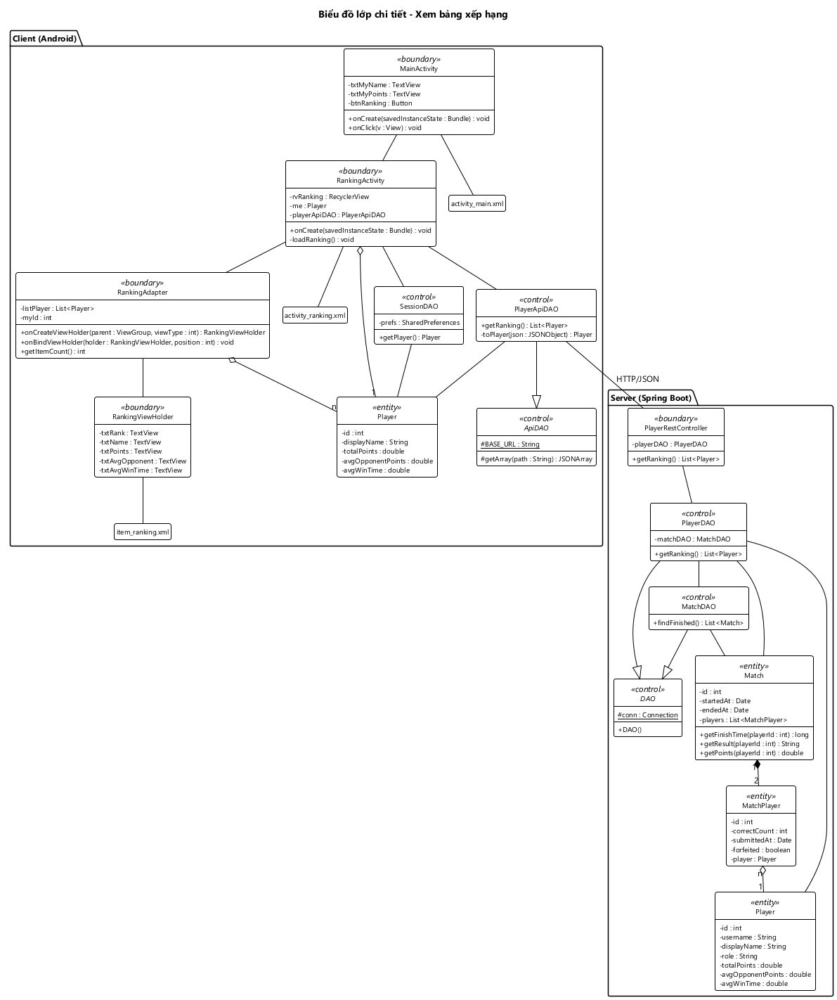

*Hình 14: Biểu đồ lớp chi tiết chức năng Xem lịch sử đấu.*

**Package "Client (Android)".**

| Loại | Lớp | Mô tả |
|---|---|---|
| Boundary | OnlineActivity | onClick của btnHistory mở HistoryActivity; btnRanking mở HistoryActivity kèm EXTRA_TAB = TAB_RANKING trong Intent |
| Boundary | HistoryActivity | onCreate lấy người chơi bằng SessionDAO.getPlayer rồi gọi loadHistory; Intent có EXTRA_TAB = TAB_RANKING thì chọn sẵn thẻ Bảng xếp hạng bằng tabLayout.selectTab, onTabSelected được gọi và tải bảng xếp hạng. loadHistory gọi MatchApiDAO.getHistory trong Thread, rồi trong runOnUiThread gọi showSummary và gắn MatchHistoryAdapter. showSummary đếm Match.getResult theo id người chơi thành số trận thắng, hòa, thua, gọi PieChartView.setData và ghi chú giải. onTabSelected ẩn / hiện 2 khối layoutMyMatches, layoutRanking; chưa tải bảng xếp hạng (rankingLoaded sai) thì gọi loadRanking. loadRanking đặt rankingLoaded, lỗi thì đặt lại để lần chọn sau tải lại. onMatchClick mở MatchDetailActivity kèm matchId với khóa EXTRA_MATCH_ID. Lỗi mạng thì showError hiện Toast |
| Boundary | PieChartView | View tự vẽ, kế thừa View của Android. Giữ 3 số wins, draws, losses, 3 Paint (arcPaint, percentPaint, labelPaint) và khung oval tạo sẵn để onDraw không cấp phát lại. setData lưu 3 số rồi gọi invalidate; onDraw gọi drawPart vẽ từng cung tròn bằng Canvas.drawArc theo tỉ lệ, khoét giữa thành vành khuyên và ghi tỉ lệ thắng. Cả 3 số bằng 0 thì vẽ vòng xám |
| Boundary | MatchHistoryAdapter, MatchHistoryViewHolder | MatchHistoryAdapter giữ danh sách Match, id người xem, HistoryActivity chứa nó và timeFormat định dạng thời điểm kết thúc. onBindViewHolder gọi Match.getOpponent, getResult, getPoints để điền một dòng và tô màu dải kết quả; bấm vào dòng thì gọi onMatchClick của HistoryActivity, giống cách PlayerAdapter gọi về OnlineActivity. MatchHistoryViewHolder giữ các View của một dòng |
| Boundary | RankingAdapter, RankingViewHolder | RankingAdapter hiện hạng bằng vị trí + 1, 3 tiêu chí của Player, tô nền dòng của người xem |
| Boundary | MatchDetailActivity | onCreate lấy người chơi bằng SessionDAO.getPlayer, đọc matchId từ Intent rồi gọi loadMatch. loadMatch gọi MatchApiDAO.getById trong Thread, rồi trong runOnUiThread gọi showMatch. showMatch dùng Match.getOpponent tìm MatchPlayer của đối thủ và của mình, showResult tô màu THẮNG / HÒA / THUA theo Match.getResult, getPoints ghi điểm trận; stats dùng getFinishTime ghi số câu đúng và thời gian của từng bên; ghi tên 2 người vào txtMyColumn, txtOpponentColumn; rồi gắn ProblemAdapter với đề và bài làm của 2 người. matchId giữ mã trận đọc từ Intent |
| Boundary | ProblemAdapter, ProblemViewHolder | ProblemAdapter giữ 10 MathProblem (listProblem) và bài làm của mình, của đối thủ (myAnswers, opponentAnswers : List\<Answer>). onBindViewHolder ghi số thứ tự, MathProblem.getExpression thay dấu "?" bằng correctAnswer, rồi gọi showAnswer cho 2 ô bài làm. answerAt lấy bài làm ở vị trí câu, không có thì trả null (người bỏ trận khi chưa nộp). showAnswer dùng Answer.isAnswered, isCorrect để hiện "✓" xanh hoặc "✗" đỏ kèm phương án đã chọn và answerTime đổi ra giây; bỏ trống hiện "Bỏ trống", không có bài làm hiện "—". ProblemViewHolder giữ txtIndex, txtExpression, txtMyAnswer, txtOpponentAnswer |
| Control | SessionDAO | Như ở Chơi online |
| Control | ApiDAO ← MatchApiDAO | getHistory gửi GET /api/matches?playerId={id}; getById gửi GET /api/matches/{id}. Cả 2 đóng gói JSON thành Match bằng toMatch. Với getById, toMatchPlayer gọi toAnswers đóng gói bài làm của từng người và gắn câu thứ i của đề vào bài làm thứ i; lịch sử đấu không kèm bài làm nên toAnswers trả danh sách rỗng |
| Control | ApiDAO ← PlayerApiDAO | getRanking gửi GET /api/players/ranking, đóng gói từng phần tử thành Player bằng toPlayer |
| Entity | Match, MatchPlayer, Answer, MathProblem, Player | Match có thêm getOpponent trả MatchPlayer còn lại; các luật getResult, getPoints, getFinishTime dùng chung với Chơi online. Answer.isCorrect so phương án đã chọn với correctAnswer của câu đã gắn qua MathProblem.isCorrect |

**Package "Server (Spring Boot)".**

| Loại | Lớp | Mô tả |
|---|---|---|
| Boundary | MatchRestController | getHistory(playerId) nhận GET /api/matches?playerId={id}, gọi MatchDAO.findByPlayer và trả danh sách Match dạng JSON. getById(id) nhận GET /api/matches/{id}, gọi MatchDAO.findById, gán tổng điểm 2 người bằng PlayerDAO.getTotalPoints; trận đã xong nên trả kèm đáp án đúng và bài làm từng câu của 2 người |
| Boundary | PlayerRestController | getRanking() nhận GET /api/players/ranking, gọi PlayerDAO.getRanking |
| Control | DAO ← MatchDAO | findByPlayer truy vấn tblMatch có endedAt khác rỗng và có dòng tblMatchPlayer của người chơi, JOIN tblMatchPlayer, tblPlayer, sắp theo endedAt giảm dần; đóng gói mỗi trận thành 1 Match + 2 MatchPlayer + 2 Player, không đọc đề và bài làm. findById đọc thêm 10 dòng tblMathProblem, rồi findAnswers đọc các dòng tblAnswer của từng MatchPlayer theo tblMathProblemId tăng dần, toAnswer gắn câu hỏi có cùng id vào bài làm. findFinished dùng cho bảng xếp hạng |
| Control | DAO ← PlayerDAO | getRanking đọc mọi người chơi bằng findAllPlayers, lấy các trận đã xong bằng MatchDAO.findFinished rồi gọi rank. PlayerDAO tạo MatchDAO ngay trong hàm, không giữ làm thuộc tính. rank là hàm static không truy cập CSDL: addMatch cộng điểm, ghi đối thủ và thời gian thắng của từng trận; averagePoints, averageSeconds tính 2 tiêu chí trung bình; cuối cùng sắp xếp 3 tiêu chí. getTotalPoints cộng Match.getPoints qua các trận đã xong |
| Entity | Player, Match, MatchPlayer, Answer, MathProblem | Như ở Chơi online |

**Quan hệ giữa các lớp giao diện:**
- OnlineActivity – HistoryActivity – MatchDetailActivity nối nhau bằng quan hệ liên kết theo luồng màn hình.
- HistoryActivity nối liên kết với PieChartView, MatchHistoryAdapter, RankingAdapter; mỗi Adapter nối với ViewHolder của nó. MatchDetailActivity – ProblemAdapter – ProblemViewHolder cũng vậy.
- MatchHistoryAdapter giữ HistoryActivity để gọi lại onMatchClick khi một dòng được bấm.
- Layout: OnlineActivity – activity_online.xml, HistoryActivity – activity_history.xml, MatchHistoryViewHolder – item_match_history.xml, RankingViewHolder – item_ranking.xml, MatchDetailActivity – activity_match_detail.xml, ProblemViewHolder – item_problem.xml.
- **Kết tập:** HistoryActivity giữ me và danh sách trận; MatchHistoryAdapter giữ danh sách Match; RankingAdapter giữ danh sách Player; MatchDetailActivity giữ me và một Match; ProblemAdapter giữ 10 MathProblem và bài làm của 2 người. Hình thoi ở phía Activity hoặc Adapter.
- Thực thể: MatchPlayer gồm các Answer (hợp thành); Answer chứa thông tin MathProblem (kết tập).

Chức năng dùng lại MatchApiDAO, PlayerApiDAO, MatchRestController, PlayerRestController, MatchDAO, PlayerDAO của Chơi online; biểu đồ chỉ vẽ các phương thức chức năng này dùng. Phần mới gồm MatchApiDAO.getHistory, MatchRestController.getHistory, MatchDAO.findByPlayer và Match.getOpponent.

#### 4.2.3. Biểu đồ tuần tự chi tiết

**Đoạn A: Xem trận của tôi và chi tiết trận**

1. Người chơi nhấn biểu tượng Lịch sử đấu trên OnlineActivity.
2. Hàm onClick() của OnlineActivity gọi hàm startActivity() mở HistoryActivity.
3. Hàm onCreate() của HistoryActivity gọi hàm getPlayer() của SessionDAO.
4. Hàm getPlayer() trả đối tượng Player đang đăng nhập cho hàm onCreate().
5. Hàm onCreate() gọi hàm loadHistory() của chính nó; Intent không kèm EXTRA_TAB nên màn mở ở thẻ Trận của tôi.
6. Hàm loadHistory() mở một Thread và gọi hàm getHistory() của MatchApiDAO.
7. MatchApiDAO gửi yêu cầu GET /api/matches?playerId={id} tới hàm getHistory() của MatchRestController.
8. Hàm getHistory() của MatchRestController gọi hàm findByPlayer() của MatchDAO.
9. Hàm findByPlayer() truy vấn các trận đã kết thúc mà người chơi tham gia, kèm 2 người chơi, mới nhất đứng đầu, và gọi lớp Match để đóng gói từng trận.
10. Lớp Match trả đối tượng Match cho hàm findByPlayer().
11. Hàm findByPlayer() trả danh sách trận cho hàm getHistory().
12. Hàm getHistory() của MatchRestController trả danh sách trận dạng JSON cho MatchApiDAO.
13. Với mỗi phần tử JSON, hàm toMatch() của MatchApiDAO gọi lớp Match để đóng gói.
14. Lớp Match trả đối tượng Match cho MatchApiDAO.
15. MatchApiDAO trả danh sách trận cho hàm loadHistory().
16. Trong hàm runOnUiThread(), hàm loadHistory() gọi hàm showSummary() của chính nó.
17. Hàm showSummary() gọi hàm getResult() của Match cho từng trận để đếm số trận thắng, hòa, thua.
18. Match trả về kết quả trận của người chơi.
19. Hàm showSummary() gọi hàm setData() của PieChartView với số trận thắng, hòa, thua.
20. Hàm onDraw() của PieChartView vẽ biểu đồ tròn tỉ lệ thắng, hòa, thua cho người chơi.
21. Hàm loadHistory() tạo MatchHistoryAdapter với danh sách trận và id của người chơi, rồi gắn vào danh sách.
22. Hàm onBindViewHolder() của MatchHistoryAdapter gọi hàm getOpponent() của Match.
23. Match trả về đối thủ trong trận.
24. Hàm onBindViewHolder() gọi hàm getResult() của Match.
25. Match trả về kết quả trận.
26. Hàm onBindViewHolder() gọi hàm getPoints() của Match.
27. Match trả về điểm trận.
28. MatchHistoryAdapter hiển thị danh sách trận cho người chơi.
29. Người chơi bấm vào một trận trong danh sách.
30. MatchHistoryAdapter gọi hàm onMatchClick() của HistoryActivity.
31. Hàm onMatchClick() gọi hàm startActivity() mở MatchDetailActivity, kèm mã trận.
32. Hàm onCreate() của MatchDetailActivity gọi hàm getPlayer() của SessionDAO.
33. Hàm getPlayer() trả đối tượng Player cho hàm onCreate().
34. Hàm onCreate() gọi hàm loadMatch() của chính nó.
35. Hàm loadMatch() mở một Thread và gọi hàm getById() của MatchApiDAO.
36. MatchApiDAO gửi yêu cầu GET /api/matches/{id} tới hàm getById() của MatchRestController.
37. Hàm getById() gọi hàm findMatch() của chính nó.
38. Hàm findMatch() gọi hàm findById() của MatchDAO.
39. Hàm findById() truy vấn trận, đề, 2 người chơi và gọi lớp Match để đóng gói.
40. Lớp Match trả đối tượng Match cho hàm findById().
41. Với mỗi người chơi trong trận, hàm findById() gọi hàm findAnswers() của chính nó để đọc bài làm từng câu ở bảng tblAnswer theo thứ tự câu và gắn câu hỏi tương ứng vào từng bài làm.
42. Hàm findById() trả đối tượng Match cho hàm findMatch(), hàm findMatch() trả về cho hàm getById().
43. Hàm getById() gọi hàm getTotalPoints() của PlayerDAO cho 2 người chơi và gán vào Player của trận.
44. Hàm getTotalPoints() trả tổng điểm cho hàm getById().
45. Hàm getById() trả trận dạng JSON, kèm đáp án đúng và bài làm từng câu của 2 người vì trận đã kết thúc, cho MatchApiDAO.
46. Hàm toMatch() của MatchApiDAO gọi lớp Match để đóng gói dữ liệu JSON, kèm bài làm từng câu của 2 người chơi.
47. Lớp Match trả đối tượng Match cho MatchApiDAO.
48. MatchApiDAO trả đối tượng Match cho hàm loadMatch().
49. Trong hàm runOnUiThread(), hàm loadMatch() gọi hàm showMatch() của chính nó.
50. Hàm showMatch() gọi hàm getOpponent() của Match.
51. Match trả về đối thủ trong trận.
52. Hàm showMatch() gọi hàm getResult() của Match.
53. Match trả về kết quả trận của người chơi.
54. Hàm showMatch() gọi hàm showResult() của chính nó để hiển thị kết quả với màu tương ứng.
55. Hàm showMatch() gọi hàm getPoints() của Match.
56. Match trả về điểm trận.
57. Với người chơi và đối thủ, hàm showMatch() gọi hàm stats() của chính nó.
58. Hàm stats() gọi hàm getFinishTime() của Match.
59. Match trả về thời gian làm bài.
60. Hàm showMatch() tạo ProblemAdapter với 10 câu hỏi của trận và bài làm từng câu của người chơi, của đối thủ, rồi gắn vào danh sách.
61. Hàm onBindViewHolder() của ProblemAdapter gọi hàm getExpression() của MathProblem của câu đó.
62. MathProblem trả về chuỗi phép tính; hàm onBindViewHolder() ghép đáp án đúng vào phép tính.
63. Hàm onBindViewHolder() gọi hàm answerAt() của chính nó để lấy bài làm câu đó của người chơi và của đối thủ.
64. Với từng bài làm, hàm onBindViewHolder() gọi hàm showAnswer() của chính nó.
65. Hàm showAnswer() gọi hàm isAnswered() của Answer.
66. Answer trả về câu đó đã được làm.
67. Hàm showAnswer() gọi hàm isCorrect() của Answer.
68. Hàm isCorrect() của Answer gọi hàm isCorrect() của MathProblem để so phương án đã chọn với đáp án đúng.
69. MathProblem trả kết quả so sánh cho hàm isCorrect() của Answer.
70. Answer trả đúng / sai cho hàm showAnswer().

Các bước 61–70 lặp lại cho đến câu thứ 10.

71. MatchDetailActivity hiển thị cho người chơi kết quả, điểm trận, số câu đúng và thời gian làm bài của 2 bên, và 10 câu, mỗi câu gồm phép tính kèm đáp án đúng, với mỗi người là đúng / sai, phương án đã chọn và thời gian làm câu.
72. Người chơi nhấn Back.
73. MatchDetailActivity gọi hàm finish(), quay về HistoryActivity.
74. HistoryActivity hiển thị lại danh sách trận cho người chơi.

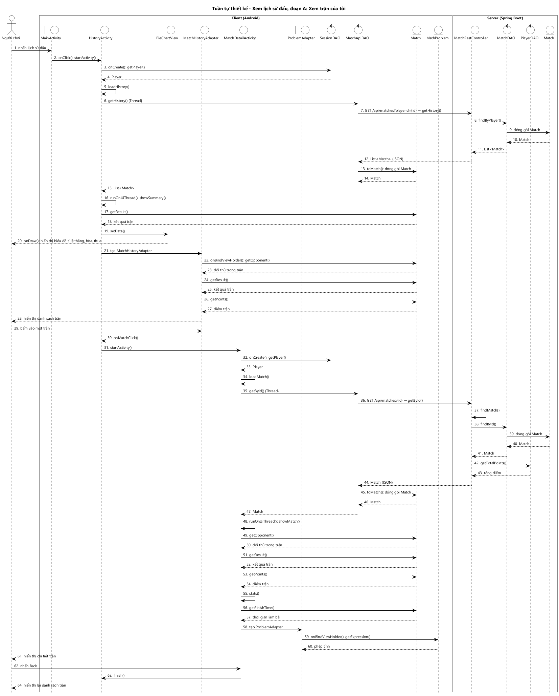

*Hình 15: Biểu đồ tuần tự chi tiết chức năng Xem lịch sử đấu, đoạn A: Xem trận của tôi và chi tiết trận.*

- Biểu đồ có 74 thông điệp.
- Bước 3–4 và 32–33 lược bỏ thông điệp đóng gói Player bên trong SessionDAO, vì đã vẽ ở chức năng Chơi online.
- **Có 2 lời gọi REST:** bước 7 lấy danh sách trận, bước 36 lấy một trận đầy đủ. Server đi theo khuôn MatchRestController → MatchDAO → Match.
- **Danh sách trận không kèm đề** (bước 9) để mỗi lần mở lịch sử chỉ đọc 2 bảng tblMatch, tblMatchPlayer. Đề, đáp án và bài làm từng câu chỉ được đọc khi người chơi mở một trận (bước 39–41).
- **Biểu đồ tròn và từng dòng trận** đều dựa trên getResult(), getPoints(), getOpponent() của Match (bước 17, 22–27). Đây là cùng luật dùng khi kết thúc trận, nên lịch sử luôn khớp với kết quả đã báo cho 2 người.
- **Từng câu của chi tiết trận** (bước 61–70): ProblemAdapter lấy bài làm câu đó của mỗi người bằng answerAt(), rồi showAnswer() hỏi Answer: isAnswered() để biết câu bỏ trống, isCorrect() để tô đúng / sai. Đúng / sai không lưu trong CSDL mà tính lại từ phương án đã chọn và đáp án đúng, bằng cùng hàm isCorrect() của MathProblem mà server dùng khi chấm. Người bỏ trận trước khi nộp không có bài làm, answerAt() không trả bài làm nào và ô đó hiện dấu gạch ngang.
- Lời gọi mạng chạy trong Thread (bước 6, 35). Phần vẽ giao diện chạy trong hàm runOnUiThread() (bước 16, 49).

**Đoạn B: Xem bảng xếp hạng**

1. Người chơi nhấn biểu tượng Bảng xếp hạng trên OnlineActivity.
2. Hàm onClick() của OnlineActivity gọi hàm startActivity() mở HistoryActivity, kèm EXTRA_TAB bằng TAB_RANKING.
3. Hàm onCreate() của HistoryActivity gọi hàm getPlayer() của SessionDAO.
4. Hàm getPlayer() trả đối tượng Player đang đăng nhập cho hàm onCreate().
5. Hàm onCreate() gọi hàm loadHistory() của chính nó để tải sẵn thẻ Trận của tôi như bước 6–28 của đoạn A.
6. Hàm onCreate() thấy Intent có EXTRA_TAB bằng TAB_RANKING, gọi hàm selectTab() của TabLayout để chọn thẻ Bảng xếp hạng.
7. TabLayout gọi hàm onTabSelected() của HistoryActivity.
8. Hàm onTabSelected() ẩn khối Trận của tôi, hiện danh sách xếp hạng và, vì chưa tải lần nào, gọi hàm loadRanking() của chính nó.
9. Hàm loadRanking() ghi rankingLoaded, mở một Thread và gọi hàm getRanking() của PlayerApiDAO.
10. PlayerApiDAO gửi yêu cầu GET /api/players/ranking tới hàm getRanking() của PlayerRestController.
11. Hàm getRanking() của PlayerRestController gọi hàm getRanking() của PlayerDAO.
12. Hàm getRanking() của PlayerDAO gọi hàm findAllPlayers() của chính nó.
13. Hàm findAllPlayers() truy vấn các tài khoản có vai trò người chơi và gọi lớp Player để đóng gói từng người.
14. Lớp Player trả đối tượng Player cho hàm findAllPlayers().
15. Hàm getRanking() gọi hàm findFinished() của MatchDAO.
16. Hàm findFinished() truy vấn các trận đã kết thúc kèm 2 người chơi, và gọi lớp Match để đóng gói từng trận.
17. Lớp Match trả đối tượng Match cho hàm findFinished().
18. Hàm findFinished() trả danh sách trận cho hàm getRanking().
19. Hàm getRanking() gọi hàm rank() của chính nó với danh sách người chơi và danh sách trận.
20. Với mỗi trận, hàm rank() gọi hàm addMatch() của chính nó.
21. Hàm addMatch() gọi hàm getPoints() của Match để cộng điểm trận vào tổng điểm của 2 người.
22. Match trả về điểm trận.
23. Hàm addMatch() gọi hàm getFinishTime() của Match.
24. Match trả về thời gian làm bài.
25. Hàm addMatch() gọi hàm getResult() của Match để biết người thắng; trận thắng thì ghi thời gian làm bài vào danh sách thời gian thắng.
26. Match trả về kết quả trận.
27. Hàm rank() tính trung bình điểm đối thủ bằng hàm averagePoints(), trung bình thời gian thắng bằng hàm averageSeconds(), rồi sắp xếp theo 3 tiêu chí.
28. Hàm getRanking() của PlayerDAO trả danh sách người chơi đã xếp hạng cho PlayerRestController.
29. Hàm getRanking() của PlayerRestController trả danh sách dạng JSON cho PlayerApiDAO.
30. Với mỗi phần tử JSON, hàm toPlayer() của PlayerApiDAO gọi lớp Player để đóng gói.
31. Lớp Player trả đối tượng Player cho PlayerApiDAO.
32. PlayerApiDAO trả danh sách người chơi cho hàm loadRanking().
33. Trong hàm runOnUiThread(), hàm loadRanking() tạo RankingAdapter với danh sách và id của người xem, rồi gắn vào danh sách xếp hạng.
34. RankingAdapter hiển thị bảng xếp hạng, dòng của người xem được tô nổi bật.
35. Người chơi nhấn Back.
36. HistoryActivity gọi hàm finish(), quay về OnlineActivity.
37. OnlineActivity hiển thị lại màn Chơi online cho người chơi.

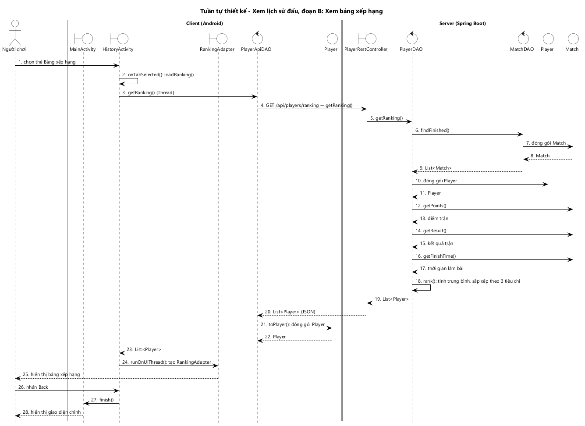

*Hình 16: Biểu đồ tuần tự chi tiết chức năng Xem lịch sử đấu, đoạn B: Xem bảng xếp hạng.*

- Biểu đồ có 37 thông điệp.
- Bước 4 lược bỏ thông điệp đóng gói Player bên trong SessionDAO, vì đã vẽ ở chức năng Chơi online.
- **Lời gọi REST** của bảng xếp hạng là bước 10. Server đi theo khuôn PlayerRestController → PlayerDAO → MatchDAO → Match, Player. Danh sách trận cho thẻ Trận của tôi vẫn được tải ở nền bằng loadHistory() (bước 5) như đoạn A.
- **Mở thẳng thẻ Bảng xếp hạng:** biểu tượng Bảng xếp hạng gửi EXTRA_TAB trong Intent (bước 2), HistoryActivity chọn sẵn thẻ bằng selectTab() và TabLayout gọi lại onTabSelected() (bước 6–8), giống như khi người chơi tự chọn thẻ.
- **Các tiêu chí không lưu trong CSDL** mà được tính lại ở bước 19–27 bằng getPoints(), getResult(), getFinishTime() của Match. Bảng xếp hạng vì vậy luôn khớp với kết quả các trận.
- rank() là hàm static, không truy cập CSDL: nhận danh sách người chơi và danh sách trận đã đọc ở bước 12–18 rồi chỉ tính toán, nên kiểm thử được bằng unit test.
- Bảng xếp hạng là một thẻ của HistoryActivity nên không cần Activity riêng; chỉ lần chọn thẻ đầu tiên mới gọi server, các lần sau dùng lại danh sách đã tải.

### 4.3. Chức năng "Quản lý bạn bè"

#### 4.3.1. Thiết kế giao diện

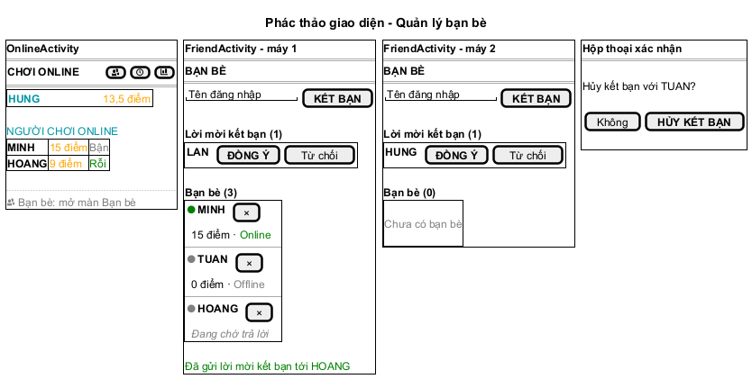

*Hình 17: Thiết kế giao diện chức năng Quản lý bạn bè.*

Chức năng có 1 màn và 1 hộp thoại xác nhận, đi theo thứ tự OnlineActivity → FriendActivity → hộp thoại "Hủy kết bạn với <tên>?" khi nhấn ×.
- **Màn Chơi online** có nút biểu tượng hai người ở góc phải thanh trên, đứng đầu trong 3 nút biểu tượng, mở màn Bạn bè.
- **Màn Bạn bè** có thanh trên với tiêu đề BẠN BÈ căn trái, bên dưới chia 3 phần từ trên xuống:
  1. Hàng nhập: ô tên đăng nhập chiếm phần lớn chiều ngang, nút Kết bạn bên phải. Gửi xong thì ô được xóa trống để gửi tiếp.
  2. Mục "Lời mời kết bạn (n)": chỉ hiện khi có lời mời đã nhận, đặt trên cùng để người chơi thấy ngay. Mỗi dòng có tên người gửi, nút Đồng ý nổi bật, nút Từ chối viền mảnh để tránh bấm nhầm.
  3. Mục "Bạn bè (n)": danh sách cuộn. Mỗi dòng có chấm xanh (Online) hoặc xám (Offline) bên trái, tên chữ đậm, dòng dưới là tổng điểm và chữ Online / Offline, nút × bên phải. Lời mời mình đã gửi nằm cuối, chữ nghiêng màu xám "Đang chờ trả lời". Chưa có ai thì hiện "Chưa có bạn bè".
- Nút × là nút biểu tượng nên có mô tả "Hủy kết bạn" cho trình đọc màn hình. Hủy kết bạn luôn hỏi xác nhận vì không hoàn tác được.

**Bảng thành phần:**

| Màn | id trong layout | Loại View | Chức năng | Tên ở pha phân tích |
|---|---|---|---|---|
| OnlineActivity | btnFriends | ImageButton | Biểu tượng hai người, mở màn Bạn bè; contentDescription "Bạn bè" | subFriends |
| FriendActivity | edtUsername | EditText | Ô nhập tên đăng nhập người muốn kết bạn | inUsername |
| | btnAddFriend | Button | Kết bạn | subAddFriend |
| | txtRequestsTitle | TextView | "Lời mời kết bạn (1)"; ẩn khi không có lời mời | outsubListRequest |
| | rvRequests | RecyclerView | Danh sách lời mời đã nhận | outsubListRequest |
| | txtFriendsTitle | TextView | "Bạn bè (3)" | outsubListFriend |
| | txtEmpty | TextView | "Chưa có bạn bè"; chỉ hiện khi danh sách trống | outsubListFriend |
| | rvFriends | RecyclerView | Danh sách bạn bè và lời mời đã gửi | outsubListFriend |
| item_friend_request.xml | txtName | TextView | Tên người gửi | một dòng của outsubListRequest |
| | btnAccept | Button | Đồng ý | một dòng của outsubListRequest |
| | btnReject | Button | Từ chối | một dòng của outsubListRequest |
| item_friend.xml | viewOnlineDot | View | Chấm tròn xanh / xám | một dòng của outsubListFriend |
| | txtName | TextView | Tên người bạn | một dòng của outsubListFriend |
| | txtPoints | TextView | "15 điểm"; lời mời đã gửi thì để trống | một dòng của outsubListFriend |
| | txtStatus | TextView | Online / Offline / Đang chờ trả lời | một dòng của outsubListFriend |
| | btnUnfriend | ImageButton | Hủy kết bạn hoặc rút lời mời, contentDescription "Hủy kết bạn" | một dòng của outsubListFriend |

Các thông báo ngắn ("Đã gửi lời mời kết bạn tới HOANG", "Không tìm thấy người chơi", "Lời mời không còn"…) dùng Toast. Hộp thoại "Hủy kết bạn với TUAN?" dùng AlertDialog. Cả hai đều không phải thành phần của layout.

#### 4.3.2. Biểu đồ lớp chi tiết

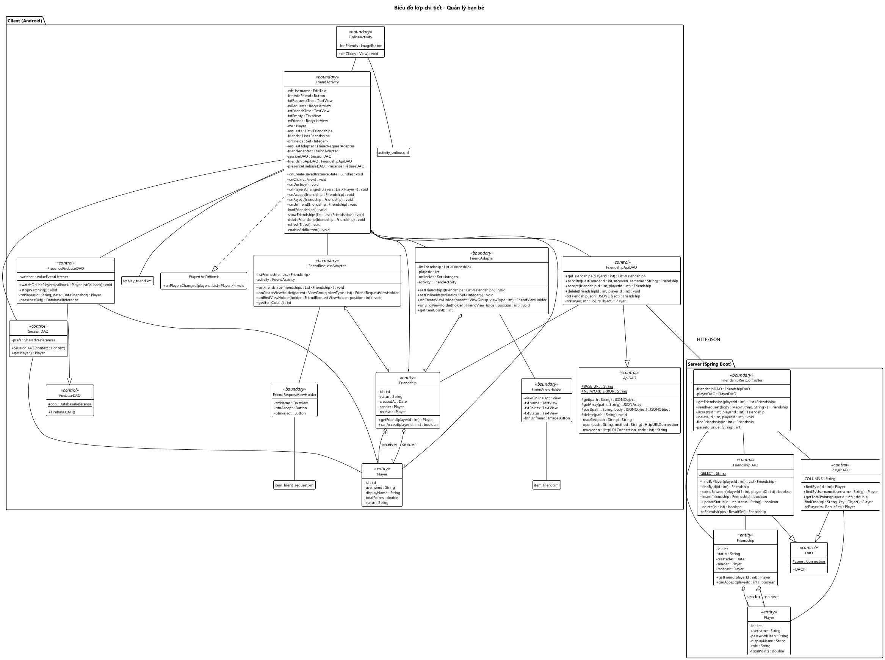

*Hình 18: Biểu đồ lớp chi tiết chức năng Quản lý bạn bè.*

**Package "Client (Android)".**

| Loại | Lớp | Mô tả |
|---|---|---|
| Boundary | OnlineActivity | onClick của btnFriends mở FriendActivity |
| Boundary | FriendActivity | Màn Bạn bè, cài đặt View.OnClickListener và PlayerListCallback; giữ người chơi đang đăng nhập (me), các lời mời đã nhận (requests), bạn bè và lời mời đã gửi (friends), id những người đang online (onlineIds).<br>- onCreate lấy me bằng SessionDAO.getPlayer, gọi bindViews (gắn các View, tạo FriendRequestAdapter cho rvRequests và FriendAdapter cho rvFriends, gắn sự kiện nút Kết bạn), gọi PresenceFirebaseDAO.watchOnlinePlayers rồi loadFriendships.<br>- loadFriendships gọi FriendshipApiDAO.getFriendships trong Thread, rồi trong runOnUiThread gọi showFriendships.<br>- showFriendships dùng Friendship.canAccept để tách lời mời mình cần trả lời vào requests, phần còn lại vào friends, rồi đưa vào 2 Adapter.<br>- onPlayersChanged lấy id những người đang online vào onlineIds và gọi FriendAdapter.setOnlineIds.<br>- onClick của nút Kết bạn kiểm tra ô không trống, gọi FriendshipApiDAO.sendRequest trong Thread, thêm lời mời vào cuối friends và hiện Toast.<br>- onAccept gọi FriendshipApiDAO.accept, chuyển quan hệ từ requests sang friends. onReject và onUnfriend (sau khi hỏi xác nhận) cùng gọi deleteFriendship, hàm này gọi FriendshipApiDAO.delete rồi bỏ quan hệ khỏi 2 danh sách.<br>- refreshTitles cập nhật số lời mời, số bạn và dòng "Chưa có bạn bè"; enableAddButton bật lại nút Kết bạn khi gửi lỗi.<br>- onDestroy gọi PresenceFirebaseDAO.stopWatching.<br>Lỗi server (không tìm thấy, đã có quan hệ, lời mời không còn) hiện bằng showToast: hàm này hiện Toast trong runOnUiThread với câu thông báo server trả về, gọi được từ Thread |
| Boundary | FriendRequestAdapter, FriendRequestViewHolder | FriendRequestAdapter kế thừa RecyclerView.Adapter, giữ danh sách Friendship đã nhận. setFriendships thay danh sách và vẽ lại. onBindViewHolder hiện tên người gửi (sender); nút Đồng ý gọi FriendActivity.onAccept, nút Từ chối gọi FriendActivity.onReject. FriendRequestViewHolder giữ txtName, btnAccept, btnReject |
| Boundary | FriendAdapter, FriendViewHolder | FriendAdapter giữ danh sách Friendship, id của người xem (playerId) và onlineIds. onBindViewHolder lấy người bạn bằng Friendship.getFriend(playerId):<br>- Quan hệ accepted: hiện tổng điểm, chấm xanh và Online nếu id người bạn có trong onlineIds, ngược lại chấm xám và Offline.<br>- Lời mời pending mình đã gửi: hiện "Đang chờ trả lời".<br>Nút × gọi FriendActivity.onUnfriend. setOnlineIds chỉ vẽ lại trạng thái, không gọi server. FriendViewHolder giữ viewOnlineDot, txtName, txtPoints, txtStatus, btnUnfriend |
| — | PlayerListCallback | Interface trả danh sách người chơi online từ PresenceFirebaseDAO về FriendActivity; dùng chung với Chơi online |
| Control | SessionDAO | Như ở Chơi online |
| Control | FirebaseDAO ← PresenceFirebaseDAO | Như ở Chơi online. Chức năng này chỉ đọc node presence qua watchOnlinePlayers, stopWatching; không ghi gì lên Firebase |
| Control | ApiDAO ← FriendshipApiDAO | ApiDAO có thêm delete(path) gửi yêu cầu DELETE. FriendshipApiDAO có 4 hàm, mỗi hàm một API:<br>- getFriendships: GET /api/friendships?playerId={id}.<br>- sendRequest: POST /api/friendships, thân gồm senderId và receiverUsername.<br>- accept: POST /api/friendships/{id}/accept?playerId={id}.<br>- delete: DELETE /api/friendships/{id}?playerId={id}.<br>toFriendship đóng gói JSON thành Friendship, dùng toPlayer cho người gửi và người nhận |
| Entity | Friendship, Player | Như thiết kế lớp thực thể. Friendship có 2 phương thức nghiệp vụ là hàm Java thuần:<br>- getFriend(playerId): người còn lại trong quan hệ.<br>- canAccept(playerId): lời mời đang chờ và playerId là người nhận |

**Package "Server (Spring Boot)".**

| Loại | Lớp | Mô tả |
|---|---|---|
| Boundary | FriendshipRestController | - getFriendships(playerId) nhận GET /api/friendships: FriendshipDAO.findByPlayer, rồi gán tổng điểm cho người gửi và người nhận bằng PlayerDAO.getTotalPoints.<br>- sendRequest(body) nhận POST /api/friendships:<br>  1. PlayerDAO.findById lấy người gửi; PlayerDAO.findByUsername tìm người nhận, không có thì trả 404 "Không tìm thấy người chơi".<br>  2. Người nhận là người gửi thì trả 400 "Không thể kết bạn với chính mình".<br>  3. FriendshipDAO.existsBetween đúng thì trả 409 "Đã có lời mời hoặc đã là bạn bè".<br>  4. Tạo Friendship pending, FriendshipDAO.insert, trả 201 kèm lời mời.<br>- accept(id, playerId): FriendshipDAO.findById, không có thì trả 404 "Lời mời không còn"; Friendship.canAccept sai thì trả 403; đúng thì updateStatus accepted, gán tổng điểm và trả quan hệ.<br>- delete(id, playerId): FriendshipDAO.findById; playerId không phải người gửi hay người nhận thì trả 403; ngược lại FriendshipDAO.delete, trả 204.<br>Các hàm riêng: findFriendship gọi FriendshipDAO.findById, không có thì trả 404 "Lời mời không còn"; parseId đọc senderId, sai định dạng thì trả 400 |
| Control | DAO ← FriendshipDAO | DAO giữ conn : Connection (JDBC). FriendshipDAO giữ câu SELECT dùng chung cho findByPlayer, findById.<br>- findByPlayer truy vấn tblFriendship có tblPlayerSenderId hoặc tblPlayerReceiverId bằng playerId, JOIN tblPlayer 2 lần để có người gửi và người nhận.<br>- findById đọc một quan hệ theo id, cùng cách JOIN.<br>- existsBetween kiểm tra có dòng nào giữa 2 người theo cả 2 chiều.<br>- insert ghi 1 dòng tblFriendship, gán id vừa sinh.<br>- updateStatus ghi status, chỉ khi dòng đang pending.<br>- delete xóa 1 dòng theo id.<br>- toFriendship đóng gói một dòng kết quả thành Friendship kèm 2 Player |
| Control | DAO ← PlayerDAO | findById, findByUsername đọc tblPlayer; getTotalPoints như ở Chơi online. Cả 3 hàm thuộc phần chung, chức năng này chỉ gọi lại |
| Entity | Friendship, Player | Cùng tên, cùng thuộc tính với phía app, để Jackson chuyển JSON thẳng vào đối tượng. passwordHash của Player không bao giờ trả ra JSON |

**Quan hệ giữa các lớp giao diện:**
- OnlineActivity – FriendActivity, FriendActivity – FriendRequestAdapter – FriendRequestViewHolder, FriendActivity – FriendAdapter – FriendViewHolder nối nhau bằng quan hệ liên kết.
- Layout: OnlineActivity – activity_online.xml, FriendActivity – activity_friend.xml, FriendRequestViewHolder – item_friend_request.xml, FriendViewHolder – item_friend.xml.
- FriendActivity thực thi interface PlayerListCallback.
- Kết tập:
  - FriendActivity chứa người chơi trong thuộc tính me, nên Player kết tập vào FriendActivity.
  - FriendActivity, FriendRequestAdapter, FriendAdapter chứa danh sách Friendship, bội số n ở phía Friendship.
  - Friendship chứa 2 Player ở vai trò sender và receiver, ở cả 2 package.

**Quan hệ liên kết HTTP/JSON** giữa 2 package có 1 cặp: FriendshipApiDAO – FriendshipRestController.

Trạng thái online của bạn bè đi qua Firebase, không đi qua server: PresenceFirebaseDAO đọc cùng node presence mà OnlineActivity đã ghi. Một người bạn hiện Online khi người đó đang ở màn Chơi online hoặc một màn mở từ đó.

#### 4.3.3. Biểu đồ tuần tự chi tiết

**Đoạn A: Gửi lời mời kết bạn**

1. Người chơi nhấn biểu tượng Bạn bè trên OnlineActivity.
2. Hàm onClick() của OnlineActivity gọi hàm startActivity() mở FriendActivity.
3. Hàm onCreate() của FriendActivity gọi hàm getPlayer() của SessionDAO.
4. Hàm getPlayer() gọi lớp Player để đóng gói người chơi đang đăng nhập.
5. Lớp Player trả đối tượng Player cho hàm getPlayer().
6. Hàm getPlayer() trả đối tượng Player cho hàm onCreate().
7. Hàm onCreate() gọi hàm watchOnlinePlayers() của PresenceFirebaseDAO, truyền chính FriendActivity làm PlayerListCallback, để theo dõi danh sách người chơi online.
8. Hàm onCreate() gọi hàm loadFriendships() của chính nó.
9. Hàm loadFriendships() mở một Thread và gọi hàm getFriendships() của FriendshipApiDAO.
10. FriendshipApiDAO gửi yêu cầu GET /api/friendships?playerId={id} tới hàm getFriendships() của FriendshipRestController.
11. Hàm getFriendships() của FriendshipRestController gọi hàm findByPlayer() của FriendshipDAO.
12. Hàm findByPlayer() truy vấn bảng tblFriendship nối với tblPlayer, và gọi lớp Friendship để đóng gói từng quan hệ kèm người gửi, người nhận.
13. Lớp Friendship trả đối tượng Friendship cho hàm findByPlayer().
14. Hàm findByPlayer() trả danh sách Friendship cho hàm getFriendships().
15. Với mỗi người gửi và người nhận, hàm getFriendships() gọi hàm getTotalPoints() của PlayerDAO.
16. Hàm getTotalPoints() trả tổng điểm cho hàm getFriendships().
17. Hàm getFriendships() trả danh sách quan hệ dạng JSON cho FriendshipApiDAO.
18. Với mỗi phần tử JSON, hàm toFriendship() của FriendshipApiDAO gọi lớp Friendship để đóng gói.
19. Lớp Friendship trả đối tượng Friendship cho FriendshipApiDAO.
20. FriendshipApiDAO trả danh sách Friendship cho hàm loadFriendships().
21. Trong hàm runOnUiThread(), hàm loadFriendships() gọi hàm showFriendships() của chính nó.
22. Với mỗi quan hệ, hàm showFriendships() gọi hàm canAccept() của Friendship để biết đó có phải lời mời người chơi cần trả lời không.
23. Friendship trả kết quả kiểm tra cho hàm showFriendships().
24. Hàm showFriendships() gọi hàm setFriendships() của FriendRequestAdapter với các lời mời đã nhận.
25. FriendRequestAdapter hiển thị danh sách lời mời đã nhận cho người chơi.
26. Hàm showFriendships() gọi hàm setFriendships() của FriendAdapter với các bạn bè và lời mời đã gửi.
27. Với mỗi quan hệ, hàm onBindViewHolder() của FriendAdapter gọi hàm getFriend() của Friendship.
28. Friendship trả đối tượng Player của người bạn cho FriendAdapter.
29. FriendAdapter hiển thị danh sách bạn bè gồm tên, tổng điểm hoặc dòng đang chờ trả lời.
30. Khi danh sách online thay đổi, hàm onDataChange() của PresenceFirebaseDAO gọi hàm toPlayer() cho từng người chơi.
31. Hàm toPlayer() gọi lớp Player để đóng gói người chơi kèm trạng thái.
32. Lớp Player trả đối tượng Player cho hàm toPlayer().
33. PresenceFirebaseDAO gọi hàm onPlayersChanged() của PlayerListCallback đã đăng ký ở bước 7, chính là FriendActivity, truyền danh sách người chơi online.
34. Hàm onPlayersChanged() lấy id những người đang online và gọi hàm setOnlineIds() của FriendAdapter.
35. FriendAdapter hiển thị trạng thái Online / Offline của từng người bạn.
36. Người chơi nhập tên đăng nhập của một người và nhấn nút Kết bạn.
37. Hàm onClick() của FriendActivity mở một Thread và gọi hàm sendRequest() của FriendshipApiDAO.
38. FriendshipApiDAO gửi yêu cầu POST /api/friendships tới hàm sendRequest() của FriendshipRestController.
39. Hàm sendRequest() gọi hàm findById() của PlayerDAO để lấy người gửi.
40. Hàm findById() truy vấn bảng tblPlayer và gọi lớp Player để đóng gói kết quả.
41. Lớp Player trả đối tượng Player cho hàm findById().
42. Hàm findById() trả đối tượng Player cho hàm sendRequest().
43. Hàm sendRequest() gọi hàm findByUsername() của PlayerDAO để tìm người nhận theo tên đăng nhập.
44. Hàm findByUsername() truy vấn bảng tblPlayer và gọi lớp Player để đóng gói kết quả.
45. Lớp Player trả đối tượng Player cho hàm findByUsername().
46. Hàm findByUsername() trả đối tượng Player cho hàm sendRequest().
47. Hàm sendRequest() gọi hàm existsBetween() của FriendshipDAO để kiểm tra giữa 2 người đã có quan hệ chưa.
48. Hàm existsBetween() trả về chưa có quan hệ cho hàm sendRequest().
49. Hàm sendRequest() gọi lớp Friendship để tạo lời mời đang chờ với người gửi, người nhận.
50. Lớp Friendship trả đối tượng Friendship cho hàm sendRequest().
51. Hàm sendRequest() gọi hàm insert() của FriendshipDAO.
52. Hàm insert() ghi 1 dòng vào bảng tblFriendship, gán id vừa sinh và trả về thành công.
53. Hàm sendRequest() gọi hàm getTotalPoints() của PlayerDAO cho người nhận.
54. Hàm getTotalPoints() trả tổng điểm cho hàm sendRequest().
55. Hàm sendRequest() trả lời mời dạng JSON cho FriendshipApiDAO.
56. Hàm toFriendship() của FriendshipApiDAO gọi lớp Friendship để đóng gói dữ liệu JSON.
57. Lớp Friendship trả đối tượng Friendship cho FriendshipApiDAO.
58. FriendshipApiDAO trả đối tượng Friendship cho hàm onClick().
59. Trong hàm runOnUiThread(), hàm onClick() thêm lời mời vào cuối danh sách bạn bè và gọi hàm setFriendships() của FriendAdapter.
60. FriendAdapter hiển thị dòng người nhận với trạng thái đang chờ trả lời; FriendActivity hiển thị thông báo đã gửi lời mời.

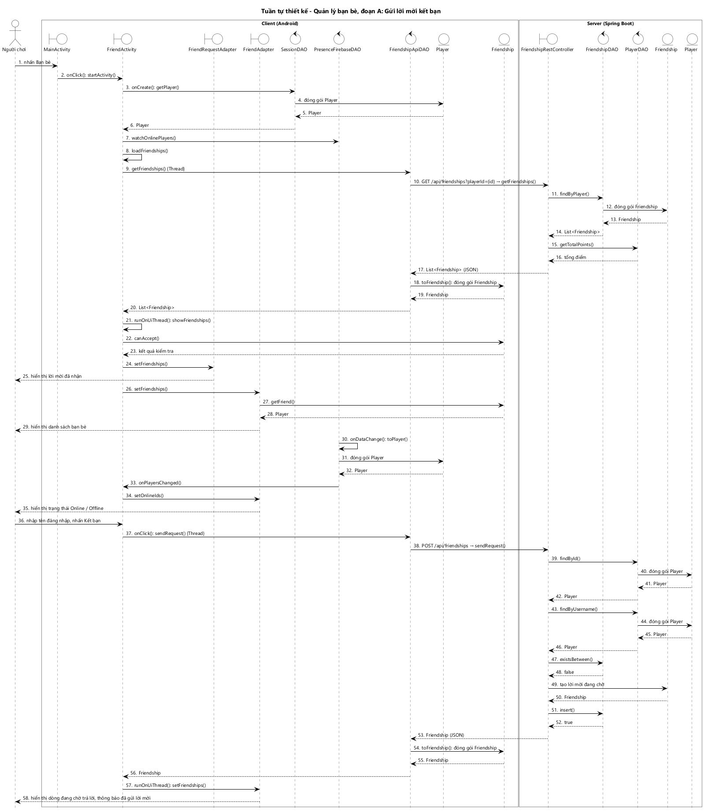

*Hình 19: Biểu đồ tuần tự chi tiết chức năng Quản lý bạn bè, đoạn A: Gửi lời mời kết bạn.*

- Biểu đồ có 60 thông điệp.
- **Lời gọi REST** có 2 lần: bước 10 lấy lời mời và bạn bè, bước 38 gửi lời mời. Server đi theo khuôn FriendshipRestController → FriendshipDAO, PlayerDAO → Friendship, Player.
- **Firebase** chỉ dùng để biết bạn nào đang online (bước 7, 30–34). Bước 30 xảy ra mỗi khi có người vào hoặc rời màn Chơi online, nên trạng thái Online / Offline tự cập nhật mà không phải gọi server. PresenceFirebaseDAO gọi về qua interface PlayerListCallback (bước 33), dùng chung với OnlineActivity, MatchActivity của Chơi online.
- **Luật nghiệp vụ** nằm ở thực thể Friendship: canAccept() tách lời mời đã nhận (bước 22), getFriend() lấy người còn lại trong quan hệ (bước 27). Kiểm tra trùng quan hệ theo cả 2 chiều nằm ở existsBetween() của FriendshipDAO (bước 47).
- Lời gọi mạng chạy trong Thread (bước 9, 37). Phần vẽ giao diện chạy trong hàm runOnUiThread() (bước 21, 59).

**Đoạn B: Đồng ý lời mời kết bạn**

Người chơi là người nhận; FriendActivity đã hiển thị các lời mời đã nhận như bước 1–35 của đoạn A.

1. Người chơi nhấn nút Đồng ý ở một lời mời trong danh sách lời mời đã nhận.
2. Hàm onClick() của FriendRequestAdapter gọi hàm onAccept() của FriendActivity.
3. Hàm onAccept() mở một Thread và gọi hàm accept() của FriendshipApiDAO.
4. FriendshipApiDAO gửi yêu cầu POST /api/friendships/{id}/accept?playerId={id} tới hàm accept() của FriendshipRestController.
5. Hàm accept() gọi hàm findFriendship() của chính nó.
6. Hàm findFriendship() gọi hàm findById() của FriendshipDAO.
7. Hàm findById() truy vấn bảng tblFriendship nối với tblPlayer, và gọi lớp Friendship để đóng gói kết quả.
8. Lớp Friendship trả đối tượng Friendship cho hàm findById().
9. Hàm findById() trả đối tượng Friendship cho hàm findFriendship(), hàm findFriendship() trả về cho hàm accept().
10. Hàm accept() gọi hàm canAccept() của Friendship để kiểm tra lời mời còn đang chờ và người chơi là người nhận.
11. Friendship trả về hợp lệ cho hàm accept().
12. Hàm accept() gọi hàm updateStatus() của FriendshipDAO để chuyển lời mời sang trạng thái accepted.
13. Hàm updateStatus() cập nhật bảng tblFriendship và trả về thành công.
14. Hàm accept() gọi hàm getTotalPoints() của PlayerDAO cho người gửi lời mời.
15. Hàm getTotalPoints() trả tổng điểm cho hàm accept().
16. Hàm accept() trả quan hệ đã đồng ý dạng JSON cho FriendshipApiDAO.
17. Hàm toFriendship() của FriendshipApiDAO gọi lớp Friendship để đóng gói dữ liệu JSON.
18. Lớp Friendship trả đối tượng Friendship cho FriendshipApiDAO.
19. FriendshipApiDAO trả đối tượng Friendship cho hàm onAccept().
20. Trong hàm runOnUiThread(), hàm onAccept() bỏ lời mời khỏi danh sách lời mời đã nhận và gọi hàm setFriendships() của FriendRequestAdapter.
21. Hàm onAccept() thêm quan hệ vào danh sách bạn bè và gọi hàm setFriendships() của FriendAdapter.
22. Hàm onBindViewHolder() của FriendAdapter gọi hàm getFriend() của Friendship.
23. Friendship trả đối tượng Player của người gửi cho FriendAdapter.
24. FriendAdapter hiển thị người gửi trong danh sách bạn bè kèm tổng điểm và trạng thái online.

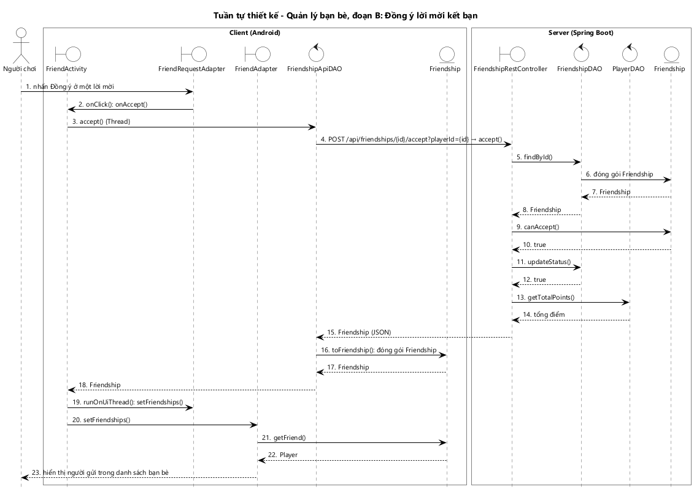

*Hình 20: Biểu đồ tuần tự chi tiết chức năng Quản lý bạn bè, đoạn B: Đồng ý lời mời kết bạn.*

- Biểu đồ có 24 thông điệp.
- **Lời gọi REST** duy nhất là bước 4. Server không tin vào máy gửi yêu cầu: nó đọc lại lời mời từ CSDL qua findFriendship() (bước 5–9) rồi mới kiểm tra bằng canAccept() (bước 10).
- updateStatus() chỉ cập nhật dòng đang pending, nên 2 lần nhấn Đồng ý liên tiếp không làm hỏng dữ liệu.
- Trạng thái Online / Offline của người bạn mới lấy từ onlineIds mà FriendActivity đã có từ đoạn A, không cần gọi Firebase lại.

---

## Phụ lục: các bước phân tích

### A. Lớp thực thể pha phân tích

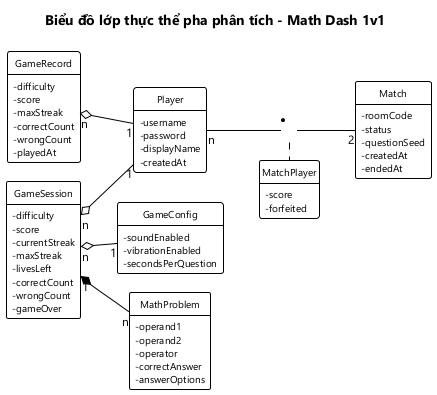

*Hình 21: Biểu đồ lớp thực thể pha phân tích toàn hệ thống.*

### B. Biểu đồ lớp pha phân tích


*Hình 22: Biểu đồ lớp pha phân tích chức năng Chơi online.*

- **4 lớp View** nối nhau bằng quan hệ liên kết theo luồng màn hình: MainView – OnlineView – MatchView – MatchResultView. MatchResultView quay về MatchView khi chơi tiếp, về OnlineView khi dừng.
- Mỗi View nối với lớp thực thể nó gọi phương thức bằng **quan hệ liên kết**:
  - MainView không gọi thực thể nào, chỉ mở OnlineView.
  - OnlineView: Player (vào danh sách online, danh sách online), Challenge (lời mời), Match (tạo trận).
  - MatchView: Match (theo dõi trận, nộp bài, thoát trận).
  - MatchResultView: Match (kết quả, điểm, chơi tiếp).
- **Quan hệ giữa các thực thể** giữ đúng như biểu đồ lớp thực thể pha phân tích ở Phụ lục A:
  - Challenge chứa thông tin 2 Player (kết tập).
  - Player – Match là n-n, qua lớp liên kết MatchPlayer.
  - MathProblem là thành phần của Match (hợp thành).
  - MatchPlayer – MathProblem là n-n, qua lớp liên kết Answer: mỗi người chơi trong trận làm 10 câu, mỗi câu được 2 người chơi làm; Answer giữ phương án đã chọn và thời gian làm câu.
- **Match nhận nhiều phương thức nhất**, vì hầu hết xử lý của chức năng trả về một trận đấu. Các luật của trận đều nằm ở thực thể, không nằm ở giao diện; chấm từng câu là isCorrect() của Answer.
- Ghi phương án đã chọn và thời gian làm từng câu là xử lý của MatchView, không phải phương thức của thực thể: giao diện đo thời gian từ lúc câu hiện ra tới lúc người chơi bấm một ô và giữ bài làm từng câu cho tới khi nộp. Giao diện không biết đáp án đúng nên không chấm; việc chấm nằm ở isCorrect() của Answer, dùng luật isCorrect() của MathProblem.


*Hình 23: Biểu đồ lớp pha phân tích chức năng Xem lịch sử đấu.*

- **3 lớp View** nối nhau bằng quan hệ liên kết theo luồng màn hình: OnlineView – HistoryView – MatchDetailView. OnlineView mở HistoryView bằng subHistory hoặc subRanking.
- Mỗi View nối với lớp thực thể nó gọi phương thức bằng **quan hệ liên kết**:
  - HistoryView: Match (lịch sử, kết quả, điểm, đối thủ), Player (bảng xếp hạng).
  - MatchDetailView: Match (trận đầy đủ, kết quả, điểm, đối thủ, thời gian làm bài), Answer (đúng / sai của từng câu).
- **Quan hệ giữa các thực thể** giữ đúng như biểu đồ lớp thực thể pha phân tích ở Phụ lục A:
  - Player – Match là n-n, qua lớp liên kết MatchPlayer.
  - MathProblem là thành phần của Match (hợp thành); chi tiết trận cần đề để hiện đáp án đúng.
  - MatchPlayer – MathProblem là n-n, qua lớp liên kết Answer; chi tiết trận cần bài làm từng câu của 2 người.
- **Lịch sử đấu và bảng xếp hạng dùng cùng luật thắng thua** với trận đấu: getResult(), getPoints(), getFinishTime() của Match; chi tiết trận dùng cùng luật chấm câu isCorrect() với lúc nộp bài. Không có luật nào được viết lại ở giao diện.

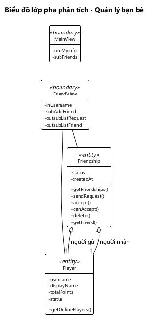

*Hình 24: Biểu đồ lớp pha phân tích chức năng Quản lý bạn bè.*

- Chức năng có 2 lớp View nối nhau bằng quan hệ liên kết: OnlineView mở FriendView.
- FriendView nối với 2 lớp thực thể nó gọi phương thức:
  - Friendship: lấy, gửi, đồng ý, xóa lời mời và quan hệ bạn bè.
  - Player: lấy danh sách người chơi online để hiện trạng thái của bạn bè.
- **Quan hệ giữa các thực thể** giữ đúng như biểu đồ lớp thực thể pha phân tích ở Phụ lục A: Friendship chứa thông tin 2 Player ở 2 vai trò người gửi và người nhận (kết tập).
- **Friendship nhận mọi phương thức** của chức năng, kể cả luật "chỉ người nhận mới đồng ý được" (canAccept()). Trạng thái online của bạn bè không lưu trong Friendship mà lấy từ danh sách online.

Đối chiếu với kịch bản v1:

| Thành phần trong kịch bản v1 | Thuộc tính |
|---|---|
| Nút Bạn bè | OnlineView.subFriends |
| Ô tên đăng nhập, nút Kết bạn | FriendView.inUsername, subAddFriend |
| Mục Lời mời kết bạn, nút Đồng ý, nút Từ chối | FriendView.outsubListRequest |
| Mục Bạn bè, trạng thái, tổng điểm, dòng "Đang chờ trả lời", nút × | FriendView.outsubListFriend |

### C. Kịch bản v2 và biểu đồ tuần tự pha phân tích

**Chơi online, đoạn A: Gửi lời thách đấu**

1. Người chơi nhấn nút Chơi online trên MainView.
2. MainView gọi OnlineView.
3. OnlineView gọi hàm goOnline() của lớp Player để ghi người chơi vào danh sách online với trạng thái rỗi.
4. OnlineView gọi hàm getOnlinePlayers() của lớp Player.
5. Lớp Player trả về danh sách người chơi online, kèm tổng điểm và trạng thái, cho OnlineView.
6. OnlineView hiển thị tên, tổng điểm của người chơi và danh sách người chơi online.
7. Người chơi bấm vào tên một đối thủ đang rỗi trên OnlineView.
8. OnlineView gọi hàm sendChallenge() của lớp Challenge.
9. Lớp Challenge tạo lời mời đang chờ và trả về cho OnlineView.
10. OnlineView hiển thị thông báo đang chờ đối thủ trả lời.
11. OnlineView gọi hàm watchChallenge() của lớp Challenge để theo dõi lời mời.
12. Khi đối thủ đồng ý, lớp Challenge trả về lời mời đã được đồng ý, kèm trận đấu, cho OnlineView.
13. OnlineView gọi MatchView.

**Ngoại lệ 5a: Không có người chơi nào khác online.**

- 5a.1. Lớp Player trả về danh sách chỉ có người chơi cho OnlineView.
- 5a.2. OnlineView hiển thị thông báo chưa có ai khác online; danh sách tự cập nhật khi có người vào.

**Ngoại lệ 7a: Người chơi bấm vào một đối thủ đang bận.**

- 7a.1. OnlineView hiển thị thông báo đối thủ đang bận, không gọi sendChallenge().

**Ngoại lệ 11a: Người chơi hủy lời mời khi đang chờ.**

- 11a.1. Người chơi nhấn Hủy trên OnlineView.
- 11a.2. OnlineView gọi hàm rejectChallenge() của lớp Challenge.
- 11a.3. Lớp Challenge đánh dấu lời mời đã hủy và trả về cho OnlineView.
- 11a.4. OnlineView đóng thông báo chờ và giữ nguyên giao diện chơi online.

**Ngoại lệ 12a: Đối thủ từ chối lời mời.**

- 12a.1. Lớp Challenge trả về lời mời đã bị từ chối cho OnlineView.
- 12a.2. OnlineView hiển thị thông báo đối thủ đã từ chối và giữ nguyên giao diện chơi online.

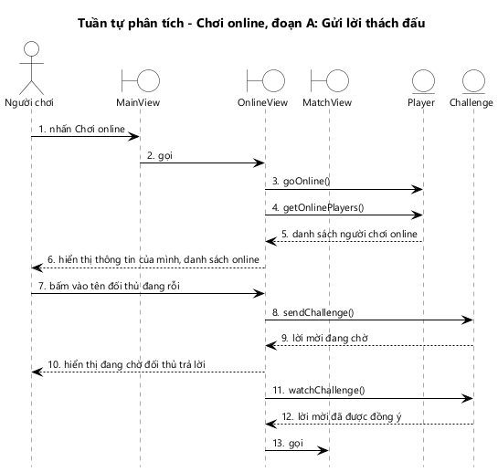

*Hình 25: Biểu đồ tuần tự pha phân tích chức năng Chơi online, đoạn A: Gửi lời thách đấu.*

- Biểu đồ có 13 thông điệp, khớp với 13 bước của kịch bản chuẩn.
- MainView chỉ mở OnlineView (bước 1–2). Người chơi chỉ vào danh sách online khi OnlineView gọi goOnline() (bước 3), nên chỉ người đang ở giao diện chơi online mới được người khác thấy và thách đấu.
- Hàm watchChallenge() ở bước 11 là lời đăng ký theo dõi: kết quả không trả về ngay mà trả về ở bước 12, khi đối thủ trả lời.
- Bước 12 xảy ra khi đối thủ đồng ý ở đoạn B, nên giữa bước 11 và bước 12 có một khoảng chờ.

**Chơi online, đoạn B: Nhận lời thách đấu**

Người chơi là người được mời, đang ở OnlineView; OnlineView đã gọi goOnline() như bước 3 của đoạn A.

1. OnlineView gọi hàm watchChallenge() của lớp Challenge để nhận các lời mời gửi tới người chơi.
2. Khi có lời mời mới, lớp Challenge trả về lời mời cho OnlineView.
3. OnlineView hiển thị hộp thoại lời mời gồm tên và tổng điểm của người mời.
4. Người chơi nhấn Đồng ý.
5. OnlineView gọi hàm createMatch() của lớp Match.
6. Lớp Match gọi hàm generateProblem() của lớp MathProblem để sinh đề.
7. Lớp MathProblem trả về các câu hỏi của đề cho lớp Match.
8. Lớp Match tạo trận với đề vừa sinh, chuyển 2 người chơi sang trạng thái bận và trả về trận cho OnlineView.
9. OnlineView gọi MatchView.

**Ngoại lệ 4a: Người chơi từ chối lời mời.**

- 4a.1. Người chơi nhấn Từ chối.
- 4a.2. OnlineView gọi hàm rejectChallenge() của lớp Challenge.
- 4a.3. Lớp Challenge đánh dấu lời mời bị từ chối và trả về cho OnlineView.
- 4a.4. OnlineView đóng hộp thoại lời mời.

**Ngoại lệ 8a: Không tạo được trận.**

- 8a.1. Lớp Match trả về cho OnlineView: người mời không còn online hoặc đã bận.
- 8a.2. OnlineView hiển thị thông báo không bắt đầu được trận đấu.

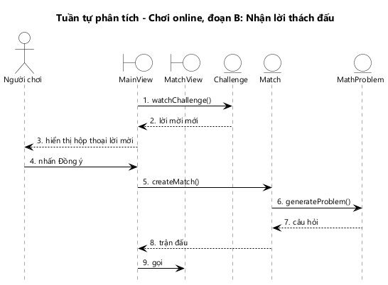

*Hình 26: Biểu đồ tuần tự pha phân tích chức năng Chơi online, đoạn B: Nhận lời thách đấu.*

- Biểu đồ có 9 thông điệp, khớp với 9 bước của kịch bản chuẩn.
- Lời mời chỉ tới được người chơi đang ở OnlineView, vì OnlineView là nơi đăng ký watchChallenge() (bước 1).
- Việc sinh đề nằm ở lớp thực thể (bước 6, 7). Cả 2 người chơi nhận đúng trận do lớp Match trả về, nên cùng một đề.

**Chơi online, đoạn C: Thi đấu**

1. MatchView gọi hàm watchMatch() của lớp Match để theo dõi trận.
2. Lớp Match trả về trận đấu kèm đề bài cho MatchView.
3. MatchView hiển thị ô thời gian, trạng thái đối thủ và nút Thoát cho người chơi.
4. MatchView hiển thị số thứ tự, phép tính của câu đang làm và 4 ô phương án A, B, C, D cho người chơi.
5. Người chơi bấm một ô phương án trên MatchView; MatchView ghi phương án đã chọn, thời gian làm câu và chuyển sang câu sau.

   Các bước 4–5 lặp lại cho đến câu thứ 10.
6. MatchView hiển thị thông báo đã làm xong 10 câu và nút Nộp bài cho người chơi.
7. Người chơi nhấn Nộp bài trên MatchView.
8. MatchView gọi hàm submitAnswers() của lớp Match, gửi bài làm gồm phương án đã chọn và thời gian làm từng câu.
9. Lớp Match gọi hàm isCorrect() của lớp Answer để chấm từng câu của bài làm.
10. Lớp Answer gọi hàm isCorrect() của lớp MathProblem để so phương án đã chọn với đáp án đúng.
11. Lớp MathProblem trả kết quả so sánh cho lớp Answer.
12. Lớp Answer trả về câu đúng hay sai cho lớp Match.
13. Lớp Match lưu bài làm từng câu, số câu đúng, thời điểm nộp bài và trả về trận cho MatchView.
14. MatchView hiển thị thông báo đã nộp bài, đang chờ đối thủ.
15. Khi đối thủ cũng nộp bài, lớp Match gọi hàm isOver() của chính nó để kiểm tra trận đã xong.
16. Lớp Match trả về trận đã kết thúc cho MatchView, theo lời đăng ký ở bước 1.
17. MatchView gọi MatchResultView.
18. MatchResultView gọi hàm getResult() của lớp Match.
19. Lớp Match trả về kết quả của người chơi cho MatchResultView.
20. MatchResultView gọi hàm getFinishTime() của lớp Match.
21. Lớp Match trả về thời gian làm bài của 2 người chơi cho MatchResultView.
22. MatchResultView gọi hàm getPoints() của lớp Match.
23. Lớp Match trả về điểm trận của người chơi cho MatchResultView.
24. MatchResultView hiển thị kết quả, số câu đúng, thời gian làm bài, điểm trận, tổng điểm và câu hỏi chơi tiếp cho người chơi.

**Ngoại lệ 4a: Hết thời gian trước khi người chơi nộp bài.**

- 4a.1. MatchView hiển thị thông báo hết giờ.
- 4a.2. MatchView tự gọi hàm submitAnswers() của lớp Match với bài làm hiện có; câu chưa làm ghi là bỏ trống và tính là sai. Kịch bản tiếp tục từ bước 9.

**Ngoại lệ 4b: Người chơi thoát trận.**

- 4b.1. Người chơi nhấn Thoát trên MatchView và xác nhận thoát.
- 4b.2. MatchView gọi hàm forfeit() của lớp Match.
- 4b.3. Lớp Match đánh dấu người chơi bỏ trận, kết thúc trận và trả về cho MatchView.
- 4b.4. MatchView gọi OnlineView.
- 4b.5. OnlineView hiển thị giao diện chơi online cho người chơi.

**Ngoại lệ 13a: Không nộp được bài.**

- 13a.1. Lớp Match trả về lỗi cho MatchView.
- 13a.2. MatchView hiển thị thông báo không kết nối được máy chủ và hiện lại nút Nộp bài. Kịch bản tiếp tục từ bước 7.

**Ngoại lệ 16a: Đối thủ bỏ trận.**

- 16a.1. Lớp Match trả về trận đã kết thúc do đối thủ bỏ trận cho MatchView.
- 16a.2. MatchView hiển thị thông báo đối thủ đã thoát. Kịch bản tiếp tục từ bước 17; MatchResultView không hiển thị lựa chọn chơi tiếp.

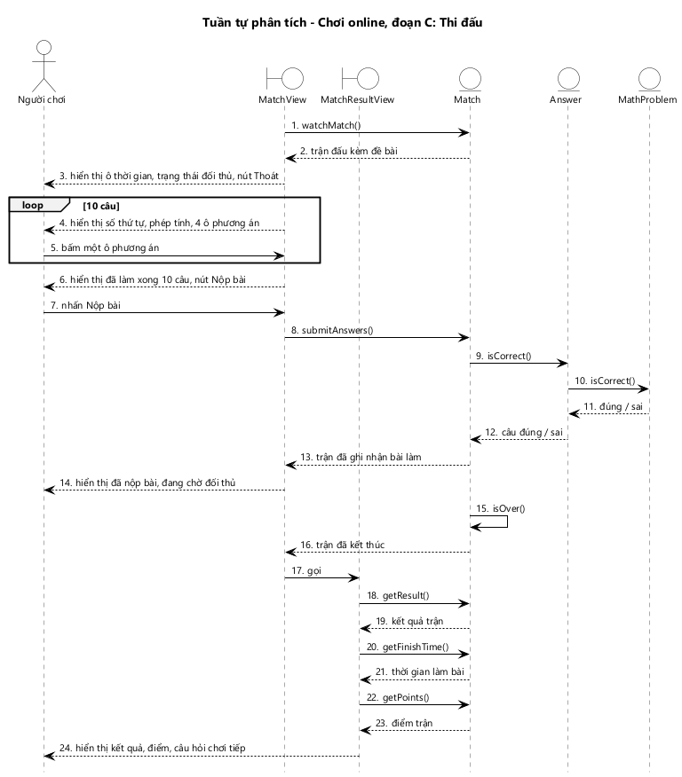

*Hình 27: Biểu đồ tuần tự pha phân tích chức năng Chơi online, đoạn C: Thi đấu.*

- Biểu đồ có 24 thông điệp, khớp với 24 bước của kịch bản chuẩn. Khung loop 10 câu bọc bước 4–5.
- Trong lúc làm bài, MatchView chỉ ghi phương án đã chọn và thời gian làm từng câu, không gọi thực thể nào và không báo đúng sai. Bài làm 10 câu được gửi một lần khi nộp (bước 8).
- Chấm bài (bước 9–12) và kiểm tra trận đã xong (bước 15) đều do lớp thực thể làm, giao diện không tự chấm. Answer chấm từng câu bằng luật isCorrect() của MathProblem.
- Bước 16 trả về theo lời đăng ký watchMatch() ở bước 1, khi đối thủ nộp bài.
- Kết quả, thời gian, điểm trận đều là thuộc tính dẫn xuất, được tính bằng getResult(), getFinishTime(), getPoints() (bước 18–23).

**Chơi online, đoạn D: Chơi tiếp**

1. Người chơi nhấn Chơi tiếp trên MatchResultView.
2. MatchResultView gọi hàm continueMatch() của lớp Match.
3. Lớp Match ghi nhận lựa chọn chơi tiếp và trả về cho MatchResultView.
4. MatchResultView hiển thị thông báo đang chờ đối thủ.
5. MatchResultView gọi hàm watchMatch() của lớp Match để biết lựa chọn của đối thủ.
6. Khi đối thủ cũng chọn chơi tiếp, lớp Match gọi hàm generateProblem() của lớp MathProblem để sinh đề mới.
7. Lớp MathProblem trả về các câu hỏi của đề mới cho lớp Match.
8. Lớp Match tạo trận mới và trả về cho MatchResultView.
9. MatchResultView gọi MatchView.
10. MatchView hiển thị giao diện thi đấu với câu đầu tiên của đề mới cho người chơi; trận tiếp theo diễn ra như đoạn C.

**Ngoại lệ 1a: Người chơi dừng chơi.**

- 1a.1. Người chơi nhấn Dừng trên MatchResultView.
- 1a.2. MatchResultView gọi hàm continueMatch() của lớp Match với lựa chọn dừng.
- 1a.3. Lớp Match ghi nhận, trả 2 người chơi về trạng thái rỗi và trả về cho MatchResultView.
- 1a.4. MatchResultView gọi OnlineView.
- 1a.5. OnlineView hiển thị giao diện chơi online cho người chơi.

**Ngoại lệ 3a: Đối thủ đã chọn chơi tiếp trước.**

- 3a.1. Lớp Match gọi hàm generateProblem() của lớp MathProblem để sinh đề mới, tạo trận mới và trả về ngay cho MatchResultView. Kịch bản tiếp tục từ bước 9.

**Ngoại lệ 8a: Đối thủ dừng chơi.**

- 8a.1. Lớp Match trả về trận đã dừng cho MatchResultView.
- 8a.2. MatchResultView hiển thị thông báo đối thủ đã dừng chơi.
- 8a.3. MatchResultView gọi OnlineView.
- 8a.4. OnlineView hiển thị giao diện chơi online cho người chơi.

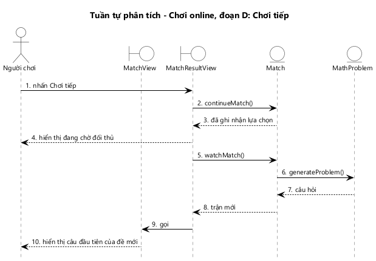

*Hình 28: Biểu đồ tuần tự pha phân tích chức năng Chơi online, đoạn D: Chơi tiếp.*

- Biểu đồ có 10 thông điệp, khớp với 10 bước của kịch bản chuẩn, vẽ cho người chọn chơi tiếp trước.
- Trận mới chỉ được tạo khi cả 2 người đã chọn chơi tiếp (bước 6–8). Người chọn sau đi theo ngoại lệ 3a.

**Xem lịch sử đấu, đoạn A: Xem trận của tôi và chi tiết trận**

1. Người chơi nhấn nút Lịch sử đấu trên OnlineView.
2. OnlineView gọi HistoryView.
3. HistoryView gọi hàm getHistory() của lớp Match.
4. Lớp Match trả về danh sách các trận đã kết thúc của người chơi, mới nhất đứng đầu, cho HistoryView.
5. HistoryView gọi hàm getResult() của lớp Match cho từng trận.
6. Lớp Match trả về kết quả trận của người chơi cho HistoryView.
7. HistoryView gọi hàm getPoints() của lớp Match.
8. Lớp Match trả về điểm trận cho HistoryView.
9. HistoryView gọi hàm getOpponent() của lớp Match.
10. Lớp Match trả về đối thủ trong trận cho HistoryView.
11. HistoryView đếm số trận thắng, hòa, thua, hiển thị biểu đồ tròn tỉ lệ thắng, hòa, thua và danh sách trận cho người chơi.
12. Người chơi bấm vào một trận trên HistoryView.
13. HistoryView gọi MatchDetailView.
14. MatchDetailView gọi hàm getMatch() của lớp Match.
15. Lớp Match trả về trận kèm đề, đáp án đúng, 2 người chơi và bài làm từng câu của mỗi người cho MatchDetailView.
16. MatchDetailView gọi hàm getResult() của lớp Match.
17. Lớp Match trả về kết quả trận cho MatchDetailView.
18. MatchDetailView gọi hàm getPoints() của lớp Match.
19. Lớp Match trả về điểm trận cho MatchDetailView.
20. MatchDetailView gọi hàm getOpponent() của lớp Match.
21. Lớp Match trả về đối thủ trong trận cho MatchDetailView.
22. MatchDetailView gọi hàm getFinishTime() của lớp Match cho người chơi và đối thủ.
23. Lớp Match trả về thời gian làm bài cho MatchDetailView.
24. MatchDetailView gọi hàm isCorrect() của lớp Answer cho từng câu trong bài làm của 2 người chơi.
25. Lớp Answer gọi hàm isCorrect() của lớp MathProblem để so phương án đã chọn với đáp án đúng.
26. Lớp MathProblem trả kết quả so sánh cho lớp Answer.
27. Lớp Answer trả về câu đúng hay sai cho MatchDetailView.
28. MatchDetailView hiển thị kết quả, điểm trận, số câu đúng và thời gian làm bài của 2 bên, và 10 câu, mỗi câu có phép tính kèm đáp án đúng và, với mỗi người chơi, đúng / sai, phương án đã chọn, thời gian làm câu cho người chơi.
29. Người chơi nhấn Back trên MatchDetailView.
30. MatchDetailView gọi HistoryView.
31. HistoryView hiển thị lại danh sách trận cho người chơi.

**Ngoại lệ 4a: Người chơi chưa đấu trận nào.**

- 4a.1. Lớp Match trả về danh sách rỗng cho HistoryView.
- 4a.2. HistoryView hiển thị biểu đồ trống và thông báo người chơi chưa đấu trận nào.

**Ngoại lệ 4b: Không lấy được lịch sử đấu.**

- 4b.1. Lớp Match trả về lỗi cho HistoryView.
- 4b.2. HistoryView hiển thị thông báo không tải được lịch sử đấu, biểu đồ và danh sách để trống.

**Ngoại lệ 15a: Không lấy được chi tiết trận.**

- 15a.1. Lớp Match trả về lỗi cho MatchDetailView.
- 15a.2. MatchDetailView hiển thị thông báo không tải được chi tiết trận, các mục kết quả và từng câu để trống.

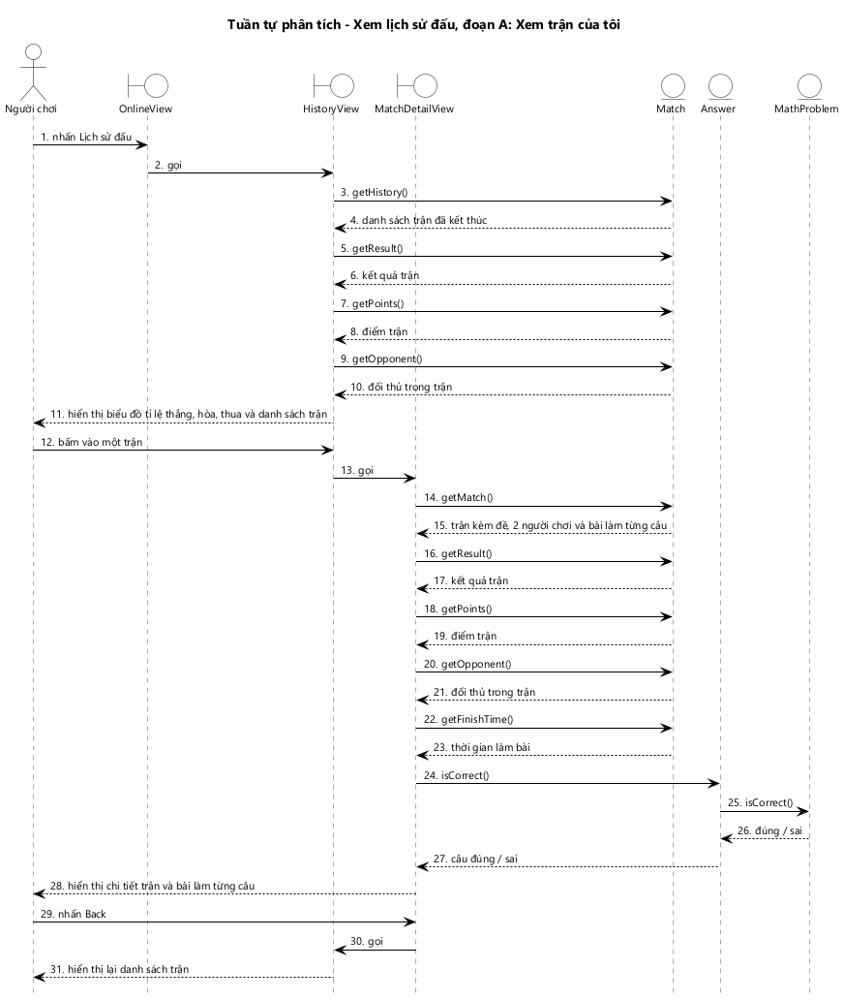

*Hình 29: Biểu đồ tuần tự pha phân tích chức năng Xem lịch sử đấu, đoạn A: Xem trận của tôi và chi tiết trận.*

- Biểu đồ có 31 thông điệp, khớp với 31 bước của kịch bản chuẩn.
- Kết quả, điểm và đối thủ của từng dòng trong danh sách đều lấy từ Match (bước 5–10). Biểu đồ tròn là phép đếm trên các kết quả này, không lưu ở đâu.
- Chi tiết trận cần đề, đáp án đúng và bài làm từng câu nên gọi getMatch() để lấy trận đầy đủ (bước 14), thay vì dùng lại trận trong danh sách vốn không kèm đề và bài làm.
- Đúng / sai của từng ô bài làm do Answer tính bằng isCorrect() (bước 24–27), cùng luật chấm với lúc nộp bài; phương án đã chọn và thời gian làm câu là thuộc tính của Answer.

**Xem lịch sử đấu, đoạn B: Xem bảng xếp hạng**

Người chơi đang ở OnlineView.

1. Người chơi nhấn nút Bảng xếp hạng trên OnlineView.
2. OnlineView gọi HistoryView, mở sẵn thẻ Bảng xếp hạng.
3. HistoryView gọi hàm getRanking() của lớp Player.
4. Lớp Player gọi hàm getPoints() của lớp Match cho từng trận đã kết thúc.
5. Lớp Match trả về điểm trận của người chơi cho lớp Player.
6. Lớp Player gọi hàm getResult() của lớp Match để biết các trận thắng.
7. Lớp Match trả về kết quả trận cho lớp Player.
8. Lớp Player gọi hàm getFinishTime() của lớp Match cho các trận thắng.
9. Lớp Match trả về thời gian làm bài cho lớp Player.
10. Lớp Player tính 3 tiêu chí, sắp xếp và trả danh sách người chơi cho HistoryView.
11. HistoryView hiển thị bảng xếp hạng ở thẻ Bảng xếp hạng cho người chơi.
12. Người chơi nhấn Back trên HistoryView.
13. HistoryView gọi OnlineView.
14. OnlineView hiển thị giao diện chơi online cho người chơi.

**Ngoại lệ 10a: Không lấy được bảng xếp hạng.**

- 10a.1. Lớp Player trả về lỗi cho HistoryView.
- 10a.2. HistoryView hiển thị thông báo không tải được bảng xếp hạng, danh sách để trống.

**Ngoại lệ 12a: Người chơi chọn thẻ Trận của tôi.**

- 12a.1. Người chơi chọn thẻ Trận của tôi trên HistoryView.
- 12a.2. HistoryView hiển thị biểu đồ tỉ lệ thắng, hòa, thua và danh sách trận như bước 3–11 của đoạn A. Người chơi chọn lại thẻ Bảng xếp hạng thì HistoryView hiển thị lại bảng xếp hạng.

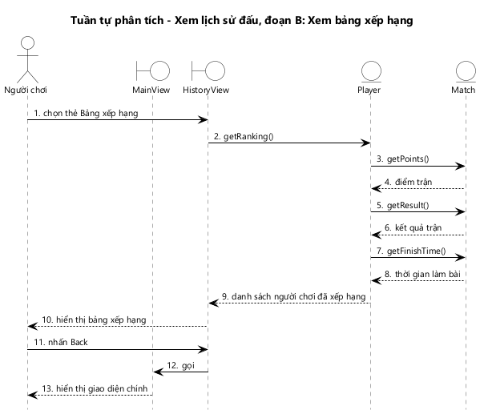

*Hình 30: Biểu đồ tuần tự pha phân tích chức năng Xem lịch sử đấu, đoạn B: Xem bảng xếp hạng.*

- Biểu đồ có 14 thông điệp, khớp với 14 bước của kịch bản chuẩn.
- Bảng xếp hạng mở thẳng từ nút Bảng xếp hạng của OnlineView (bước 1–2), không phải qua thẻ Trận của tôi; 2 thẻ vẫn thuộc cùng một HistoryView.
- Lớp Player tính các tiêu chí dựa trên 3 phương thức của lớp Match (bước 4–9). Bảng xếp hạng vì vậy dùng đúng luật thắng thua của trận đấu.

**Quản lý bạn bè, đoạn A: Gửi lời mời kết bạn**

1. Người chơi nhấn nút Bạn bè trên OnlineView.
2. OnlineView gọi FriendView.
3. FriendView gọi hàm getFriendships() của lớp Friendship.
4. Lớp Friendship trả về các lời mời kết bạn và quan hệ bạn bè của người chơi cho FriendView.
5. FriendView gọi hàm getOnlinePlayers() của lớp Player.
6. Lớp Player trả về danh sách người chơi online cho FriendView.
7. FriendView gọi hàm getFriend() của lớp Friendship để lấy người còn lại trong từng quan hệ.
8. Lớp Friendship trả về người bạn cho FriendView.
9. FriendView hiển thị các lời mời đã nhận và danh sách bạn bè kèm tổng điểm, trạng thái online cho người chơi.
10. Người chơi nhập tên đăng nhập của một người và nhấn Kết bạn trên FriendView.
11. FriendView gọi hàm sendRequest() của lớp Friendship.
12. Lớp Friendship tìm người nhận theo tên đăng nhập, tạo lời mời đang chờ và trả về cho FriendView.
13. FriendView hiển thị thông báo đã gửi lời mời và thêm dòng đang chờ trả lời vào cuối danh sách bạn bè.

**Ngoại lệ 4a: Không lấy được danh sách bạn bè.**

- 4a.1. Lớp Friendship trả về lỗi cho FriendView.
- 4a.2. FriendView hiển thị thông báo không kết nối được máy chủ, 2 danh sách để trống.

**Ngoại lệ 9a: Người chơi từ chối một lời mời đã nhận.**

- 9a.1. Người chơi nhấn Từ chối ở một lời mời trên FriendView.
- 9a.2. FriendView gọi hàm delete() của lớp Friendship.
- 9a.3. Lớp Friendship xóa lời mời và trả về cho FriendView.
- 9a.4. FriendView bỏ lời mời khỏi danh sách lời mời đã nhận.

**Ngoại lệ 9b: Người chơi hủy kết bạn hoặc rút lại lời mời đã gửi.**

- 9b.1. Người chơi nhấn nút Hủy kết bạn ở một dòng của danh sách bạn bè trên FriendView.
- 9b.2. FriendView hỏi người chơi có chắc muốn hủy kết bạn không.
- 9b.3. Người chơi đồng ý.
- 9b.4. FriendView gọi hàm delete() của lớp Friendship.
- 9b.5. Lớp Friendship xóa quan hệ và trả về cho FriendView.
- 9b.6. FriendView bỏ dòng đó khỏi danh sách bạn bè.

**Ngoại lệ 10a: Người chơi để trống ô tên đăng nhập.**

- 10a.1. FriendView hiển thị thông báo yêu cầu nhập tên đăng nhập, không gọi sendRequest().

**Ngoại lệ 12a: Không có người chơi nào có tên đăng nhập đã nhập.**

- 12a.1. Lớp Friendship trả về lỗi không tìm thấy người chơi cho FriendView.
- 12a.2. FriendView hiển thị thông báo không tìm thấy người chơi, giữ nguyên nội dung ô tên đăng nhập.

**Ngoại lệ 12b: Tên đăng nhập là của chính người chơi.**

- 12b.1. Lớp Friendship trả về lỗi không thể kết bạn với chính mình cho FriendView.
- 12b.2. FriendView hiển thị thông báo không thể kết bạn với chính mình.

**Ngoại lệ 12c: Hai người đã là bạn bè hoặc đã có lời mời giữa 2 người.**

- 12c.1. Lớp Friendship trả về lỗi đã có quan hệ cho FriendView.
- 12c.2. FriendView hiển thị thông báo đã có lời mời hoặc đã là bạn bè, không thêm dòng mới.

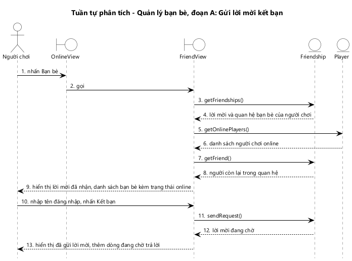

*Hình 31: Biểu đồ tuần tự pha phân tích chức năng Quản lý bạn bè, đoạn A: Gửi lời mời kết bạn.*

- Biểu đồ có 13 thông điệp, khớp với 13 bước của kịch bản chuẩn.
- Trạng thái online của bạn bè không nằm trong Friendship: FriendView lấy danh sách online từ Player (bước 5–6) rồi so với người bạn trong từng quan hệ (bước 7–8).
- Việc tìm người nhận theo tên đăng nhập và kiểm tra trùng quan hệ nằm trong sendRequest() của Friendship (bước 12), không nằm ở giao diện.

**Quản lý bạn bè, đoạn B: Đồng ý lời mời kết bạn**

Người chơi là người nhận, đang ở FriendView; các lời mời đã nhận được hiển thị như bước 1–9 của đoạn A.

1. Người chơi nhấn Đồng ý ở một lời mời trên FriendView.
2. FriendView gọi hàm accept() của lớp Friendship.
3. Lớp Friendship gọi hàm canAccept() của chính nó để kiểm tra lời mời còn đang chờ và người chơi là người nhận.
4. Lớp Friendship chuyển lời mời sang trạng thái đã là bạn bè và trả về cho FriendView.
5. FriendView gọi hàm getFriend() của lớp Friendship.
6. Lớp Friendship trả về người gửi lời mời cho FriendView.
7. FriendView bỏ lời mời khỏi danh sách lời mời đã nhận và hiển thị người gửi trong danh sách bạn bè cho người chơi.

**Ngoại lệ 1a: Người chơi từ chối lời mời.**

- 1a.1. Người chơi nhấn Từ chối ở lời mời trên FriendView.
- 1a.2. FriendView gọi hàm delete() của lớp Friendship.
- 1a.3. Lớp Friendship xóa lời mời và trả về cho FriendView.
- 1a.4. FriendView bỏ lời mời khỏi danh sách lời mời đã nhận.

**Ngoại lệ 3a: Lời mời không còn, vì người gửi đã rút lại.**

- 3a.1. Lớp Friendship trả về lỗi lời mời không còn cho FriendView.
- 3a.2. FriendView hiển thị thông báo lời mời không còn và bỏ lời mời khỏi danh sách lời mời đã nhận.

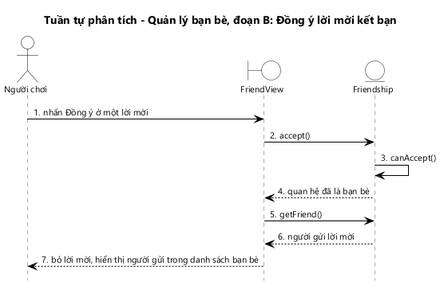

*Hình 32: Biểu đồ tuần tự pha phân tích chức năng Quản lý bạn bè, đoạn B: Đồng ý lời mời kết bạn.*

- Biểu đồ có 7 thông điệp, khớp với 7 bước của kịch bản chuẩn.
- Luật "chỉ người nhận mới đồng ý được lời mời đang chờ" là phương thức canAccept() của Friendship (bước 3), nên không máy nào đồng ý thay cho người khác.
