# BÁO CÁO THIẾT KẾ CÁ NHÂN — MATH DASH 1v1

**Sinh viên:** Nguyễn Bá Hùng (@HungNguyenBa1811) · **Lớp:** E23CNPM01
**Chức năng trình bày:** Chơi online (UC05), Xem lịch sử đấu (UC06)

> Issue: #47 [M4-05]. Bản nháp Markdown, ghép từ `docs/chung/` và `docs/hung/`. Bản nộp cuối viết trên file online riêng, xuất một lần ra `docs/BaoCao_Hung.docx`.
>
> **Việc còn lại trước khi nộp:**
> 1. Thay 2 hình phác thảo giao diện (Hình 6, Hình 9) bằng ảnh chụp app thật.
> 2. Đối chiếu tên lớp, hàm, API với code trên `main`.
> 3. Hoàng đọc lại.

Hình trong báo cáo đánh số liên tục từ 1. Số hình trong tài liệu nguồn ở `docs/` khác với số ở đây.

**Phạm vi hệ thống:**
- Math Dash 1v1 là ứng dụng Android luyện tính nhẩm, chơi một mình hoặc thi đấu 1v1.
- Kiến trúc có 3 phần:
  - **App Android** (Java, MVC).
  - **Backend Spring Boot**: REST, MySQL, giữ tài khoản và lịch sử đấu, làm trọng tài khi trận kết thúc.
  - **Firebase Realtime Database**: chỉ giữ trận đang diễn ra để 2 máy thấy điểm của nhau.
- Hai chức năng trong báo cáo này thuộc module Chơi online.

---

## 1. Mô tả chi tiết các chức năng

### 1.1. Biểu đồ use case chi tiết module Chơi online

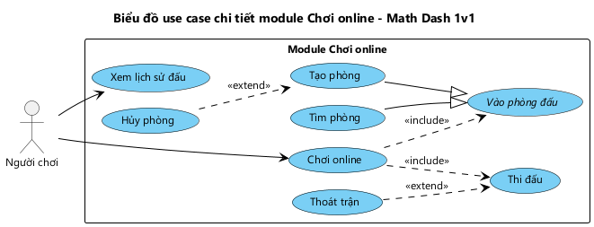

*Hình 1: Biểu đồ use case chi tiết module Chơi online.*

Người chơi khởi phát 2 use case: "Chơi online" và "Xem lịch sử đấu".
- "Chơi online" include "Vào phòng đấu" (use case trừu tượng). "Vào phòng đấu" có 2 use case con kế thừa: "Tạo phòng" (nhận mã phòng 6 chữ số, chờ bạn) và "Tìm phòng" (nhập mã bạn gửi).
- "Chơi online" include "Thi đấu": 60 giây trên cùng một dãy câu hỏi.
- "Hủy phòng" mở rộng "Tạo phòng". "Thoát trận" mở rộng "Thi đấu"; người thoát bị xử thua.

### 1.2. Chức năng "Chơi online"

**Luồng nghiệp vụ:**

```
Người chơi đang ở giao diện chính → Giao diện chính có: dòng "Xin chào, <tên hiển thị>", các nút Chơi offline, Chơi online, Lịch sử đấu, Cài đặt, Đăng xuất → Người chơi nhấn Chơi online → Giao diện chơi online hiện lên với: nút Tạo phòng; ô nhập mã phòng (6 chữ số) và nút Vào phòng
  → Tạo phòng: Người chơi nhấn Tạo phòng → Hệ thống tạo phòng mới với một mã phòng 6 chữ số chưa được dùng → Giao diện phòng chờ hiện lên với: mã phòng (chữ lớn), dòng hướng dẫn "Gửi mã này cho bạn để vào phòng", trạng thái "Đang chờ đối thủ...", tên đối thủ (đang trống), nút Hủy → Người chơi gửi mã cho bạn → Khi bạn vào phòng: giao diện phòng chờ hiện tên đối thủ và "Trận đấu bắt đầu!", nút Hủy ẩn đi → Sau 2 giây chuyển sang giao diện thi đấu
      → Nếu người chơi nhấn Hủy khi đang chờ (hoặc tắt ứng dụng): Hệ thống xóa phòng → Quay về giao diện chính
  → Tìm phòng: Người chơi nhập mã phòng và nhấn Vào phòng → Hệ thống kiểm tra phòng → Đưa người chơi vào phòng, trận chuyển sang đang đấu → Giao diện phòng chờ hiện mã phòng, tên chủ phòng và "Trận đấu bắt đầu!" → Sau 2 giây chuyển sang giao diện thi đấu
      → Mã không đủ 6 chữ số: "Mã phòng gồm 6 chữ số"
      → Không có phòng mang mã này: "Không tìm thấy phòng"
      → Phòng đã đủ 2 người hoặc đã bắt đầu: "Phòng đã đầy"
Thi đấu: Giao diện thi đấu hiện lên với: tên và điểm của mình, đồng hồ 60 giây, tên và điểm của đối thủ, câu hỏi, 4 nút đáp án, dòng phản hồi → Hai máy nhận cùng một dãy câu hỏi → Người chơi chọn một đáp án
  → Đúng: cộng 10 + chuỗi đúng × 2 điểm, hiển thị "+12 PTS!" → điểm mới được gửi để máy đối thủ thấy → câu tiếp theo
  → Sai: không cộng điểm, chuỗi đúng về 0, hiển thị "MISS!", không mất mạng → câu tiếp theo
→ (lặp đến khi hết giờ; cứ 5 câu khó lên 1 mức) → Mỗi khi đối thủ ghi điểm, điểm đối thủ trên màn hình được cập nhật → Hết 60 giây: ẩn nút đáp án, hiện "Hết giờ! Đang chờ kết quả..." → Khi cả 2 máy hết giờ: Hệ thống xác định kết quả và lưu trận vào lịch sử đấu của cả 2 người → Giao diện kết quả hiện: THẮNG! / THUA! / HÒA!, tỉ số, nút Về menu → Người chơi nhấn Về menu → Quay về giao diện chính
  → Nhấn Back khi đang thi đấu: hỏi "Thoát sẽ bị xử thua?" (Ở lại / Thoát) → Thoát: bị xử thua, lưu trận, về giao diện chính
  → Đối thủ thoát hoặc mất kết nối: "Đối thủ đã thoát" → được xử thắng, hiện giao diện kết quả
  → Máy mình mất kết nối: "Mất kết nối, trận đấu đã kết thúc" → về giao diện chính, bị xử thua
```

**Kịch bản chuẩn.**

| | |
|---|---|
| **Actor** | Người chơi: Hùng (`HUNG`, máy 1) tạo phòng; Hoàng (`HOANG`, máy 2) tìm phòng |
| **Tiền điều kiện** | Cả 2 đã đăng nhập, có mạng, đang ở giao diện chính |
| **Hậu điều kiện** | Trận được lưu vào lịch sử đấu của cả 2 người; 2 máy thấy cùng một kết quả |

*A. Tạo phòng (máy 1)*
1. Ở giao diện chính ("Xin chào, HUNG"), Hùng nhấn **Chơi online**.
2. Giao diện chơi online hiện lên: nút **Tạo phòng**, ô nhập mã phòng, nút **Vào phòng**.
3. Hùng nhấn **Tạo phòng**.
4. Hệ thống tạo phòng mã `482915`, đang chờ. Giao diện phòng chờ hiện lên:
   - Mã `482915` (chữ lớn).
   - Dòng "Gửi mã này cho bạn để vào phòng".
   - Trạng thái "Đang chờ đối thủ...".
   - Đối thủ "—".
   - Nút **Hủy**.
5. Hùng đọc mã `482915` cho Hoàng.

*B. Tìm phòng (máy 2)*

6. Hoàng nhấn **Chơi online** ở giao diện chính của máy 2.
7. Giao diện chơi online hiện lên như bước 2.
8. Hoàng nhập `482915` và nhấn **Vào phòng**.
9. Hệ thống kiểm tra phòng `482915`: đang chờ, mới có HUNG. Hệ thống đưa Hoàng vào phòng và chuyển trận sang đang đấu. Máy 2 hiện:
   - Mã phòng.
   - "Trận đấu bắt đầu!".
   - Đối thủ `HUNG`.
10. Máy 1 cập nhật: "Trận đấu bắt đầu!", đối thủ `HOANG`, nút Hủy ẩn.

*C. Thi đấu (máy 1)*

11. Sau 2 giây, giao diện thi đấu hiện lên trên cả 2 máy:
    - HUNG `0` | đồng hồ `60` | HOANG `0`.
    - Câu hỏi `12 + 7 = ?`.
    - 4 nút đáp án `17` · `19` · `21` · `18`.
12. Hùng nhấn **19**.
13. Hệ thống chấm đúng, cộng `12` điểm, hiện "+12 PTS!" và điểm mới `12`. Hệ thống gửi điểm cho máy đối thủ, rồi hiện câu `9 − 4 = ?`.
14. Hoàng trả lời đúng; trên máy 1, điểm HOANG thành `12`. *(Lặp 12–14 đến hết 60 giây.)*
15. Đồng hồ về `0`. Hệ thống ẩn đáp án, hiện "Hết giờ! Đang chờ kết quả...". Điểm cuối: HUNG `120`, HOANG `96`.
16. Máy 2 cũng hết giờ. Hệ thống xác định Hùng thắng và lưu trận.
17. Giao diện kết quả hiện lên:
    - Máy 1: **THẮNG!**, `HUNG 120 - 96 HOANG`, nút **Về menu**.
    - Máy 2: **THUA!**.
18. Hùng nhấn **Về menu**.
19. Giao diện chính hiện lại.

**Kịch bản ngoại lệ.**

| Bước | Ngoại lệ và cách xử lý |
|---|---|
| 5 | Hùng nhấn **Hủy** (hoặc tắt app) khi chưa có đối thủ. Hệ thống xóa phòng, quay về giao diện chính. |
| 8 | Mã `48291` không đủ 6 chữ số. Hệ thống báo "Mã phòng gồm 6 chữ số". |
| 9 | Mã `482910` không tồn tại. Hệ thống báo "Không tìm thấy phòng". |
| 9 | Minh (máy 3) nhập `482915` sau khi Hoàng đã vào. Hệ thống báo "Phòng đã đầy". |
| 12–14 | Hùng nhấn Back, chọn **Thoát**. Hùng bị xử thua dù đang dẫn điểm; hệ thống lưu trận, về giao diện chính. Chọn **Ở lại** thì đấu tiếp. |
| 12–14 | Hoàng thoát hoặc mất mạng khi tỉ số `36 – 72`. Máy 1 báo "Đối thủ đã thoát" và hiện **THẮNG!** `HUNG 36 - 72 HOANG`. |
| 12–15 | Máy 1 mất mạng. Hệ thống báo "Mất kết nối, trận đấu đã kết thúc", về giao diện chính; Hùng bị xử thua. |
| 16 | Tỉ số `84 – 84`, không ai bỏ trận. Cả 2 máy hiện **HÒA!**. |
| 16 | Không kết nối được máy chủ. Hệ thống báo "Không lưu được kết quả trận, kiểm tra kết nối mạng"; trận vẫn được lưu khi máy đối thủ gửi kết quả. |

### 1.3. Chức năng "Xem lịch sử đấu"

**Luồng nghiệp vụ:**

```
Người chơi đang ở giao diện chính → Nhấn Lịch sử đấu → Hệ thống lấy các trận online đã kết thúc của người chơi → Giao diện lịch sử đấu hiện lên với: tiêu đề "LỊCH SỬ ĐẤU", danh sách trận mới nhất ở trên; mỗi dòng có thời gian kết thúc, tên đối thủ, tỉ số (mình - đối thủ), kết quả THẮNG (xanh) / THUA (đỏ) / HÒA (vàng) → Nhấn Back → Quay về giao diện chính
  → Chưa đấu trận nào: hiển thị "Chưa có trận nào"
  → Không kết nối được máy chủ: "Không tải được lịch sử đấu, kiểm tra kết nối mạng", danh sách để trống
```

**Kịch bản chuẩn.**

| | |
|---|---|
| **Actor** | Người chơi (Hùng) |
| **Tiền điều kiện** | Đã đăng nhập, có mạng, đang ở giao diện chính |
| **Hậu điều kiện** | Hùng thấy danh sách trận đã đấu; dữ liệu không đổi |

1. Ở giao diện chính, Hùng nhấn **Lịch sử đấu**.
2. Giao diện lịch sử đấu hiện lên với danh sách trận, mới nhất ở trên:

   | Thời gian | Đối thủ | Tỉ số | Kết quả |
   |---|---|---|---|
   | 23/10/2026 20:16 | HOANG | 120 - 96 | THẮNG |
   | 22/10/2026 21:42 | HOANG | 84 - 84 | HÒA |
   | 22/10/2026 21:35 | HOANG | 60 - 132 | THUA |
   | 21/10/2026 19:05 | MINH | 36 - 72 | THẮNG (Minh bỏ trận) |

3. Hùng xem xong và nhấn Back.
4. Giao diện chính hiện lại.

**Kịch bản ngoại lệ.**

| Bước | Ngoại lệ và cách xử lý |
|---|---|
| 2 | Chưa có trận nào. Hệ thống hiện "Chưa có trận nào". |
| 2 | Mất mạng. Hệ thống báo "Không tải được lịch sử đấu, kiểm tra kết nối mạng", danh sách trống. |

---

## 2. Thiết kế cơ sở dữ liệu

Hai chức năng dùng 2 nơi lưu trữ:
- **MySQL** trên backend: tài khoản và các trận **đã kết thúc**. Đây là nguồn dữ liệu của lịch sử đấu.
- **Firebase Realtime Database**: chỉ các trận **đang diễn ra**, để 2 máy thấy điểm của nhau ngay; trận xong thì không còn dùng.

### 2.1. CSDL MySQL

**Bước 1: Mỗi lớp thực thể cần lưu đề xuất một bảng.**
- `Player` → `tblPlayer`.
- `Match` → `tblMatch`.
- `MatchPlayer` → `tblMatchPlayer`.
- `MathProblem`, `GameSession` chỉ tồn tại trong bộ nhớ khi đang chơi nên không có bảng.

**Bước 2: Thuộc tính kiểu cơ bản thành cột.**
- Bỏ thuộc tính kiểu đối tượng: `Match.players`, `MatchPlayer.player`.
- Kiểu dữ liệu: `String` → `varchar(255)` (mã phòng `varchar(6)`); `int` → `integer(10)`; `long` → `bigint(20)`; `Date` → `datetime`; `boolean` → `tinyint(1)`.
- Kết quả:
  - `tblPlayer`: id, username, passwordHash, displayName, createdAt.
  - `tblMatch`: id, roomCode, status, questionSeed, createdAt, endedAt.
  - `tblMatchPlayer`: id, score, forfeited, timeUp.

**Bước 3: Quan hệ giữa các bảng.**
- 1 `tblMatch` – n `tblMatchPlayer` (đúng 2 dòng mỗi trận).
- 1 `tblPlayer` – n `tblMatchPlayer`.
- Quan hệ n-n `tblPlayer` – `tblMatch` đã được tách bằng `tblMatchPlayer` từ thiết kế lớp thực thể.

**Bước 4: Khóa.**
- **Khóa chính:** `id` (`AUTO_INCREMENT`) ở mọi bảng.
- **Khóa ngoại** đặt ở bảng phía n:
  - `tblMatchPlayer.tblMatchId` → `tblMatch.id`, có `ON DELETE CASCADE` đúng với quan hệ hợp thành.
  - `tblMatchPlayer.tblPlayerId` → `tblPlayer.id`.
- **Ràng buộc duy nhất:**
  - `tblPlayer.username`.
  - `tblMatchPlayer (tblMatchId, tblPlayerId)`.
  - `tblMatch (roomCode, createdAt)`: mã phòng được dùng lại sau khi trận cũ xong, nhưng mã phòng + thời điểm tạo xác định duy nhất một trận. Backend dựa vào cặp này để không lưu một trận 2 lần khi cả 2 máy cùng gọi kết thúc trận.

**Bước 5: Loại thuộc tính gây dư thừa.**
- **Kết quả thắng / thua / hòa** là thuộc tính dẫn xuất từ `forfeited` và `score` của 2 dòng `tblMatchPlayer`. Không có cột; tính bằng `Match.getResult(playerId)`.
- **`tblMatch.status`, `tblMatchPlayer.timeUp`:** MySQL chỉ lưu trận đã kết thúc, nên `status` luôn là `finished` và `timeUp` không còn ý nghĩa. Hai thuộc tính này bị loại khỏi bảng; chúng chỉ được giữ trên Firebase khi trận đang diễn ra.
- **`questionSeed`** được giữ: không suy ra được từ cột khác, dùng để sinh lại đúng dãy câu hỏi của trận khi cần kiểm tra.
- Mọi cột `NOT NULL`. Mật khẩu chỉ lưu dạng băm BCrypt.


*Hình 2: Biểu đồ thiết kế CSDL MySQL dùng cho Chơi online và Xem lịch sử đấu.*

- `tblMatchPlayer` là bảng trung gian: mỗi trận có đúng 2 dòng, mỗi dòng giữ điểm và cờ bỏ trận của một người.
- Lịch sử đấu của một người chơi được lấy bằng một truy vấn: `tblMatch` JOIN 2 lần `tblMatchPlayer` (mình và đối thủ) JOIN `tblPlayer` (tên đối thủ), sắp theo `endedAt` giảm dần.
- Lưu một trận là 1 `INSERT` vào `tblMatch` và 2 `INSERT` vào `tblMatchPlayer` trong cùng một transaction.

```sql
CREATE TABLE tblPlayer (
    id           INT(10)      NOT NULL AUTO_INCREMENT,
    username     VARCHAR(255) NOT NULL,
    passwordHash VARCHAR(255) NOT NULL,
    displayName  VARCHAR(255) NOT NULL,
    createdAt    DATETIME     NOT NULL DEFAULT CURRENT_TIMESTAMP,
    PRIMARY KEY (id),
    UNIQUE KEY uq_player_username (username)
);

CREATE TABLE tblMatch (
    id           INT(10)    NOT NULL AUTO_INCREMENT,
    roomCode     VARCHAR(6) NOT NULL,
    questionSeed BIGINT(20) NOT NULL,
    createdAt    DATETIME   NOT NULL,
    endedAt      DATETIME   NOT NULL,
    PRIMARY KEY (id),
    UNIQUE KEY uq_match_room_created (roomCode, createdAt)
);

CREATE TABLE tblMatchPlayer (
    id          INT(10)    NOT NULL AUTO_INCREMENT,
    score       INT(10)    NOT NULL DEFAULT 0,
    forfeited   TINYINT(1) NOT NULL DEFAULT 0,
    tblMatchId  INT(10)    NOT NULL,
    tblPlayerId INT(10)    NOT NULL,
    PRIMARY KEY (id),
    UNIQUE KEY uq_matchplayer (tblMatchId, tblPlayerId),
    FOREIGN KEY (tblMatchId)  REFERENCES tblMatch(id)  ON DELETE CASCADE,
    FOREIGN KEY (tblPlayerId) REFERENCES tblPlayer(id)
);
```

### 2.2. Dữ liệu trên Firebase Realtime Database

Firebase là cây JSON. Ánh xạ từ lớp thực thể theo cùng tinh thần 5 bước:
- `Match` thành node `matches/{roomCode}`. Mã phòng duy nhất trong các trận chưa kết thúc.
- `MatchPlayer` là thành phần của `Match` (hợp thành), nên thành node con `players/{playerId}`.
- Khóa `playerId` là `id` trên MySQL, cũng là `auth.uid` khi đăng nhập Firebase bằng custom token do backend cấp.

```
matches/{roomCode}
    status       : "waiting" | "playing" | "finished"
    questionSeed : long
    createdAt    : ServerValue.TIMESTAMP
    players/
        {playerId} : { displayName: String, score: int, forfeited: bool, connected: bool, timeUp: bool }
```

**Thuộc tính chỉ có trên Firebase:**
- `status`, `timeUp`: chỉ có ý nghĩa khi trận đang diễn ra.
- `connected`: cờ kỹ thuật do `onDisconnect()` ghi khi máy mất kết nối. Cùng lúc đó `forfeited` cũng được ghi, nên luật thắng thua chỉ cần `forfeited`.
- `displayName`: chép từ `Player` để máy đối thủ hiện được tên mà không cần gọi backend.

**Security Rules** bảo vệ dữ liệu:
- Mỗi người chỉ ghi được node `players/{auth.uid}` của mình.
- `score` không được giảm, mỗi lần tăng tối đa 200.
- `status` chỉ nhận 3 giá trị hợp lệ.

---

## 3. Thiết kế lớp thực thể

Đầu vào là biểu đồ lớp thực thể pha phân tích (Phụ lục A). Các lớp liên quan đến 2 chức năng: `Player`, `Match`, `MatchPlayer`, `GameSession`, `MathProblem`.

**Bước 1: Bổ sung thuộc tính khóa.**
- Thêm `id : int` cho các lớp cần lưu lâu dài: `Player`, `Match`, `MatchPlayer`.
- `MathProblem`, `GameSession` chỉ sống trong bộ nhớ nên không có `id`.
- `roomCode` không làm khóa vì các trận đã kết thúc có thể trùng mã.

**Bước 2: Bổ sung kiểu dữ liệu.**
- Kiểu Java: chuỗi `String`; điểm, số đếm `int`; `questionSeed` `long` (khớp `java.util.Random`); thời điểm `Date`; cờ `boolean`.
- Thuộc tính `boolean` không có tiền tố `is` (`forfeited` → getter `isForfeited()`), để Jackson và Firebase SDK đọc đúng tên trường.
- Thêm 3 thuộc tính phục vụ thiết kế:
  - `GameSession.onlineMode`: ở chế độ online, trả lời sai không trừ mạng.
  - `GameSession.questionsAsked`: để tính mức.
  - `MatchPlayer.timeUp`: trận chỉ xong khi cả 2 máy đã hết giờ.

**Bước 3: Chuyển quan hệ liên kết thành kết tập / hợp thành.**
- Quan hệ n-n `Player` – `Match` qua lớp liên kết `MatchPlayer` chuyển thành:
  - **`MatchPlayer` là thành phần của `Match`** (hợp thành, 1-2): người chơi trong trận không tồn tại nếu không có trận.
  - **`Player` nằm trong `MatchPlayer`** (kết tập, 1-n): người chơi tồn tại độc lập với trận.
- Giữ nguyên từ pha phân tích:
  - `MathProblem` là thành phần của `GameSession` (hợp thành).
  - `Player` nằm trong `GameSession` (kết tập).

**Bước 4: Bổ sung thuộc tính đối tượng.**
- `Match.players : List<MatchPlayer>`.
- `MatchPlayer.player : Player`.
- `GameSession.player : Player`.
- `GameSession.currentProblem : MathProblem`: chỉ giữ câu đang hiển thị.

Thuộc tính dẫn xuất được viết thành **phương thức nghiệp vụ** (hàm Java thuần, có unit test):

| Lớp | Phương thức | Ý nghĩa |
|---|---|---|
| `Match` | `canJoin(playerId : int) : boolean` | Trận đang `waiting`, chưa đủ 2 người, người này chưa có trong trận |
| `Match` | `isOver() : boolean` | Có người bỏ trận, hoặc cả 2 đã hết giờ |
| `Match` | `getResult(playerId : int) : String` | `WIN` / `LOSE` / `DRAW`: ai bỏ trận thì thua; không ai bỏ thì so điểm |
| `GameSession` | `getCurrentLevel() : int` | `min(difficulty + questionsAsked / 5, 4)` |


*Hình 3: Biểu đồ lớp thực thể pha thiết kế (các lớp dùng cho Chơi online, Xem lịch sử đấu).*

- Không còn đường liên kết trơn nào trên biểu đồ.
- `Player`, `Match`, `MatchPlayer` có ở **cả app và backend** với cùng tên và cùng thuộc tính, để JSON đi qua REST ánh xạ thẳng vào đối tượng.
- `passwordHash` chỉ có giá trị ở backend.
- `GameSession` và `MathProblem` là lõi chấm điểm, dùng chung với chế độ offline.

---

## 4. Thiết kế chi tiết từng chức năng

**Quy ước chung:**
- **Lớp View → Activity.** Mỗi lớp View ở pha phân tích thành một Activity; riêng `MatchResultView` thành overlay trong màn thi đấu.
- **Thành phần giao diện:** bỏ tiền tố `in` / `out` / `sub`, đặt theo loại View (`btn`, `edt`, `txt`, `rv`).
- **Phương thức của thực thể:**
  - Phương thức truy cập dữ liệu chuyển sang DAO.
  - Phương thức điều phối chuyển sang `MatchController`.
  - Luật nghiệp vụ giữ lại ở thực thể.
- **DAO cha giữ kết nối, DAO con kế thừa:**
  - App: `FirebaseDAO` ← `MatchFirebaseDAO`; `ApiDAO` ← `MatchApiDAO`.
  - Server: `DAO` (`conn : Connection`) ← `MatchDAO`.
- **Biểu đồ lớp có 2 package** "Client (Android)" và "Server (Spring Boot)", nối nhau bằng **một** mũi tên `HTTP/JSON` từ `MatchApiDAO` tới `MatchRestController`. Server không có tầng Service.

| Phương thức pha phân tích | Phương thức pha thiết kế | Lớp |
|---|---|---|
| `Match.createMatch()` | `createRoom(me, listener)`; `createMatch(match, callback)` | `MatchController`; `MatchFirebaseDAO` |
| `Match.joinMatch()`, `canJoin()` | `findRoom(roomCode, me, listener)`; `joinMatch(roomCode, me, callback)`; `canJoin(playerId)` | `MatchController`; `MatchFirebaseDAO`; `Match` |
| `Match.watchMatch()` | `waitForOpponent`, `startGame`; `watchMatch(roomCode, callback)` | `MatchController`; `MatchFirebaseDAO` |
| `Match.deleteMatch()` | `cancelRoom()`; `deleteMatch(roomCode)` | `MatchController`; `MatchFirebaseDAO` |
| `MathProblem.generateProblem()` | `nextProblem()`; `generateProblem(level)` | `MatchController`; `ProblemDAO` |
| `GameSession.submitAnswer()` | `submitAnswer(value)`; `isCorrect(answer)`; `recordCorrectAnswer()` | `MatchController`; `MathProblem`; `GameSession` |
| `MatchPlayer.updateScore()`, `forfeit()` | `updateScore(...)`, `leaveMatch()`, `forfeit(...)` | `MatchFirebaseDAO`, `MatchController` |
| `Match.finishMatch()` | `setTimeUp`; `isOver()`; `finishMatch(roomCode)` → `finish(roomCode)`; `readMatch`, `updateStatus`; `insert`, `findByRoomCode` | `MatchFirebaseDAO`; `Match`; `MatchApiDAO` → `MatchRestController`; `FirebaseAdminDAO`; `MatchDAO` |
| `Match.getHistory()` | `getHistory(playerId)` → `getByPlayer(playerId)`; `findByPlayer(playerId)` | `MatchApiDAO` → `MatchRestController`; `MatchDAO` |
| `Match.getResult()` | `getResult(playerId)` | `Match` |

### 4.1. Chức năng "Chơi online"

#### 4.1.1. Thiết kế giao diện

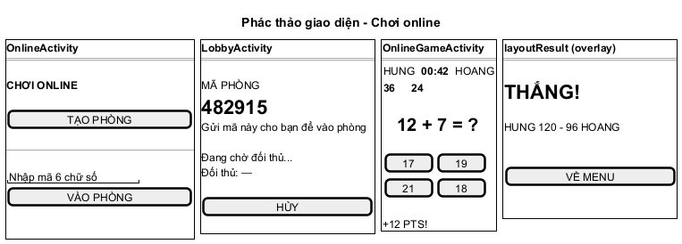

*Hình 4: Giao diện chức năng Chơi online: màn Chơi online, Phòng chờ, Thi đấu và overlay kết quả.*

Người tạo phòng đi qua đủ 4 màn. Người tìm phòng nhập mã ở màn đầu; màn phòng chờ hiện ngay "Trận đấu bắt đầu!". Lưới 2x2 nút đáp án cao tối thiểu 72dp, chữ monospace 26sp. Thông báo lỗi dùng `Toast`; xác nhận thoát trận dùng `AlertDialog`.

| Màn | `id` | Loại View | Chức năng | Tên pha phân tích |
|---|---|---|---|---|
| `OnlineActivity` | `btnCreateRoom` | `Button` | Tạo phòng | `subCreateRoom` |
| | `edtRoomCode` | `EditText` (số, tối đa 6) | Nhập mã phòng | `inRoomCode` |
| | `btnJoinRoom` | `Button` | Vào phòng | `subJoinRoom` |
| `LobbyActivity` | `txtRoomCode` | `TextView` | Mã phòng | `outRoomCode` |
| | `txtStatus` | `TextView` | Trạng thái chờ / bắt đầu | `outStatus` |
| | `txtOpponentName` | `TextView` | Tên đối thủ | `outOpponentName` |
| | `btnCancel` | `Button` | Hủy phòng | `subCancel` |
| `OnlineGameActivity` | `txtMyName`, `txtMyScore` | `TextView` | Tên, điểm của mình | `outMyName`, `outMyScore` |
| | `txtTimer` | `TextView` | Đồng hồ | `outTimer` |
| | `txtOpponentName`, `txtOpponentScore` | `TextView` | Tên, điểm đối thủ | `outOpponentName`, `outOpponentScore` |
| | `txtProblem` | `TextView` | Câu hỏi | `outProblem` |
| | `btnAnswer1`…`btnAnswer4` | `Button` | 4 phương án | `outsubAnswers` |
| | `txtFeedback` | `TextView` | "+12 PTS!" / "MISS!" / "Hết giờ!..." | `outFeedback` |
| Overlay `layoutResult` | `txtResult` | `TextView` | THẮNG! / THUA! / HÒA! | `outResult` |
| | `txtFinalScore` | `TextView` | Tỉ số | `outScoreLine` |
| | `btnBackToMenu` | `Button` | Về menu | `subBackToMenu` |

#### 4.1.2. Biểu đồ lớp chi tiết

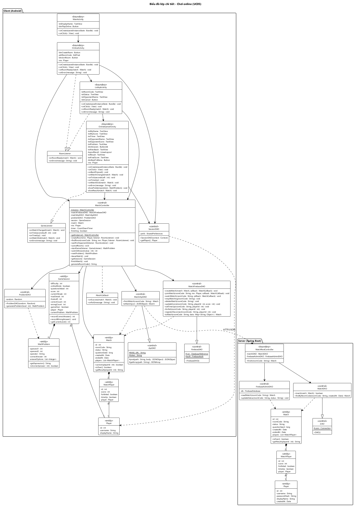

*Hình 5: Biểu đồ lớp chi tiết chức năng Chơi online (client + server).*

**Client (Android):**
- `OnlineActivity`, `LobbyActivity` cài đặt `RoomListener`; `OnlineGameActivity` cài đặt `GameListener`. Activity chỉ gọi `MatchController` và hiển thị, không gọi Firebase hay REST trực tiếp, không tự chấm điểm hay phân thắng thua.
- `MatchController` (Singleton) điều phối cả trận, giữ `match`, `session`, `me`, `timer`.
  - `createRoom` sinh mã phòng và `questionSeed`.
  - `startGame` tạo `ProblemDAO(new Random(questionSeed))` (2 máy cùng dãy câu), `GameSession` online, đăng ký `onDisconnect` và bật đồng hồ 60 giây.
  - `submitAnswer` chấm điểm và gửi điểm lên Firebase.
  - Khi `Match.isOver()` đúng, `finishMatch` gọi backend trong `Thread`.
- `MatchFirebaseDAO` kế thừa `FirebaseDAO` (giữ `con`, `auth`), đọc và ghi node `matches/{roomCode}`.
  - `createMatch`, `joinMatch` dùng transaction. `joinMatch` gọi `Match.canJoin` bên trong transaction, nên 2 người vào cùng lúc vẫn không vượt quá 2 người.
  - `watchMatch` báo mọi thay đổi qua `MatchCallback`.
  - `toMatch` đóng gói node thành `Match`.
- `MatchApiDAO` kế thừa `ApiDAO` (giữ `BASE_URL`, `token`). `finishMatch` gửi `POST /api/matches/{roomCode}/finish`.
- `SessionDAO.getPlayer()` đọc người chơi đang đăng nhập từ SharedPreferences.
- `ProblemDAO.generateProblem(level)` sinh câu hỏi.

**Server (Spring Boot):**
- `MatchRestController.finish(roomCode)` là trọng tài:
  1. Đọc trận bằng `FirebaseAdminDAO.readMatch`.
  2. Trận đã `finished` thì trả bản đã lưu (`MatchDAO.findByRoomCode`).
  3. `isOver()` sai thì trả 409.
  4. Ngược lại thì `MatchDAO.insert` và `FirebaseAdminDAO.updateStatus(..., "finished")`.
- `MatchDAO` kế thừa `DAO` (giữ `conn : Connection`). `insert` ghi 1 dòng `tblMatch` + 2 dòng `tblMatchPlayer` trong một transaction.
- `FirebaseAdminDAO` dùng Admin SDK đọc node trận và ghi trạng thái.

#### 4.1.3. Biểu đồ tuần tự chi tiết

Chức năng chia 3 đoạn, mỗi đoạn một biểu đồ. Kịch bản v3 đầy đủ (từng bước khớp với từng thông điệp) ở `docs/hung/5-kich-ban-v3.md`, mục 1. Tóm tắt các bước chính:

**Đoạn A: Tạo phòng (26 bước).**
1. `MainActivity.onClick` mở `OnlineActivity`.
2. `onCreate` lấy người chơi bằng `SessionDAO.getPlayer` (bước 3–6).
3. Hùng nhấn Tạo phòng. `onClick` gọi `MatchController.createRoom`, hàm này tạo `Match` và gọi `MatchFirebaseDAO.createMatch` (bước 9–12).
4. `runTransaction` ghi node; `onComplete` báo về `onSuccess`, rồi `onRoomReady` mở `LobbyActivity` (bước 13–16).
5. `LobbyActivity` gọi `waitForOpponent` → `watchMatch` (bước 17–18).
6. Khi Hoàng vào, `onDataChange` → `toMatch` → `onSuccess` → `onRoomReady`. Lobby hiện đối thủ và mở `OnlineGameActivity` (bước 20–26).
7. Ngoại lệ 19a: Hủy phòng → `cancelRoom` → `stopWatching`, `deleteMatch`.

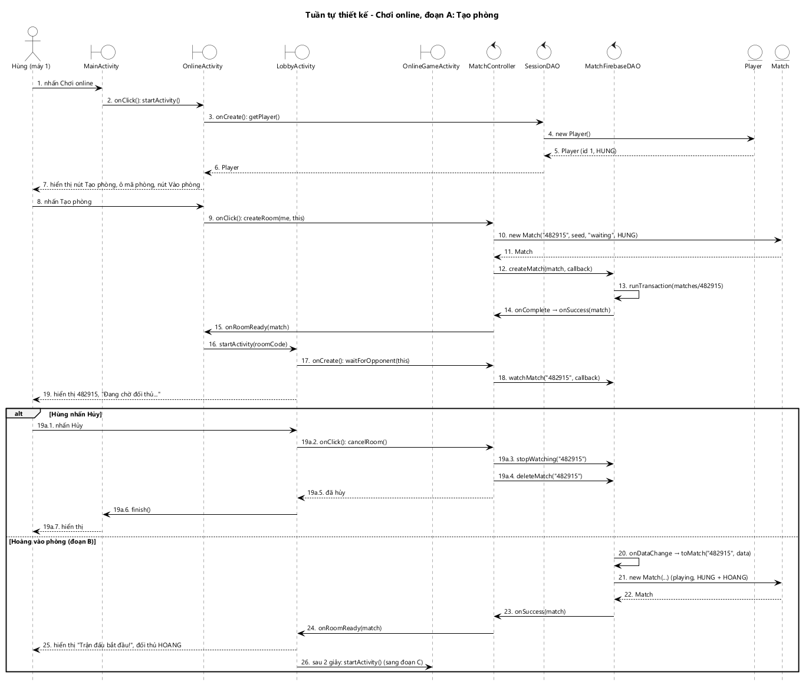

*Hình 6: Biểu đồ tuần tự chi tiết Chơi online, đoạn A: Tạo phòng.*

**Đoạn B: Tìm phòng (23 bước).**
1. Hoàng nhập mã. `onClick` gọi `findRoom` → `MatchFirebaseDAO.joinMatch` (bước 9–10).
2. Trong `doTransaction`, `toMatch` đóng gói trận hiện tại, rồi gọi `Match.canJoin(2)` (bước 11–15).
3. Nếu đúng thì ghi `players/2` và `status = "playing"`. `onComplete` → `onSuccess` → `onRoomReady` → `LobbyActivity` → `OnlineGameActivity` (bước 16–23).
4. Ngoại lệ 15a: `canJoin` sai hoặc không có phòng → `Transaction.abort()` → `onFail` → `onError` → `Toast`.

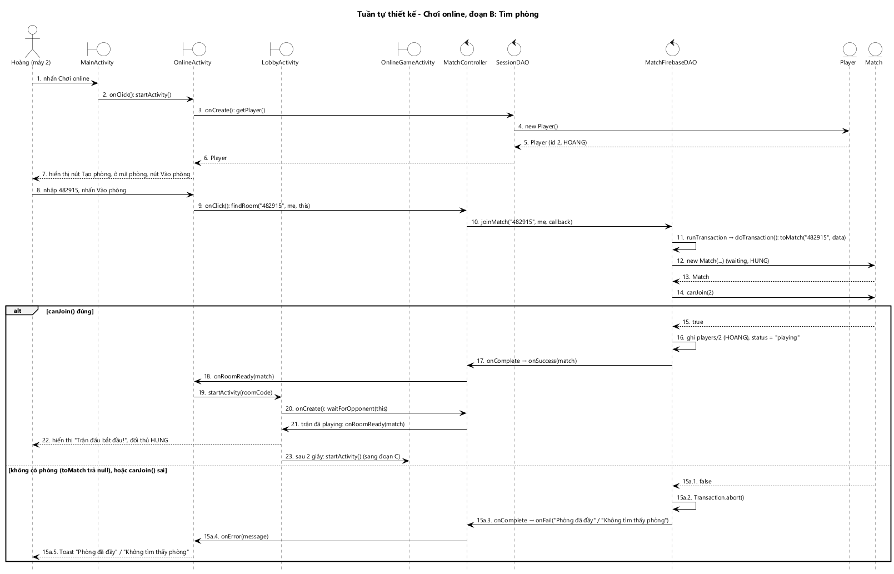

*Hình 7: Biểu đồ tuần tự chi tiết Chơi online, đoạn B: Tìm phòng.*

**Đoạn C: Thi đấu và kết thúc trận (77 bước).**
1. `startGame` đăng ký `onDisconnect`, tạo `ProblemDAO` theo seed, tạo `GameSession(1, true)`, theo dõi trận, bật `CountDownTimer`, sinh câu đầu tiên (bước 1–14).
2. Vòng lặp:
   - `onTick` vẽ đồng hồ (bước 15–17).
   - Chọn đáp án: `submitAnswer` → `isCorrect` → `recordCorrectAnswer` → `updateScore`; `nextProblem` → `generateProblem` (bước 18–34).
   - Đối thủ ghi điểm: `onDataChange` → `toMatch` → `onSuccess` → `isOver()` sai → `onMatchChanged` (bước 35–42).
3. `onFinish` → `setTimeUp` → `onTimeUp` (bước 43–46).
4. Khi máy kia cũng hết giờ, `isOver()` đúng → `finishMatch` trong `Thread` → `MatchApiDAO.finishMatch` → **`POST /api/matches/482915/finish`** (bước 47–55).
5. Server: `readMatch` → `isOver()` → `insert` (1 transaction) → `updateStatus("finished")` → trả `Match` (bước 56–66).
6. App: `toMatch(json)` → `stopWatching` → `onMatchEnd` → `getResult(1)` = `WIN` → overlay THẮNG! (bước 67–74).
7. Ngoại lệ:
   - 18a: thoát trận → `leaveMatch` → `forfeit` → `finishMatch`.
   - 40a: đối thủ bỏ trận → `isOver()` đúng ngay → kết thúc trận.
   - 60a: máy kia đã gọi trước → `findByRoomCode` trả bản đã lưu, nên 2 máy cùng một kết quả và MySQL chỉ có một dòng `tblMatch`.

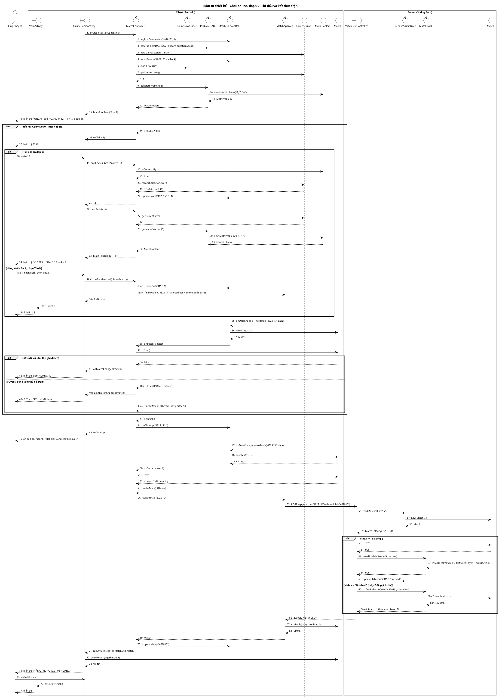

*Hình 8: Biểu đồ tuần tự chi tiết Chơi online, đoạn C: Thi đấu và kết thúc trận (client + server).*

- Logic của chức năng nằm trong code của nhóm:
  - Chấm điểm: `GameSession`, `MathProblem`.
  - Luật vào phòng: `Match.canJoin`.
  - Điều kiện kết thúc: `Match.isOver`, kiểm tra ở cả app và server.
  - Thắng thua: `Match.getResult`, trên bản trận server đã lưu.
- Firebase chỉ chuyển điểm giữa 2 máy và báo khi trận thay đổi.

### 4.2. Chức năng "Xem lịch sử đấu"

#### 4.2.1. Thiết kế giao diện

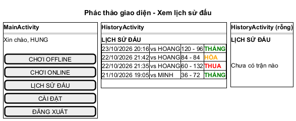

*Hình 9: Giao diện chức năng Xem lịch sử đấu: màn Chính, Lịch sử đấu (có dữ liệu và rỗng).*

| Màn | `id` | Loại View | Chức năng | Tên pha phân tích |
|---|---|---|---|---|
| `MainActivity` | `btnHistory` | `Button` | Mở Lịch sử đấu | `subHistory` |
| `HistoryActivity` | `rvHistory` | `RecyclerView` | Danh sách trận | `outListMatch` |
| | `txtEmpty` | `TextView` | "Chưa có trận nào" | `outListMatch` (rỗng) |
| `item_history.xml` | `txtPlayedAt`, `txtOpponent`, `txtScore`, `txtResult` | `TextView` | Thời gian, đối thủ, tỉ số, kết quả có màu | một dòng của `outListMatch` |

#### 4.2.2. Biểu đồ lớp chi tiết

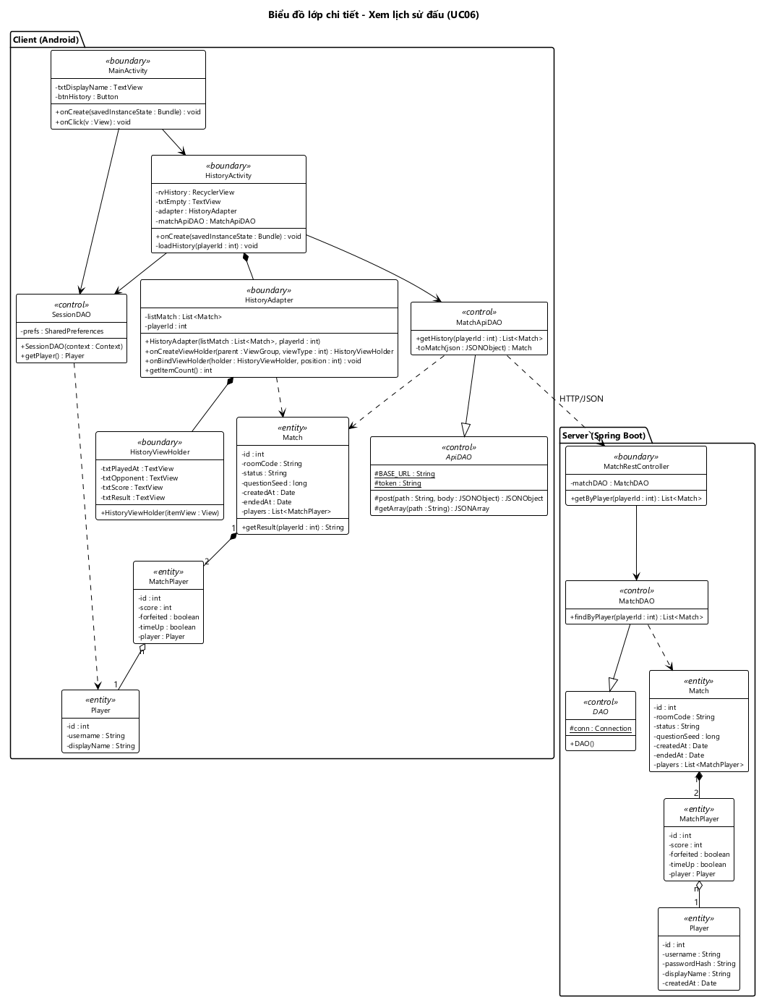

*Hình 10: Biểu đồ lớp chi tiết chức năng Xem lịch sử đấu (client + server).*

**Client (Android):**
- `HistoryActivity.onCreate` lấy người chơi bằng `SessionDAO`.
- `loadHistory(playerId)` gọi `MatchApiDAO.getHistory` trong `Thread`, rồi gắn `HistoryAdapter` trong `runOnUiThread`.
- `HistoryAdapter` giữ danh sách `Match` và `playerId`. `onBindViewHolder` gọi `Match.getResult(playerId)` để chọn chữ và màu.
- `MatchApiDAO` kế thừa `ApiDAO`. `getHistory` gửi `GET /api/matches?playerId={id}`.

**Server (Spring Boot):**
- `MatchRestController.getByPlayer` gọi `MatchDAO.findByPlayer`. `MatchDAO` kế thừa `DAO`, chạy truy vấn JOIN và đóng gói `Match` + 2 `MatchPlayer` + 2 `Player`.

#### 4.2.3. Biểu đồ tuần tự chi tiết

Kịch bản v3 đầy đủ ở `docs/hung/5-kich-ban-v3.md`, mục 2 (25 bước):
1. `MainActivity.onClick` mở `HistoryActivity` (bước 1–2).
2. `onCreate` lấy người chơi bằng `SessionDAO.getPlayer` (bước 3–6).
3. `loadHistory(1)` → `MatchApiDAO.getHistory(1)` trong `Thread` → **`GET /api/matches?playerId=1`** → `MatchRestController.getByPlayer` → `MatchDAO.findByPlayer` truy vấn và đóng gói `Match` → trả JSON (bước 7–15).
4. `toMatch(json)` đóng gói `Match` phía app → trả `List<Match>` (bước 16–18).
5. Trong `runOnUiThread`, tạo `HistoryAdapter`. Mỗi dòng gọi `getResult(1)` để chọn chữ và màu, rồi hiển thị danh sách (bước 19–22).
6. Back → `finish()` → màn Chính (bước 23–25).
7. Ngoại lệ:
   - 19a: danh sách rỗng → "Chưa có trận nào".
   - 9a: mất mạng → `Toast` báo lỗi.

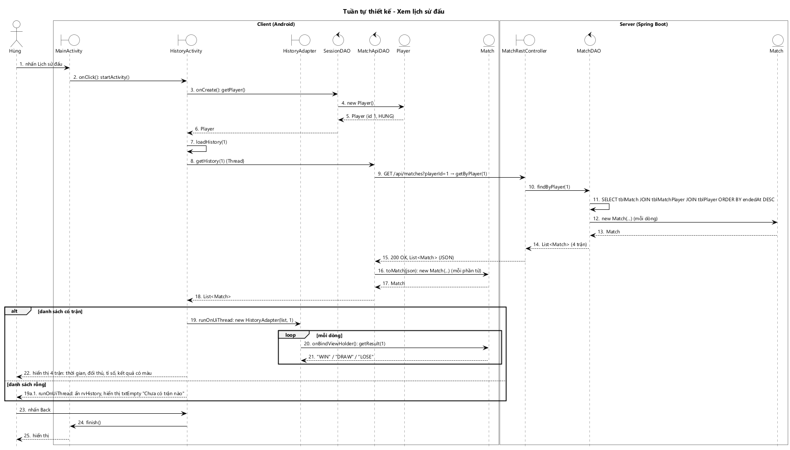

*Hình 11: Biểu đồ tuần tự chi tiết chức năng Xem lịch sử đấu (client + server).*

- Server đi đúng khuôn Controller → DAO → Entity, không có tầng Service.
- Kết quả thắng / thua / hòa không lưu trong CSDL mà tính lại bằng `Match.getResult`. Dữ liệu lấy từ MySQL nên kết quả trùng với lúc trận kết thúc.

---

## Phụ lục: các bước phân tích

### A. Lớp thực thể pha phân tích

Xem `docs/chung/02-lop-thuc-the.md`, phần A. Các lớp liên quan: `Player`, `Match`, `MatchPlayer` (lớp liên kết n-n), `GameSession`, `MathProblem`.

### B. Biểu đồ lớp pha phân tích

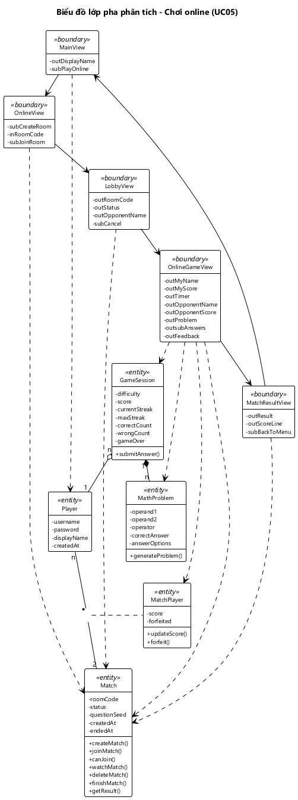

*Hình 12: Biểu đồ lớp pha phân tích chức năng Chơi online.*

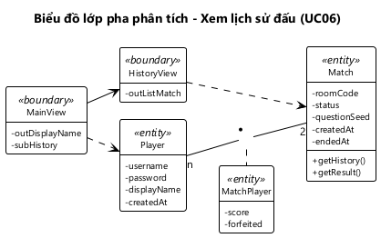

*Hình 13: Biểu đồ lớp pha phân tích chức năng Xem lịch sử đấu.*

Cách đề xuất lớp View, thành phần `in` / `out` / `sub` và gán phương thức theo 4 câu hỏi ở `docs/hung/2-lop-phan-tich.md`.

### C. Kịch bản v2 và biểu đồ tuần tự pha phân tích


*Hình 14: Tuần tự pha phân tích Chơi online, đoạn A: Tạo phòng.*


*Hình 15: Tuần tự pha phân tích Chơi online, đoạn B: Tìm phòng.*


*Hình 16: Tuần tự pha phân tích Chơi online, đoạn C: Thi đấu.*


*Hình 17: Tuần tự pha phân tích Xem lịch sử đấu.*

Kịch bản v2 từng bước ở `docs/hung/3-kich-ban-v2.md`.
