# BÁO CÁO THIẾT KẾ CÁ NHÂN — MATH DASH 1v1

**Sinh viên:** Nguyễn Bá Hùng · **Lớp:** E23CNPM01
**Chức năng trình bày:** Chơi online, Xem lịch sử đấu

**Phạm vi hệ thống:**
- Math Dash 1v1 là trò chơi giải toán nhanh trên Android: người chơi thách đấu nhau trên cùng một đề 10 câu trắc nghiệm, làm lần lượt từng câu, hoặc chơi với máy.
- Hệ thống gồm một server và nhiều client:
  - **App Android** (client): Java, mô hình MVC 3 tầng entity – dao – view.
  - **Server Spring Boot**: REST, MySQL. Lưu tài khoản, trận đấu, đề bài, bài làm từng câu; sinh đề, chấm bài và làm trọng tài.
  - **Firebase Realtime Database**: kênh báo tức thời giữa các máy: ai đang ở giao diện chơi online, lời mời thách đấu, diễn biến trận đang đấu.
- Sau khi đăng nhập, giao diện chính chỉ có 2 nút chọn chế độ chơi: Chơi với máy, Chơi online. Nút Chơi online mở giao diện chơi online; người chơi chỉ có trong danh sách online và chỉ nhận được lời thách đấu khi đang ở giao diện này. Từ giao diện chơi online, 2 nút biểu tượng ở góc phải trên mở giao diện lịch sử đấu và bảng xếp hạng.
- 2 chức năng thuộc 2 module:
  - Chơi online thuộc module Đấu đối kháng.
  - Xem lịch sử đấu thuộc module Xem lịch sử đấu; module này đọc kết quả và bài làm từng câu của các trận chơi online và gồm cả bảng xếp hạng.

---

## 1. Mô tả hệ thống bằng ngôn ngữ tự nhiên

Hệ thống là một trò chơi giải toán nhanh gồm một server và nhiều client; server lưu toàn bộ thông tin và dữ liệu. Mỗi người chơi có một tài khoản gồm tên đăng nhập, mật khẩu và tên hiển thị; người chơi đăng ký tài khoản rồi đăng nhập từ một máy client để chơi. Quản trị viên cũng đăng nhập bằng tài khoản, nhưng chỉ để quản lý thông tin các người chơi: xem, sửa tên hiển thị, đặt lại mật khẩu, xóa tài khoản. Sau khi đăng nhập, người chơi chọn chơi với máy hoặc chơi online. Khi chơi với máy, người chơi chọn độ khó của máy rồi làm một đề 10 câu; máy cũng có số câu đúng và thời gian làm bài theo độ khó, và kết quả ván được lưu lại cùng thời điểm chơi. Khi vào chơi online, người chơi thấy danh sách người chơi đang online, mỗi người có tên, tổng điểm và trạng thái rỗi hoặc bận. Người chơi bấm vào tên một người đang rỗi để gửi lời mời thách đấu, người được mời đồng ý hoặc từ chối. Khi lời mời được đồng ý, server tạo một trận đấu giữa 2 người, sinh một đề bài gồm 10 câu hỏi và gửi cùng đề cho cả 2 người. Mỗi câu hỏi là một phép tính gồm hai toán hạng và một toán tử, kèm 4 phương án trả lời trong đó có một đáp án đúng. Mỗi người làm lần lượt từng câu: chọn một phương án rồi sang câu sau, hệ thống ghi lại phương án đã chọn và thời gian làm câu; làm xong 10 câu thì nộp bài làm, tất cả trong tối đa 60 giây. Server ghi nhận thời điểm nộp bài, số câu đúng và bài làm từng câu của từng người. Người nhấn thoát giữa chừng thì bỏ trận và bị xử thua. Khi cả 2 đã nộp bài, server xác định kết quả trận: ai đúng hết và nhanh hơn thì thắng, cả 2 đều có câu sai thì hòa. Thắng được 1 điểm, hòa 0,5 điểm, thua 0 điểm; tổng điểm của người chơi là tổng các điểm trận này. Sau mỗi trận, nếu cả 2 chọn chơi tiếp thì server tạo trận mới với đề mới; nếu một người dừng thì server báo cho người còn lại. Người chơi xem được lịch sử đấu gồm các trận đối kháng mình đã đấu cùng tỉ lệ thắng, hòa, thua; xem chi tiết một trận gồm đề bài kèm đáp án đúng và bài làm của mỗi người ở từng câu: đúng hay sai, phương án đã chọn, thời gian làm câu; và xem bảng xếp hạng mọi người chơi theo tổng điểm, trung bình điểm của các đối thủ đã gặp và trung bình thời gian làm bài trong các trận thắng.

---

## 2. Thiết kế cơ sở dữ liệu

Hệ thống lưu dữ liệu ở 3 nơi:
- **MySQL** trên server: tài khoản, trận đấu, đề bài, kết quả chấm và bài làm từng câu. Đây là nguồn dữ liệu của tổng điểm, lịch sử đấu, chi tiết trận và bảng xếp hạng.
- **SQLite** trên máy client: bản sao người chơi đã đăng nhập trên máy và các ván chơi với máy, để chơi với máy chạy được khi không có mạng. Chơi online và Xem lịch sử đấu không đọc hay ghi SQLite.
- **Firebase Realtime Database**: người chơi đang online, lời mời, trận đang đấu. Dữ liệu này chỉ có ý nghĩa trong lúc chơi.

### 2.1. CSDL MySQL

**Bước 1: Mỗi lớp thực thể cần lưu đề xuất một bảng.**
- Player → tblPlayer.
- Match → tblMatch.
- MatchPlayer → tblMatchPlayer.
- MathProblem → tblMathProblem: server phải giữ đề và đáp án để chấm bài và để xem lại trong lịch sử đấu.
- Answer → tblAnswer: bài làm từng câu được lưu vì giao diện chi tiết trận cần hiện lại, với mỗi người chơi, từng câu đúng hay sai, phương án đã chọn và thời gian làm câu, kể cả khi trận đã xong từ lâu.
- Challenge không có bảng: lời mời chỉ có ý nghĩa vài giây, sau đó không chức năng nào tra lại.

**Bước 2: Thuộc tính kiểu cơ bản thành cột.**
- Bỏ thuộc tính kiểu đối tượng: Match.questions, Match.players, MatchPlayer.player, MatchPlayer.answers, Answer.problem.
- Kiểu dữ liệu: String → varchar(255); int → integer(10); long → bigint(20); Date → timestamp(3), có mili giây để so thời gian làm bài; boolean → tinyint(1).
- answerOptions luôn có 4 phần tử nên tách thành 4 cột option1 … option4.
- Kết quả:
  - tblPlayer: id, username, passwordHash, displayName, role, createdAt.
  - tblMatch: id, startedAt, endedAt.
  - tblMathProblem: id, operand1, operand2, operator, correctAnswer, option1, option2, option3, option4.
  - tblMatchPlayer: id, correctCount, submittedAt, forfeited.
  - tblAnswer: id, selectedOption, answerTime.

**Bước 3: Quan hệ giữa các bảng.**
- 1 tblMatch – n tblMatchPlayer (đúng 2 dòng mỗi trận).
- 1 tblMatch – n tblMathProblem (đúng 10 dòng mỗi trận).
- 1 tblMatchPlayer – n tblAnswer (đúng 10 dòng khi người chơi đã nộp bài; không có dòng nào nếu người chơi bỏ trận trước khi nộp).
- 1 tblMathProblem – n tblAnswer (tối đa 2 dòng cho mỗi câu, mỗi người chơi trong trận một dòng).
- 1 tblPlayer – n tblMatchPlayer.
- Quan hệ n-n tblPlayer – tblMatch đã được tách bằng tblMatchPlayer từ thiết kế lớp thực thể; quan hệ n-n tblMatchPlayer – tblMathProblem đã được tách bằng tblAnswer.

**Bước 4: Khóa.**
- **Khóa chính:** id (AUTO_INCREMENT) ở mọi bảng.
- **Khóa ngoại** đặt ở bảng phía n:
  - tblMatchPlayer.tblMatchId → tblMatch.id và tblMathProblem.tblMatchId → tblMatch.id, có ON DELETE CASCADE.
  - tblAnswer.tblMatchPlayerId → tblMatchPlayer.id và tblAnswer.tblMathProblemId → tblMathProblem.id, có ON DELETE CASCADE.
  - Xóa trận thì xóa luôn 2 người chơi trong trận và 10 câu hỏi, kéo theo xóa luôn bài làm từng câu của 2 người, vì khi trận không còn thì 2 dòng người chơi trong trận, 10 câu hỏi và bài làm không còn ý nghĩa.
  - tblMatchPlayer.tblPlayerId → tblPlayer.id.
- **Ràng buộc duy nhất:** tblPlayer.username; tblMatchPlayer (tblMatchId, tblPlayerId); tblAnswer (tblMatchPlayerId, tblMathProblemId), mỗi người chơi trong trận chỉ có một bài làm cho mỗi câu.
- Thứ tự câu trong đề là thứ tự id tăng dần, vì server chèn 10 câu theo đúng thứ tự trong một transaction. Thứ tự câu trong bài làm cũng là thứ tự tblMathProblemId tăng dần, nên tblAnswer không cần cột số thứ tự.

**Bước 5: Loại thuộc tính gây dư thừa.**
- **Thuộc tính dẫn xuất không có cột:**
  - Kết quả và điểm trận: suy ra từ correctCount, submittedAt, forfeited của 2 người và startedAt của trận → Match.getResult(playerId), Match.getPoints(playerId).
  - Đúng / sai của một câu trong bài làm: so tblAnswer.selectedOption với correctAnswer của câu tương ứng trong tblMathProblem → Answer.isCorrect().
  - Tổng điểm, trung bình điểm đối thủ, trung bình thời gian thắng: tính từ các trận đã xong.
  - Tỉ lệ thắng / hòa / thua trong lịch sử đấu: đếm Match.getResult(playerId) trên các trận của người chơi.
  - tblMatch.status: trận đã xong khi và chỉ khi endedAt có giá trị.
- **Không cần lưu lâu dài:** trạng thái rỗi / bận của người chơi (chỉ ở Firebase).
- **Giữ lại có chủ đích:**
  - correctAnswer suy ra được từ phép tính, nhưng là căn cứ chấm và đối chiếu kết quả.
  - correctCount suy ra được bằng cách đếm các dòng tblAnswer đúng của người chơi trong trận. Tuy vậy, kết quả trận, lịch sử đấu, tổng điểm và bảng xếp hạng đều đọc correctCount của mọi trận đã xong mà không cần đề và bài làm; giữ cột này thì không phải đọc và chấm lại 20 dòng tblAnswer cho mỗi trận.
- Chỉ endedAt và submittedAt được rỗng (trận đang đấu, người chưa nộp). tblAnswer.selectedOption có mặc định −1 (bỏ trống), tblAnswer.answerTime có mặc định 0. Mật khẩu chỉ lưu dạng băm BCrypt.

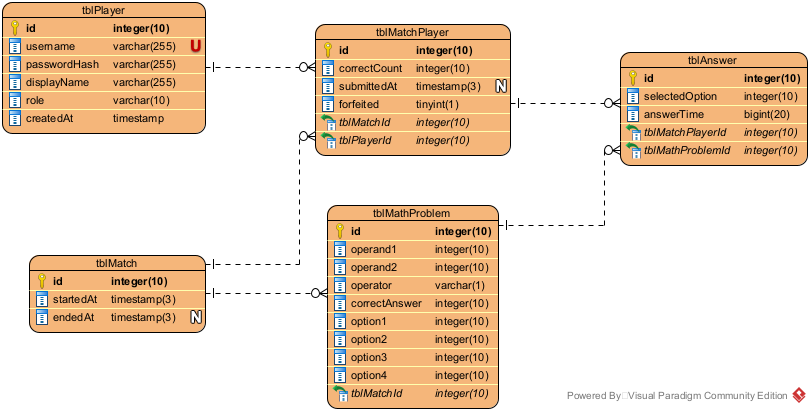

*Hình 1: Biểu đồ thiết kế CSDL MySQL cho chức năng Chơi online, Xem lịch sử đấu.*

- tblMatch là trung tâm: 10 dòng tblMathProblem là đề, 2 dòng tblMatchPlayer nối trận với 2 người chơi.
- Mỗi dòng tblMatchPlayer có các dòng tblAnswer là bài làm từng câu của người đó; mỗi dòng tblAnswer trỏ tới đúng một câu trong tblMathProblem.
- Lịch sử đấu và bảng xếp hạng chỉ đọc tblPlayer, tblMatch, tblMatchPlayer; riêng chi tiết trận đọc thêm 10 dòng tblMathProblem và các dòng tblAnswer của 2 người.
- Nộp bài ghi tblMatchPlayer và 10 dòng tblAnswer của người chơi trong cùng một transaction.

### 2.2. CSDL SQLite trên client

**Bước 1: Mỗi lớp thực thể cần lưu đề xuất một bảng.**
- BotGame → tblBotGame: ván chơi với máy lưu ngay trên máy, để chơi với máy chạy được khi không có mạng.
- Player → tblPlayer, là bản sao của người chơi đã đăng nhập trên máy. SQLite không đặt được khóa ngoại sang một CSDL khác, và khi mất mạng app không đọc được MySQL, nên mỗi lần đăng nhập thành công app lưu một bản sao người chơi, cùng id với MySQL, vào SQLite.
- Match, MatchPlayer, MathProblem, Answer, Challenge không có bảng trên client: trận đối kháng chỉ lưu ở MySQL, app lấy qua server khi cần.
- Đề của ván với máy (BotGame.questions) chỉ nằm trong bộ nhớ trong lúc chơi, không lưu.

**Bước 2: Thuộc tính kiểu cơ bản thành cột.**
- Bỏ thuộc tính kiểu đối tượng: BotGame.player, BotGame.questions.
- Kiểu dữ liệu: String → varchar(255); int, long → integer; Date → varchar(255), lưu dạng yyyy-MM-dd HH:mm:ss. SQLite xếp varchar vào nhóm kiểu TEXT.
- tblPlayer chỉ lấy các cột app cần khi không có mạng.
- Kết quả:
  - tblPlayer: id, username, displayName.
  - tblBotGame: id, difficulty, correctCount, finishTime, botCorrectCount, botFinishTime, playedAt.

**Bước 3: Quan hệ giữa các bảng.**
- 1 tblPlayer – n tblBotGame: một người chơi có nhiều ván với máy trên cùng một máy.

**Bước 4: Khóa.**
- **Khóa chính:** tblBotGame.id tự tăng. tblPlayer.id không tự tăng mà lấy đúng id của người chơi trên MySQL, để bản sao và bản chính là cùng một người.
- **Khóa ngoại** đặt ở bảng phía n: tblBotGame.tblPlayerId → tblPlayer.id. SQLite chỉ kiểm tra khóa ngoại khi được bật, nên app bật khóa ngoại mỗi lần mở CSDL.
- **Ràng buộc:** difficulty chỉ nhận 1, 2, 3 ứng với Dễ, Trung bình, Khó.

**Bước 5: Loại thuộc tính gây dư thừa.**
- **Thuộc tính dẫn xuất không có cột:** kết quả ván suy ra từ correctCount, finishTime của người chơi và botCorrectCount, botFinishTime của máy, theo cùng luật với trận đối kháng → BotGame.getResult().
- **Giữ lại có chủ đích:** username, displayName trong tblPlayer của SQLite trùng với tblPlayer của MySQL. Đây là bản sao để chơi với máy khi mất mạng; bản sao được ghi đè mỗi lần đăng nhập nên luôn khớp bản chính.
- Mọi cột đều không rỗng. finishTime và botFinishTime tính bằng mili giây.

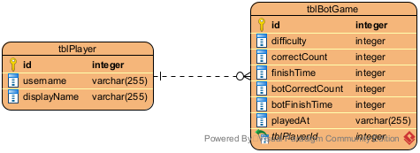

*Hình 2: Biểu đồ thiết kế CSDL SQLite trên client.*

- tblBotGame nối tới bản sao tblPlayer bằng khóa ngoại thật.
- Mỗi lần đăng nhập thành công, app ghi đè dòng tblPlayer của người chơi; mỗi ván với máy thêm một dòng tblBotGame.

### 2.3. Dữ liệu trên Firebase Realtime Database

Firebase lưu dữ liệu dạng cây JSON nên không có bảng. Thiết kế đi theo đúng 5 bước như MySQL, với bảng thay bằng node, cột thay bằng field.

**Bước 1: Mỗi lớp thực thể cần đồng bộ tức thời giữa các máy đề xuất một node gốc.**
- Player, phần trạng thái online → presence: các máy cần thấy ngay ai vào, ai rời giao diện chơi online và ai đang bận.
- Challenge → challenges: người được mời phải nhận lời mời ngay, người mời phải biết ngay lời mời được đồng ý hay bị từ chối.
- Match, phần trận đang đấu → matches: 2 máy cần nhận cùng đề, biết đối thủ đã nộp bài, biết trận đã xong và lựa chọn chơi tiếp của đối thủ.
- Không có node gốc:
  - MathProblem và MatchPlayer: nằm trong Match (kết tập) nên thành node con của matches (bước 3).
  - Answer: bài làm chỉ gửi qua REST lúc nộp và chỉ đọc lại khi trận đã xong, không cần đồng bộ tức thời.

**Bước 2: Thuộc tính kiểu cơ bản thành field.**
- Bỏ thuộc tính kiểu đối tượng: Match.questions, Match.players, MatchPlayer.player, Challenge.challenger, Challenge.opponent.
- Kiểu dữ liệu: String → chuỗi; int, double → số; boolean → true / false; Date → số mili giây (startedAt do server ghi, createdAt lấy giờ của Firebase).
- Firebase không nối được 2 node như khóa ngoại, nên những gì giao diện cần hiện thì chép thẳng vào node: lời mời giữ tên và tổng điểm của người mời, người chơi trong trận giữ tên hiển thị.
- Kết quả:
  - presence: displayName, totalPoints, status.
  - challenges: challengerId, challengerName, challengerPoints, opponentId, opponentName, status, createdAt, matchId.
  - matches: status, startedAt.
  - câu hỏi trong trận: operand1, operand2, operator, answerOptions.
  - người chơi trong trận: displayName, submitted, forfeited.

**Bước 3: Chuyển quan hệ giữa các lớp thành quan hệ giữa các node.**
- MathProblem, MatchPlayer nằm trong Match (kết tập) nên thành node con của matches:
  - Match có 10 MathProblem → matches/{matchId}/questions/{i}.
  - Match có 2 MatchPlayer → matches/{matchId}/players/{playerId}.
- Lớp đã có node gốc riêng thì không lồng node mà giữ khóa của node kia:
  - Challenge chứa thông tin 2 Player → challengerId, opponentId.
  - Lời mời được đồng ý dẫn tới một trận → matchId.
- Diễn biến sau trận ghi thêm vào node trận: players/{playerId}/choice (continue / stop), nextMatchId (trận mới khi cả 2 chơi tiếp), stoppedBy (người dừng hoặc bỏ trận).

**Bước 4: Khóa.**
- presence/{playerId}: khóa là id người chơi trong MySQL, nên mỗi người có tối đa một node.
- challenges/{challengeId}: khóa là push id do Firebase sinh, kiểu String; Challenge.id lấy đúng giá trị này.
- matches/{matchId}: khóa là id trận trong MySQL, để app theo dõi trên Firebase và gọi REST bằng cùng một id.
- questions/{i}: chỉ số 0 – 9 theo thứ tự đề. players/{playerId}: id người chơi.
- challenges có chỉ mục trên opponentId, để máy người được mời chỉ lọc ra lời mời gửi cho mình.

**Bước 5: Loại thuộc tính gây dư thừa và thuộc tính không được đưa lên.**
- Không đưa lên Firebase:
  - correctAnswer: người chơi đọc được dữ liệu trận của mình, nên đáp án chỉ nằm ở MySQL.
  - Bài làm từng câu, correctCount, thời điểm nộp thật, kết quả và điểm trận: server tính và lưu ở MySQL; Firebase chỉ có cờ submitted để báo đối thủ đã nộp.
  - avgOpponentPoints, avgWinTime: chỉ dùng cho bảng xếp hạng, đọc qua REST.
- Giữ lại có chủ đích: totalPoints trong presence là bản sao của tổng điểm tính từ MySQL, để danh sách online hiện điểm ngay; server ghi lại sau mỗi trận.
- Dữ liệu chỉ sống trong lúc chơi: node presence bị xóa khi người chơi rời giao diện chơi online hoặc mất kết nối; lời mời bị xóa khi máy người mời mất kết nối.

Cây dữ liệu thu được:

| Node | Khóa | Field |
|---|---|---|
| presence/{playerId} | id người chơi trong MySQL | displayName, totalPoints, status: free / busy |
| challenges/{challengeId} | push id do Firebase sinh | challengerId, challengerName, challengerPoints, opponentId, opponentName, status: pending / accepted / rejected, createdAt, matchId |
| matches/{matchId} | id trận trong MySQL | status: playing / finished, startedAt, nextMatchId, stoppedBy |
| matches/{matchId}/questions/{i} | thứ tự câu trong đề, 0 – 9 | operand1, operand2, operator, answerOptions |
| matches/{matchId}/players/{playerId} | id người chơi | displayName, submitted, forfeited, choice: continue / stop |

- **presence**: app ghi khi vào giao diện chơi online, xóa khi rời giao diện này, và đăng ký tự xóa khi app tắt hoặc mất mạng. Server đổi status sang busy / free khi trận bắt đầu, kết thúc và cập nhật totalPoints.
- **challenges**: app người mời tạo, app người được mời ghi rejected, server ghi accepted kèm matchId.
- **matches**: chỉ server ghi: đề và 2 người chơi lúc tạo trận, submitted khi một người nộp, status finished khi trận xong, choice, nextMatchId, stoppedBy sau trận.

---

## 3. Thiết kế lớp thực thể

Đầu vào là biểu đồ lớp thực thể pha phân tích (Phụ lục B). Các lớp liên quan đến 2 chức năng: Player, Challenge, Match, MatchPlayer, MathProblem, Answer.

**Bước 1: Bổ sung thuộc tính khóa.**
- Thêm id : int cho Player, Match, MatchPlayer, MathProblem, Answer.
- Challenge có id : String là push id do Firebase sinh, vì lời mời chỉ nằm trên Firebase.

**Bước 2: Bổ sung kiểu dữ liệu.**
- Kiểu Java: chuỗi String; số đếm, toán hạng int; thời gian làm bài, thời gian làm câu long (mili giây); thời điểm Date; cờ boolean; điểm double vì có điểm hòa 0,5.
- Phương án đã chọn là int, cùng kiểu với các phương án trả lời; câu bỏ trống có giá trị −1, đặt thành hằng Answer.NONE.
- Thuộc tính boolean không có tiền tố is (forfeited → getter isForfeited()), để Jackson và Firebase SDK đọc đúng tên trường.
- password đổi thành passwordHash vì chỉ lưu mật khẩu đã băm.

**Bước 3: Chuyển quan hệ liên kết thành kết tập.**
- Quan hệ n-n Player – Match qua lớp liên kết MatchPlayer chuyển thành:
  - **MatchPlayer là thành phần của Match** (kết tập, 1-2): thông tin 2 người chơi trong trận nằm trong Match.
  - **Player nằm trong MatchPlayer** (kết tập, n-1): người chơi tồn tại độc lập với trận.
- Quan hệ n-n MatchPlayer – MathProblem qua lớp liên kết Answer chuyển thành:
  - **Answer là thành phần của MatchPlayer** (kết tập, 1-n): thông tin bài làm từng câu của một người nằm trong MatchPlayer của người đó. Người chơi đã nộp bài có đúng 10 Answer; người bỏ trận trước khi nộp không có Answer nào.
  - **MathProblem nằm trong Answer** (kết tập, n-1): câu hỏi thuộc về đề của trận, tồn tại không phụ thuộc vào bài làm; mỗi câu hỏi có tối đa 2 Answer, mỗi người chơi trong trận một. Khi chấm bài và khi hiện chi tiết trận, mỗi Answer cần biết câu hỏi của nó để tự xác định đúng hay sai.
- Giữ nguyên từ pha phân tích:
  - MathProblem là thành phần của Match (kết tập, 1-10): thông tin 10 câu hỏi của đề nằm trong Match.
  - Player nằm trong Challenge ở 2 vai trò người mời, người được mời (kết tập).

**Bước 4: Bổ sung thuộc tính đối tượng.**
- Challenge.challenger, Challenge.opponent : Player.
- Match.questions : List\<MathProblem>, Match.players : List\<MatchPlayer>.
- MatchPlayer.player : Player.
- MatchPlayer.answers : List\<Answer>. Answer thứ i của bài làm ứng với câu thứ i của đề.
- Answer.problem : MathProblem.

Thuộc tính dẫn xuất được viết thành **phương thức nghiệp vụ** (hàm Java thuần, có unit test):

| Lớp | Phương thức | Ý nghĩa |
|---|---|---|
| MathProblem | isCorrect(answer : int) : boolean | answer bằng correctAnswer |
| MathProblem | getExpression() : String | Chuỗi hiển thị, ví dụ "12 + 7 = ?" |
| Answer | isAnswered() : boolean | Câu đã được làm: selectedOption khác NONE |
| Answer | isCorrect() : boolean | Câu trả lời đúng: problem.isCorrect(selectedOption) |
| Match | countCorrect(answers : List\<Answer>) : int | Chấm một bài làm: gắn câu thứ i của đề vào answers.get(i) rồi đếm số câu có answers.get(i).isCorrect() |
| Match | isOver() : boolean | Có người bỏ trận, hoặc cả 2 đã nộp bài |
| Match | getFinishTime(playerId : int) : long | submittedAt − startedAt |
| Match | getResult(playerId : int) : String | WIN / LOSE / DRAW: bỏ trận thì thua; một người đúng hết thì người đó thắng; cả 2 có câu sai thì hòa; cả 2 đúng hết thì ai nhanh hơn thắng |
| Match | getPoints(playerId : int) : double | 1 / 0,5 / 0 |
| Match | getOpponent(playerId : int) : MatchPlayer | Người chơi còn lại trong trận, dùng cho lịch sử đấu |

Player giữ thêm các giá trị dẫn xuất mà giao diện cần hiển thị cùng tên: totalPoints, avgOpponentPoints, avgWinTime do server tính; status lấy từ Firebase. Các giá trị này không có cột trong CSDL.

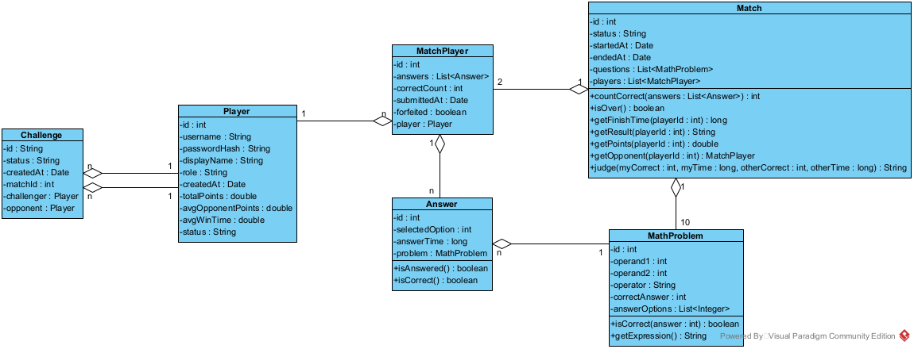

*Hình 3: Biểu đồ lớp thực thể pha thiết kế cho Chơi online, Xem lịch sử đấu.*

- Không còn đường liên kết trơn nào trên biểu đồ.
- Lớp liên kết MatchPlayer trở thành thành phần của Match và chứa Player; lớp liên kết Answer trở thành thành phần của MatchPlayer và chứa MathProblem. Mọi quan hệ chứa trên biểu đồ đều là kết tập (hình thoi rỗng).
- Player, Challenge, Match, MatchPlayer, MathProblem, Answer nằm trong project Java riêng common, đóng gói thành thư viện mathdash-common.jar. App và server cùng nhập thư viện này, nên JSON đi qua REST ánh xạ thẳng vào cùng một lớp ở 2 phía.
- passwordHash chỉ có giá trị ở server; correctAnswer và bài làm từng câu của 2 người chỉ được gửi về app khi trận đã xong, để không ai biết trước đáp án hay xem được bài làm của đối thủ giữa trận.
- Answer.problem không đi qua JSON. Answer thứ i ứng với câu thứ i của đề, nên bên nhận tự gắn lại câu hỏi vào bài làm.

---

## 4. Thiết kế chi tiết từng chức năng

**Ánh xạ từ pha phân tích sang pha thiết kế:**

**Lớp View sang Activity**

| Lớp phân tích | Lớp thiết kế | Layout |
|---|---|---|
| MainView | MainActivity | activity_main.xml |
| OnlineView | OnlineActivity | activity_online.xml, item_player.xml |
| MatchView | MatchActivity | activity_match.xml |
| MatchResultView | Overlay layoutResult nằm trong MatchActivity | activity_match.xml |
| HistoryView | HistoryActivity | activity_history.xml, item_match_history.xml, item_ranking.xml |
| MatchDetailView | MatchDetailActivity | activity_match_detail.xml, item_problem.xml |

OnlineView là Activity riêng, tách khỏi giao diện chính:
- Người chơi chỉ online khi đang ở OnlineActivity hoặc một màn mở từ đó: onCreate gọi goOnline ghi node presence, onDestroy gọi goOffline xóa node. Nhấn Back về MainActivity là offline, nên người đang ở giao diện chính hay đang chơi với máy không hiện trong danh sách online và không bị thách đấu.
- Lời mời thách đấu cũng chỉ được theo dõi trong OnlineActivity.

MatchView hiện mỗi lần một câu nên không cần danh sách: 4 ô phương án là 4 Button cố định trong layoutOptions, gom thành mảng btnOptions; sang câu sau chỉ đổi chữ trên 4 ô.

MatchResultView là overlay chứ không phải Activity riêng:
- Kết quả hiện đè lên màn thi đấu ngay khi trận xong.
- Câu hỏi "Chơi tiếp?" cần tiếp tục theo dõi trận đang mở.

HistoryView là một Activity có 2 thẻ (TabLayout):
- Thẻ Trận của tôi gồm biểu đồ tròn pieChart và danh sách rvMatches; thẻ Bảng xếp hạng là danh sách rvRanking. Chọn thẻ chỉ ẩn / hiện 2 khối này, không mở Activity mới.
- Nút Lịch sử đấu và nút Bảng xếp hạng của OnlineView cùng mở HistoryActivity. Nút Bảng xếp hạng gửi kèm EXTRA_TAB = TAB_RANKING trong Intent để chọn sẵn thẻ Bảng xếp hạng.
- Biểu đồ tròn là View tự vẽ bằng Canvas, nằm trong HistoryActivity, không dùng thư viện ngoài.

**Phương thức của thực thể sang Activity hoặc DAO**

| Phương thức pha phân tích | Lớp phân tích | Phương thức pha thiết kế | Lớp thiết kế |
|---|---|---|---|
| goOnline() | Player | goOnline(player : Player) : void | PresenceFirebaseDAO |
| getOnlinePlayers() | Player | watchOnlinePlayers(callback : PlayerListCallback) : void onPlayersChanged(players : List\<Player>) : void | PresenceFirebaseDAO OnlineActivity |
| sendChallenge() | Challenge | onPlayerClick(opponent : Player) : void sendChallenge(challenger : Player, opponent : Player) : Challenge | OnlineActivity ChallengeFirebaseDAO |
| watchChallenge() | Challenge | watchIncoming(playerId : int, callback : ChallengeCallback) : void watchChallenge(challengeId : String, callback : ChallengeCallback) : void onChallengeChanged(challenge : Challenge) : void | ChallengeFirebaseDAO ChallengeFirebaseDAO OnlineActivity |
| rejectChallenge() | Challenge | rejectChallenge(challengeId : String) : void | ChallengeFirebaseDAO |
| createMatch() | Match | createMatch(challenge : Challenge) : Match → create(challenge : Challenge) : Match readPresence(playerId : int) : Player, updateStatus(playerId : int, status : String) : void, updateChallenge(challengeId : String, status : String, matchId : int) : void, writeMatch(match : Match) : void insert(match : Match) : boolean | MatchApiDAO → MatchRestController FirebaseAdminDAO  MatchDAO |
| generateProblem() | MathProblem | generateProblems(count : int) : List\<MathProblem> generateProblem() : MathProblem | ProblemDAO (server) |
| watchMatch() | Match | watchMatch(matchId : int, callback : MatchCallback) : void onSuccess(match : Match) : void, onNextMatch(nextMatchId : int) : void, onStopped(playerId : int) : void | MatchFirebaseDAO MatchActivity |
| submitAnswers() | Match | chooseOption(index : int) : void, submitAnswers() : void submit(matchId : int, playerId : int, answers : List\<Answer>) : Match → submit(id : int, matchPlayer : MatchPlayer) : Match findById(id : int) : Match, updateSubmission(matchId : int, mp : MatchPlayer) : boolean, updateEndedAt(matchId : int, endedAt : Date) : boolean writeSubmitted(matchId : int, playerId : int) : void, writeFinished(matchId : int) : void, updatePoints(playerId : int, totalPoints : double) : void | MatchActivity MatchApiDAO → MatchRestController MatchDAO  FirebaseAdminDAO |
| isCorrect() | Answer | countCorrect(answers : List\<Answer>) : int isCorrect() : boolean isCorrect(answer : int) : boolean | Match Answer MathProblem |
| isOver(), getResult(), getFinishTime(), getPoints() | Match | Giữ nguyên, thêm tham số playerId : int cho 3 hàm sau | Match |
| forfeit() | Match | leaveMatch() : void forfeit(matchId : int, playerId : int) : Match → forfeit(id : int, playerId : int) : Match updateForfeit(matchId : int, playerId : int) : boolean, writeStopped(matchId : int, playerId : int) : void | MatchActivity MatchApiDAO → MatchRestController MatchDAO, FirebaseAdminDAO |
| continueMatch() | Match | sendChoice(choice : boolean) : void continueMatch(matchId : int, playerId : int, choice : boolean) : Match → continueMatch(id : int, playerId : int, choice : boolean) : Match writeChoice(matchId : int, playerId : int, choice : boolean) : void, writeNextMatch(matchId : int, nextMatchId : int) : void, writeStopped(matchId : int, playerId : int) : void | MatchActivity MatchApiDAO → MatchRestController FirebaseAdminDAO |
| getHistory() | Match | getHistory(playerId : int) : List\<Match> → getHistory(playerId : int) : List\<Match> findByPlayer(playerId : int) : List\<Match> | MatchApiDAO → MatchRestController MatchDAO |
| getMatch() | Match | getById(matchId : int) : Match → getById(id : int) : Match findById(id : int) : Match, findAnswers(matchPlayerId : int, questions : List\<MathProblem>) : List\<Answer>, getTotalPoints(playerId : int) : double | MatchApiDAO → MatchRestController MatchDAO, PlayerDAO |
| getOpponent() | Match | getOpponent(playerId : int) : MatchPlayer | Match |
| isCorrect() | Answer | isCorrect() : boolean, isAnswered() : boolean showAnswer(view : TextView, answer : Answer) : void | Answer MatchDetailActivity |
| getResult(), getPoints(), getFinishTime() | Match | Giữ nguyên như ở Chơi online | Match |
| getRanking() | Player | getRanking() : List\<Player> → getRanking() : List\<Player> getRanking() : List\<Player>, rank(players : List\<Player>, matches : List\<Match>) : List\<Player>, findFinished() : List\<Match> | PlayerApiDAO → PlayerRestController PlayerDAO, MatchDAO |
| Đếm thắng / hòa / thua của HistoryView | HistoryView | showSummary(matches : List\<Match>) : void | HistoryActivity |

Ghi phương án đã chọn và thời gian làm từng câu là xử lý của giao diện: chooseOption của MatchActivity ghi vào một Answer, không phải phương thức của thực thể. Answer chỉ giữ bài làm một câu và luật isCorrect; luật so phương án với đáp án vẫn nằm ở MathProblem.isCorrect.

**Lớp DAO cha**

Mỗi nơi lưu trữ có một lớp DAO cha giữ kết nối dùng chung; các DAO con kế thừa.

| Nơi lưu trữ | DAO cha | Giữ | DAO con dùng ở đây |
|---|---|---|---|
| App → Firebase | FirebaseDAO | con : DatabaseReference | PresenceFirebaseDAO, ChallengeFirebaseDAO, MatchFirebaseDAO |
| App → REST | ApiDAO | request gửi / nhận JSON | PlayerApiDAO, MatchApiDAO |
| Server → MySQL | DAO | con : Connection | PlayerDAO, MatchDAO |

ApiDAO có một hàm request(method, path, body) gửi mọi yêu cầu GET, POST và trả nội dung phản hồi.

Các lớp không có lớp cha:
- SessionDAO chỉ đọc SharedPreferences.
- FirebaseAdminDAO gọi REST API của Firebase Realtime Database, không dùng JDBC nên không kế thừa DAO của server.
- ProblemDAO ở server chỉ sinh câu hỏi bằng Random, không kết nối nơi lưu trữ nào.

### 4.1. Chức năng "Chơi online"

#### 4.1.1. Thiết kế giao diện

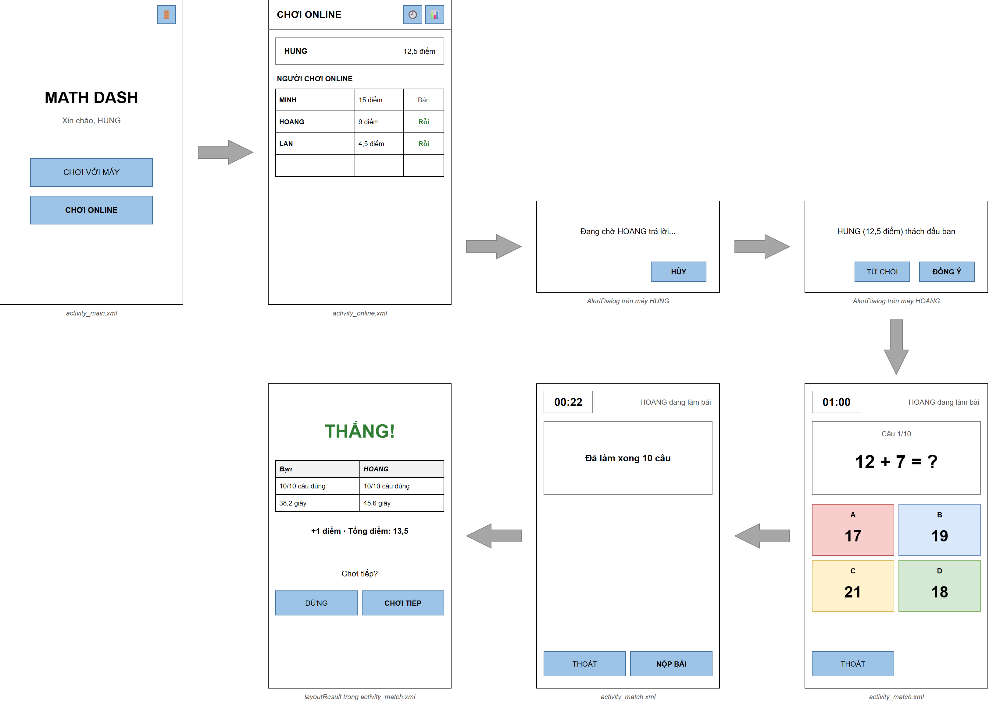

*Hình 4: Thiết kế giao diện chức năng Chơi online.*

Chức năng có 3 màn, 2 hộp thoại và 1 overlay, đi theo thứ tự MainActivity → OnlineActivity → hộp thoại chờ trả lời trên máy người mời → hộp thoại lời mời trên máy người được mời → MatchActivity → overlay layoutResult.
- **Màn chính** chỉ để chọn chế độ chơi: chữ MATH DASH, lời chào "Xin chào, HUNG", 2 nút lớn Chơi với máy và Chơi online. Góc phải thanh trên là nút biểu tượng đăng xuất.
- **Màn Chơi online** chia 3 phần từ trên xuống:
  1. Thanh trên: tiêu đề CHƠI ONLINE căn trái; góc phải có 2 nút biểu tượng Lịch sử đấu, Bảng xếp hạng.
  2. Thẻ thông tin của mình: tên, tổng điểm.
  3. Danh sách người chơi online. Mỗi dòng có tên, tổng điểm và nhãn trạng thái: Rỗi chữ xanh, Bận chữ xám. Dòng Bận vẫn bấm được nhưng chỉ hiện thông báo. Không có ai khác online thì hiện "Chưa có ai khác online".
- **Màn thi đấu** hiện mỗi lần một câu, chia 4 tầng từ trên xuống:
  1. Hàng trên: ô thời gian đếm ngược bên trái, dòng trạng thái đối thủ bên phải.
  2. Thẻ câu hỏi: dòng "Câu 3/10" và phép tính chữ lớn "12 + 7 = ?".
  3. 4 ô phương án lớn xếp 2 x 2, mỗi ô một màu: A đỏ, B xanh dương, C vàng, D xanh lá. Trong ô, chữ cái nhỏ ở trên, giá trị phương án lớn ở dưới. Bấm một ô là chọn và sang câu sau: ô vừa chọn giữ nguyên, 3 ô còn lại mờ đi trong 0,2 giây. App không biết đáp án nên không báo đúng / sai ngay.
  4. Hàng dưới: nút Thoát; nút Nộp bài chỉ hiện khi đã làm xong 10 câu.
- Làm xong 10 câu, hết giờ, đang nộp hay đã nộp thì 4 ô và phép tính ẩn đi, thẻ câu hỏi chỉ còn một dòng thông báo: "Đã làm xong 10 câu", "Hết giờ", "Đang nộp bài...", "Đã nộp bài, đang chờ đối thủ...".
- **Overlay kết quả** che màn thi đấu. Bảng so sánh 2 cột (Bạn, đối thủ) giúp người chơi thấy vì sao thắng: đúng hết hay nhanh hơn.

Thanh trên của các màn Chơi online, Lịch sử đấu, Chi tiết trận cùng một kiểu: tiêu đề chữ lớn căn trái, các nút biểu tượng đặt ở góc phải.

**Bảng thành phần:**

| Màn | id trong layout | Loại View | Chức năng | Tên ở pha phân tích |
|---|---|---|---|---|
| MainActivity | txtMyName | TextView | "Xin chào, HUNG" | |
| | btnPlayOnline | Button | Mở màn Chơi online | subPlayOnline |
| OnlineActivity | txtMyName | TextView | Tên hiển thị của mình | outMyInfo |
| | txtMyPoints | TextView | "12,5 điểm" | outMyInfo |
| | rvPlayers | RecyclerView | Danh sách người chơi online, bấm một dòng để thách đấu | outsubListPlayer |
| | txtEmpty | TextView | "Chưa có ai khác online"; chỉ hiện khi danh sách rỗng | outsubListPlayer |
| item_player.xml | txtName | TextView | Tên người chơi | một dòng của outsubListPlayer |
| | txtPoints | TextView | Tổng điểm | một dòng của outsubListPlayer |
| | txtStatus | TextView | Rỗi (xanh) / Bận (xám) | một dòng của outsubListPlayer |
| MatchActivity | txtTimer | TextView | Ô thời gian 01:00 → 00:00 | outTimer |
| | txtOpponentStatus | TextView | "HOANG đang làm bài" / "HOANG đã nộp bài" | outOpponentStatus |
| | txtProgress | TextView | "Câu 3/10"; làm xong, hết giờ, đang nộp, đã nộp thì hiện thông báo tương ứng | outQuestion |
| | txtExpression | TextView | Phép tính chữ lớn "12 + 7 = ?" | outQuestion |
| | layoutOptions | LinearLayout | Khung xếp 4 ô 2 x 2, ẩn khi thẻ câu hỏi hiện thông báo | subOptions |
| | btnOptionA, btnOptionB, btnOptionC, btnOptionD | Button | 4 ô phương án "A 17", "B 19", "C 21", "D 18"; trong code gom thành mảng btnOptions : Button[4] | subOptions |
| | btnSubmit | Button | Nộp bài; ẩn lúc đầu, hiện khi đã làm xong 10 câu hoặc khi nộp lỗi để nộp lại | subSubmit |
| | btnExit | Button | Thoát trận | subExit |
| Overlay layoutResult | txtResult | TextView | WIN! (xanh) / LOSE! (đỏ) / TIE! (vàng) | outResult |
| | txtMyResult | TextView | "Bạn: 10/10 câu đúng · 38,2 giây" | outMyResult |
| | txtOpponentResult | TextView | "HOANG: 10/10 câu đúng · 45,6 giây" | outOpponentResult |
| | txtPoints | TextView | "+1 điểm · Tổng điểm: 13,5" | outPoints |
| | btnContinue | Button | Chơi tiếp | subContinue |
| | btnStop | Button | Dừng; khi có người bỏ trận thì đổi thành Về menu | subStop |

Các thông báo ngắn ("MINH đang bận", "HOANG đã từ chối lời mời", "Đối thủ đã dừng chơi") dùng Toast. Hộp thoại lời mời, hộp thoại chờ trả lời và hộp thoại "Thoát sẽ bị xử thua?" dùng AlertDialog. Cả hai đều không phải thành phần của layout.

#### 4.1.2. Biểu đồ lớp chi tiết

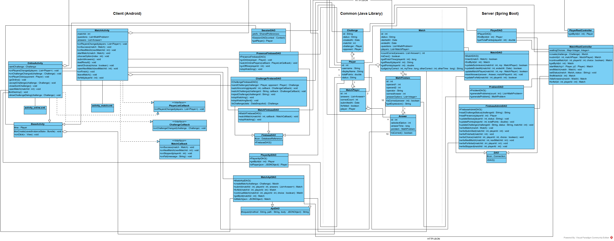

*Hình 5: Biểu đồ lớp chi tiết chức năng Chơi online.*

Biểu đồ chia 3 package: Client (Android) bên trái, Common (Java Library) ở giữa, Server (Spring Boot) bên phải. Package Common là thư viện mathdash-common.jar chứa các lớp thực thể; DAO của app và DAO của server cùng dùng một bộ thực thể này. Biểu đồ chỉ có các lớp tham gia vào logic của chức năng; màn chỉ dùng để mở sang màn khác không được vẽ. Lớp giao diện chỉ ghi các phương thức xử lý nghiệp vụ, các hàm chỉ để vẽ giao diện nằm trong mã nguồn. DAO cha ghi đối tượng kết nối dùng chung (con); mỗi DAO ghi hàm khởi tạo và mọi phương thức mà chức năng này gọi; DAO không ghi biến môi trường như địa chỉ server. Phần chung của các Activity nằm ở lớp cha BaseActivity; danh sách trên mỗi màn do chính Activity đổ dữ liệu. Các View con, biến tạm, cờ trạng thái và hàm override của Android như onDestroy, onBackPressed nằm trong mã nguồn.

**Package "Client (Android)".**

| Loại | Lớp | Mô tả |
|---|---|---|
| Boundary | BaseActivity | BaseActivity là lớp cha trừu tượng của mọi Activity trong chức năng. Lớp này giữ người chơi đang đăng nhập (me), lấy bằng SessionDAO.getPlayer trong onCreate, và cài đặt View.OnClickListener với onClick; Activity con chỉ viết phần riêng của màn mình. Danh sách trên màn hình (RecyclerView) do chính Activity đổ dữ liệu, bằng một lớp Adapter nội bộ nằm trong file Activity đó |
| Boundary | OnlineActivity | Màn Chơi online, cài đặt View.OnClickListener, PlayerListCallback và ChallengeCallback. Giữ người chơi đang đăng nhập (me), lời mời mình đã gửi và đang chờ trả lời (sentChallenge), id các lời mời tới mình đã hiện hộp thoại (shownChallenges), hộp thoại chờ (waitingDialog). - onCreate gọi bindViews, lấy me bằng SessionDAO.getPlayer, gọi watchOnlinePlayers và watchIncoming truyền chính nó (this) làm callback, rồi gọi goOnline. - goOnline gọi PlayerApiDAO.getById trong Thread để có tổng điểm mới, xong thì gọi PresenceFirebaseDAO.goOnline. - onPlayersChanged hiện thông tin của mình, đưa những người còn lại vào rvPlayers, danh sách rỗng thì hiện txtEmpty. - onPlayerClick: đối thủ bận thì hiện Toast; đã có sentChallenge thì bỏ qua; ngược lại sendChallenge, watchChallenge rồi showWaitingDialog hiện hộp thoại chờ có nút Hủy. - onChallengeChanged: lời mời tới mình chưa có trong shownChallenges thì showChallengeDialog; lời mình gửi được đồng ý thì closeSentChallenge rồi openMatch(challenge.getMatchId()); bị từ chối thì closeSentChallenge và hiện Toast. - closeSentChallenge gọi ChallengeFirebaseDAO.stopWatchingSent, xóa sentChallenge và đóng hộp thoại chờ. - acceptChallenge gọi MatchApiDAO.createMatch trong Thread, xong thì openMatch. Nút Từ chối gọi ChallengeFirebaseDAO.rejectChallenge. - onClick của btnHistory, btnRanking mở HistoryActivity, mô tả ở chức năng Xem lịch sử đấu. - onDestroy gọi stopWatching của PresenceFirebaseDAO và ChallengeFirebaseDAO rồi PresenceFirebaseDAO.goOffline: rời màn này là offline |
| Boundary | MatchActivity | Màn thi đấu, cài đặt View.OnClickListener, MatchCallback và PlayerListCallback. Giữ me, mã trận (matchId, nhận qua Intent với khóa EXTRA_MATCH_ID), id đối thủ (opponentId), đồng hồ (timer, MATCH_MILLIS = 60 giây), đề (questions : List\<MathProblem>), bài làm (answers : List\<Answer>), chỉ số câu đang hiện (current) và thời điểm câu đó hiện ra (shownAt). 4 ô phương án gom thành mảng btnOptions : Button[4]; LETTERS giữ 4 chữ A, B, C, D. 7 cờ started, submitted, resultLoading, resultShown, opponentStopped, opponentForfeited, leaving chặn gọi lặp, vì onSuccess được gọi lại mỗi lần node trận thay đổi. - onCreate gọi MatchFirebaseDAO.watchMatch, truyền chính nó làm MatchCallback. - Lần đầu nhận trận có đề, onSuccess gọi startMatch: lưu opponentId bằng opponentOf, lấy đề vào questions, tạo 10 Answer rỗng, gọi showQuestion, createTimer rồi start, gọi PresenceFirebaseDAO.watchOnlinePlayers với chính nó làm PlayerListCallback. - showQuestion hiện câu thứ current: số thứ tự "Câu 3/10", phép tính và chữ của 4 ô (optionText ghép chữ cái nhỏ với giá trị lớn), bật lại 4 ô và ghi shownAt = SystemClock.elapsedRealtime(). Khi current đã qua câu cuối thì showMessage "Đã làm xong 10 câu" và hiện btnSubmit. - onClick của một ô gọi chooseOption(index): ghi giá trị phương án vào selectedOption và thời gian từ shownAt vào answerTime của answers[current], khóa 4 ô, làm mờ 3 ô không chọn, tăng current rồi sau NEXT_DELAY = 200 ms gọi lại showQuestion. Khóa 4 ô trong lúc chờ để bấm đúp không trả lời nhầm câu sau. - showMessage ẩn 4 ô và phép tính, ghi thông báo vào txtProgress. - onTick vẽ thời gian; onFinish showMessage "Hết giờ" rồi gọi submitAnswers; câu chưa làm giữ selectedOption = −1. - submitAnswers (nút Nộp bài hoặc hết giờ) showMessage "Đang nộp bài...", gọi MatchApiDAO.submit(matchId, me.getId(), answers) trong Thread. Thành công thì onSubmitted hủy đồng hồ, ẩn btnSubmit, showMessage "Đã nộp bài, đang chờ đối thủ..."; lỗi thì onSubmitFailed hiện lại btnSubmit để nộp lại. - Mỗi lần onSuccess gọi showOpponentStatus; trận đã xong thì loadResult gọi MatchApiDAO.getById rồi showResult. - showResult dùng Match.getResult cho showResultTitle; showScores dùng getFinishTime, getPoints trên bản trận server trả về. mineOf, opponentOf tìm MatchPlayer của mình và của đối thủ. - Nút Chơi tiếp / Dừng gọi sendChoice (MatchApiDAO.continueMatch). onNextMatch gọi openNextMatch: stopWatching trận cũ rồi mở trận mới. onStopped hiện Toast và đóng màn thi đấu, quay về màn Chơi online. - Nút Thoát và onBackPressed gọi confirmLeave hỏi xác nhận rồi gọi leaveMatch (MatchApiDAO.forfeit). - onPlayersChanged: khi trận đang đấu mà đối thủ biến khỏi danh sách online (mất kết nối), gọi forfeit(opponentId) thay cho đối thủ. - onDestroy hủy đồng hồ, gọi stopWatching của MatchFirebaseDAO và PresenceFirebaseDAO. Activity không tự chấm bài, không tự phân thắng thua |
| Control | SessionDAO | Giữ prefs : SharedPreferences "session". getPlayer() đọc playerId, username, displayName, role và đóng gói thành Player |
| Control | FirebaseDAO ← PresenceFirebaseDAO | FirebaseDAO giữ con (gốc Realtime Database). PresenceFirebaseDAO đọc / ghi node presence: - goOnline ghi tên, tổng điểm, trạng thái free và đăng ký onDisconnect().removeValue(). goOffline xóa node của mình. - watchOnlinePlayers thêm ValueEventListener; mỗi lần node presence đổi, onDataChange đóng gói từng node con thành Player kèm tổng điểm, trạng thái rồi gọi onPlayersChanged. stopWatching gỡ listener đang giữ trong watcher |
| Control | FirebaseDAO ← ChallengeFirebaseDAO | Đọc / ghi node challenges: - sendChallenge tạo node bằng push(). - watchIncoming lọc lời mời có opponentId là mình và status pending; giữ incomingQuery, incomingWatcher. - watchChallenge theo dõi một lời mời đã gửi; giữ sentRef, sentWatcher. - stopWatchingSent chỉ gỡ theo dõi lời mời đã gửi; stopWatching gỡ cả 2. - rejectChallenge ghi status rejected. - toChallenge đóng gói một node thành Challenge kèm 2 Player người mời và người được mời; watchIncoming và watchChallenge cùng dùng |
| Control | FirebaseDAO ← MatchFirebaseDAO | Chỉ đọc node matches/{matchId}; giữ matchRef và watcher để stopWatching gỡ đúng listener. Mỗi lần node đổi, onDataChange xét theo thứ tự: có nextMatchId thì gọi onNextMatch; có stoppedBy thì gọi onStopped; còn lại đóng gói thành Match kèm 10 MathProblem không có đáp án và 2 MatchPlayer rồi gọi onSuccess. Mất kết nối thì gọi onFail |
| — | PlayerListCallback, ChallengeCallback, MatchCallback | Interface trả kết quả bất đồng bộ từ các FirebaseDAO về Activity. FirebaseDAO chỉ phụ thuộc vào interface, không biết Activity cụ thể; Activity truyền chính nó (this) khi gọi hàm watch... Nhờ vậy PresenceFirebaseDAO dùng chung cho OnlineActivity và MatchActivity |
| Control | ApiDAO ← PlayerApiDAO | getById gửi GET /api/players/{id}; toPlayer đóng gói JSON thành Player. Hàm chạy đồng bộ nên phải gọi trong Thread |
| Control | ApiDAO ← MatchApiDAO | ApiDAO có một hàm request mở HttpURLConnection, gửi thân JSON nếu có, đọc phản hồi và ném IOException kèm câu thông báo của server khi mã ≥ 400. MatchApiDAO có 5 hàm, mỗi hàm một API: - createMatch: POST /api/matches. - submit(matchId, playerId, answers): POST /api/matches/{id}/submit, thân gồm id người chơi và 10 bài làm, mỗi bài làm có selectedOption, answerTime. - forfeit: POST /api/matches/{id}/forfeit. - continueMatch: POST /api/matches/{id}/continue. - getById: GET /api/matches/{id}. toMatch đóng gói JSON trả về thành Match kèm 10 câu hỏi, 2 người chơi và bài làm của từng người, gắn câu thứ i của đề vào bài làm thứ i |

**Package "Common (Java Library)".**

| Loại | Lớp | Mô tả |
|---|---|---|
| Entity | Player, Challenge, Match, MatchPlayer, Answer, MathProblem | Như thiết kế lớp thực thể. Answer là bài làm một câu: phương án đã chọn (selectedOption, NONE = −1 khi bỏ trống), thời gian làm câu (answerTime, mili giây) và câu hỏi tương ứng (problem). Các phương thức nghiệp vụ là hàm Java thuần, có unit test: - MathProblem: isCorrect, getExpression. - Answer: isAnswered, isCorrect. - Match: countCorrect, isOver, getFinishTime, getResult, getPoints. App và server cùng nhập thư viện này, nên Jackson ở server chuyển JSON thẳng vào cùng các lớp. Player có thêm passwordHash, chỉ server gán giá trị và gắn @JsonIgnore nên không bao giờ trả ra JSON. correctAnswer và bài làm chỉ trả ra JSON khi trận đã xong. Answer gửi qua JSON chỉ có id, selectedOption, answerTime; problem, isAnswered, isCorrect gắn @JsonIgnore vì câu thứ i của bài làm ứng với câu thứ i của đề |

**Package "Server (Spring Boot)".**

| Loại | Lớp | Mô tả |
|---|---|---|
| Boundary | PlayerRestController | getById(id) nhận GET /api/players/{id}: PlayerDAO.findById rồi gán tổng điểm bằng PlayerDAO.getTotalPoints |
| Boundary | MatchRestController | Trọng tài của mọi trận. Giữ waitingChoices: các trận đang có một người chọn chơi tiếp. - create(challenge) nhận POST /api/matches:   1. readChallengeStatus: lời mời đã bị hủy thì trả 409. readPresence của 2 người; một người không online hoặc đang bận thì trả 409 "Không bắt đầu được trận đấu".   2. startMatch: ProblemDAO.generateProblems(10), tạo Match, MatchDAO.insert, FirebaseAdminDAO.writeMatch, updateStatus busy cho 2 người.   3. updateChallenge accepted kèm id trận, rồi hideAnswers xóa đáp án trước khi trả về. - submit(id, matchPlayer):   1. Ghi thời điểm nhận, findMatch, findPlayer. Trận chưa xong và người chơi chưa nộp thì lưu bài làm vào MatchPlayer bằng setAnswers, chấm bằng Match.countCorrect, ghi submittedAt.   2. updateSubmission lưu kết quả và 10 bài làm; lỗi thì trả 500 "Không lưu được bài làm". Rồi writeSubmitted.   3. Nếu Match.isOver: endMatch (updateEndedAt, tính lại tổng điểm 2 người, updatePoints), rồi writeFinished. - forfeit(id, playerId): updateForfeit, endMatch, rồi mới writeStopped, writeFinished để máy đối thủ đọc được kết quả đã lưu; trả 2 người về free. - continueMatch(id, playerId, choice), synchronized:   - Dừng: writeStopped, 2 người về free.   - Chơi tiếp mà đối thủ chưa chọn: lưu vào waitingChoices, writeChoice.   - Đối thủ đã chọn chơi tiếp: startMatch rồi writeNextMatch. - getById(id): findById, gán tổng điểm cho 2 người chơi. Các hàm riêng: findMatch gọi MatchDAO.findById, không có thì trả 404; findPlayer tìm MatchPlayer theo id, không có thì trả 403; setStatus gọi updateStatus cho 2 người; isFree kiểm tra người chơi online và rỗi; hideAnswers khi trận chưa kết thúc thì đặt correctAnswer = −1 cho mọi câu và xóa bài làm của cả 2 người, để không ai xem được bài làm của đối thủ giữa trận |
| Control | DAO ← PlayerDAO | DAO giữ con : Connection (JDBC), mở một lần trong hàm khởi tạo DAO() bằng cấu hình loadConfig; PlayerDAO(), MatchDAO() gọi lại hàm khởi tạo này. - findById đọc tblPlayer qua findOne; toPlayer đóng gói một dòng. - getTotalPoints lấy các trận đã xong bằng MatchDAO.findFinished, lọc trận có người chơi bằng hasPlayer rồi cộng Match.getPoints |
| Control | DAO ← MatchDAO | - insert ghi 1 dòng tblMatch, 10 dòng tblMathProblem, 2 dòng tblMatchPlayer trong một transaction bằng insertMatch, insertProblem, insertMatchPlayer, gán id vừa sinh. - findById, findFinished dùng chung một câu SELECT qua query; toMatch, toMatchPlayer đóng gói dòng kết quả, findProblems và toProblem đọc đề. - findById đọc trận kèm đề, 2 người chơi và bài làm của từng người: findAnswers đọc tblAnswer theo tblMathProblemId tăng dần, toAnswer đóng gói một dòng và gắn câu hỏi có cùng id. - updateSubmission chạy một transaction: updateMatchPlayer ghi correctCount, submittedAt (chỉ khi chưa nộp), rồi insertAnswer ghi từng câu vào tblAnswer; lỗi thì rollback và trả false. - updateForfeit ghi forfeited. - updateEndedAt ghi endedAt |
| Control | ProblemDAO | Giữ random : Random và 3 hằng OPERATORS, OPTION_COUNT = 4, MAX_OFFSET = 10. generateProblems gọi generateProblem 10 lần. Mỗi câu chọn toán tử +, −, ×, sinh 2 toán hạng bằng nextInt, tính correctAnswer; createOptions sinh 3 phương án nhiễu lệch không quá MAX_OFFSET rồi xáo trộn |
| Control | FirebaseAdminDAO | Giữ dbUrl, khóa truy cập secret, client : HttpClient và mapper : ObjectMapper; gọi REST API của Firebase: - readPresence, readChallengeStatus gửi GET. - Các hàm write..., update... gửi PUT hoặc PATCH tới đúng node trong tài liệu CSDL mục 2. updateStatus, updatePoints đi qua updatePresence. - toQuestions, toPlayers chuyển đề (bỏ đáp án) và 2 người chơi thành dữ liệu node. - send gửi yêu cầu và trả nội dung phản hồi |

**Quan hệ giữa các lớp giao diện:**
- OnlineActivity – MatchActivity nối nhau bằng quan hệ liên kết theo luồng màn hình. Màn chính MainActivity chỉ mở OnlineActivity nên không vẽ.
- Mỗi Activity nối với layout của nó: activity_online.xml, activity_match.xml. Overlay kết quả nằm trong activity_match.xml.
- Kết tập:
  - OnlineActivity và MatchActivity chứa thông tin người chơi trong thuộc tính me của lớp cha BaseActivity, nên Player kết tập vào BaseActivity.
  - OnlineActivity chứa danh sách Player đang online, hiện trên rvPlayers.
  - MatchActivity chứa đề (10 MathProblem) và bài làm (10 Answer) trong questions, answers.
- Thực thể: Match gồm 2 MatchPlayer và 10 MathProblem (kết tập); MatchPlayer gồm các Answer (kết tập, 10 khi đã nộp); Answer chứa thông tin MathProblem (kết tập, mỗi câu có 2 bài làm của 2 người).

DAO của app và DAO của server nối liên kết với thực thể trong package Common.

**Quan hệ liên kết HTTP/JSON** giữa package Client và package Server có 2 cặp:
- MatchApiDAO – MatchRestController: trận đấu.
- PlayerApiDAO – PlayerRestController: tổng điểm.

Firebase không phải một lớp trên biểu đồ: các FirebaseDAO ở app và FirebaseAdminDAO ở server cùng đọc / ghi một cây dữ liệu, như mô tả trong tài liệu CSDL mục 2.

Biểu đồ của module gồm mọi lớp của cả 2 use case con nên khá dày. Mỗi biểu đồ dưới đây chỉ có các lớp và phương thức mà một use case dùng.

##### 4.1.2.1. Use case Thách đấu

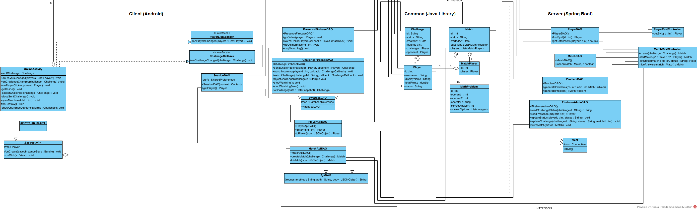

*Hình 6: Biểu đồ lớp chi tiết use case Thách đấu.*

Biểu đồ xoay quanh OnlineActivity: danh sách người chơi online và lời mời. Màn chính và màn thi đấu chỉ là điểm vào, điểm ra của use case nên không vẽ. Phía app, PresenceFirebaseDAO đưa người chơi vào danh sách online sau khi PlayerApiDAO lấy tổng điểm mới nhất; ChallengeFirebaseDAO gửi và theo dõi lời mời; MatchApiDAO.createMatch gọi server tạo trận. Phía server, MatchRestController.create kiểm tra lời mời và trạng thái 2 người qua FirebaseAdminDAO, sinh đề bằng ProblemDAO, lưu trận bằng MatchDAO.insert rồi ghi trận lên Firebase. Thực thể dùng ở đây là Player, Challenge, Match, MatchPlayer và MathProblem.

##### 4.1.2.2. Use case Thi đấu

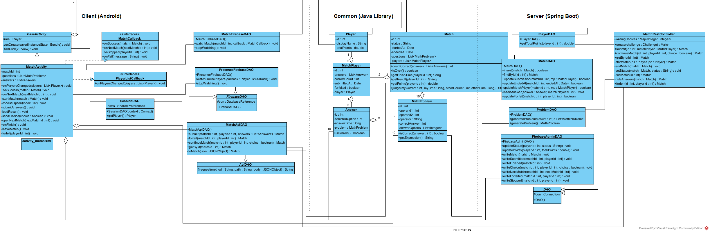

*Hình 7: Biểu đồ lớp chi tiết use case Thi đấu.*

Biểu đồ xoay quanh MatchActivity. MatchFirebaseDAO theo dõi node trận và gọi lại MatchActivity qua MatchCallback; PresenceFirebaseDAO cho biết đối thủ còn online hay không. MatchApiDAO gửi bài làm bằng submit, gửi lựa chọn chơi tiếp bằng continueMatch và lấy kết quả bằng getById. Phía server, MatchRestController chấm bài bằng Match.countCorrect, lưu bài làm bằng MatchDAO.updateSubmission, kết thúc trận bằng endMatch và cập nhật tổng điểm qua PlayerDAO.getTotalPoints, FirebaseAdminDAO.updatePoints. Khi cả 2 chọn chơi tiếp, ProblemDAO sinh đề mới và MatchDAO.insert lưu trận mới. Thực thể dùng ở đây là Player, Match, MatchPlayer, Answer và MathProblem.

#### 4.1.3. Biểu đồ tuần tự chi tiết

**Đoạn A: Gửi lời thách đấu**

1. Người chơi nhấn nút Chơi online trên MainActivity.
2. Hàm onClick() của MainActivity gọi hàm startActivity() mở OnlineActivity.
3. Hàm onCreate() của OnlineActivity gọi hàm getPlayer() của SessionDAO.
4. Hàm getPlayer() gọi lớp Player để đóng gói người chơi đang đăng nhập.
5. Lớp Player gọi hàm khởi tạo Player() của chính nó để tạo đối tượng.
6. Lớp Player trả đối tượng Player cho SessionDAO.
7. SessionDAO trả đối tượng Player cho hàm onCreate().
8. Hàm onCreate() gọi hàm watchOnlinePlayers() của PresenceFirebaseDAO để đăng ký theo dõi danh sách online, truyền chính OnlineActivity làm PlayerListCallback.
9. Hàm onCreate() gọi hàm watchIncoming() của ChallengeFirebaseDAO để đăng ký theo dõi lời mời gửi tới người chơi, truyền chính OnlineActivity làm ChallengeCallback.
10. Hàm onCreate() gọi hàm goOnline() của chính nó.
11. Trong một Thread, hàm goOnline() gọi hàm getById() của PlayerApiDAO để lấy tổng điểm mới nhất.
12. Hàm getById() của PlayerApiDAO gửi yêu cầu GET /api/players/{id} tới hàm getById() của PlayerRestController.
13. Hàm getById() của PlayerRestController gọi hàm findById() của PlayerDAO.
14. Hàm findById() đọc tblPlayer rồi gọi lớp Player để đóng gói.
15. Lớp Player gọi hàm khởi tạo Player() của chính nó để tạo đối tượng.
16. Lớp Player trả đối tượng Player cho PlayerDAO.
17. PlayerDAO trả đối tượng Player cho PlayerRestController.
18. Hàm getById() gọi hàm getTotalPoints() của PlayerDAO để tính tổng điểm của người chơi.
19. PlayerDAO trả tổng điểm cho PlayerRestController.
20. PlayerRestController trả người chơi kèm tổng điểm dạng JSON cho PlayerApiDAO.
21. Hàm toPlayer() của PlayerApiDAO gọi lớp Player để đóng gói dữ liệu JSON.
22. Lớp Player gọi hàm khởi tạo Player() của chính nó để tạo đối tượng.
23. Lớp Player trả đối tượng Player cho PlayerApiDAO.
24. PlayerApiDAO trả đối tượng Player cho hàm goOnline().
25. Trong hàm runOnUiThread(), hàm goOnline() của OnlineActivity gọi hàm goOnline() của PresenceFirebaseDAO để ghi người chơi vào danh sách online với trạng thái rỗi.
26. Khi danh sách online thay đổi, Firebase gọi hàm onDataChange() của PresenceFirebaseDAO.
27. Hàm onDataChange() gọi lớp Player để đóng gói từng người chơi kèm tổng điểm và trạng thái.
28. Lớp Player gọi hàm khởi tạo Player() của chính nó để tạo đối tượng.
29. Lớp Player trả đối tượng Player cho hàm onDataChange().
30. PresenceFirebaseDAO gọi hàm onPlayersChanged() của PlayerListCallback đã đăng ký ở bước 8, chính là OnlineActivity, truyền danh sách người chơi online.
31. OnlineActivity hiển thị tổng điểm của người chơi và danh sách những người chơi online khác gồm tên, tổng điểm, trạng thái.
32. Người chơi bấm vào tên một đối thủ đang rỗi.
33. Hàm onClick() của dòng đó gọi hàm onPlayerClick() của OnlineActivity.
34. Hàm onPlayerClick() thấy đối thủ đang rỗi và người chơi chưa có lời mời nào đang chờ, gọi hàm sendChallenge() của ChallengeFirebaseDAO.
35. Hàm sendChallenge() ghi lời mời lên Firebase rồi gọi lớp Challenge để đóng gói lời mời.
36. Lớp Challenge gọi hàm khởi tạo Challenge() rồi các setter setChallenger(), setOpponent() của chính nó để đóng gói lời mời.
37. Lớp Challenge trả đối tượng Challenge cho ChallengeFirebaseDAO.
38. ChallengeFirebaseDAO trả đối tượng Challenge cho hàm onPlayerClick().
39. Hàm onPlayerClick() gọi hàm watchChallenge() của ChallengeFirebaseDAO để đăng ký theo dõi lời mời vừa gửi.
40. OnlineActivity hiển thị hộp thoại đang chờ đối thủ trả lời, có nút Hủy.
41. Khi đối thủ đồng ý, Firebase gọi hàm onDataChange() của ChallengeFirebaseDAO, hàm này gọi hàm toChallenge().
42. Hàm toChallenge() gọi lớp Challenge để đóng gói lời mời mới nhất, đã có mã trận.
43. Lớp Challenge gọi hàm khởi tạo Challenge() của chính nó để tạo đối tượng.
44. Lớp Challenge trả đối tượng Challenge cho hàm toChallenge().
45. ChallengeFirebaseDAO gọi hàm onChallengeChanged() của ChallengeCallback đã đăng ký, chính là OnlineActivity.
46. Hàm onChallengeChanged() thấy lời mời đã được đồng ý, gọi hàm closeSentChallenge() của chính nó.
47. Hàm closeSentChallenge() gọi hàm stopWatchingSent() của ChallengeFirebaseDAO để gỡ theo dõi lời mời, rồi đóng hộp thoại chờ.
48. Hàm onChallengeChanged() gọi hàm openMatch() mở MatchActivity với mã trận trong lời mời.
49. MatchActivity hiển thị màn thi đấu cho người chơi; trận diễn ra ở đoạn C.

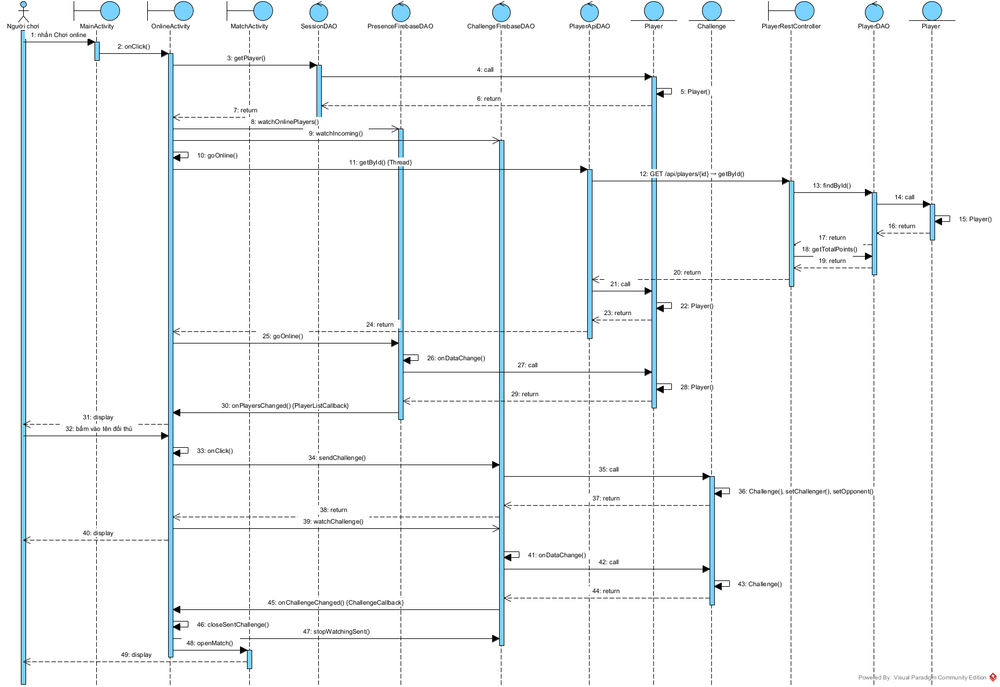

*Hình 8: Biểu đồ tuần tự chi tiết chức năng Chơi online, đoạn A: Gửi lời thách đấu.*

- Biểu đồ có 49 thông điệp.
- MainActivity chỉ là điểm vào: nút Chơi online mở OnlineActivity (bước 1–2). Mọi việc của chức năng này, từ danh sách online tới lời mời, nằm ở OnlineActivity.
- **Lời gọi REST** duy nhất là bước 12, để lấy tổng điểm mới nhất từ server. Server đi theo khuôn PlayerRestController → PlayerDAO → Player.
- **Bước 8, 9 và 39 không có thông điệp trả về** vì đó là lời đăng ký theo dõi (mẫu Observer), vẽ bằng mũi tên bất đồng bộ. Hàm watchOnlinePlayers(), watchIncoming(), watchChallenge() chỉ gắn listener lên Firebase rồi trả về void ngay, không chờ dữ liệu. Dữ liệu đến sau, mỗi khi node thay đổi: Firebase gọi onDataChange() của DAO, DAO gọi lại OnlineActivity qua callback (bước 26–30 cho danh sách online, bước 41–45 cho lời mời). Thông điệp callback đó đóng vai trò kết quả trả về và có thể đến nhiều lần cho một lần đăng ký.
- **Nhiều người thay đổi cùng lúc** không làm sai trạng thái:
  - Firebase gọi các listener lần lượt trên main thread, cùng luồng với sự kiện bấm nút, nên 2 callback không chạy song song trên OnlineActivity. Vì thế onPlayersChanged() cập nhật giao diện trực tiếp mà không cần runOnUiThread().
  - Mỗi lần onDataChange() nhận ảnh chụp toàn bộ node tại thời điểm đó, không phải phần thay đổi. Nhiều người vào, ra cùng lúc thì lần gọi sau thay danh sách bằng trạng thái mới nhất.
  - Xung đột nghiệp vụ do server quyết định: hàm create() của MatchRestController là synchronized, đọc lại trạng thái lời mời và trạng thái 2 người trên Firebase. Lời mời đã hủy, hay một người đã bận vì nhận lời mời khác, thì server từ chối và trả lỗi 409. Ở app, onPlayerClick() bỏ qua đối thủ đang bận và chỉ cho 1 lời mời chờ trả lời.
- **Activity chỉ nhận đối tượng:** các DAO trả về Player, Challenge đã đóng gói; cách hiển thị các đối tượng đó nằm trong mã nguồn của OnlineActivity, biểu đồ chỉ vẽ bước hiển thị cho người chơi (bước 31, 40, 49).
- Bước 46–47 gỡ theo dõi lời mời đã gửi trước khi mở trận, để lần ghi sau của server lên lời mời không gọi lại onChallengeChanged().

**Đoạn B: Nhận lời thách đấu**

1. Khi có lời mời mới gửi tới người chơi, Firebase gọi hàm onDataChange() của ChallengeFirebaseDAO, hàm này gọi hàm toChallenge().
2. Hàm toChallenge() gọi lớp Challenge để đóng gói lời mời.
3. Lớp Challenge gọi hàm khởi tạo Challenge() của chính nó để tạo đối tượng.
4. Lớp Challenge trả đối tượng Challenge cho hàm toChallenge().
5. ChallengeFirebaseDAO gọi hàm onChallengeChanged() của ChallengeCallback đã đăng ký ở đoạn A, chính là OnlineActivity.
6. Hàm onChallengeChanged() thấy lời mời mới, gọi hàm showChallengeDialog() của chính nó.
7. OnlineActivity hiển thị hộp thoại lời mời gồm tên, tổng điểm người mời và 2 nút Từ chối, Đồng ý.
8. Người chơi nhấn Đồng ý.
9. Hàm onClick() của nút Đồng ý gọi hàm acceptChallenge() của OnlineActivity.
10. Trong một Thread, hàm acceptChallenge() gọi hàm createMatch() của MatchApiDAO với lời mời.
11. Hàm createMatch() gửi yêu cầu POST /api/matches tới hàm create() của MatchRestController.
12. Hàm create() gọi hàm readPresence() của FirebaseAdminDAO để đọc trạng thái 2 người chơi.
13. Hàm readPresence() gọi lớp Player để đóng gói người chơi kèm trạng thái.
14. Lớp Player gọi hàm khởi tạo Player() của chính nó để tạo đối tượng.
15. Lớp Player trả đối tượng Player cho FirebaseAdminDAO.
16. FirebaseAdminDAO trả người chơi cho hàm create().
17. Hàm create() gọi hàm readChallengeStatus() của FirebaseAdminDAO để đọc trạng thái lời mời.
18. FirebaseAdminDAO trả trạng thái lời mời cho hàm create().
19. Thấy lời mời còn chờ và cả 2 người đều rỗi, hàm create() gọi hàm startMatch() của chính nó.
20. Hàm startMatch() gọi lớp Match để đóng gói trận mới gồm 2 người chơi.
21. Lớp Match gọi hàm khởi tạo Match() của chính nó để tạo đối tượng.
22. Lớp Match trả đối tượng Match cho hàm startMatch().
23. Hàm startMatch() gọi hàm generateProblems() của ProblemDAO để sinh 10 câu hỏi.
24. Hàm generateProblems() gọi lớp MathProblem để đóng gói từng câu hỏi kèm 4 phương án.
25. Lớp MathProblem gọi hàm khởi tạo MathProblem() của chính nó để tạo đối tượng.
26. Lớp MathProblem trả đối tượng MathProblem cho ProblemDAO.
27. ProblemDAO trả 10 câu hỏi cho hàm startMatch().
28. Hàm startMatch() gọi hàm insert() của MatchDAO để lưu trận, đề và 2 người chơi trong một transaction.
29. MatchDAO trả kết quả lưu thành công cho hàm startMatch().
30. Hàm startMatch() gọi hàm writeMatch() của FirebaseAdminDAO để ghi trận lên Firebase, đề không kèm đáp án.
31. Hàm startMatch() gọi hàm updateStatus() của FirebaseAdminDAO để đặt 2 người chơi sang trạng thái đang đấu.
32. Hàm create() gọi hàm updateChallenge() của FirebaseAdminDAO để ghi lời mời là accepted kèm mã trận; máy người mời nhận được ở đoạn A.
33. MatchRestController trả trận không kèm đáp án dạng JSON cho MatchApiDAO.
34. Hàm toMatch() của MatchApiDAO gọi lớp Match để đóng gói dữ liệu JSON.
35. Lớp Match gọi hàm khởi tạo Match() của chính nó để tạo đối tượng.
36. Lớp Match trả đối tượng Match cho MatchApiDAO.
37. MatchApiDAO trả đối tượng Match cho hàm acceptChallenge().
38. Trong hàm runOnUiThread(), hàm acceptChallenge() gọi hàm openMatch() mở MatchActivity với mã trận.
39. MatchActivity hiển thị màn thi đấu cho người chơi; trận diễn ra ở đoạn C.

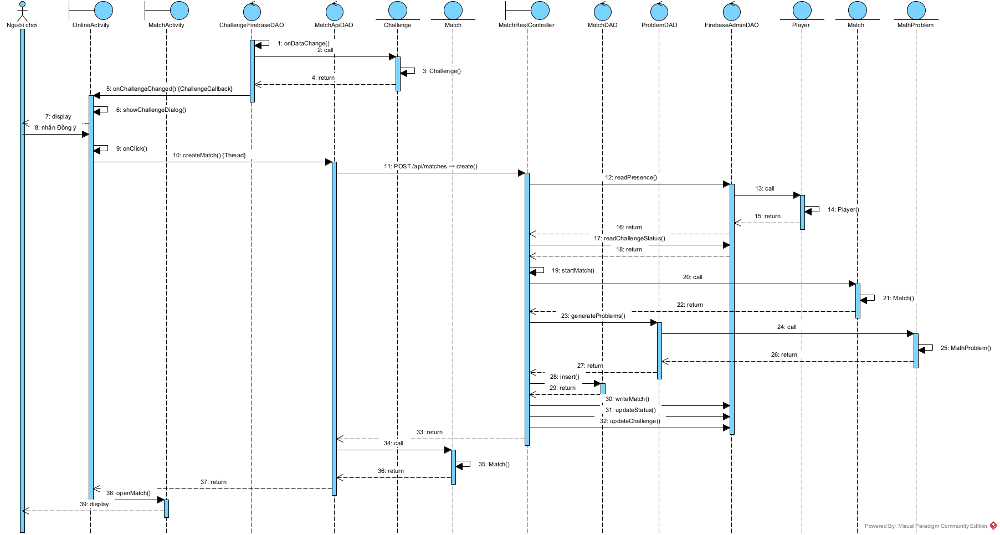

*Hình 9: Biểu đồ tuần tự chi tiết chức năng Chơi online, đoạn B: Nhận lời thách đấu.*

- Biểu đồ có 39 thông điệp.
- **Server sinh đề** (bước 23–27) và lưu đề vào MySQL cùng trận (bước 28–29), vì server cần đáp án để chấm bài sau này.
- **Đề không kèm đáp án:** đề ghi lên Firebase (bước 30) và bản trận trả về cho app (bước 33) đều không có đáp án. Người chơi không đọc được đáp án trước khi nộp bài.
- **Server kiểm tra lại** lời mời và trạng thái 2 người (bước 12–18) trước khi tạo trận, vì người mời có thể đã hủy hoặc một người đã vào trận khác.
- Bước 1 là callback của lời đăng ký watchIncoming() ở đoạn A, nên không có lời gọi nào đi trước.

**Đoạn C: Thi đấu**

1. Hàm onCreate() của MatchActivity (A) gọi hàm watchMatch() của MatchFirebaseDAO (A) để đăng ký theo dõi trận, truyền chính MatchActivity (A) làm MatchCallback.
2. Khi node trận có dữ liệu, Firebase gọi hàm onDataChange() của MatchFirebaseDAO (A).
3. Hàm onDataChange() gọi lớp Match để đóng gói trận kèm 10 câu hỏi và 2 người chơi.
4. Lớp Match gọi hàm khởi tạo Match() của chính nó để tạo đối tượng.
5. Lớp Match trả đối tượng Match cho MatchFirebaseDAO (A).
6. MatchFirebaseDAO (A) gọi hàm onSuccess() của MatchActivity (A), truyền đối tượng Match.
7. Lần đầu nhận trận, hàm onSuccess() gọi hàm startMatch() của MatchActivity (A) để lấy đề, tạo 10 bài làm rỗng và bắt đầu đếm ngược 60 giây.
8. MatchActivity (A) hiển thị câu thứ nhất với 4 ô A, B, C, D, đồng hồ đếm ngược và nút Thoát cho người chơi A.
9. Cùng lúc, hàm onCreate() của MatchActivity (B) gọi hàm watchMatch() của MatchFirebaseDAO (B).
10. Firebase gọi hàm onDataChange() của MatchFirebaseDAO (B).
11. Hàm onDataChange() gọi lớp Match để đóng gói trận.
12. Lớp Match gọi hàm khởi tạo Match() của chính nó để tạo đối tượng.
13. Lớp Match trả đối tượng Match cho MatchFirebaseDAO (B).
14. MatchFirebaseDAO (B) gọi hàm onSuccess() của MatchActivity (B).
15. Hàm onSuccess() gọi hàm startMatch() của MatchActivity (B).
16. MatchActivity (B) hiển thị câu thứ nhất cho người chơi B; 2 người làm cùng một đề.
17. Người chơi A bấm một ô phương án.
18. Hàm onClick() của MatchActivity (A) ghi phương án đã chọn và thời gian làm câu vào bài làm của câu đó.
19. MatchActivity (A) hiển thị câu tiếp theo; sau câu thứ 10 thì hiển thị nút Nộp bài.
20. Người chơi A làm xong trước và nhấn Nộp bài.
21. Hàm onClick() của MatchActivity (A) gọi hàm submitAnswers().
22. Trong một Thread, hàm submitAnswers() gọi hàm submit() của MatchApiDAO (A) với 10 bài làm.
23. Hàm submit() của MatchApiDAO (A) gửi yêu cầu POST /api/matches/{id}/submit tới hàm submit() của MatchRestController.
24. Hàm submit() gọi hàm findById() của MatchDAO để đọc trận kèm đề và đáp án.
25. Hàm findById() gọi lớp Match để đóng gói trận.
26. Lớp Match gọi hàm khởi tạo Match() của chính nó để tạo đối tượng.
27. Lớp Match trả đối tượng Match cho MatchDAO.
28. MatchDAO trả trận cho hàm submit(); hàm submit() chấm bài làm của người chơi A.
29. Hàm submit() gọi hàm updateSubmission() của MatchDAO để lưu số câu đúng, thời điểm nộp và 10 bài làm của người chơi A.
30. MatchDAO trả kết quả lưu cho hàm submit().
31. Hàm submit() gọi hàm writeSubmitted() của FirebaseAdminDAO để báo người chơi A đã nộp bài.
32. B chưa nộp nên trận chưa kết thúc; MatchRestController trả trận không kèm bài làm dạng JSON cho MatchApiDAO (A).
33. Hàm toMatch() của MatchApiDAO (A) gọi lớp Match để đóng gói dữ liệu JSON.
34. Lớp Match gọi hàm khởi tạo Match() của chính nó để tạo đối tượng.
35. Lớp Match trả đối tượng Match cho MatchApiDAO (A).
36. MatchApiDAO (A) trả đối tượng Match cho MatchActivity (A).
37. MatchActivity (A) dừng đồng hồ và hiển thị đã nộp bài, đang chờ đối thủ.
38. Người chơi B bấm một ô phương án.
39. Hàm onClick() của MatchActivity (B) ghi bài làm của câu đó.
40. MatchActivity (B) hiển thị câu tiếp theo; sau câu thứ 10 thì hiển thị nút Nộp bài.
41. Người chơi B nhấn Nộp bài sau người chơi A.
42. Hàm onClick() của MatchActivity (B) gọi hàm submitAnswers().
43. Trong một Thread, hàm submitAnswers() gọi hàm submit() của MatchApiDAO (B).
44. Hàm submit() của MatchApiDAO (B) gửi yêu cầu POST /api/matches/{id}/submit tới hàm submit() của MatchRestController.
45. Hàm submit() gọi hàm findById() của MatchDAO.
46. Hàm findById() gọi lớp Match để đóng gói trận, lúc này đã có bài làm của người chơi A.
47. Lớp Match gọi hàm khởi tạo Match() của chính nó để tạo đối tượng.
48. Lớp Match trả đối tượng Match cho MatchDAO.
49. MatchDAO trả trận cho hàm submit(); hàm submit() chấm bài làm của người chơi B.
50. Hàm submit() gọi hàm updateSubmission() của MatchDAO để lưu bài làm của người chơi B.
51. MatchDAO trả kết quả lưu cho hàm submit().
52. Hàm submit() gọi hàm writeSubmitted() của FirebaseAdminDAO để báo người chơi B đã nộp bài.
53. Cả 2 đã nộp, hàm submit() gọi hàm endMatch() của chính nó.
54. Hàm endMatch() gọi hàm updateEndedAt() của MatchDAO để ghi thời điểm kết thúc trận.
55. MatchDAO trả kết quả lưu cho hàm endMatch().
56. Hàm endMatch() gọi hàm getTotalPoints() của PlayerDAO để tính lại tổng điểm của từng người.
57. PlayerDAO trả tổng điểm cho hàm endMatch().
58. Hàm endMatch() gọi hàm updatePoints() của FirebaseAdminDAO để cập nhật tổng điểm trong danh sách online.
59. Hàm submit() gọi hàm writeFinished() của FirebaseAdminDAO để báo trận đã kết thúc cho cả 2 máy.
60. MatchRestController trả trận đã kết thúc dạng JSON cho MatchApiDAO (B).
61. Hàm toMatch() của MatchApiDAO (B) gọi lớp Match để đóng gói dữ liệu JSON.
62. Lớp Match gọi hàm khởi tạo Match() của chính nó để tạo đối tượng.
63. Lớp Match trả đối tượng Match cho MatchApiDAO (B).
64. MatchApiDAO (B) trả đối tượng Match cho MatchActivity (B).
65. Khi node trận đổi sang đã kết thúc, Firebase gọi hàm onDataChange() của MatchFirebaseDAO (A).
66. Hàm onDataChange() gọi lớp Match để đóng gói trận mới nhất.
67. Lớp Match gọi hàm khởi tạo Match() của chính nó để tạo đối tượng.
68. Lớp Match trả đối tượng Match cho MatchFirebaseDAO (A).
69. MatchFirebaseDAO (A) gọi hàm onSuccess() của MatchActivity (A).
70. Thấy trận đã kết thúc, hàm onSuccess() gọi hàm loadResult() của MatchActivity (A).
71. Trong một Thread, hàm loadResult() gọi hàm getById() của MatchApiDAO (A).
72. Hàm getById() của MatchApiDAO (A) gửi yêu cầu GET /api/matches/{id} tới hàm getById() của MatchRestController.
73. Hàm getById() gọi hàm findById() của MatchDAO.
74. Hàm findById() gọi lớp Match để đóng gói trận kèm đề và bài làm của 2 người.
75. Lớp Match gọi hàm khởi tạo Match() của chính nó để tạo đối tượng.
76. Lớp Match trả đối tượng Match cho MatchDAO.
77. MatchDAO trả trận cho hàm getById().
78. MatchRestController trả trận đã kết thúc dạng JSON cho MatchApiDAO (A).
79. Hàm toMatch() của MatchApiDAO (A) gọi lớp Match để đóng gói dữ liệu JSON.
80. Lớp Match gọi hàm khởi tạo Match() của chính nó để tạo đối tượng.
81. Lớp Match trả đối tượng Match cho MatchApiDAO (A).
82. MatchApiDAO (A) trả đối tượng Match cho MatchActivity (A).
83. MatchActivity (A) hiển thị kết quả trận, số câu đúng, thời gian, điểm của 2 người và 2 nút Chơi tiếp, Dừng.
84. Firebase cũng gọi hàm onDataChange() của MatchFirebaseDAO (B).
85. Hàm onDataChange() gọi lớp Match để đóng gói trận mới nhất.
86. Lớp Match gọi hàm khởi tạo Match() của chính nó để tạo đối tượng.
87. Lớp Match trả đối tượng Match cho MatchFirebaseDAO (B).
88. MatchFirebaseDAO (B) gọi hàm onSuccess() của MatchActivity (B).
89. Hàm onSuccess() gọi hàm loadResult() của MatchActivity (B).
90. Trong một Thread, hàm loadResult() gọi hàm getById() của MatchApiDAO (B).
91. Hàm getById() của MatchApiDAO (B) gửi yêu cầu GET /api/matches/{id} tới hàm getById() của MatchRestController.
92. Hàm getById() gọi hàm findById() của MatchDAO.
93. Hàm findById() gọi lớp Match để đóng gói trận.
94. Lớp Match gọi hàm khởi tạo Match() của chính nó để tạo đối tượng.
95. Lớp Match trả đối tượng Match cho MatchDAO.
96. MatchDAO trả trận cho hàm getById().
97. MatchRestController trả trận đã kết thúc dạng JSON cho MatchApiDAO (B).
98. Hàm toMatch() của MatchApiDAO (B) gọi lớp Match để đóng gói dữ liệu JSON.
99. Lớp Match gọi hàm khởi tạo Match() của chính nó để tạo đối tượng.
100. Lớp Match trả đối tượng Match cho MatchApiDAO (B).
101. MatchApiDAO (B) trả đối tượng Match cho MatchActivity (B).
102. MatchActivity (B) hiển thị kết quả trận và 2 nút Chơi tiếp, Dừng cho người chơi B.

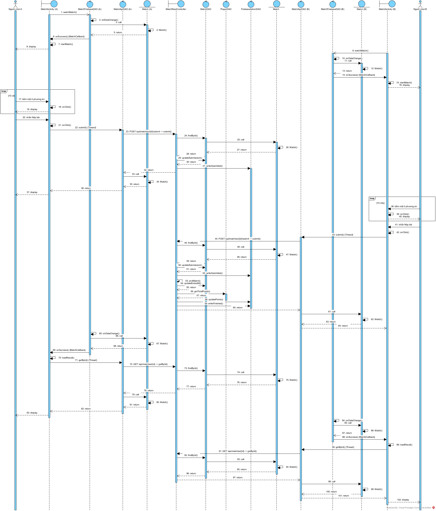

*Hình 10: Biểu đồ tuần tự chi tiết chức năng Chơi online, đoạn C: Thi đấu.*

- Biểu đồ có 102 thông điệp.
- **Hai người chơi:** người chơi A ở bên trái, người chơi B ở bên phải; các lớp của mỗi máy ghi (A) hoặc (B). Server ở giữa là trọng tài chung. Biểu đồ vẽ trường hợp A nộp bài trước, B nộp sau.
- **Làm bài từng câu** lặp 10 lần trên mỗi máy: mỗi lần bấm, onClick() ghi phương án và thời gian làm câu vào bài làm của câu đó rồi hiện câu sau. App không có đáp án nên không báo đúng / sai ngay.
- **Server làm trọng tài:** mỗi lần nộp, hàm submit() đọc trận từ MySQL, chấm và lưu bài làm. Khi người nộp sau (B) gửi bài, submit() thấy cả 2 đã nộp nên gọi endMatch() ghi thời điểm kết thúc, tính lại tổng điểm và báo trận kết thúc qua Firebase.
- **Cả 2 máy nhận kết quả như nhau:** onDataChange() báo trận đã kết thúc, mỗi máy gọi getById() lấy trận đầy đủ rồi hiển thị kết quả. Activity chỉ nhận đối tượng Match; việc tính thắng thua, điểm để hiển thị nằm trong mã nguồn.
- watchMatch() là lời đăng ký theo dõi nên vẽ bất đồng bộ, không có thông điệp trả về; kết quả đến sau qua onSuccess(). Đồng hồ đếm ngược, theo dõi đối thủ còn online và phiên đăng nhập nằm trong mã nguồn của MatchActivity, không vẽ ở đây.

**Đoạn D: Chơi tiếp**

1. Người chơi nhấn Chơi tiếp.
2. Hàm onClick() gọi hàm sendChoice() của MatchActivity.
3. Trong một Thread, hàm sendChoice() gọi hàm continueMatch() của MatchApiDAO với lựa chọn chơi tiếp.
4. Hàm continueMatch() của MatchApiDAO gửi yêu cầu POST /api/matches/{id}/continue tới hàm continueMatch() của MatchRestController.
5. Hàm continueMatch() của MatchRestController gọi hàm findById() của MatchDAO.
6. Hàm findById() gọi lớp Match để đóng gói trận.
7. Lớp Match gọi hàm khởi tạo Match() của chính nó để tạo đối tượng.
8. Lớp Match trả đối tượng Match cho MatchDAO.
9. MatchDAO trả trận cho hàm continueMatch().
10. Hàm continueMatch() gọi hàm writeChoice() của FirebaseAdminDAO để ghi lựa chọn chơi tiếp; đối thủ chưa chọn nên server ghi nhớ lựa chọn này.
11. MatchRestController trả trận dạng JSON cho MatchApiDAO.
12. Hàm toMatch() của MatchApiDAO gọi lớp Match để đóng gói dữ liệu JSON.
13. Lớp Match gọi hàm khởi tạo Match() của chính nó để tạo đối tượng.
14. Lớp Match trả đối tượng Match cho MatchApiDAO.
15. MatchApiDAO trả đối tượng Match cho hàm sendChoice().
16. MatchActivity hiển thị đang chờ đối thủ chọn.
17. Khi đối thủ cũng chọn Chơi tiếp, hàm continueMatch() xử lý yêu cầu của đối thủ gọi hàm startMatch() của chính nó.
18. Hàm startMatch() gọi lớp Match để đóng gói trận mới gồm 2 người chơi.
19. Lớp Match gọi hàm khởi tạo Match() của chính nó để tạo đối tượng.
20. Lớp Match trả đối tượng Match cho hàm startMatch().
21. Hàm startMatch() gọi hàm generateProblems() của ProblemDAO để sinh 10 câu hỏi mới.
22. Hàm generateProblems() gọi lớp MathProblem để đóng gói từng câu hỏi.
23. Lớp MathProblem gọi hàm khởi tạo MathProblem() của chính nó để tạo đối tượng.
24. Lớp MathProblem trả đối tượng MathProblem cho ProblemDAO.
25. ProblemDAO trả 10 câu hỏi cho hàm startMatch().
26. Hàm startMatch() gọi hàm insert() của MatchDAO để lưu trận mới.
27. MatchDAO trả kết quả lưu thành công cho hàm startMatch().
28. Hàm startMatch() gọi hàm writeMatch() của FirebaseAdminDAO để ghi trận mới lên Firebase.
29. Hàm startMatch() gọi hàm updateStatus() của FirebaseAdminDAO để đặt 2 người chơi sang trạng thái đang đấu.
30. Hàm continueMatch() gọi hàm writeNextMatch() của FirebaseAdminDAO để ghi mã trận mới vào trận cũ.
31. Khi trận cũ có mã trận mới, hàm onDataChange() của MatchFirebaseDAO gọi hàm onNextMatch() của MatchCallback, chính là MatchActivity.
32. Hàm onNextMatch() gọi hàm openNextMatch() của chính nó.
33. Hàm openNextMatch() gọi hàm stopWatching() của MatchFirebaseDAO để gỡ theo dõi trận cũ.
34. Hàm openNextMatch() gọi hàm startActivity() mở MatchActivity cho trận mới rồi đóng màn cũ.
35. MatchActivity hiển thị màn thi đấu của trận mới; trận diễn ra như đoạn C.

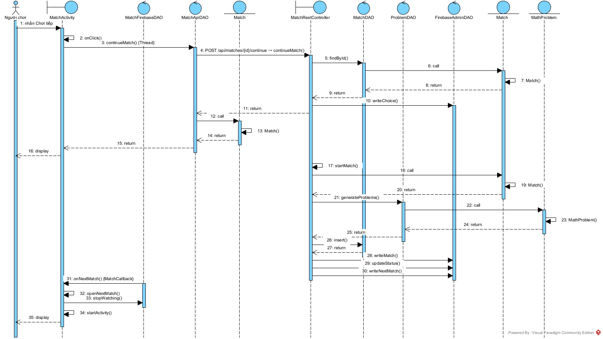

*Hình 11: Biểu đồ tuần tự chi tiết chức năng Chơi online, đoạn D: Chơi tiếp.*

- Biểu đồ có 35 thông điệp.
- Biểu đồ vẽ cho người chọn Chơi tiếp trước. Lựa chọn được ghi lên Firebase (bước 10) và server ghi nhớ lựa chọn đó cho tới khi đối thủ chọn.
- Trận mới chỉ được tạo khi cả 2 cùng chọn Chơi tiếp (bước 17–29), trong yêu cầu của người chọn sau. Server ghi mã trận mới vào trận cũ (bước 30), cả 2 máy nhận qua onNextMatch() (bước 31) và cùng mở trận mới.
- Người chơi chọn Dừng thì server ghi stoppedBy lên Firebase, đối thủ nhận qua onStopped() và quay về màn Chơi online; nhánh này thuộc ngoại lệ nên không vẽ.

### 4.2. Chức năng "Xem lịch sử đấu"

#### 4.2.1. Thiết kế giao diện

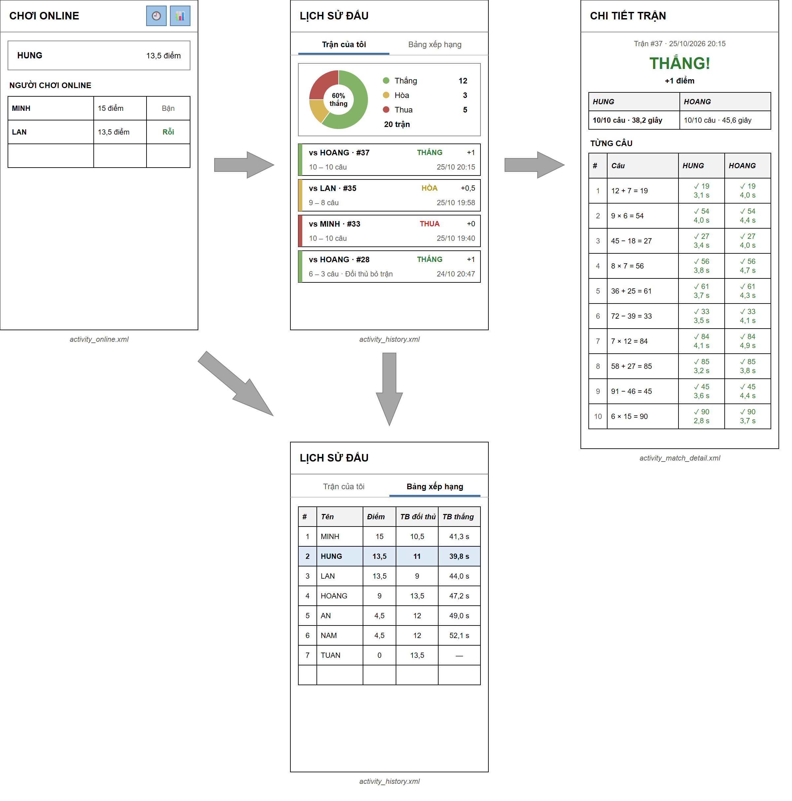

*Hình 12: Thiết kế giao diện chức năng Xem lịch sử đấu.*

Chức năng đi từ màn Chơi online: biểu tượng đồng hồ mở màn Lịch sử đấu ở thẻ Trận của tôi, biểu tượng bảng xếp hạng ở góc phải ngoài cùng mở thẳng thẻ Bảng xếp hạng. Màn Lịch sử đấu có thanh trên với tiêu đề LỊCH SỬ ĐẤU căn trái, dưới là 2 thẻ.
- **Thẻ Trận của tôi** mở sẵn khi vào từ biểu tượng Lịch sử đấu. Trên cùng là thẻ tóm tắt: biểu đồ tròn dạng vành khuyên bên trái, giữa ghi tỉ lệ thắng to; chú giải 3 màu và tổng số trận bên phải. Người chơi thấy ngay phong độ của mình trước khi đọc từng trận.
- **Danh sách trận** nằm dưới thẻ tóm tắt, trận mới nhất ở trên. Mỗi dòng là một item_match_history.xml có dải màu bên trái theo kết quả: xanh lá thắng, vàng hòa, đỏ thua. Dòng trên ghi đối thủ, số trận, kết quả, điểm trận; dòng dưới ghi số câu đúng 2 bên và thời điểm kết thúc. Trận có người bỏ trận ghi thêm "Đối thủ bỏ trận" hoặc "Bạn bỏ trận".
- **Thẻ Bảng xếp hạng** giữ nguyên bố cục bảng xếp hạng: hàng tiêu đề cột cố định, mỗi dòng là một item_ranking.xml, dòng của người xem có nền màu nhấn.

Màn Chi tiết trận có thanh trên với tiêu đề CHI TIẾT TRẬN căn trái, nội dung đi từ tổng quát tới chi tiết:
- Trên cùng là số trận kèm thời điểm kết thúc, kết quả và điểm trận chữ to.
- Giữa là khung so sánh 2 cột: tên, số câu đúng và thời gian nộp của mình và của đối thủ. Cột của người xem in đậm.
- Dưới là bảng TỪNG CÂU, hàng tiêu đề cột gồm #, Câu, tên mình, tên đối thủ. Mỗi dòng một câu: số thứ tự, phép tính kèm đáp án đúng, rồi ô bài làm của từng người. Ô bài làm có 2 dòng: dòng trên "✓ 19" chữ xanh nếu đúng hoặc "✗ 18" chữ đỏ kèm phương án đã chọn nếu sai, dòng dưới là thời gian làm câu "3,1 s". Câu bỏ trống hiện "Bỏ trống" chữ xám; người bỏ trận khi chưa nộp không có bài làm nên hiện "—".

**Bảng thành phần:**

| Màn | id trong layout | Loại View | Chức năng | Tên ở pha phân tích |
|---|---|---|---|---|
| OnlineActivity | btnHistory | ImageButton | Biểu tượng đồng hồ, mở màn Lịch sử đấu ở thẻ Trận của tôi; contentDescription "Lịch sử đấu" | subHistory |
| | btnRanking | ImageButton | Biểu tượng bảng xếp hạng dạng cột, góc phải ngoài cùng, mở màn Lịch sử đấu ở thẻ Bảng xếp hạng; contentDescription "Bảng xếp hạng" | subRanking |
| HistoryActivity | tabLayout | TabLayout | 2 thẻ Trận của tôi, Bảng xếp hạng | subTabRanking |
| | layoutMyMatches | LinearLayout | Khối thẻ Trận của tôi, ẩn khi chọn thẻ Bảng xếp hạng | |
| | pieChart | View tự vẽ | Biểu đồ tròn tỉ lệ thắng, hòa, thua | outWinRateChart |
| | txtWins, txtDraws, txtLosses | TextView | Chú giải số trận thắng, hòa, thua | outSummary |
| | txtTotal | TextView | Tổng số trận | outSummary |
| | rvMatches | RecyclerView | Danh sách trận | outsubListMatch |
| | txtEmpty | TextView | "Bạn chưa đấu trận nào", ẩn khi có trận | outsubListMatch |
| | rvRanking | RecyclerView | Danh sách đã xếp hạng | outListRanking |
| item_match_history.xml | viewResultBar | View | Dải màu theo kết quả | một dòng của outsubListMatch |
| | txtOpponent | TextView | "vs HOANG · #37" | một dòng của outsubListMatch |
| | txtResult | TextView | THẮNG / HÒA / THUA, kèm "Đối thủ bỏ trận" nếu có | một dòng của outsubListMatch |
| | txtPoints | TextView | "+1" | một dòng của outsubListMatch |
| | txtScore | TextView | "10 – 10 câu" | một dòng của outsubListMatch |
| | txtEndedAt | TextView | "25/10 20:15" | một dòng của outsubListMatch |
| item_ranking.xml | txtRank, txtName, txtPoints | TextView | Hạng, tên, tổng điểm | một dòng của outListRanking |
| MatchDetailActivity | txtTitle | TextView | "Trận #37 · 25/10/2026 20:15" | |
| | txtResult | TextView | WIN! / LOSE! / TIE! | outResult |
| | txtPoints | TextView | "+1 điểm" | outPoints |
| | txtMyName, txtMyStats | TextView | Tên, "10/10 · 38,2 giây" của mình | outMyResult |
| | txtOpponentName, txtOpponentStats | TextView | Tên, "10/10 · 45,6 giây" hoặc "Bỏ trận" của đối thủ | outOpponentResult |
| | txtMyColumn | TextView | Tiêu đề cột bài làm của mình, ghi tên mình | outListAnswer |
| | txtOpponentColumn | TextView | Tiêu đề cột bài làm của đối thủ, ghi tên đối thủ | outListAnswer |
| | rvProblems | RecyclerView | 10 câu, mỗi câu kèm đáp án đúng và bài làm của 2 người | outListAnswer |
| item_problem.xml | txtIndex | TextView | Số thứ tự câu | một dòng của outListAnswer |
| | txtExpression | TextView | "12 + 7 = 19", phép tính kèm đáp án đúng | một dòng của outListAnswer |
| | txtMyAnswer | TextView | Bài làm của mình: "✓ 19" xanh hoặc "✗ 18" đỏ, dòng dưới "3,1 s"; "Bỏ trống" xám; "—" khi không có bài làm | một dòng của outListAnswer |
| | txtOpponentAnswer | TextView | Bài làm của đối thủ, cùng cách hiện như txtMyAnswer | một dòng của outListAnswer |

#### 4.2.2. Biểu đồ lớp chi tiết

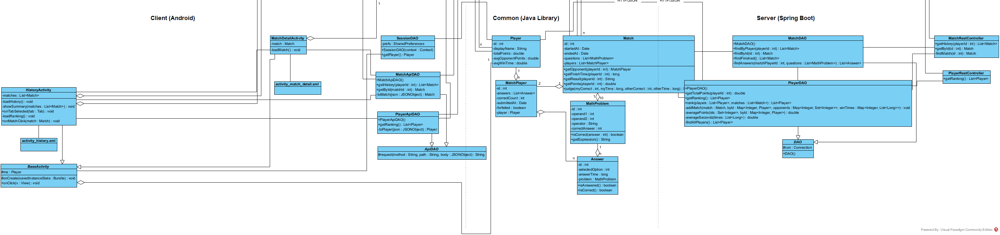

*Hình 13: Biểu đồ lớp chi tiết chức năng Xem lịch sử đấu.*

Biểu đồ chia 3 package: Client (Android) bên trái, Common (Java Library) ở giữa, Server (Spring Boot) bên phải. Package Common là thư viện mathdash-common.jar chứa các lớp thực thể; DAO của app và DAO của server cùng dùng một bộ thực thể này. Biểu đồ chỉ có các lớp tham gia vào logic của chức năng; màn chỉ dùng để mở sang màn khác không được vẽ. Lớp giao diện chỉ ghi các phương thức xử lý nghiệp vụ, các hàm chỉ để vẽ giao diện nằm trong mã nguồn. DAO cha ghi đối tượng kết nối dùng chung (con); mỗi DAO ghi hàm khởi tạo và mọi phương thức mà chức năng này gọi; DAO không ghi biến môi trường như địa chỉ server. Phần chung của các Activity nằm ở lớp cha BaseActivity; danh sách trên mỗi màn do chính Activity đổ dữ liệu. Các View con, biến tạm, cờ trạng thái và hàm override của Android như onDestroy, onBackPressed nằm trong mã nguồn.

**Package "Client (Android)".**

| Loại | Lớp | Mô tả |
|---|---|---|
| Boundary | BaseActivity | BaseActivity là lớp cha trừu tượng của mọi Activity trong chức năng. Lớp này giữ người chơi đang đăng nhập (me), lấy bằng SessionDAO.getPlayer trong onCreate, và cài đặt View.OnClickListener với onClick; Activity con chỉ viết phần riêng của màn mình. Danh sách trên màn hình (RecyclerView) do chính Activity đổ dữ liệu, bằng một lớp Adapter nội bộ nằm trong file Activity đó |
| Boundary | HistoryActivity | onCreate lấy người chơi bằng SessionDAO.getPlayer rồi gọi loadHistory; Intent có EXTRA_TAB = TAB_RANKING thì chọn sẵn thẻ Bảng xếp hạng bằng tabLayout.selectTab, onTabSelected được gọi và tải bảng xếp hạng. loadHistory gọi MatchApiDAO.getHistory trong Thread, rồi trong runOnUiThread gọi showSummary và gắn danh sách trận vào rvMatches: mỗi dòng dùng Match.getOpponent, getResult, getPoints và tô màu dải kết quả, bấm vào dòng thì gọi onMatchClick. showSummary đếm Match.getResult theo id người chơi thành số trận thắng, hòa, thua, vẽ biểu đồ tròn lên pieChart và ghi chú giải. pieChart là View tự vẽ nằm trong HistoryActivity: vẽ từng cung tròn bằng Canvas.drawArc theo tỉ lệ, khoét giữa thành vành khuyên và ghi tỉ lệ thắng. onTabSelected ẩn / hiện 2 khối layoutMyMatches, layoutRanking; chưa tải bảng xếp hạng (rankingLoaded sai) thì gọi loadRanking. loadRanking đặt rankingLoaded, lỗi thì đặt lại để lần chọn sau tải lại. onMatchClick mở MatchDetailActivity kèm matchId với khóa EXTRA_MATCH_ID. Lỗi mạng thì showError hiện Toast |
| Boundary | MatchDetailActivity | onCreate lấy người chơi bằng SessionDAO.getPlayer, đọc matchId từ Intent rồi gọi loadMatch. loadMatch gọi MatchApiDAO.getById trong Thread, rồi trong runOnUiThread gọi showMatch. showMatch dùng Match.getOpponent tìm MatchPlayer của đối thủ và của mình, showResult tô màu THẮNG / HÒA / THUA theo Match.getResult, getPoints ghi điểm trận; stats dùng getFinishTime ghi số câu đúng và thời gian của từng bên; ghi tên 2 người vào txtMyColumn, txtOpponentColumn; rồi gắn đề và bài làm của 2 người vào rvProblems: mỗi dòng ghi phép tính có đáp án đúng, answerAt lấy bài làm ở vị trí câu (null khi người bỏ trận chưa nộp), showAnswer dùng Answer.isAnswered, isCorrect để hiện "✓" xanh hoặc "✗" đỏ kèm phương án đã chọn và thời gian. matchId giữ mã trận đọc từ Intent |
| Control | SessionDAO | Như ở Chơi online |
| Control | ApiDAO ← MatchApiDAO | getHistory gửi GET /api/matches?playerId={id}; getById gửi GET /api/matches/{id}. Cả 2 đóng gói JSON thành Match bằng toMatch. Với getById, toMatch đóng gói cả bài làm của từng người và gắn câu thứ i của đề vào bài làm thứ i; lịch sử đấu không kèm bài làm nên danh sách bài làm rỗng |
| Control | ApiDAO ← PlayerApiDAO | getRanking gửi GET /api/players/ranking, đóng gói từng phần tử thành Player bằng toPlayer |

**Package "Common (Java Library)".**

| Loại | Lớp | Mô tả |
|---|---|---|
| Entity | Match, MatchPlayer, Answer, MathProblem, Player | Match có thêm getOpponent trả MatchPlayer còn lại; các luật getResult, getPoints, getFinishTime dùng chung với Chơi online. Answer.isCorrect so phương án đã chọn với correctAnswer của câu đã gắn qua MathProblem.isCorrect |

**Package "Server (Spring Boot)".**

| Loại | Lớp | Mô tả |
|---|---|---|
| Boundary | MatchRestController | getHistory(playerId) nhận GET /api/matches?playerId={id}, gọi MatchDAO.findByPlayer và trả danh sách Match dạng JSON. getById(id) nhận GET /api/matches/{id}, gọi MatchDAO.findById, gán tổng điểm 2 người bằng PlayerDAO.getTotalPoints; trận đã xong nên trả kèm đáp án đúng và bài làm từng câu của 2 người |
| Boundary | PlayerRestController | getRanking() nhận GET /api/players/ranking, gọi PlayerDAO.getRanking |
| Control | DAO ← MatchDAO | findByPlayer truy vấn tblMatch có endedAt khác rỗng và có dòng tblMatchPlayer của người chơi, JOIN tblMatchPlayer, tblPlayer, sắp theo endedAt giảm dần; đóng gói mỗi trận thành 1 Match + 2 MatchPlayer + 2 Player, không đọc đề và bài làm. findById đọc thêm 10 dòng tblMathProblem, rồi findAnswers đọc các dòng tblAnswer của từng MatchPlayer theo tblMathProblemId tăng dần, toAnswer gắn câu hỏi có cùng id vào bài làm. findFinished dùng cho bảng xếp hạng |
| Control | DAO ← PlayerDAO | getRanking đọc mọi người chơi bằng findAllPlayers, lấy các trận đã xong bằng MatchDAO.findFinished rồi gọi rank. PlayerDAO tạo MatchDAO ngay trong hàm, không giữ làm thuộc tính. rank là hàm static không truy cập CSDL: addMatch cộng điểm, ghi đối thủ và thời gian thắng của từng trận; averagePoints, averageSeconds tính 2 tiêu chí trung bình; cuối cùng sắp xếp 3 tiêu chí. getTotalPoints cộng Match.getPoints qua các trận đã xong |

**Quan hệ giữa các lớp giao diện:**
- HistoryActivity – MatchDetailActivity nối nhau bằng quan hệ liên kết theo luồng màn hình. OnlineActivity chỉ mở HistoryActivity nên không vẽ.
- Danh sách trận và bảng xếp hạng là 2 RecyclerView của HistoryActivity; 10 câu của trận là RecyclerView của MatchDetailActivity.
- Layout: HistoryActivity – activity_history.xml, MatchDetailActivity – activity_match_detail.xml.
- **Kết tập:** HistoryActivity giữ danh sách trận và danh sách người chơi của bảng xếp hạng; MatchDetailActivity giữ một Match gồm 10 MathProblem và bài làm của 2 người; me nằm ở BaseActivity. Hình thoi ở phía Activity.
- Thực thể: Match gồm 2 MatchPlayer và 10 MathProblem (kết tập); MatchPlayer gồm các Answer (kết tập); Answer chứa thông tin MathProblem (kết tập).

Chức năng dùng lại MatchApiDAO, PlayerApiDAO, MatchRestController, PlayerRestController, MatchDAO, PlayerDAO của Chơi online; biểu đồ chỉ vẽ các phương thức chức năng này dùng. Phần mới gồm MatchApiDAO.getHistory, MatchRestController.getHistory, MatchDAO.findByPlayer và Match.getOpponent.

Mỗi biểu đồ dưới đây chỉ có các lớp và phương thức mà một use case của module dùng.

##### 4.2.2.1. Use case Xem lịch sử đấu

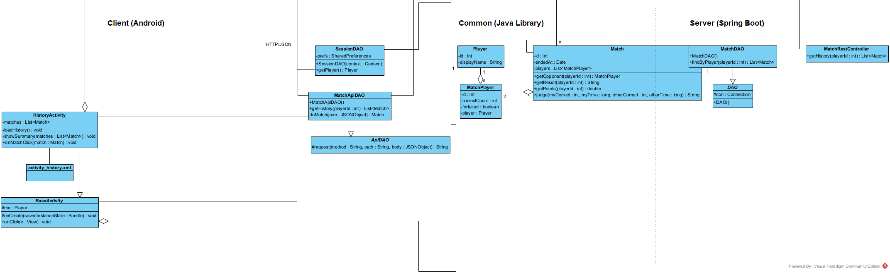

*Hình 14: Biểu đồ lớp chi tiết use case Xem lịch sử đấu.*

HistoryActivity lấy danh sách trận, đếm thắng, hòa, thua bằng showSummary và vẽ biểu đồ tròn, rồi hiện danh sách trận trên rvMatches. MatchApiDAO.getHistory gọi MatchRestController.getHistory, và MatchDAO.findByPlayer đọc các trận đã kết thúc của người chơi. Thực thể dùng ở đây là Player, Match và MatchPlayer; lịch sử đấu không kèm đề và bài làm.

##### 4.2.2.2. Use case Xem chi tiết trận

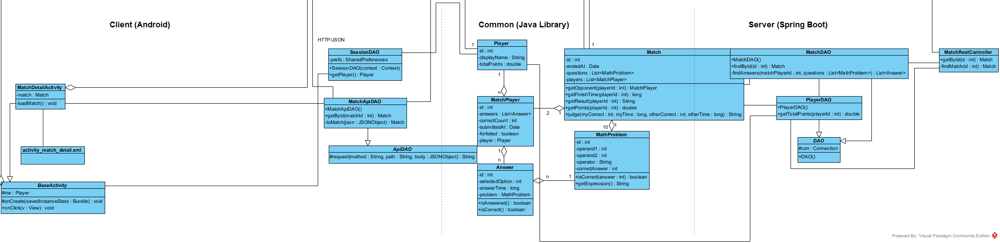

*Hình 15: Biểu đồ lớp chi tiết use case Xem chi tiết trận.*

MatchDetailActivity lấy trận bằng MatchApiDAO.getById rồi hiện 10 câu cùng bài làm của 2 người trên rvProblems. Phía server, MatchRestController.getById đọc đề và bài làm bằng MatchDAO.findById, findAnswers, rồi gán tổng điểm bằng PlayerDAO.getTotalPoints. Thực thể dùng ở đây là Player, Match, MatchPlayer, Answer và MathProblem.

##### 4.2.2.3. Use case Xem bảng xếp hạng

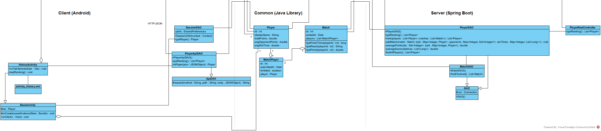

*Hình 16: Biểu đồ lớp chi tiết use case Xem bảng xếp hạng.*

HistoryActivity ở thẻ Bảng xếp hạng: onTabSelected gọi loadRanking và hiện danh sách trên rvRanking. PlayerApiDAO.getRanking gọi PlayerRestController.getRanking. PlayerDAO lấy mọi người chơi bằng findAllPlayers, lấy các trận đã xong bằng MatchDAO.findFinished, rồi rank tính 3 tiêu chí qua addMatch, averagePoints, averageSeconds. Thực thể dùng ở đây là Player, Match và MatchPlayer.

#### 4.2.3. Biểu đồ tuần tự chi tiết

**Đoạn A: Xem trận của tôi và chi tiết trận**

1. Người chơi nhấn biểu tượng Lịch sử đấu trên OnlineActivity.
2. Hàm onClick() của OnlineActivity gọi hàm startActivity() mở HistoryActivity.
3. Hàm onCreate() của HistoryActivity gọi hàm getPlayer() của SessionDAO.
4. Hàm getPlayer() gọi lớp Player để đóng gói người chơi đang đăng nhập.
5. Lớp Player gọi hàm khởi tạo Player() của chính nó để tạo đối tượng.
6. Lớp Player trả đối tượng Player cho SessionDAO.
7. SessionDAO trả đối tượng Player cho hàm onCreate().
8. Hàm onCreate() gọi hàm loadHistory() của chính nó.
9. Trong một Thread, hàm loadHistory() gọi hàm getHistory() của MatchApiDAO.
10. Hàm getHistory() của MatchApiDAO gửi yêu cầu GET /api/matches?playerId={id} tới hàm getHistory() của MatchRestController.
11. Hàm getHistory() gọi hàm findByPlayer() của MatchDAO.
12. Hàm findByPlayer() đọc các trận đã kết thúc của người chơi rồi gọi lớp Match để đóng gói từng trận kèm 2 người chơi, không kèm đề.
13. Lớp Match gọi hàm khởi tạo Match() của chính nó để tạo đối tượng.
14. Lớp Match trả đối tượng Match cho MatchDAO.
15. MatchDAO trả danh sách trận, mới nhất ở đầu, cho hàm getHistory().
16. MatchRestController trả danh sách trận dạng JSON cho MatchApiDAO.
17. Với mỗi phần tử JSON, hàm toMatch() của MatchApiDAO gọi lớp Match để đóng gói.
18. Lớp Match gọi hàm khởi tạo Match() của chính nó để tạo đối tượng.
19. Lớp Match trả đối tượng Match cho MatchApiDAO.
20. MatchApiDAO trả danh sách trận cho hàm loadHistory().
21. Trong hàm runOnUiThread(), HistoryActivity hiển thị biểu đồ tròn tỉ lệ thắng, hòa, thua và danh sách trận.
22. Người chơi bấm vào một trận trong danh sách.
23. Hàm onClick() của dòng đó gọi hàm onMatchClick() của HistoryActivity.
24. Hàm onMatchClick() gọi hàm startActivity() mở MatchDetailActivity với mã trận.
25. Hàm onCreate() của MatchDetailActivity gọi hàm getPlayer() của SessionDAO.
26. Hàm getPlayer() gọi lớp Player để đóng gói người chơi đang đăng nhập.
27. Lớp Player gọi hàm khởi tạo Player() của chính nó để tạo đối tượng.
28. Lớp Player trả đối tượng Player cho SessionDAO.
29. SessionDAO trả đối tượng Player cho hàm onCreate().
30. Hàm onCreate() gọi hàm loadMatch() của chính nó.
31. Trong một Thread, hàm loadMatch() gọi hàm getById() của MatchApiDAO.
32. Hàm getById() của MatchApiDAO gửi yêu cầu GET /api/matches/{id} tới hàm getById() của MatchRestController.
33. Hàm getById() gọi hàm findById() của MatchDAO.
34. Hàm findById() gọi lớp Match để đóng gói trận kèm đề và 2 người chơi.
35. Lớp Match gọi hàm khởi tạo Match() của chính nó để tạo đối tượng.
36. Lớp Match trả đối tượng Match cho MatchDAO.
37. Hàm findById() gọi hàm findAnswers() của chính nó để đọc bài làm từng câu của mỗi người.
38. MatchDAO trả trận đầy đủ cho hàm getById().
39. Hàm getById() gọi hàm getTotalPoints() của PlayerDAO để gán tổng điểm của 2 người.
40. PlayerDAO trả tổng điểm cho hàm getById().
41. MatchRestController trả trận kèm đáp án đúng và bài làm dạng JSON cho MatchApiDAO.
42. Hàm toMatch() của MatchApiDAO gọi lớp Match để đóng gói dữ liệu JSON, kèm bài làm từng câu của 2 người chơi.
43. Lớp Match gọi hàm khởi tạo Match() của chính nó để tạo đối tượng.
44. Lớp Match trả đối tượng Match cho MatchApiDAO.
45. MatchApiDAO trả đối tượng Match cho hàm loadMatch().
46. Trong hàm runOnUiThread(), MatchDetailActivity hiển thị kết quả, điểm trận, số câu đúng, thời gian của 2 người và bảng 10 câu với bài làm đúng / sai của mỗi người.
47. Người chơi nhấn Back.
48. MatchDetailActivity gọi hàm finish(), quay về HistoryActivity.
49. HistoryActivity hiển thị lại danh sách trận.

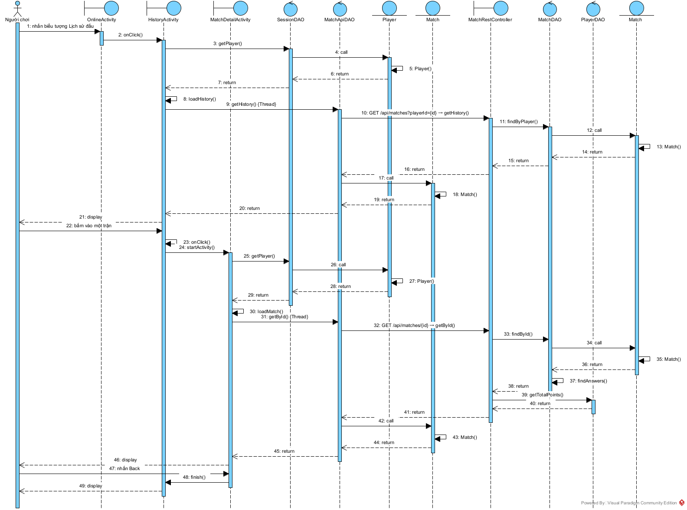

*Hình 17: Biểu đồ tuần tự chi tiết chức năng Xem lịch sử đấu, đoạn A: Xem trận của tôi và chi tiết trận.*

- Biểu đồ có 49 thông điệp.
- **Có 2 lời gọi REST:** bước 10 lấy danh sách trận, bước 32 lấy một trận đầy đủ. Server đi theo khuôn MatchRestController → MatchDAO → Match.
- **Danh sách trận không kèm đề** (bước 12) để mỗi lần mở lịch sử chỉ đọc 2 bảng tblMatch, tblMatchPlayer. Đề, đáp án và bài làm từng câu chỉ được đọc khi người chơi mở một trận (bước 34–37).
- **Activity chỉ nhận đối tượng Match:** việc đếm thắng, hòa, thua, tìm đối thủ, tính điểm và tô đúng / sai từng câu nằm trong mã nguồn của HistoryActivity, MatchDetailActivity và dùng các phương thức của Match, Answer. Biểu đồ chỉ vẽ bước hiển thị cho người chơi (bước 21, 46, 49).
- Lời gọi mạng chạy trong Thread (bước 9, 31); phần hiển thị chạy trong hàm runOnUiThread().

**Đoạn B: Xem bảng xếp hạng**

1. Người chơi nhấn biểu tượng Bảng xếp hạng trên OnlineActivity.
2. Hàm onClick() của OnlineActivity gọi hàm startActivity() mở HistoryActivity ở thẻ Bảng xếp hạng.
3. Hàm onCreate() của HistoryActivity gọi hàm getPlayer() của SessionDAO.
4. Hàm getPlayer() gọi lớp Player để đóng gói người chơi đang đăng nhập.
5. Lớp Player gọi hàm khởi tạo Player() của chính nó để tạo đối tượng.
6. Lớp Player trả đối tượng Player cho SessionDAO.
7. SessionDAO trả đối tượng Player cho hàm onCreate().
8. Hàm onCreate() chọn sẵn thẻ Bảng xếp hạng nên hàm onTabSelected() của HistoryActivity được gọi.
9. Hàm onTabSelected() gọi hàm loadRanking() của chính nó.
10. Trong một Thread, hàm loadRanking() gọi hàm getRanking() của PlayerApiDAO.
11. Hàm getRanking() của PlayerApiDAO gửi yêu cầu GET /api/players/ranking tới hàm getRanking() của PlayerRestController.
12. Hàm getRanking() của PlayerRestController gọi hàm getRanking() của PlayerDAO.
13. Hàm getRanking() của PlayerDAO gọi hàm findAllPlayers() của chính nó.
14. Hàm findAllPlayers() đọc tblPlayer rồi gọi lớp Player để đóng gói từng người chơi.
15. Lớp Player gọi hàm khởi tạo Player() của chính nó để tạo đối tượng.
16. Lớp Player trả đối tượng Player cho PlayerDAO.
17. Hàm getRanking() gọi hàm findFinished() của MatchDAO để lấy các trận đã kết thúc.
18. Hàm findFinished() gọi lớp Match để đóng gói từng trận.
19. Lớp Match gọi hàm khởi tạo Match() của chính nó để tạo đối tượng.
20. Lớp Match trả đối tượng Match cho MatchDAO.
21. MatchDAO trả danh sách trận cho hàm getRanking().
22. Hàm getRanking() gọi hàm rank() để tính tổng điểm, trung bình điểm đối thủ, trung bình thời gian thắng của từng người rồi sắp xếp theo 3 tiêu chí đó.
23. PlayerDAO trả danh sách người chơi đã xếp hạng cho PlayerRestController.
24. PlayerRestController trả danh sách dạng JSON cho PlayerApiDAO.
25. Với mỗi phần tử JSON, hàm toPlayer() của PlayerApiDAO gọi lớp Player để đóng gói.
26. Lớp Player gọi hàm khởi tạo Player() của chính nó để tạo đối tượng.
27. Lớp Player trả đối tượng Player cho PlayerApiDAO.
28. PlayerApiDAO trả danh sách người chơi cho hàm loadRanking().
29. Trong hàm runOnUiThread(), HistoryActivity hiển thị bảng xếp hạng gồm hạng, tên, tổng điểm; dòng của người xem được tô nổi bật.
30. Người chơi nhấn Back.
31. HistoryActivity gọi hàm finish(), quay về OnlineActivity.
32. OnlineActivity hiển thị lại màn Chơi online.

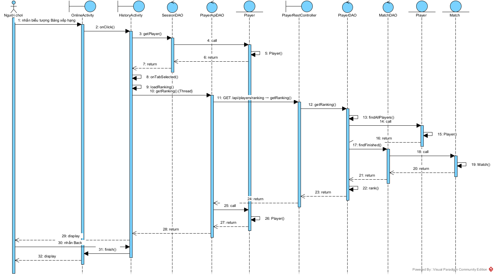

*Hình 18: Biểu đồ tuần tự chi tiết chức năng Xem lịch sử đấu, đoạn B: Xem bảng xếp hạng.*

- Biểu đồ có 32 thông điệp.
- **Lời gọi REST** của bảng xếp hạng là bước 11. Server đi theo khuôn PlayerRestController → PlayerDAO → MatchDAO → Match, Player.
- **Mở thẳng thẻ Bảng xếp hạng:** biểu tượng Bảng xếp hạng mở HistoryActivity và chọn sẵn thẻ này (bước 2, 8), giống như khi người chơi tự chọn thẻ.
- **Các tiêu chí không lưu trong CSDL** mà được hàm rank() tính lại từ các trận đã kết thúc (bước 22), nên bảng xếp hạng luôn khớp với kết quả các trận. Bảng chỉ hiện tổng điểm; 2 tiêu chí trung bình dùng để phân định khi trùng điểm.

---

## Phụ lục: các bước phân tích

### A. Biểu đồ use case chi tiết và kịch bản v1

#### A.1. Biểu đồ use case chi tiết module Đấu đối kháng

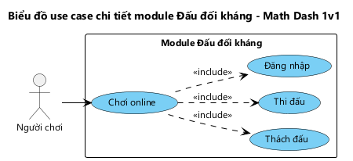

*Hình 19: Biểu đồ use case chi tiết module Đấu đối kháng.*

Người chơi khởi phát trực tiếp use case Chơi online (UC03). Use case này include 3 use case. Đăng nhập thuộc module Tài khoản: người chơi phải đăng nhập rồi mới chơi online được. Thách đấu diễn ra ở giao diện chơi online, nơi người chơi xem danh sách người đang online và bấm vào tên một người đang rỗi để mời; người được mời đồng ý hoặc từ chối trên hộp thoại lời mời. Thi đấu diễn ra ở giao diện thi đấu: 2 người làm lần lượt 10 câu rồi nộp bài, sau đó giao diện kết quả hiện kết quả, điểm trận và hỏi có chơi tiếp không. Hủy lời mời, Từ chối, Thoát trận, Chơi tiếp và Dừng là các bước bên trong Thách đấu và Thi đấu nên không tách thành use case riêng.

| Use case | Mô tả |
|---|---|
| Chơi online (UC03) | Vào giao diện chơi online, thách đấu một người chơi online, thi đấu trên cùng đề do server sinh, nhận kết quả do server xác định |
| Đăng nhập | Người chơi nhập tên đăng nhập, mật khẩu để vào hệ thống |
| Thách đấu | Người chơi chọn một người đang rỗi trong danh sách online và gửi lời mời; người được mời đồng ý thì server sinh đề, tạo trận và đưa cả 2 vào trận, từ chối thì người mời nhận thông báo |
| Thi đấu | Hai người làm cùng đề 10 câu, mỗi lần một câu, trong tối đa 60 giây, nộp bài; server lưu bài làm từng câu, chấm, xác định kết quả, cộng điểm; sau trận hai người chọn chơi tiếp hoặc dừng |

#### A.2. Kịch bản UC03 "Chơi online"

**Dữ liệu mẫu:**

| Người chơi | Tên đăng nhập | Tên hiển thị | Tổng điểm | Trạng thái | Máy |
|---|---|---|---|---|---|
| Hùng | hung | HUNG | 12,5 | Rỗi | Máy 1, người mời |
| Hoàng | hoang | HOANG | 9 | Rỗi | Máy 2, người được mời |
| Minh | minh | MINH | 15 | Bận | Máy 3, đang đấu với người khác |
| Lan | lan | LAN | 4,5 | Rỗi | Máy 4 |

Trận số 37 bắt đầu lúc 20:15:03,0 ngày 25/10/2026. Đề bài server sinh cho trận 37:

| Câu | Phép tính | Ô A | Ô B | Ô C | Ô D | Đáp án đúng |
|---|---|---|---|---|---|---|
| 1 | 12 + 7 | 17 | 19 | 21 | 18 | B · 19 |
| 2 | 9 × 6 | 48 | 54 | 56 | 63 | B · 54 |
| 3 | 45 − 18 | 27 | 23 | 33 | 37 | A · 27 |
| 4 | 8 × 7 | 54 | 56 | 48 | 64 | B · 56 |
| 5 | 36 + 25 | 51 | 61 | 59 | 71 | B · 61 |
| 6 | 72 − 39 | 33 | 43 | 31 | 37 | A · 33 |
| 7 | 7 × 12 | 74 | 84 | 82 | 96 | B · 84 |
| 8 | 58 + 27 | 75 | 85 | 83 | 95 | B · 85 |
| 9 | 91 − 46 | 45 | 55 | 35 | 47 | A · 45 |
| 10 | 6 × 15 | 80 | 90 | 96 | 75 | B · 90 |

Bài làm của HUNG và HOANG trong trận 37. Thời gian làm câu tính từ lúc câu hiện ra tới lúc người chơi bấm chọn:

| Câu | HUNG chọn | Thời gian | HOANG chọn | Thời gian |
|---|---|---|---|---|
| 1 | 19 | 3,1 giây | 19 | 4,0 giây |
| 2 | 54 | 4,0 giây | 54 | 4,4 giây |
| 3 | 27 | 3,4 giây | 27 | 4,0 giây |
| 4 | 56 | 3,8 giây | 56 | 4,7 giây |
| 5 | 61 | 3,7 giây | 61 | 4,3 giây |
| 6 | 33 | 3,5 giây | 33 | 4,1 giây |
| 7 | 84 | 4,1 giây | 84 | 4,9 giây |
| 8 | 85 | 3,2 giây | 85 | 3,8 giây |
| 9 | 45 | 3,6 giây | 45 | 4,4 giây |
| 10 | 90 | 2,8 giây | 90 | 3,7 giây |
| Tổng | 10/10 câu đúng | 35,2 giây | 10/10 câu đúng | 42,3 giây |

HUNG nhấn Nộp bài ở giây 38,2, HOANG ở giây 45,6, tính từ lúc trận bắt đầu.

| | |
|---|---|
| **Use case** | Chơi online (UC03), gồm Thách đấu, Thi đấu |
| **Actor** | Người chơi: Hùng ở máy 1 là người mời, Hoàng ở máy 2 là người được mời; mỗi người là actor trên máy của mình |
| **Tiền điều kiện** | Cả 2 người chơi đã đăng nhập, máy có kết nối mạng; Hùng đang ở giao diện chính trên máy 1; Hoàng đã vào giao diện chơi online trên máy 2; MINH đang đấu với người khác trên máy 3 |
| **Hậu điều kiện** | Trận 37 được lưu trên server cùng đề, bài làm từng câu, số câu đúng và thời gian nộp bài của 2 người; tổng điểm của HUNG thành 13,5, của HOANG giữ 9; cả 2 thấy cùng một kết quả; trận 38 bắt đầu |
| **Sự kiện chính** | 1. Trên máy 1, giao diện chính của Hùng hiện lên gồm: tiêu đề MATH DASH; lời chào "Xin chào, HUNG"; 2 nút **Chơi với máy**, **Chơi online**; nút Đăng xuất dạng biểu tượng ở góc phải trên. 2. Hùng nhấn **Chơi online**. 3. Hệ thống ghi HUNG vào danh sách online với trạng thái Rỗi. Giao diện chơi online hiện lên gồm: thanh trên có tiêu đề CHƠI ONLINE và 2 nút biểu tượng **Lịch sử đấu**, **Bảng xếp hạng** ở góc phải trên; thẻ thông tin HUNG · 12,5 điểm; mục Người chơi online gồm 3 dòng MINH · 15 · Bận, HOANG · 9 · Rỗi, LAN · 4,5 · Rỗi. Trên máy 2 và máy 4, dòng HUNG · 12,5 · Rỗi xuất hiện trong danh sách. 4. Hùng bấm vào dòng HOANG. 5. Hệ thống thấy HOANG đang rỗi, gửi lời mời tới máy 2. Máy 1 hiện hộp thoại "Đang chờ HOANG trả lời..." với nút **Hủy**. 6. Trên máy 2, ở giao diện chơi online của Hoàng, hộp thoại "HUNG (12,5 điểm) thách đấu bạn" hiện lên với 2 nút **Đồng ý**, **Từ chối**. 7. Hoàng nhấn **Đồng ý**. 8. Server kiểm tra HUNG và HOANG vẫn online và đang rỗi. Server sinh đề 10 câu như bảng đề bài trận 37 ở phần Dữ liệu mẫu, tạo trận số 37 bắt đầu lúc 20:15:03,0 ngày 25/10/2026, chuyển HUNG và HOANG sang Bận, rồi gửi đề cho cả 2 máy. 9. Máy 2 chuyển sang giao diện thi đấu. Cùng lúc, máy 1 đóng hộp thoại chờ và chuyển sang giao diện thi đấu. Trên máy của Lan, HUNG và HOANG chuyển sang Bận. 10. Giao diện thi đấu trên máy 1 hiện câu 1, gồm: ô thời gian 01:00 đếm ngược mỗi giây; dòng trạng thái "HOANG đang làm bài"; dòng "Câu 1/10"; phép tính "12 + 7 = ?"; 4 ô phương án **A** 17 màu đỏ, **B** 19 màu xanh dương, **C** 21 màu vàng, **D** 18 màu xanh lá; nút **Thoát**. Máy 2 hiện cùng câu 1, dòng trạng thái là "HUNG đang làm bài". 11. Sau 3,1 giây, Hùng bấm ô **B** 19. 12. Hệ thống ghi câu 1 của HUNG: phương án 19, thời gian 3,1 giây. Ô B giữ nguyên, 3 ô còn lại mờ đi, không báo đúng hay sai. Câu 2 hiện ra: "Câu 2/10", "9 × 6 = ?", **A** 48, **B** 54, **C** 56, **D** 63. 13. Các bước 11–12 lặp lại tới câu 10. Hùng lần lượt chọn 54, 27, 56, 61, 33, 84, 85, 45, 90, thời gian từng câu như bảng bài làm trận 37 ở phần Dữ liệu mẫu. 14. Sau khi Hùng chọn ở câu 10, thẻ câu hỏi chỉ còn dòng "Đã làm xong 10 câu", 4 ô ẩn đi, nút **Nộp bài** hiện cạnh nút **Thoát**. Ô thời gian còn 00:22. 15. Hùng nhấn **Nộp bài**. 16. Máy 1 hiện "Đang nộp bài...". Server nhận bài làm của HUNG lúc 20:15:41,2, tức thời gian làm bài 38,2 giây, lưu phương án và thời gian làm từng câu, chấm đúng 10/10 câu. Máy 1 ẩn nút Nộp bài, hiện "Đã nộp bài, đang chờ đối thủ...". Trên máy 2, dòng trạng thái đổi thành "HUNG đã nộp bài". 17. Hoàng làm xong 10 câu và nhấn **Nộp bài** trên máy 2. 18. Server nhận bài làm của HOANG lúc 20:15:48,6, tức 45,6 giây, lưu bài làm từng câu, chấm đúng 10/10 câu. 19. Server xác định kết quả: không ai bỏ trận, cả 2 đúng hết, HUNG nộp nhanh hơn nên HUNG thắng. HUNG được 1 điểm, tổng điểm thành 13,5; HOANG được 0 điểm, tổng điểm giữ 9. Server lưu trận và báo cả 2 máy. 20. Giao diện kết quả hiện đè lên giao diện thi đấu trên máy 1, gồm: dòng kết quả **WIN!** màu xanh; dòng Bạn 10/10 câu đúng · 38,2 giây; dòng HOANG 10/10 câu đúng · 45,6 giây; dòng điểm +1 điểm · Tổng điểm: 13,5; câu hỏi "Chơi tiếp?"; 2 nút **Chơi tiếp**, **Dừng**. Máy 2 hiện **LOSE!** màu đỏ, +0 điểm, tổng điểm 9. 21. Hùng nhấn **Chơi tiếp**. 22. Máy 1 ẩn 2 nút, hiện "Đang chờ đối thủ...". 23. Hoàng nhấn **Chơi tiếp** trên máy 2. 24. Server sinh đề mới, câu đầu là 23 + 48, tạo trận số 38 và gửi đề cho cả 2 máy. 25. Cả 2 máy hiện giao diện thi đấu của trận 38: ô thời gian 01:00, "Câu 1/10", "23 + 48 = ?". Trận 38 diễn ra như các bước 10–20. |
| **Ngoại lệ** | 3a. Không có ai khác online, chỉ có HUNG ở giao diện chơi online. 3a.1. Mục Người chơi online hiện "Chưa có ai khác online"; danh sách tự hiện người chơi khi có người vào. Kịch bản tiếp tục từ bước 4 khi có người vào giao diện chơi online. 3b. Hùng nhấn Back ở giao diện chơi online. 3b.1. Hệ thống xóa HUNG khỏi danh sách online; máy 1 về giao diện chính. Trên máy 2 và máy 4, dòng HUNG biến khỏi danh sách; không ai thách đấu được HUNG cho tới khi Hùng nhấn lại **Chơi online**. Use case kết thúc. 4a. Hùng bấm vào dòng MINH. 4a.1. MINH đang Bận nên hệ thống báo "MINH đang bận", không gửi lời mời, giữ nguyên giao diện chơi online. Kịch bản tiếp tục từ bước 4. 5a. Hùng nhấn **Hủy** trên hộp thoại chờ. 5a.1. Lời mời bị hủy, máy 1 ở lại giao diện chơi online. 5a.2. Nếu Hoàng nhấn **Đồng ý** sau đó thì server thấy lời mời đã hủy nên không tạo trận; máy 2 báo "Không bắt đầu được trận đấu". Use case kết thúc. 7a. Hoàng nhấn **Từ chối**. 7a.1. Máy 2 đóng hộp thoại. Máy 1 đóng hộp thoại chờ và báo "HOANG đã từ chối lời mời"; Hùng vẫn ở giao diện chơi online, có thể mời người khác. Kịch bản tiếp tục từ bước 4. 8a. Hùng rời giao diện chơi online hoặc tắt ứng dụng trước khi Hoàng nhấn **Đồng ý**. 8a.1. Server thấy HUNG không còn online nên không tạo trận. Máy 2 báo "Không bắt đầu được trận đấu" và ở lại giao diện chơi online. Use case kết thúc. 11a. Hùng mới làm xong 8 câu thì ô thời gian về 00:00. 11a.1. Thẻ câu hỏi hiện "Hết giờ", hệ thống tự nộp bài; câu 9 và câu 10 ghi là bỏ trống và tính là sai, HUNG đúng 8/10. Kịch bản tiếp tục từ bước 16 với thời gian làm bài của HUNG là 60 giây. 11b. Đang làm bài ở một trong các bước 11–15, Hùng nhấn **Thoát**. 11b.1. Hệ thống hỏi "Thoát sẽ bị xử thua?" với 2 nút **Ở lại**, **Thoát**. 11b.2. Hùng nhấn **Thoát**. 11b.3. Server xử HUNG thua, HOANG thắng và được 1 điểm, tổng điểm thành 10, rồi trả cả 2 về Rỗi. Máy 1 về giao diện chơi online. Máy 2 báo "Đối thủ đã thoát, bạn thắng" và hiện giao diện kết quả **WIN!** chỉ có nút **Về menu**, không hỏi chơi tiếp. Use case kết thúc. 11b.4. Nếu ở bước 11b.2 Hùng nhấn **Ở lại** thì hộp thoại đóng, Hùng tiếp tục làm bài ở câu đang làm, ô thời gian vẫn chạy. Kịch bản tiếp tục từ bước 11. 11c. Đang ở một trong các bước 11–17, máy 2 mất mạng khi Hoàng đang làm bài. 11c.1. HOANG biến khỏi danh sách online; hệ thống xử HOANG bỏ trận. 11c.2. Máy 1 báo "Đối thủ đã thoát, bạn thắng" và hiện giao diện kết quả **WIN!** chỉ có nút **Về menu**, như bước 11b.3. Use case kết thúc. 15a. Hùng đã làm xong 10 câu nhưng chưa nhấn **Nộp bài** thì ô thời gian về 00:00. 15a.1. Hệ thống tự nộp đủ 10 câu. Kịch bản tiếp tục từ bước 16 với thời gian làm bài của HUNG là 60 giây. 16a. Máy 1 không kết nối được server khi nộp bài. 16a.1. Hệ thống báo "Không kết nối được máy chủ, kiểm tra kết nối mạng", nút **Nộp bài** hiện lại để Hùng nộp lại; ô thời gian vẫn chạy. Kịch bản tiếp tục từ bước 15. 19a. Hoàng chọn ô **A** 74 ở câu 7 nên chỉ đúng 9/10, dù nộp ở giây 30,0. 19a.1. HUNG đúng hết nên server xác định HUNG thắng, không xét thời gian. Kịch bản tiếp tục từ bước 20. 19b. HUNG chọn ô **B** 23 ở câu 3, HOANG chọn ô **C** 35 ở câu 9; cả 2 đều có câu sai. 19b.1. Server xác định hòa, mỗi người được 0,5 điểm: tổng điểm HUNG thành 13, HOANG thành 9,5. 19b.2. Giao diện kết quả hiện **TIE!** màu vàng. Kịch bản tiếp tục từ bước 21. 23a. Hoàng nhấn **Dừng**. 23a.1. Server trả HUNG và HOANG về Rỗi. Máy 2 về giao diện chơi online. Máy 1 báo "Đối thủ đã dừng chơi" và về giao diện chơi online. Use case kết thúc. |

#### A.3. Biểu đồ use case chi tiết module Xem lịch sử đấu

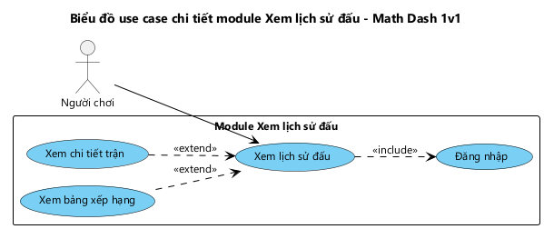

*Hình 20: Biểu đồ use case chi tiết module Xem lịch sử đấu.*

Người chơi khởi phát trực tiếp use case Xem lịch sử đấu (UC04). Use case này include Đăng nhập của module Tài khoản, vì người chơi phải đăng nhập rồi mới xem được lịch sử đấu. Xem chi tiết trận và Xem bảng xếp hạng là 2 use case extend Xem lịch sử đấu. Ở giao diện lịch sử đấu, người chơi có thể bấm vào một trận để mở giao diện chi tiết trận. Người chơi cũng có thể mở thẻ Bảng xếp hạng, bằng cách chọn thẻ này khi đang xem lịch sử đấu hoặc nhấn nút Bảng xếp hạng ở giao diện chơi online.

| Use case | Mô tả |
|---|---|
| Xem lịch sử đấu (UC04) | Xem tỉ lệ thắng / hòa / thua dạng biểu đồ tròn và danh sách các trận chơi online mình đã đấu, trận mới nhất đứng đầu |
| Đăng nhập | Người chơi nhập tên đăng nhập, mật khẩu để vào hệ thống |
| Xem chi tiết trận | Xem đối thủ, kết quả, điểm trận, số câu đúng và thời gian làm bài của 2 bên; 10 câu của đề, mỗi câu có phép tính kèm đáp án đúng và bài làm của từng người: đúng / sai, phương án đã chọn, thời gian làm câu |
| Xem bảng xếp hạng | Xem thứ hạng mọi người chơi theo tổng điểm, trung bình điểm đối thủ, trung bình thời gian thắng |

#### A.4. Kịch bản các use case của module Xem lịch sử đấu

##### A.4.1. Xem lịch sử đấu

| | |
|---|---|
| **Use case** | Xem lịch sử đấu |
| **Actor** | Người chơi: Hùng |
| **Tiền điều kiện** | Hùng đã đăng nhập, máy có kết nối mạng, đang ở giao diện chơi online với thẻ thông tin HUNG · 13,5 điểm; Hùng đã đấu 20 trận online, trận gần nhất là trận số 37 |
| **Hậu điều kiện** | Hùng thấy tỉ lệ thắng / hòa / thua và danh sách các trận đã đấu; dữ liệu không thay đổi; giao diện chơi online hiện lại |
| **Sự kiện chính** | 1. Ở giao diện chơi online, Hùng nhấn nút biểu tượng **Lịch sử đấu** ở góc phải trên. 2. Hệ thống lấy 20 trận đã kết thúc của HUNG, trận mới nhất đứng đầu. Giao diện lịch sử đấu hiện lên, thẻ **Trận của tôi** được mở sẵn, gồm: thanh trên có tiêu đề LỊCH SỬ ĐẤU; 2 thẻ **Trận của tôi** đang chọn và Bảng xếp hạng; biểu đồ tròn Thắng 60%, Hòa 15%, Thua 25%, giữa biểu đồ ghi "60% thắng"; chú giải "Thắng 12 · Hòa 3 · Thua 5 · 20 trận"; danh sách trận như bảng dữ liệu mẫu danh sách trận của HUNG bên dưới, cuộn xuống để xem các trận cũ hơn. Tổng điểm trận của 20 trận là 12 × 1 + 3 × 0,5 = 13,5, khớp với tổng điểm của HUNG. 3. Hùng xem danh sách rồi nhấn Back. 4. Giao diện chơi online hiện lại. |
| **Ngoại lệ** | 2a. Người chơi chưa đấu trận nào: TUAN vừa đăng ký, mở Lịch sử đấu. 2a.1. Biểu đồ tròn để trống, chú giải ghi "Thắng 0 · Hòa 0 · Thua 0 · 0 trận", danh sách hiện "Bạn chưa đấu trận nào". Kịch bản tiếp tục từ bước 3. 2b. Máy mất mạng hoặc server không phản hồi. 2b.1. Hệ thống báo "Không tải được lịch sử đấu, kiểm tra kết nối mạng", biểu đồ và danh sách để trống. Kịch bản tiếp tục từ bước 3. 2c. Trong danh sách có trận đối thủ bỏ trận: ở trận #28, HOANG nhấn Thoát giữa trận nên bị xử thua. 2c.1. Dòng của trận #28 ghi "THẮNG · Đối thủ bỏ trận"; trên máy của Hoàng, dòng này ghi "THUA · Bạn bỏ trận". 3a. Hùng bấm vào một dòng trận. 3a.1. Kịch bản chuyển sang use case Xem chi tiết trận. 3b. Hùng chọn thẻ Bảng xếp hạng. 3b.1. Kịch bản chuyển sang use case Xem bảng xếp hạng, từ bước 2. |

Bảng dữ liệu mẫu danh sách trận của HUNG:

| Trận | Đối thủ | Kết quả | Điểm | Câu đúng | Kết thúc |
|---|---|---|---|---|---|
| #37 | HOANG | THẮNG | +1 | 10 – 10 | 25/10 20:15 |
| #35 | LAN | HÒA | +0,5 | 9 – 8 | 25/10 19:58 |
| #33 | MINH | THUA | +0 | 10 – 10 | 25/10 19:40 |
| #28 | HOANG | THẮNG · Đối thủ bỏ trận | +1 | 6 – 3 | 24/10 20:47 |
| … | … | … | … | … | … |

##### A.4.2. Xem chi tiết trận

| | |
|---|---|
| **Use case** | Xem chi tiết trận |
| **Actor** | Người chơi: Hùng |
| **Tiền điều kiện** | Hùng đã đăng nhập, máy có kết nối mạng, đang ở thẻ Trận của tôi của giao diện lịch sử đấu với danh sách trận như bảng dữ liệu mẫu danh sách trận của HUNG ở use case Xem lịch sử đấu |
| **Hậu điều kiện** | Hùng thấy kết quả, điểm trận, số câu đúng, thời gian làm bài của 2 bên và bài làm từng câu của trận 37; dữ liệu không thay đổi; giao diện lịch sử đấu hiện lại |
| **Sự kiện chính** | 1. Hùng bấm vào dòng trận #37. 2. Hệ thống lấy trận 37 kèm đề, đáp án đúng và bài làm từng câu của HUNG và HOANG. Giao diện chi tiết trận hiện lên gồm: thanh trên có tiêu đề CHI TIẾT TRẬN; dòng "Trận #37 · 25/10/2026 20:15"; dòng kết quả **WIN!** màu xanh · +1 điểm; khung so sánh gồm cột HUNG 10/10 câu · 38,2 giây và cột HOANG 10/10 câu · 45,6 giây; mục Từng câu như bảng dữ liệu mẫu bài làm từng câu trận 37 bên dưới. Mỗi ô bài làm hiện 2 dòng: dòng trên là dấu ✓ màu xanh kèm phương án đã chọn, dòng dưới là thời gian làm câu. Ví dụ câu 1: HUNG chọn đúng 19 sau 3,1 giây, HOANG chọn đúng 19 sau 4,0 giây. 3. Hùng xem xong và nhấn Back. 4. Giao diện lịch sử đấu hiện lại ở thẻ Trận của tôi, danh sách giữ nguyên vị trí. |
| **Ngoại lệ** | 1a. Hùng bấm vào trận #35 với LAN, HÒA 9 – 8, có câu sai và câu bỏ trống. 1a.1. Giao diện chi tiết trận hiện như bước 2. Ở câu 3 của trận này, HUNG chọn sai nên ô của HUNG hiện "✗ 23" màu đỏ, dòng dưới "5,2 s". LAN chưa làm câu 10 khi hết giờ nên ô của LAN ở câu 10 hiện "Bỏ trống" màu xám. Kịch bản tiếp tục từ bước 3. 1b. Hùng cuộn xuống và bấm vào trận #12 với AN. AN nhấn Thoát ở câu 4 khi chưa nộp bài nên không có bài làm. 1b.1. Cột AN ở khung so sánh ghi "Bỏ trận", mọi ô bài làm của AN ở mục Từng câu ghi "—". Kịch bản tiếp tục từ bước 3. 2a. Máy mất mạng khi Hùng bấm vào trận #37. 2a.1. Hệ thống báo "Không tải được chi tiết trận, kiểm tra kết nối mạng"; giao diện chi tiết trận chỉ có dòng "Trận #37", các mục kết quả và từng câu để trống. Kịch bản tiếp tục từ bước 3. |

Bảng dữ liệu mẫu bài làm từng câu trận 37:

| # | Câu | HUNG | HOANG |
|---|---|---|---|
| 1 | 12 + 7 = 19 | ✓ 19 · 3,1 s | ✓ 19 · 4,0 s |
| 2 | 9 × 6 = 54 | ✓ 54 · 4,0 s | ✓ 54 · 4,4 s |
| 3 | 45 − 18 = 27 | ✓ 27 · 3,4 s | ✓ 27 · 4,0 s |
| 4 | 8 × 7 = 56 | ✓ 56 · 3,8 s | ✓ 56 · 4,7 s |
| 5 | 36 + 25 = 61 | ✓ 61 · 3,7 s | ✓ 61 · 4,3 s |
| 6 | 72 − 39 = 33 | ✓ 33 · 3,5 s | ✓ 33 · 4,1 s |
| 7 | 7 × 12 = 84 | ✓ 84 · 4,1 s | ✓ 84 · 4,9 s |
| 8 | 58 + 27 = 85 | ✓ 85 · 3,2 s | ✓ 85 · 3,8 s |
| 9 | 91 − 46 = 45 | ✓ 45 · 3,6 s | ✓ 45 · 4,4 s |
| 10 | 6 × 15 = 90 | ✓ 90 · 2,8 s | ✓ 90 · 3,7 s |

##### A.4.3. Xem bảng xếp hạng

| | |
|---|---|
| **Use case** | Xem bảng xếp hạng |
| **Actor** | Người chơi: Hùng |
| **Tiền điều kiện** | Hùng đã đăng nhập, máy có kết nối mạng, đang ở giao diện chơi online; hệ thống có 7 người chơi với tổng điểm và các trận đã kết thúc như bảng dữ liệu mẫu bảng xếp hạng bên dưới |
| **Hậu điều kiện** | Hùng thấy thứ hạng của mọi người chơi; dữ liệu không thay đổi; giao diện chơi online hiện lại |
| **Sự kiện chính** | 1. Ở giao diện chơi online, Hùng nhấn nút biểu tượng **Bảng xếp hạng** ở góc phải ngoài cùng. 2. Hệ thống lấy mọi người chơi và các trận đã kết thúc, tính 3 tiêu chí rồi sắp xếp. Giao diện lịch sử đấu hiện lên với thẻ **Bảng xếp hạng** được mở sẵn, thẻ Trận của tôi nằm bên cạnh để chọn qua lại. Thẻ Bảng xếp hạng hiện danh sách gồm hạng, tên và tổng điểm theo thứ tự trong bảng dữ liệu mẫu bảng xếp hạng bên dưới, dòng HUNG được tô nổi bật. HUNG và LAN cùng 13,5 điểm, HUNG đã gặp các đối thủ mạnh hơn, 11 so với 9, nên đứng trên. AN và NAM trùng cả 2 tiêu chí đầu, AN thắng nhanh hơn nên đứng trên. 3. Hùng xem danh sách rồi nhấn Back. 4. Giao diện chơi online hiện lại. |
| **Ngoại lệ** | 1a. Đang ở thẻ Trận của tôi của giao diện lịch sử đấu, Hùng chọn thẻ Bảng xếp hạng. 1a.1. Kịch bản tiếp tục từ bước 2. 2a. Máy mất mạng khi Hùng mở thẻ Bảng xếp hạng. 2a.1. Hệ thống báo "Không tải được bảng xếp hạng, kiểm tra kết nối mạng", danh sách để trống. 2a.2. Hùng chọn thẻ Trận của tôi rồi chọn lại thẻ Bảng xếp hạng để tải lại. Kịch bản tiếp tục từ bước 2. 3a. Đang ở thẻ Bảng xếp hạng, Hùng chọn thẻ Trận của tôi. 3a.1. Giao diện hiện biểu đồ tròn và danh sách trận như bước 2 của use case Xem lịch sử đấu; Hùng bấm vào một trận để xem chi tiết như use case Xem chi tiết trận. |

Bảng dữ liệu mẫu bảng xếp hạng. Giao diện chỉ hiện 3 cột đầu; 2 cột cuối là tiêu chí phụ hệ thống dùng để sắp xếp khi trùng tổng điểm.

| Hạng | Tên | Tổng điểm | TB điểm đối thủ | TB thời gian thắng |
|---|---|---|---|---|
| 1 | MINH | 15 | 10,5 | 41,3 giây |
| 2 | **HUNG** (dòng nổi bật) | 13,5 | 11 | 39,8 giây |
| 3 | LAN | 13,5 | 9 | 44,0 giây |
| 4 | HOANG | 9 | 13,5 | 47,2 giây |
| 5 | AN | 4,5 | 12 | 49,0 giây |
| 6 | NAM | 4,5 | 12 | 52,1 giây |
| 7 | TUAN | 0 | 13,5 | — |

### B. Lớp thực thể pha phân tích

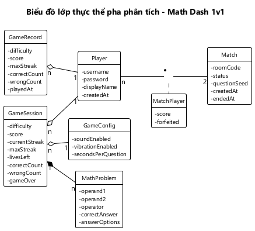

*Hình 21: Biểu đồ lớp thực thể pha phân tích toàn hệ thống.*

### C. Biểu đồ lớp pha phân tích

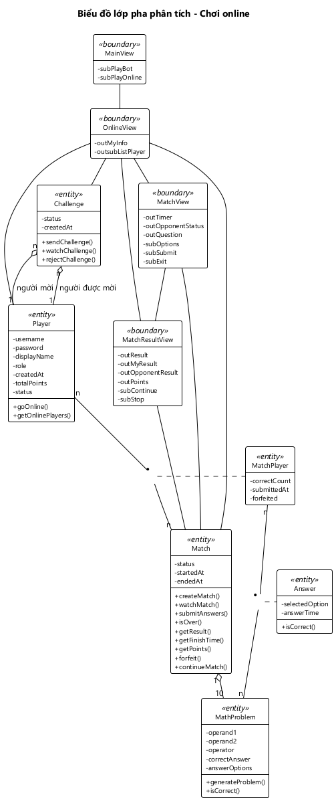

*Hình 22: Biểu đồ lớp pha phân tích chức năng Chơi online.*

- **4 lớp View** nối nhau bằng quan hệ liên kết theo luồng màn hình: MainView – OnlineView – MatchView – MatchResultView. MatchResultView quay về MatchView khi chơi tiếp, về OnlineView khi dừng.
- Mỗi View nối với lớp thực thể nó gọi phương thức bằng **quan hệ liên kết**:
  - MainView không gọi thực thể nào, chỉ mở OnlineView.
  - OnlineView: Player (vào danh sách online, danh sách online), Challenge (lời mời), Match (tạo trận).
  - MatchView: Match (theo dõi trận, nộp bài, thoát trận).
  - MatchResultView: Match (kết quả, điểm, chơi tiếp).
- **Quan hệ giữa các thực thể** giữ đúng như biểu đồ lớp thực thể pha phân tích ở Phụ lục B:
  - Challenge chứa thông tin 2 Player (kết tập).
  - Player – Match là n-n, qua lớp liên kết MatchPlayer.
  - MathProblem là thành phần của Match (kết tập): thông tin 10 câu hỏi của đề nằm trong Match.
  - MatchPlayer – MathProblem là n-n, qua lớp liên kết Answer: mỗi người chơi trong trận làm 10 câu, mỗi câu được 2 người chơi làm; Answer giữ phương án đã chọn và thời gian làm câu.
- **Match nhận nhiều phương thức nhất**, vì hầu hết xử lý của chức năng trả về một trận đấu. Các luật của trận đều nằm ở thực thể, không nằm ở giao diện; chấm từng câu là isCorrect() của Answer.
- Ghi phương án đã chọn và thời gian làm từng câu là xử lý của MatchView, không phải phương thức của thực thể: giao diện đo thời gian từ lúc câu hiện ra tới lúc người chơi bấm một ô và giữ bài làm từng câu cho tới khi nộp. Giao diện không biết đáp án đúng nên không chấm; việc chấm nằm ở isCorrect() của Answer, dùng luật isCorrect() của MathProblem.

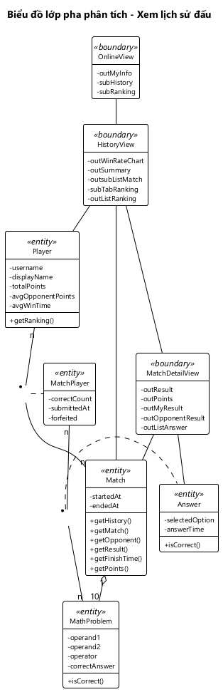

*Hình 23: Biểu đồ lớp pha phân tích chức năng Xem lịch sử đấu.*

- **3 lớp View** nối nhau bằng quan hệ liên kết theo luồng màn hình: OnlineView – HistoryView – MatchDetailView. OnlineView mở HistoryView bằng subHistory hoặc subRanking.
- Mỗi View nối với lớp thực thể nó gọi phương thức bằng **quan hệ liên kết**:
  - HistoryView: Match (lịch sử, kết quả, điểm, đối thủ), Player (bảng xếp hạng).
  - MatchDetailView: Match (trận đầy đủ, kết quả, điểm, đối thủ, thời gian làm bài), Answer (đúng / sai của từng câu).
- **Quan hệ giữa các thực thể** giữ đúng như biểu đồ lớp thực thể pha phân tích ở Phụ lục B:
  - Player – Match là n-n, qua lớp liên kết MatchPlayer.
  - MathProblem là thành phần của Match (kết tập); chi tiết trận cần đề để hiện đáp án đúng.
  - MatchPlayer – MathProblem là n-n, qua lớp liên kết Answer; chi tiết trận cần bài làm từng câu của 2 người.
- **Lịch sử đấu và bảng xếp hạng dùng cùng luật thắng thua** với trận đấu: getResult(), getPoints(), getFinishTime() của Match; chi tiết trận dùng cùng luật chấm câu isCorrect() với lúc nộp bài. Không có luật nào được viết lại ở giao diện.

### D. Kịch bản v2 và biểu đồ tuần tự pha phân tích

**Chơi online, đoạn A: Gửi lời thách đấu**

1. Người chơi nhấn nút Chơi online trên MainView.
2. MainView gọi OnlineView.
3. OnlineView gọi hàm goOnline() của lớp Player để ghi người chơi vào danh sách online với trạng thái rỗi.
4. OnlineView gọi hàm getOnlinePlayers() của lớp Player.
5. Lớp Player trả về danh sách người chơi online, kèm tổng điểm và trạng thái, cho OnlineView.
6. OnlineView hiển thị tên, tổng điểm của người chơi và danh sách người chơi online.
7. Người chơi bấm vào tên một đối thủ đang rỗi trên OnlineView.
8. OnlineView gọi hàm sendChallenge() của lớp Challenge.
9. Lớp Challenge tạo lời mời đang chờ và trả về cho OnlineView.
10. OnlineView hiển thị thông báo đang chờ đối thủ trả lời.
11. OnlineView gọi hàm watchChallenge() của lớp Challenge để theo dõi lời mời.
12. Khi đối thủ đồng ý, lớp Challenge trả về lời mời đã được đồng ý, kèm trận đấu, cho OnlineView.
13. OnlineView gọi MatchView.

**Ngoại lệ 5a: Không có người chơi nào khác online.**

- 5a.1. Lớp Player trả về danh sách chỉ có người chơi cho OnlineView.
- 5a.2. OnlineView hiển thị thông báo chưa có ai khác online; danh sách tự cập nhật khi có người vào.

**Ngoại lệ 7a: Người chơi bấm vào một đối thủ đang bận.**

- 7a.1. OnlineView hiển thị thông báo đối thủ đang bận, không gọi sendChallenge().

**Ngoại lệ 11a: Người chơi hủy lời mời khi đang chờ.**

- 11a.1. Người chơi nhấn Hủy trên OnlineView.
- 11a.2. OnlineView gọi hàm rejectChallenge() của lớp Challenge.
- 11a.3. Lớp Challenge đánh dấu lời mời đã hủy và trả về cho OnlineView.
- 11a.4. OnlineView đóng thông báo chờ và giữ nguyên giao diện chơi online.

**Ngoại lệ 12a: Đối thủ từ chối lời mời.**

- 12a.1. Lớp Challenge trả về lời mời đã bị từ chối cho OnlineView.
- 12a.2. OnlineView hiển thị thông báo đối thủ đã từ chối và giữ nguyên giao diện chơi online.

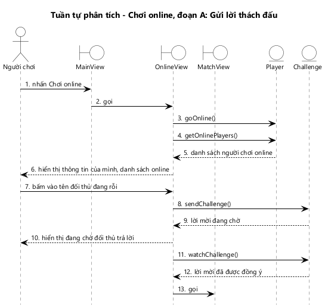

*Hình 24: Biểu đồ tuần tự pha phân tích chức năng Chơi online, đoạn A: Gửi lời thách đấu.*

- Biểu đồ có 13 thông điệp, khớp với 13 bước của kịch bản chuẩn.
- MainView chỉ mở OnlineView (bước 1–2). Người chơi chỉ vào danh sách online khi OnlineView gọi goOnline() (bước 3), nên chỉ người đang ở giao diện chơi online mới được người khác thấy và thách đấu.
- Hàm watchChallenge() ở bước 11 là lời đăng ký theo dõi: kết quả không trả về ngay mà trả về ở bước 12, khi đối thủ trả lời.
- Bước 12 xảy ra khi đối thủ đồng ý ở đoạn B, nên giữa bước 11 và bước 12 có một khoảng chờ.

**Chơi online, đoạn B: Nhận lời thách đấu**

Người chơi là người được mời, đang ở OnlineView; OnlineView đã gọi goOnline() như bước 3 của đoạn A.

1. OnlineView gọi hàm watchChallenge() của lớp Challenge để nhận các lời mời gửi tới người chơi.
2. Khi có lời mời mới, lớp Challenge trả về lời mời cho OnlineView.
3. OnlineView hiển thị hộp thoại lời mời gồm tên và tổng điểm của người mời.
4. Người chơi nhấn Đồng ý.
5. OnlineView gọi hàm createMatch() của lớp Match.
6. Lớp Match gọi hàm generateProblem() của lớp MathProblem để sinh đề.
7. Lớp MathProblem trả về các câu hỏi của đề cho lớp Match.
8. Lớp Match tạo trận với đề vừa sinh, chuyển 2 người chơi sang trạng thái bận và trả về trận cho OnlineView.
9. OnlineView gọi MatchView.

**Ngoại lệ 4a: Người chơi từ chối lời mời.**

- 4a.1. Người chơi nhấn Từ chối.
- 4a.2. OnlineView gọi hàm rejectChallenge() của lớp Challenge.
- 4a.3. Lớp Challenge đánh dấu lời mời bị từ chối và trả về cho OnlineView.
- 4a.4. OnlineView đóng hộp thoại lời mời.

**Ngoại lệ 8a: Không tạo được trận.**

- 8a.1. Lớp Match trả về cho OnlineView: người mời không còn online hoặc đã bận.
- 8a.2. OnlineView hiển thị thông báo không bắt đầu được trận đấu.

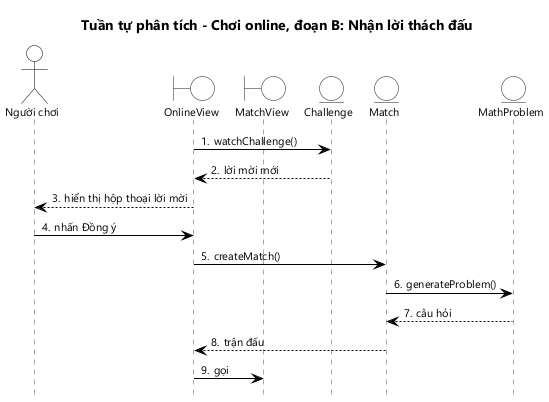

*Hình 25: Biểu đồ tuần tự pha phân tích chức năng Chơi online, đoạn B: Nhận lời thách đấu.*

- Biểu đồ có 9 thông điệp, khớp với 9 bước của kịch bản chuẩn.
- Lời mời chỉ tới được người chơi đang ở OnlineView, vì OnlineView là nơi đăng ký watchChallenge() (bước 1).
- Việc sinh đề nằm ở lớp thực thể (bước 6, 7). Cả 2 người chơi nhận đúng trận do lớp Match trả về, nên cùng một đề.

**Chơi online, đoạn C: Thi đấu**

1. MatchView gọi hàm watchMatch() của lớp Match để theo dõi trận.
2. Lớp Match trả về trận đấu kèm đề bài cho MatchView.
3. MatchView hiển thị ô thời gian, trạng thái đối thủ và nút Thoát cho người chơi.
4. MatchView hiển thị số thứ tự, phép tính của câu đang làm và 4 ô phương án A, B, C, D cho người chơi.
5. Người chơi bấm một ô phương án trên MatchView; MatchView ghi phương án đã chọn, thời gian làm câu và chuyển sang câu sau.

   Các bước 4–5 lặp lại cho đến câu thứ 10.
6. MatchView hiển thị thông báo đã làm xong 10 câu và nút Nộp bài cho người chơi.
7. Người chơi nhấn Nộp bài trên MatchView.
8. MatchView gọi hàm submitAnswers() của lớp Match, gửi bài làm gồm phương án đã chọn và thời gian làm từng câu.
9. Lớp Match gọi hàm isCorrect() của lớp Answer để chấm từng câu của bài làm.
10. Lớp Answer gọi hàm isCorrect() của lớp MathProblem để so phương án đã chọn với đáp án đúng.
11. Lớp MathProblem trả kết quả so sánh cho lớp Answer.
12. Lớp Answer trả về câu đúng hay sai cho lớp Match.
13. Lớp Match lưu bài làm từng câu, số câu đúng, thời điểm nộp bài và trả về trận cho MatchView.
14. MatchView hiển thị thông báo đã nộp bài, đang chờ đối thủ.
15. Khi đối thủ cũng nộp bài, lớp Match gọi hàm isOver() của chính nó để kiểm tra trận đã xong.
16. Lớp Match trả về trận đã kết thúc cho MatchView, theo lời đăng ký ở bước 1.
17. MatchView gọi MatchResultView.
18. MatchResultView gọi hàm getResult() của lớp Match.
19. Lớp Match trả về kết quả của người chơi cho MatchResultView.
20. MatchResultView gọi hàm getFinishTime() của lớp Match.
21. Lớp Match trả về thời gian làm bài của 2 người chơi cho MatchResultView.
22. MatchResultView gọi hàm getPoints() của lớp Match.
23. Lớp Match trả về điểm trận của người chơi cho MatchResultView.
24. MatchResultView hiển thị kết quả, số câu đúng, thời gian làm bài, điểm trận, tổng điểm và câu hỏi chơi tiếp cho người chơi.

**Ngoại lệ 4a: Hết thời gian trước khi người chơi nộp bài.**

- 4a.1. MatchView hiển thị thông báo hết giờ.
- 4a.2. MatchView tự gọi hàm submitAnswers() của lớp Match với bài làm hiện có; câu chưa làm ghi là bỏ trống và tính là sai. Kịch bản tiếp tục từ bước 9.

**Ngoại lệ 4b: Người chơi thoát trận.**

- 4b.1. Người chơi nhấn Thoát trên MatchView và xác nhận thoát.
- 4b.2. MatchView gọi hàm forfeit() của lớp Match.
- 4b.3. Lớp Match đánh dấu người chơi bỏ trận, kết thúc trận và trả về cho MatchView.
- 4b.4. MatchView gọi OnlineView.
- 4b.5. OnlineView hiển thị giao diện chơi online cho người chơi.

**Ngoại lệ 13a: Không nộp được bài.**

- 13a.1. Lớp Match trả về lỗi cho MatchView.
- 13a.2. MatchView hiển thị thông báo không kết nối được máy chủ và hiện lại nút Nộp bài. Kịch bản tiếp tục từ bước 7.

**Ngoại lệ 16a: Đối thủ bỏ trận.**

- 16a.1. Lớp Match trả về trận đã kết thúc do đối thủ bỏ trận cho MatchView.
- 16a.2. MatchView hiển thị thông báo đối thủ đã thoát. Kịch bản tiếp tục từ bước 17; MatchResultView không hiển thị lựa chọn chơi tiếp.

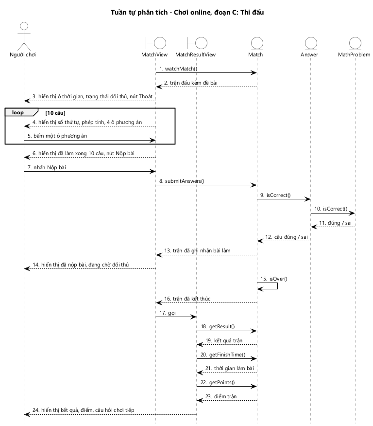

*Hình 26: Biểu đồ tuần tự pha phân tích chức năng Chơi online, đoạn C: Thi đấu.*

- Biểu đồ có 24 thông điệp, khớp với 24 bước của kịch bản chuẩn. Khung loop 10 câu bọc bước 4–5.
- Trong lúc làm bài, MatchView chỉ ghi phương án đã chọn và thời gian làm từng câu, không gọi thực thể nào và không báo đúng sai. Bài làm 10 câu được gửi một lần khi nộp (bước 8).
- Chấm bài (bước 9–12) và kiểm tra trận đã xong (bước 15) đều do lớp thực thể làm, giao diện không tự chấm. Answer chấm từng câu bằng luật isCorrect() của MathProblem.
- Bước 16 trả về theo lời đăng ký watchMatch() ở bước 1, khi đối thủ nộp bài.
- Kết quả, thời gian, điểm trận đều là thuộc tính dẫn xuất, được tính bằng getResult(), getFinishTime(), getPoints() (bước 18–23).

**Chơi online, đoạn D: Chơi tiếp**

1. Người chơi nhấn Chơi tiếp trên MatchResultView.
2. MatchResultView gọi hàm continueMatch() của lớp Match.
3. Lớp Match ghi nhận lựa chọn chơi tiếp và trả về cho MatchResultView.
4. MatchResultView hiển thị thông báo đang chờ đối thủ.
5. MatchResultView gọi hàm watchMatch() của lớp Match để biết lựa chọn của đối thủ.
6. Khi đối thủ cũng chọn chơi tiếp, lớp Match gọi hàm generateProblem() của lớp MathProblem để sinh đề mới.
7. Lớp MathProblem trả về các câu hỏi của đề mới cho lớp Match.
8. Lớp Match tạo trận mới và trả về cho MatchResultView.
9. MatchResultView gọi MatchView.
10. MatchView hiển thị giao diện thi đấu với câu đầu tiên của đề mới cho người chơi; trận tiếp theo diễn ra như đoạn C.

**Ngoại lệ 1a: Người chơi dừng chơi.**

- 1a.1. Người chơi nhấn Dừng trên MatchResultView.
- 1a.2. MatchResultView gọi hàm continueMatch() của lớp Match với lựa chọn dừng.
- 1a.3. Lớp Match ghi nhận, trả 2 người chơi về trạng thái rỗi và trả về cho MatchResultView.
- 1a.4. MatchResultView gọi OnlineView.
- 1a.5. OnlineView hiển thị giao diện chơi online cho người chơi.

**Ngoại lệ 3a: Đối thủ đã chọn chơi tiếp trước.**

- 3a.1. Lớp Match gọi hàm generateProblem() của lớp MathProblem để sinh đề mới, tạo trận mới và trả về ngay cho MatchResultView. Kịch bản tiếp tục từ bước 9.

**Ngoại lệ 8a: Đối thủ dừng chơi.**

- 8a.1. Lớp Match trả về trận đã dừng cho MatchResultView.
- 8a.2. MatchResultView hiển thị thông báo đối thủ đã dừng chơi.
- 8a.3. MatchResultView gọi OnlineView.
- 8a.4. OnlineView hiển thị giao diện chơi online cho người chơi.

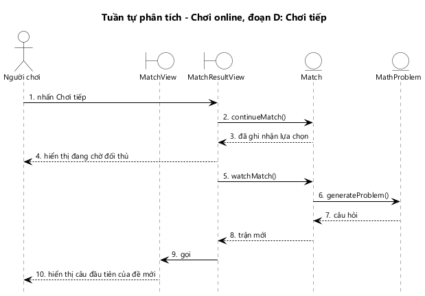

*Hình 27: Biểu đồ tuần tự pha phân tích chức năng Chơi online, đoạn D: Chơi tiếp.*

- Biểu đồ có 10 thông điệp, khớp với 10 bước của kịch bản chuẩn, vẽ cho người chọn chơi tiếp trước.
- Trận mới chỉ được tạo khi cả 2 người đã chọn chơi tiếp (bước 6–8). Người chọn sau đi theo ngoại lệ 3a.

**Xem lịch sử đấu, đoạn A: Xem trận của tôi và chi tiết trận**

1. Người chơi nhấn nút Lịch sử đấu trên OnlineView.
2. OnlineView gọi HistoryView.
3. HistoryView gọi hàm getHistory() của lớp Match.
4. Lớp Match trả về danh sách các trận đã kết thúc của người chơi, mới nhất đứng đầu, cho HistoryView.
5. HistoryView gọi hàm getResult() của lớp Match cho từng trận.
6. Lớp Match trả về kết quả trận của người chơi cho HistoryView.
7. HistoryView gọi hàm getPoints() của lớp Match.
8. Lớp Match trả về điểm trận cho HistoryView.
9. HistoryView gọi hàm getOpponent() của lớp Match.
10. Lớp Match trả về đối thủ trong trận cho HistoryView.
11. HistoryView đếm số trận thắng, hòa, thua, hiển thị biểu đồ tròn tỉ lệ thắng, hòa, thua và danh sách trận cho người chơi.
12. Người chơi bấm vào một trận trên HistoryView.
13. HistoryView gọi MatchDetailView.
14. MatchDetailView gọi hàm getMatch() của lớp Match.
15. Lớp Match trả về trận kèm đề, đáp án đúng, 2 người chơi và bài làm từng câu của mỗi người cho MatchDetailView.
16. MatchDetailView gọi hàm getResult() của lớp Match.
17. Lớp Match trả về kết quả trận cho MatchDetailView.
18. MatchDetailView gọi hàm getPoints() của lớp Match.
19. Lớp Match trả về điểm trận cho MatchDetailView.
20. MatchDetailView gọi hàm getOpponent() của lớp Match.
21. Lớp Match trả về đối thủ trong trận cho MatchDetailView.
22. MatchDetailView gọi hàm getFinishTime() của lớp Match cho người chơi và đối thủ.
23. Lớp Match trả về thời gian làm bài cho MatchDetailView.
24. MatchDetailView gọi hàm isCorrect() của lớp Answer cho từng câu trong bài làm của 2 người chơi.
25. Lớp Answer gọi hàm isCorrect() của lớp MathProblem để so phương án đã chọn với đáp án đúng.
26. Lớp MathProblem trả kết quả so sánh cho lớp Answer.
27. Lớp Answer trả về câu đúng hay sai cho MatchDetailView.
28. MatchDetailView hiển thị kết quả, điểm trận, số câu đúng và thời gian làm bài của 2 bên, và 10 câu, mỗi câu có phép tính kèm đáp án đúng và, với mỗi người chơi, đúng / sai, phương án đã chọn, thời gian làm câu cho người chơi.
29. Người chơi nhấn Back trên MatchDetailView.
30. MatchDetailView gọi HistoryView.
31. HistoryView hiển thị lại danh sách trận cho người chơi.

**Ngoại lệ 4a: Người chơi chưa đấu trận nào.**

- 4a.1. Lớp Match trả về danh sách rỗng cho HistoryView.
- 4a.2. HistoryView hiển thị biểu đồ trống và thông báo người chơi chưa đấu trận nào.

**Ngoại lệ 4b: Không lấy được lịch sử đấu.**

- 4b.1. Lớp Match trả về lỗi cho HistoryView.
- 4b.2. HistoryView hiển thị thông báo không tải được lịch sử đấu, biểu đồ và danh sách để trống.

**Ngoại lệ 15a: Không lấy được chi tiết trận.**

- 15a.1. Lớp Match trả về lỗi cho MatchDetailView.
- 15a.2. MatchDetailView hiển thị thông báo không tải được chi tiết trận, các mục kết quả và từng câu để trống.

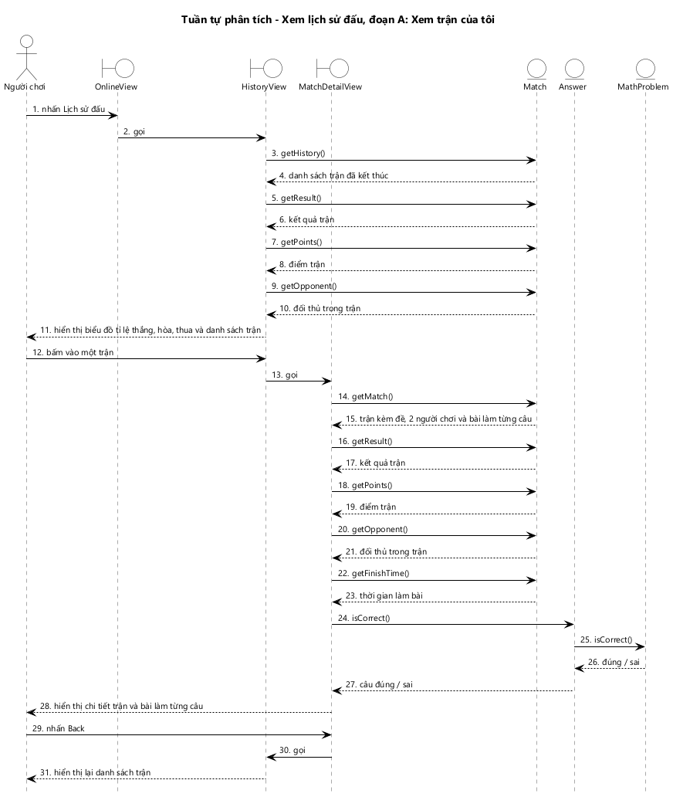

*Hình 28: Biểu đồ tuần tự pha phân tích chức năng Xem lịch sử đấu, đoạn A: Xem trận của tôi và chi tiết trận.*

- Biểu đồ có 31 thông điệp, khớp với 31 bước của kịch bản chuẩn.
- Kết quả, điểm và đối thủ của từng dòng trong danh sách đều lấy từ Match (bước 5–10). Biểu đồ tròn là phép đếm trên các kết quả này, không lưu ở đâu.
- Chi tiết trận cần đề, đáp án đúng và bài làm từng câu nên gọi getMatch() để lấy trận đầy đủ (bước 14), thay vì dùng lại trận trong danh sách vốn không kèm đề và bài làm.
- Đúng / sai của từng ô bài làm do Answer tính bằng isCorrect() (bước 24–27), cùng luật chấm với lúc nộp bài; phương án đã chọn và thời gian làm câu là thuộc tính của Answer.

**Xem lịch sử đấu, đoạn B: Xem bảng xếp hạng**

Người chơi đang ở OnlineView.

1. Người chơi nhấn nút Bảng xếp hạng trên OnlineView.
2. OnlineView gọi HistoryView, mở sẵn thẻ Bảng xếp hạng.
3. HistoryView gọi hàm getRanking() của lớp Player.
4. Lớp Player gọi hàm getPoints() của lớp Match cho từng trận đã kết thúc.
5. Lớp Match trả về điểm trận của người chơi cho lớp Player.
6. Lớp Player gọi hàm getResult() của lớp Match để biết các trận thắng.
7. Lớp Match trả về kết quả trận cho lớp Player.
8. Lớp Player gọi hàm getFinishTime() của lớp Match cho các trận thắng.
9. Lớp Match trả về thời gian làm bài cho lớp Player.
10. Lớp Player tính 3 tiêu chí, sắp xếp và trả danh sách người chơi cho HistoryView.
11. HistoryView hiển thị bảng xếp hạng ở thẻ Bảng xếp hạng cho người chơi.
12. Người chơi nhấn Back trên HistoryView.
13. HistoryView gọi OnlineView.
14. OnlineView hiển thị giao diện chơi online cho người chơi.

**Ngoại lệ 10a: Không lấy được bảng xếp hạng.**

- 10a.1. Lớp Player trả về lỗi cho HistoryView.
- 10a.2. HistoryView hiển thị thông báo không tải được bảng xếp hạng, danh sách để trống.

**Ngoại lệ 12a: Người chơi chọn thẻ Trận của tôi.**

- 12a.1. Người chơi chọn thẻ Trận của tôi trên HistoryView.
- 12a.2. HistoryView hiển thị biểu đồ tỉ lệ thắng, hòa, thua và danh sách trận như bước 3–11 của đoạn A. Người chơi chọn lại thẻ Bảng xếp hạng thì HistoryView hiển thị lại bảng xếp hạng.

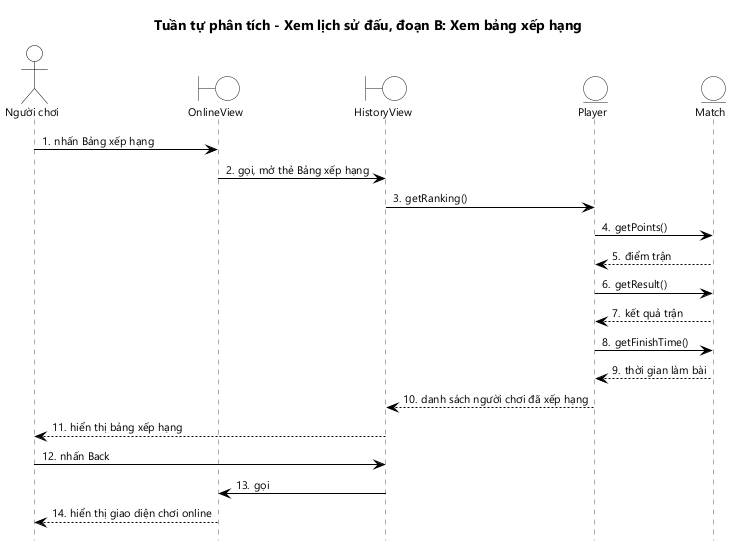

*Hình 29: Biểu đồ tuần tự pha phân tích chức năng Xem lịch sử đấu, đoạn B: Xem bảng xếp hạng.*

- Biểu đồ có 14 thông điệp, khớp với 14 bước của kịch bản chuẩn.
- Bảng xếp hạng mở thẳng từ nút Bảng xếp hạng của OnlineView (bước 1–2), không phải qua thẻ Trận của tôi; 2 thẻ vẫn thuộc cùng một HistoryView.
- Lớp Player tính các tiêu chí dựa trên 3 phương thức của lớp Match (bước 4–9). Bảng xếp hạng vì vậy dùng đúng luật thắng thua của trận đấu.
